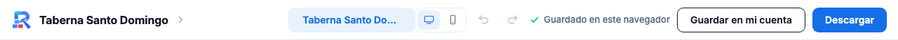
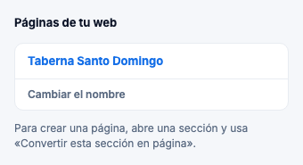
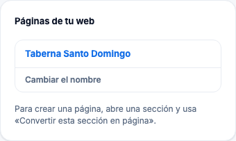
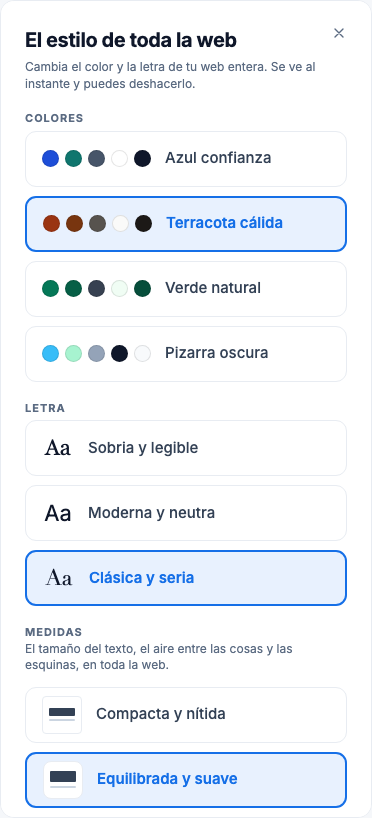
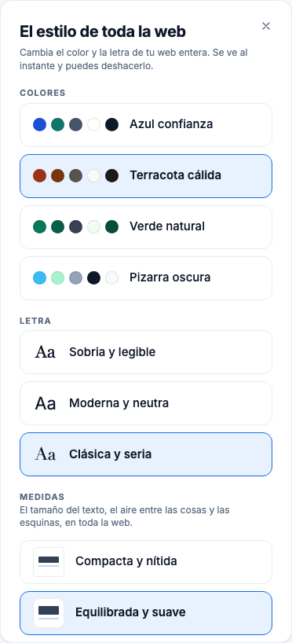
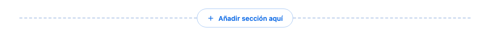
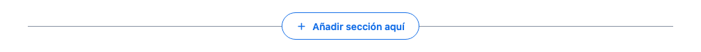
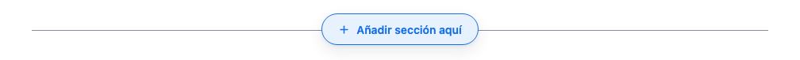
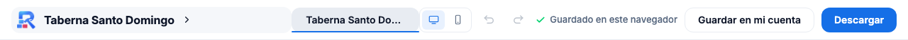
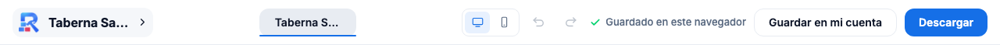

# Review of the phase 1 design handoff

**Date:** 2026-09-23 · **Reviewed against:** `docs/protocolo.md`, `docs/dossiers/`, the eleven
ADRs in `docs/decisions/`, and the merged code in `packages/`.

`HANDOFF.md` and the fifteen mockups came from a design session in Claude online. This is the
record of reading them against what the repository already decided: what holds, what does not,
and what was decided to close each gap. Where this file and `HANDOFF.md` disagree, this file is
the later document.

> **The header above is a dated record and the file is not.** The date, the eleven ADRs and the
> fifteen mockups are what the *first* reading was done against, on 23 September 2026; they are left
> as written because a review that silently re-dates itself stops saying when it looked. What has
> grown since, noted here so the numbers do not read as current: there are now **34 ADRs** and
> **19 mockups** — 16 through 19 (modo estudio, la barra y el sistema, negrita y cursiva, cómo se ve
> al compartir) were drawn after this review and are read against it rather than by it. Entries
> below carry their own dates, and the ones added in sprints 9 through 13 are the live half of this
> file. Last added to: **2 October 2026, closing sprint 13.**

## What the screens get right

Checked one by one, not assumed:

- **The five questions,** their order, and that only the first two are required (ADR 0010).
  Questions 3 to 5 carry a `Saltar` button and say what skipping costs.
- **The ten launch sectors plus "Otro sector"** (ADR 0010), with a search field above the grid.
- **Question 3's suggestions start unticked**, with "Marca solo lo que hagas de verdad" — the
  rule ADR 0010 gives for not promising services the business may not offer.
- **Question 4 feeds "Horario y ubicación"** and offers "No tengo local: trabajo solo online o a
  domicilio", saying plainly that then no city is named. That is `{ciudad}` having no value
  (ADR 0010).
- **Question 5 feeds the main button** and asks for the data the action needs on the same screen.
- **The palette comes from the logo** (mockup 06, and the dossier's own promise), and the logo is
  optional. **Since 13 October 2026, without a logo's choice the three proposals start in the
  neutral palette** — black and Retorika's blue — and the owner picks a colour afterwards in
  «Estilo» ([ADR 0041](../decisions/0041-the-proposals-start-neutral-and-the-palette-is-chosen-afterwards.md));
  the sector's default palette is no more.
- **Sample photos** are placed by the generator, not asked for (ADR 0011).
- **`Descargar` is the editor's primary action,** and there is no hosted destination anywhere
  (ADR 0008).
- **No properties panel**, editing on the element itself, a floating toolbar with few actions,
  `Guardado` instead of a save button.
- **The price is `XX €`** on every screen (protocol: a Stripe Price object, not a number in code).

## The five conflicts

### 1. The prototype did not navigate

All 23 links pointed at files that do not exist — `Main.dc.html`, `P2-Sector.dc.html`,
`Editor.dc.html`, `Descarga.dc.html` and the rest, artefacts of the export. The protocol's next
step is *a navigable prototype tested with two real businesses*, so this was a blocker, not a
detail.

**Resolved:** the links were rewritten to the real filenames.

### 2. Mockup 15 promised a preview link the CEO withdrew

The screen read: *"Antes de pagar puedes compartir un enlace de previsualización con una marca
discreta de Retorika."* **ADR 0008** retired exactly that: the preview with the Retorika mark is
seen **only inside the app**, and there is no public URL to share. The handoff's own D2 replaced
the two-destination publish screen but left this line standing.

**Resolved:** the line now says what the app does — the preview is inside the app, there is no
link to share.

### 3. Deleting a section: D8 against ADR 0003

D8 draws no confirmation dialog at all: the section goes, a dashed placeholder marks the gap, and
a toast offers `Deshacer`. **ADR 0003** says confirmation *is* asked when the section holds
content the user actually wrote.

**Decided by the product owner (2026-09-23):** never a dialog, but the toast does not fade when
the section held the user's own writing. Recorded in **ADR 0014**, which amends ADR 0003.

### 4. The example business told two stories at once

Questions 1 to 6 used `Huellitas Felices`, a dog groomer, while the sector ticked was
`Peluquería y barbería` and the services were barbering (`Corte de caballero`, `Arreglo de
barba`). On top of that, ADR 0010's launch sectors do not include dog grooming: it goes through
`Otro sector`, so the screens were demonstrating a path the product will not take.

**Decided:** rename to **`Barbería El Corte`**, the `siteName` the repository's own fixtures
already use (`fixtures/documents/barbershop-cover.json`,
`fixtures/documents/cover-and-services.json`). Name, sector and services now say the same thing,
and the preview copy changed with them.

### 5. D9's premise is wrong; its cardinality is not

D9 says a single card would be *"a lone card stranded in a four-column grid"*, leaving *"a large
empty gap"*, and proposes that the renderer pick a composition from the card count.

**Measured against the merged renderer**, at 1280, in the list of `fixtures/documents/cover-and-services.json`:

| Cards | List width | Card widths | `grid-template-columns` as computed |
|---|---|---|---|
| 1 | 1184px | 1184 | `1184px 0px 0px 0px` |
| 2 | 1184px | 584, 584 | `584px 584px 0px 0px` |
| 3 | 1184px | 384, 384, 384 | `384px 384px 384px 0px` |

`repeat(auto-fit, minmax(min(100%, 16rem), 1fr))` collapses the empty tracks, so one card already
takes the full width, two take half each and three a third. **D9's table is what the stylesheet
does today**, and the renderer does not need to choose anything: a renderer that picked a
composition from the content would also mean the same document renders differently as the user
ticks boxes, which is not how compositions work here — the composition is a variant in the
document (rule 1).

Reproduce it by rendering that fixture with `items` sliced to 1, 2 and 3 and measuring
`li` widths in a browser at 1280.

**What was real in D9** is the cardinality, and it closes the two questions ADR 0010 left open.
**Decided:** minimum 1, maximum 6, and zero cards means the section is not generated at all.
Recorded in **ADR 0013**. The "featured card with the photo beside it" is **not** adopted: it
needs images inside list items, which the "Qué hago" task excluded on purpose.

## The editor shell, as drawn

Kept here rather than in an ADR: these are measurements that will move the first week
`apps/editor` exists, and an ADR would make nudging a bar a formal amendment. ADR 0015 holds the
part that must not move — the interface tokens and their separation from the published site.

- **Top bar, 58px:** the mark, the site name with a chevron, centred page tabs, a device toggle
  (view only in phase 1), undo and redo, a green `Guardado` tick, and `Descargar`.
- **Left rail, 80px:** four icon buttons — `Secciones`, `Estilo`, `Páginas`, `Fotos`. The
  advanced-module dossier describes these four with the design tools switched off. **A fifth,
  `Compartir`, shipped on 2 October 2026 and is in no mockup before 19** — see the entry below.
- **Canvas:** the rest of the screen. Selection is a 2px blue outline with four corner handles.
- **Floating toolbar** above the selection, four to seven actions: `Aa`, a size stepper, bold,
  alignment, a colour swatch, link, then move, duplicate and delete.
- **Section insertion** happens in the gap between sections, as a dashed rule broken by a pill
  reading `Añadir sección aquí` — never a list in a side panel.

## `Compartir`: a rail item no earlier mockup draws, and the download dialog it stayed out of

Added 2 October 2026 with [ADR 0029](../decisions/0029-what-a-published-page-says-about-itself.md)
and **mockup 19**, which is the drawing the assessment below was made from.

**Why a rail item at all.** The two fields — the sentence a shared link shows, and the origin the
site will live at — belong to the whole site, like the theme and the pages, and the rail is this
editor's only site-wide navigation. The `Estilo` panel is scoped by mockup 13 to colour, type and
measures, and these are none of those.

**It takes the rail to six with the design tools on, which this file already flagged as a question.**
That is a real cost and is not waved away; what makes it worth paying is that the alternative
homes are each wrong for a reason, and the one that is only wrong *by a little* is the download
dialog, which is the next entry.

**«¿También en el diálogo de descarga?» — asked by David, drawn in mockup 19 band 3, and answered
no.** The moment is right: an owner usually knows their domain exactly when they are about to
download. What rules it out is what surrounds that moment. **The download path is where phase 1's
ten-minute criterion is measured**, and every gate on it today exists to stop or warn about
something that is wrong — too many photos, a colour nobody can read, something overflowing at
320px. An empty address is explicitly none of those: ADR 0029 makes it optional and says «vacío no
es error y no bloquea nada». A form there would be the first thing to interrupt a download that is
already correct, paid for by everybody so that a minority can fill it in.

What answers the worry underneath — that nobody finds the field — is the **name**. `Compartir` is
the word an owner already has in their head when the link is what they care about, and the help
line closes the sequence: «si la cambias, vuelve a descargar».

~~**What would reopen it:** a fourth usability session showing that nobody opens `Compartir`. That is
evidence this decision does not have, and the mockup says so rather than implying the question is
settled forever.~~

**Rewritten 2 October 2026 —
[ADR 0031](../decisions/0031-usability-is-judged-by-david-and-the-sessions-are-cancelled.md)
cancels the sessions**, and a reopening condition that names one would hold this closed forever.
Mockup 19 band 3 even says «y **no antes**», which was a guard against revisiting a decision on a
hunch and becomes a lock once the hunch is all there will ever be.

**What reopens it now:** David opening the editor, looking for where the site's address goes, and
not finding it — written down when it happens. It is weaker evidence than watching a stranger, and
saying so is the point of this paragraph rather than a hedge: the decision was taken on the shape of
the download path, which has not changed, and the thing a session would have added was the one fact
nobody inside can supply.

## Still open

- **Two things the advanced-module dossier §5 describes that this product cannot do.** Recorded
  here on 30 September 2026, with mockup 16 and [ADR 0025](../decisions/0025-studio-mode-starts-now-and-its-switch-is-not-in-the-document.md),
  because a source comment is not where a deviation from an approved artefact belongs:
  - **«Al escalar se guarda una versión.»** There is no named version history. `autosave.ts` keeps
    one session and no history, so within a session the undo stack is the version and across a
    reload there is none. **Mockup 16 does not promise a saved version**, and neither may the
    interface: what it promises instead is true — the return puts every text and photo back in its
    exact slot, because `escalate` keeps the element ids.
  - **«El panel de secciones marca las diseñadas a mano.»** There is no sections panel: `Secciones`
    *is* the canvas (`EditorShell.tsx` says so). The mark is a pill drawn on the section itself, as
    injected chrome, so it can never reach a published page.

- **The left rail is ~~five~~ *seven* items with the design tools on.** `HANDOFF.md` and this file both justify
  the four-item rail as the advanced dossier's «Apagado» column, which was right and is now only
  half the story: with the tools on it gains `Diseño`. The switch itself is **not** a rail item — it
  sits at the rail's foot, separated — and ADR 0025 records why it is not in the top bar, which is
  the measurement sprint 7 day 7 took of that row overflowing.
  **Re-counted 4 October 2026: five became six with `Compartir` (sprint 12) and seven with `Listas`
  (sprint 14).** The number is corrected rather than the entry deleted, because the entry's point was
  never the number — it was that the rail's length is a cost nobody had priced. **Sprint 14 priced
  it**: the seventh item pushed the design-tools switch to 43 pixels from the bottom-left corner at
  720px tall, where browser chrome gathers, and two `e2e` tests started failing on it. `backlog.md`
  carries the measurement. This is the question becoming a number.

- **Mockup 16's switch question is overruled, and the shipped wording is not what it draws.**
  Mockup 16 band 1 draws **«¿Montas webs para otros?»**, from the advanced dossier §4's point that
  «ante "básico o avanzado" mucha gente miente hacia arriba». That is true about *levels* and the
  remedy does not follow from it: a question about **who somebody is**, answered to obtain a
  capability, is answered yes by everyone who wants the capability — so it filtered nobody while
  looking as though it did. Session 3 watched a car workshop's owner read it, answer «Sí,
  enciéndelas» and carry on, and nothing was lost by that, because ADR 0025 §1 is kept by the press
  rather than by the wording.

  **Amended by [ADR 0025](../decisions/0025-studio-mode-starts-now-and-its-switch-is-not-in-the-document.md)'s
  own amendment, accepted by David on 1 October 2026 and built the same day.** The question now
  describes the tools — **«¿Quieres colocar tú cada elemento?»** — so the answer is accurate rather
  than aspirational. The mockup is left as drawn: it is the record of what was specified, and this is
  the file where an ADR overrules it.

  **The same amendment puts «Diseñar a mano» inside the `Diseño` panel**, beside the sentence that
  says you need it. The panel used to render «Diséñala a mano **desde su cabecera**» as a bare
  paragraph — a dead end naming its own exit — which is how an owner who had turned the tools on, and
  been told by that very panel that the grid existed, still asked for «más libertad en la posición».
  **ADR 0025 §7 is not amended**: escalation stays per section and `escalate` moves no element, which
  is exactly what makes a second door to the same offer safe.

- **`Páginas` and `Fotos` are phase 2, and mockup 08 draws them.** Organic pages and photo
  upload both belong to phase 2 in the protocol, and ADR 0011 says a phase 1 site carries sample
  photos only. The mockup now draws both dimmed and marked `Fase 2`, so nobody implements them by
  reading the screen. What, if anything, they do in phase 1 — swapping one sample photo for
  another, say — is decided when the editor task is written.

  **Answered by the shipped editor, 26 September 2026.** No editor task file was ever written;
  `apps/editor` was built directly (ADR 0017). `EditorShell.tsx` therefore holds decisions that
  diverge from mockup 08, recorded here because a source comment is not where a deviation from an
  approved screen belongs:
  - **No second page tab and no `+`.** The mockup shows `Inicio`, `Servicios` and an add-page
    control. The document has exactly one page, and a button that adds a page nothing can hold is
    the dead-button mistake sprint 1 kept refusing. `Inicio` is drawn alone.
  - **No site-preview nav bar inside the canvas card.** The mockup's `Inicio Servicios Galería
    Contacto Reserva` strip is a real multi-page site's own navigation. The generator produces no
    such navigation, so drawing it would advertise links that go nowhere.

  **`Estilo` was dimmed too, from 26 September to 28 September 2026** — the mockup dims only
  `Fotos` and `Páginas`, but protocol Part 14 put "Estilo global" in phase 2 alongside them, and
  the mockup predates that being pinned down. **No longer true**: sprint 4 day 2 gave the rail a
  live `Estilo` item and the panel behind it, once phase 1's acceptance criterion was measured
  and the same usability session named the gap. ~~`Páginas` and `Fotos` stay dimmed — organic pages
  and a real photo upload are both still unbuilt, not merely undecided.~~
  **Corrected 4 October 2026, closing sprint 14: both shipped, and the stale half of this entry sat
  inside an entry that was already correcting itself.** `PagesPanel.tsx` and `PhotosPanel.tsx` exist,
  the `e2e` suite drives both, and `EditorShell` records that the grey shade for «this exists but not
  yet» lost its last caller in sprint 6. Somebody read this line, fixed the sentence above it and left
  the one below — which is the shape of rot this file is most prone to, because a corrected entry
  looks like a checked one.
- **Resolved, 28 September 2026 — mockup 13's palettes and typefaces are not the ones in the
  code.** The claim was that the screen offers `Azul confianza`, `Verde natural`, `Coral cercano`
  and `Neutro elegante`, plus Inter, Poppins and Source Serif, while `packages/tokens` ships
  `classic-blue`, `warm-terracotta`, `forest-emerald`, `dark-slate` and the three type pairs — and
  that the reconciliation would be naming and ordering, not re-inventing. It was, and the Estilo
  panel now ships with these names, in `packages/tokens/src/locales/es.json`, which until then had
  no locale file at all: the `nameKey` every palette and pair declared resolved to nothing,
  unnoticed because nothing had ever displayed them.

  | Code | Shown as | Where the name comes from |
  |---|---|---|
  | `neutral` | **Neutra** | Added 13 October 2026 (ADR 0041), listed first: the palette every proposal starts in without a logo's choice — black ink, Retorika's blue, white surfaces |
  | `classic-blue` | **Azul confianza** | Mockup 13, unchanged |
  | `forest-emerald` | **Verde natural** | Mockup 13, unchanged |
  | `warm-terracotta` | **Terracota cálida** | The mockup's warm palette is `Coral cercano`, drawn around `#F2704B`. Ours is `#9A3412`, a deep brick. "Coral" would name a colour this palette does not contain |
  | `dark-slate` | **Pizarra oscura** | The mockup calls it `Neutro elegante`. It is white text on near-black, and the one thing an owner needs to know before clicking is that it is dark. A name that hides that is not a translation of it |
  | `modern-sans` | **Moderna y neutra** | Mockup 13's own words for Inter |
  | `classic-display` | **Clásica y seria** | Mockup 13's own words for Source Serif |
  | `editorial-serif` | **Sobria y legible** | No mockup counterpart: serif headings over a plain sans body, which is neither of the other two |

  **Typefaces are named by character, never by font**, which is the mockup's other divergence and
  the deliberate one. Issue #9: Inter and Playfair Display fall back to something else on a machine
  without them, and ADR 0001 forbids downloading either — so "Inter" as a label promises a font
  that may never arrive, while "Moderna y neutra" is true whichever one resolves. The `Aa` specimen
  beside each name is rendered in that pair's real stack, so what it shows *is* what this machine
  will give, fallback included.

  **Order follows `PALETTES`, not the mockup**, which differs only in swapping the second and third.
  Both put the safe blue first and the dark one last, and the accessibility matrix iterates
  `PALETTES` — reordering the catalog to match a mockup exactly would churn that output for nothing
  an owner could see.

- **No mockup draws «Precios» either, and a carta of several courses reads as several sections.**
  The dossier's nine include it («Tarifas o planes») and it shipped on sprint 4 day 6, but no
  screen shows one. Two decisions are recorded here because they are about how a page reads:

  **A price list is drawn as a list, not as a card grid.** Every other section that holds a list
  holds cards, and the generic `.rb-list` rule flows them three abreast, which is right for
  services and opinions. A twelve-dish carta drawn that way came out as four rows of three, which
  nobody reads top to bottom. One rule — `.rb-prices .rb-list { grid-template-columns: 1fr }` —
  rather than a second list drawing, since the only thing that differs is how many across.

  **Three courses still read as three sections, and that is measured rather than asserted.**
  Building «Entrantes», «Carnes» and «Postres» by duplicating gives each 48px of its own padding
  with 76px of page between them: **172px of empty space between the last dish of one course and
  the heading of the next**, with transparent backgrounds and nothing framing them as one menu. It
  is usable — a small restaurant's carta often is one section — but it is not a carta.

  The cheap lever, not taken: a rule closing up two adjacent sections of the same preset. It is
  left open because it is a general question rather than a price-list one — it would apply to two
  «Opiniones» in a row just as much, and whether adjacent sections of one kind should read as one
  thing is a design decision rather than a rendering detail.

- **No mockup draws «variantes de sección», and it shipped on sprint 4 day 4.** Protocol Part 14
  names it as a phase 2 item and the catalog has carried the compositions since sprint 2 — thirteen
  of them, two or three per section, built and tested and unreachable — but no screen in
  `docs/design/mockups/` shows a control for choosing one. Mockup 13 is global style; mockup 08's
  floating toolbar is about a selected *element*. So the placement was development's to decide, and
  it is recorded here rather than in a source comment:

  The control is a **sixth button in the per-section action cluster**, opening a small menu of the
  compositions by their Spanish name («Foto a la derecha», «En dos columnas»), with the one in use
  marked. It follows the pattern the insertion pill established — chrome injected into the preview
  frame, anchored to the thing it acts on — for the same reason: only the frame knows where a
  section sits. The menu names what does not change, «El texto y las fotos no cambian», because
  that is rule 1 and it is the first question anyone would have.

  **The button is drawn conditionally**, which is new for this cluster: a section carrying its own
  layout gets none, because for a hand-designed section the variant id decides nothing
  (`build.ts` reads `section.layout ?? preset.layoutFor(…)`), and a button that lights up and moves
  no pixel is the dead-button mistake in a new costume. `setVariant` in the schema refuses that case
  outright as a backstop.

  **Selection and the open menu now survive the preview's re-render**, which they never did before.
  Every action replaces the iframe's whole `srcDoc`, so the outline, the handles and the cluster
  were destroyed and rebuilt each time — one click to get back, which nobody noticed because you
  rarely delete the same section twice. Composition is the first action anyone repeats on purpose,
  and re-selecting between tries would have been the whole friction of the feature. It improves the
  other five buttons as a side effect.

- **No «+ Añadir página», and mockup 08 draws one.** The mockup's top bar has two page tabs, a
  `PÁGINAS: FASE 2` badge and a `+` labelled `Añadir página`. The shipped editor has the tabs and
  **not** the `+`, because the concept dossier §6 says a page is born by converting a section —
  «Cualquier sección puede convertirse en página» — and that «pedir al usuario que elija entre "una
  página" y "varias páginas" es pedirle una decisión técnica antes de que sepa qué va a contar».
  Where the concept exists to avoid asking a question, a screen that asks it is the screen that is
  wrong, and `CLAUDE.md` puts the dossiers above the code. Decided in
  [ADR 0022](../decisions/0022-a-page-is-born-by-converting-a-section.md), which also carries what
  would reopen it: an owner who looks for a way to make a page and does not find one.

  A second consequence worth having here rather than only in the ADR: **there is no empty page.**
  The insertion pill is drawn *between* sections (`Editor.tsx`, `wireInsertion`), so a page with
  none would have nowhere to click — the dead end the `+` would have led to.

- **The site's own menu, which this review previously ruled out, now exists.** The entry above says
  the mockup's `Inicio Servicios Galería Contacto Reserva` strip was not drawn because «the
  generator produces no such navigation, so drawing it would advertise links that go nowhere». That
  stopped being true with [ADR 0023](../decisions/0023-the-menu-and-the-footer-are-derived-chrome.md):
  the menu is derived from the home page's sections and the document's pages, and it is emitted from
  three entries upwards. The strip in the mockup is drawn inside the canvas card as part of the
  *preview*, which is exactly what it now is.

  **Two divergences from that strip, built on sprint 5 day 5 and recorded here rather than only in
  a source comment:**

  - **«Inicio» appears on every page except the home page**, where the mockup draws it always. On
    the home page a link to the page you are already reading does nothing, and a link that does
    nothing is the thing this product refuses everywhere else. Off the home page it is not
    decoration: a site whose every home section has been converted would otherwise offer, from one
    of those pages, a strip of other pages and no way back. ADR 0023 settles what the menu
    *contains* and says nothing about what it looks like from another page; this is that gap filled.
  - **No `Reserva` entry.** The mockup's last item is the main call to action repeated in the
    strip. The menu is derived from sections and pages, and the booking button is neither — it is a
    slot inside the contact section. Putting it in the menu would mean the menu knowing about one
    particular slot of one particular preset, which is the opposite of deriving.

- **Not implemented, and not planned: mockup 13's «Avanzado: colores exactos y tamaños».** The row
  at the foot of the style panel opens a free colour picker and size controls. There is no such
  control in the shipped panel and there is not meant to be. This review already said "a palette
  that is not contrast-tested cannot ship"; the protocol says it more strongly still, that a palette
  with bad contrast cannot even be declared. A picker is a machine for producing exactly that, and
  a site built with one is a site that gets published. It is the same warn-or-block line the rest of
  the product draws — marker text warns, a dead destination blocks — applied to colour, where the
  damage is invisible to the person causing it.

  **Amended by [ADR 0026](../decisions/0026-the-switch-is-the-line-between-references-and-exact-values.md)
  — and the picker stays refused.** What that ADR admits is not this row's free picker: it is
  document rule 6's own second arm, `{exact, exception: true}`, offered **only with the design tools
  on**, and only behind the pre-publish contrast review the advanced dossier §4 promised and nobody
  had built — blocking below 3:1, warning between 3:1 and 4.5:1, with the one-click fix being to
  drop the exception and go back to the reference. The sentence this row rests on stays true, and
  the ADR quotes it: an exact colour with no net is exactly what was refused here.
  **The exact value and that review shipped together**, in one merge, which is what the ADR's §2
  asks for by name.

  Two corrections to this entry, both true from sprint 9 onward. «Tamaños»: the style panel now
  offers three scales, by reference and named by character, which is the system the dossier §6
  always described — so that half of the mockup's row is answered without a picker. And **an exact
  `fontSize` is still refused**, which the ADR's own table records: not for contrast, but because
  the same §4 sentence promises the check covers «desbordes por debajo de 320 píxeles», nothing
  measures that yet, and a size is the one value in this vocabulary that can cause one.

  **The second of those two stopped being true on 1 October 2026**, sprint 10 day 6: the editor
  measures each page at 320 pixels before a download and warns with the sections that run past the
  edge, so an exact `fontSize` shipped in that same merge. **The picker is still refused** — that is
  the sentence this entry rests on and nothing has touched it. What exists is rule 6's marked
  exception, behind the design tools, behind a review; what is still refused is a free colour
  control with nothing in front of it.

  **Accepted by David on 1 October 2026, not by direction** — see the ADR's own header for what
  that does and does not mean. This entry is amended by a decision direction has not looked at.

- **Five swatches per palette, but not the mockup's five.** The mockup draws five circles; our
  palettes hold six colours. The one left out is `color.accent`, and that is a fact about the code
  rather than a preference: **no rule the renderer emits reads `var(--color-accent)`**, and it is
  the only colour whose contrast is asserted nowhere — in `classic-blue` it is 3.19:1 on surface,
  under AA. Showing it would advertise a colour that appears nowhere on the page and carries no
  guarantee. Pinned by `packages/renderer/test/theme-css.test.ts`, which fails if a rule ever starts
  reading it; the fix then is a contrast pair first, not a relaxed test.

- **Resolved, 28 September 2026 — the editor's top bar names the variant, where mockup 08 names the
  business.** Found by walking the editor, and not caused by that day's work: it had been true
  since the editor existed, because `Editor`'s `title` prop is the variant caption and the shell
  rendered it as `siteName`. Direction settled it for the mockup: **the bar shows the business
  name.** The button around it still goes back to the three variants, and the variant's own caption
  still names the preview frame, where "which of the three am I in" is the useful thing to say.
- **The mockups load Inter from Google Fonts.** Fine for a prototype opened on a laptop. It must
  never happen in a published site (ADR 0001): a client's site has no network dependency.
- **Resolved, 26 September 2026 — the Spanish interface strings.** They were the source for
  `apps/editor/src/locales/es.json` when that app existed; that file now exists and every visible
  string is read from it. No Spanish user-facing literal lives in a `.ts` or `.tsx` file.
- **Resolved, 26 September 2026 — `SERVICES_ITEMS`.** It said 2..6 when this review was written;
  `packages/catalog/src/services.ts` now declares `{ min: 1, max: 6 }`, which is what ADR 0013
  decided. The claim above had outlived the code and is corrected here rather than deleted, so the
  record of what was once open survives.
- **Superseded, 1 October 2026 — mockup 17's «Negritas y cursivas» card.** That mockup draws the
  control struck through, with the reason «ninguna de sus dos condiciones de despertar se ha
  cumplido». The third usability session met the second condition on 30 September and a second owner
  asked for both marks, so
  [ADR 0024](../decisions/0024-formatting-inside-a-text-is-designed-and-waiting.md) stopped waiting
  and [mockup 18](mockups/18-negrita-y-cursiva.html) draws the control that replaces the struck one.
  **The rest of mockup 17 stands**, its other three struck cards included — alignment, typography
  and per-element move/duplicate/delete are all still out, for the reasons it gives.
  Mockup 17 is not edited: it is the record of what sprint 9 decided, and a dated artefact that
  gets rewritten stops being evidence of anything.
  **Amended by [ADR 0027](../decisions/0027-a-mark-moves-with-the-text-under-it.md) in one further
  clause**, which is not a design matter but is recorded here because it changes what mockup 18 may
  draw: ADR 0024 forbade one run overlapping another, which read literally made bold *and* italic on
  the same words impossible — the first thing the owner named. Different marks may now overlap;
  identical ones merge.
- **Diverged since sprint 10 and recorded only now, closing sprint 12 — mockup 18's band 2, first
  state.** The mockup says that with nothing selected the `B` and `I` buttons **are not drawn**, and
  says it in as many words: «no se dibujan apagados». `Editor.tsx` draws them and disables them, and
  its comment argues for that on purpose — «"No door" and "the door is here, pick some words first"
  are different things, and removing the buttons as the selection collapses would make them
  flicker».
  **The reasoning in the code is good and it is still a divergence from an approved mockup**, which
  is what this file is for. It shipped in sprint 10 and nothing wrote it down for two sprints; the
  sweep that closes sprint 12 is what found it, by reading the mockup against the code rather than
  against memory.
  ~~**Left as it is, pending a word.** Changing a control two usability sessions have not yet met is
  not a tidy-up, and the flicker the comment names is a real cost that the mockup, drawn before the
  bar existed, could not have weighed. What is refused is the current state: a product doing one
  thing while an approved drawing says another, with nobody told.~~

  **Closed in favour of the drawing, 2 October 2026, by David, and built in sprint 13 day 3.** Without
  a selection the two buttons are not drawn — and the whole `Resaltar` group goes with them, because a
  caption over nothing is the empty row this bar refuses everywhere else.

  **The code's argument was good and lost on its merits rather than on authority.** «"No door" and
  "the door is here, pick some words first" are different things» is true, and the flicker is real.
  What decided it is that the bar already answers this question the same way everywhere else — «a
  control that does not apply is not drawn, not drawn greyed out», which is `textToolbar.ts`'s own
  rule and ADR 0025 §6's — so the disabled state was the single exception to a rule the rest of the
  bar keeps. The comment is kept in the code saying why it was discarded.

  **And the sentence above about «two usability sessions» stopped being a reason**: [ADR 0031](../decisions/0031-usability-is-judged-by-david-and-the-sessions-are-cancelled.md)
  cancels them, so «a control the sessions have not met» describes every control there will ever be.
- **Half superseded, 2 October 2026 — mockup 17's struck `Aa` card.** That card strikes two things
  at once, and only one of them comes back. Its text, word for word:

  > «La tipografía, entera — ni el `Aa` por elemento ni «tipografías propias». Incidencia #9:
  > `modern-sans` y `classic-display` caen a la fuente del sistema en máquinas sin Inter ni Playfair,
  > **y el ADR 0001 prohíbe descargarlas**. Ofrecerla sería prometer una letra que el visitante puede
  > no ver nunca.»

  **Both clauses of that reason were measured false in sprint 11**, which is why this is a premise
  that expired rather than a change of mind:

  - «el ADR 0001 prohíbe descargarlas» — a relative `@font-face` **loads and renders from `file://`**,
    measured at 385px against 411px with the file missing, in Chrome 154 and Firefox 155 by
    double-click. The double-click promise survives a shipped face, which is what let
    [ADR 0028](../decisions/0028-typography-needs-a-decision-from-direction.md) ship the two faces at
    all.
  - «caen a la fuente del sistema» — [#9](https://github.com/dnarram/retorika-builder/issues/9) closed
    on 1 October 2026. The faces travel in the ZIP with their OFL text beside them, and `buildSite`
    refuses a bundle with a face and no licence.

  So the per-element `Aa` is built, in sprint 13 day 5, as
  [ADR 0032](../decisions/0032-typography-per-element-with-the-faces-that-travel.md): a «Letra» group
  of two buttons offering the two families the theme already carries, behind the design-tools switch,
  **named «Titular» and «Texto» — by role and never by font**, which is issue #9's own rule and the one
  the `Estilo` panel has followed since sprint 4.

  **«Tipografías propias» stays struck, and its reason has not expired**: a family the owner types is
  a face the ZIP does not ship and a letter the visitor may never see, which is exactly the promise
  this card refused. ADR 0032 §2 makes it **unexpressible** rather than merely unoffered — `fontFamily`
  is the one style property with no exact arm, in the type as well as at runtime — so there is no rule
  for a later control to remember.

  **The switch is this file's business and is recorded as an open question rather than as a reading of
  the drawing.** Mockup 17 puts typography in «lo que no lleva», not in the «Encendido» half, so there
  was no drawing to follow; it went behind the switch because [ADR 0026](../decisions/0026-the-switch-is-the-line-between-references-and-exact-values.md)
  draws that line at «a design choice about one loose element». **Reversible in a line** if seeing it
  says otherwise.

  Mockup 17 is not edited, for the reason given two entries above: it is the record of what sprint 9
  decided *and of the reason it decided it*, and a dated artefact that gets rewritten stops being
  evidence of anything. Its line 157 — «La otra mitad, «tipografías propias», no entra en este sprint:
  la incidencia #9 sigue abierta» — is now true of one half and stale about the issue, and stays as
  written.
- **Not built, and that is the decision — 2 October 2026, mockup 06, «Estamos montando tu web».**
  The only approved phase-1 screen with no code and no locale keys, and after measuring what it would
  cover, there is nothing there to cover.

  It draws five progress lines — «Elegidas las secciones…», «Escritos los textos…», «Sacada la
  paleta…», «Colocando las fotos…», «Preparando las tres versiones» — under «Tarda unos segundos. No
  cierres esta ventana». **Measured, the whole of generation takes a median of 0.12 ms** (60 runs,
  min 0.07 ms, max 3.57 ms on the first cold call): `generateVariants` is synchronous and runs in the
  browser, the logo's palette was already extracted back at question 1, and the photo bank's bytes
  arrive *after* the three cards are up, filling in over the grey markers. So there is no moment
  between the last answer and mockup 07 for this screen to occupy.

  **Drawing it would mean faking all five lines and making a false statement in the sixth** — «tarda
  unos segundos» is three orders of magnitude out, and there is no window somebody must not close. A
  progress bar that reports nothing is the kind of claim this file exists to refuse; the honest
  version of this screen is its absence.

  **The premise is guarded rather than trusted.** The `e2e` suite measures the real time from
  pressing «Crear mi web» to the three cards and fails above two seconds, with the failure message
  saying what to do about it: if generation ever grows something genuinely slow, that test goes red
  and mockup 06 should be built rather than the number raised. The same test asserts the screen's own
  words appear nowhere, so «not drawn» cannot quietly become «drawn for a tenth of a millisecond».
  Mockup 06 is not edited; it stays as the record of what was expected before anything was measured.
- **Built, with one clause of its text refused — 2 October 2026, mockup 11's in-canvas notice.**
  Mockup 11 draws **two** things for one delete and only one of them had ever been built: the dark
  toast with «Deshacer», shipped in sprint 4, and a `2px dashed` panel in the flow of the page reading
  «Aquí estaba «Opiniones»» over «El hueco desaparecerá solo en unos segundos.» The second is now
  built — sprint 13 day 6 — because it says the thing the toast cannot: **where.** A section deleted
  below the fold leaves a page that silently reflows while «Deshacer» sits at the bottom of the window
  pointing at nothing the person can see.

  **The second line is not the mockup's when the toast has no timer, and the drawing loses that clause
  on its merits.** [ADR 0014](../decisions/0014-deleting-a-section-never-asks.md) gives
  a section the owner had edited **no timer at all** — its toast waits until it is undone or dismissed
  — so for that section «desaparecerá solo en unos segundos» is a promise the product does not keep.
  It reads «El hueco se queda hasta que deshagas o cierres el aviso» instead. **The mockup is not
  wrong so much as earlier**: it was drawn before the two-speed toast existed, and the clause is the
  only part of it that the later decision contradicts. Mockup 11 is not edited.

  The notice is injected chrome, like every other `rb-` node in the canvas: the section is gone from
  the document the instant it is deleted (rule 3's own exception, ADR 0003 — there is no trash inside
  the document), so there is nothing for the renderer to draw and nothing that could reach a published
  page.
- The handoff's own open list stands: the price, who issues the invoice and how VAT is handled,
  and the photo bank's actual images.

## What building the prototype surfaced

The three variants shown in screen 07 are now generated from documents written by hand for the
two businesses (`prototype/`). Filling those documents surfaced the following. None of it was
improvised: each one is recorded here and left as it is.

**Product decisions nobody has taken:**
- **There is no third cover composition.** The catalog has two (`image-right`,
  `image-background`); the mockup's "Tipográfica", everything centred with the name large, does
  not exist. The three variants are therefore combinations: `image-right` + `stacked`,
  `image-background` + `side`, `image-right` + `split`. **At thumbnail size the first and third
  are hard to tell apart**, because they share the cover and differ only in the "Qué hago" block.
  That weakens the dossier's promise that the three "cambian de composición", and a centred cover
  would be a catalog task of its own.
- **A free section's heading level follows the `catalogId` it declares:** `cover` gives `h1`,
  anything else `h2`. The prototype's "Contacto" declares `services` so that its title is an
  `h2`, which is right by accident rather than by design.
- ~~**The main button has nowhere to point.** The renderer emits no `id` on a section, so an
  in-page anchor like `#contacto` does not resolve. In the prototype the button reads `Visítanos`
  and goes nowhere, and that will have to be decided for real when the questionnaire's fifth
  answer becomes a link.~~
  **Corrected 4 October 2026: it does.** `packages/renderer/src/build.ts:474` emits the section's own
  id — «deliberately the section's own id rather than a slug of its Spanish name», because this package
  may not import the catalog — and `packages/schema/src/destinations.ts` counts the anchors pointing at
  it, which is what the delete toast's «un botón de tu web llevaba aquí» reads. The entry outlived the
  code by several sprints.
- **`location`'s `split` composition leaves a hole when `hours` is absent.** The right-hand
  column places `hours` at row 2 and `map` at row 3, so with no hours the map sits alone under an
  empty row rather than moving up. Seen building `fixtures/documents/contacto-y-horario.json`
  (`docs/tasks/catalog-horario-y-contacto.md`), which deliberately left `hours` out to exercise
  the optional slot. Fixing it means deciding a composition rule — whether an absent optional
  slot should collapse the row beneath it, generally or just here — which is a decision that task
  did not have to take. Recorded, not resolved in passing.

**What is ours rather than the product's, and is disclosed to the owner during the test:**
- **The cards were chosen by us.** The owner never ticked anything in question 3.
- **The palette was chosen by us, knowing which business it was** — terracotta for the
  restaurant, blue for the shoe shop. In the product the palette comes from the logo, and neither
  business gave one. This is exactly the knowledge the generator will not have, so a compliment
  about the colours would measure our taste, not the product. The script does not ask about
  colour.
- **The photos are placeholders** labelled "Tu foto aquí". The bank of ADR 0011 does not exist,
  so nothing about photos is being tested.
- **The main action was set by us** to "come to the premises", because no phone number or email
  enters the repository.

**Smaller things, recorded so they are not rediscovered:**
- The map's coordinates are approximate, and a map publishes as a link, not a map (ADR 0004).
- Taberna Santo Domingo has four cards and Conchi three, which exercises the cardinality of
  ADR 0013 with real content.
- Chrome will not render a `file://` page inside an `iframe` of another `file://` page, so
  screen 07 shows screenshots of the real sites and links to the sites themselves.
- `scripts/build-sample-site.ts` now also takes a path to a document, so these stay out of the
  golden corpus. It is the only code this work touched.

## The two businesses for the usability test

D13 names them, and they are the next step after this review: **Restaurante Taberna Santo
Domingo** and **Conchi**, both in Ronda, both without a website on their Google listing, both
exactly the target user. The absence of a website is confirmed on contact, since a listing can
simply be incomplete.

---

## Two screens with no mockup, and what stands in for one (4 October 2026, sprint 15)

`docs/protocolo.md:971` makes the mockups the interface specification — «la maquetación, los textos
en castellano, los colores y los gestos ya están decididos» — and **there is no mockup of a landing
page and none of a login.** There never was: the concept dossier's «Seis pantallas y ninguna más»
describes the journey from the first question to the download, and its first screen is «sin registro
previo».

[ADR 0034](../decisions/0034-the-account-arrives-at-the-end.md) §20 decides what to do about that:
**no mockup is invented and none is back-dated.** For these screens the ADR and the sprint's pull
requests are the specification, Spanish copy included, which is this file's own mechanism — an ADR
overruling the design handoff — applied to a gap rather than to a disagreement. If a mockup is ever
drawn for them, it inherits from there.

**What the screens are, so this file says it rather than only the ADR:**

| Route | What it is | Why it is not a seventh screen |
|---|---|---|
| `/` | The landing: what Retorika is, «Empezar», and «Ya tengo cuenta» | It sits *before* the dossier's six, and asks for nothing. The six are unchanged and still start at «¿Cómo se llama tu negocio?», now at `/empezar` |
| `/entrar`, `/entrar/recuperar`, `/entrar/nueva-contrasena` | Coming back to a web already saved | Not a way in. The account is created at the end (§2), so nobody on their way to a first website meets any of them |
| `/mis-webs`, `/mis-webs/[id]` | «Tus webs guardadas», and opening one | **«Guardadas», never «publicadas».** ADR 0008 gives the editor no hosted-publishing entry point, and a list on our domain that said «publicadas» would imply we host them |
| `/cuenta` | The copy you take with you, and the way out | Protocol Parts 15 and 16 |

**And one correction to this sprint's own record, found by a test that failed for the right
reason.** ADR 0034's context table claimed `es.json:7` — «Sin registro, sin tutoriales» — was the
visible promise on screen. It is not: every questionnaire step supplies its own footer caption, so
that string's `??` fallback is unreachable and it has been dead copy since the per-step footers
arrived. The ADR carries the correction and an amendment; the promise now has a visible home on the
landing, and the e2e asserts the promise itself — no password field anywhere in the five questions —
rather than a sentence about it.

---

## El cromo del editor gana un sistema visual (5 de octubre de 2026)

Dirección pidió modernizar el cromo del editor — «los paneles se ven estilo años 2000» — con
**sombreado, contraste y transiciones**, y usando el hover para dirigir la mirada, sin tocar los
colores de marca. Esta sección es el registro, porque es aquí donde va: el **ADR 0015 se excluye a
sí mismo** de la apariencia del cascarón, con todas las letras —

> «The editor's shell — the bar heights, the rail width, the toolbar's contents — is **not decided
> here**. It is drawn in the mockups and written down in `docs/design/REVIEW.md`, where it can
> change as the editor is built without amending an ADR.»

— mientras que **los valores de color sí son suyos**. De ahí la forma del trabajo: ni un color de
marca cambia; lo que cambia es la forma, la profundidad, el movimiento, el foco, y **qué color se
pone sobre cuál**.

### Lo que dibujaban las maquetas, y lo que no

La maqueta 08 dibuja el raíl de 80px con sus iconos de 46×46 en recuadro, la barra de 58px y la
tarjeta del lienzo. **Esa geometría no se toca y sigue siendo la especificación.**

Lo que las maquetas **no** dicen, y es el hallazgo que ordena todo lo demás: **la maqueta 08 no
tiene ni una regla `:hover` ni una `transition`**. Ninguna de las diecinueve las tiene. Son dibujos,
no especificaciones de interacción, y el código heredó esa ausencia: una sola `transition` en toda
la aplicación y cero `:focus-visible`. Así que el movimiento y los estados **no contradicen ninguna
maqueta**; rellenan un hueco que nunca se rellenó. Ninguna maqueta se edita.

### Lo que se midió antes de tocar nada

| Hecho | Medida |
|---|---|
| Radios distintos en el cromo | **13**, siete de ellos dentro de un rango de 9px |
| Sombras | **6**, improvisadas, de una capa; la de diálogos con alfa 0.28 |
| `transition` en toda la aplicación | **1** |
| `:focus-visible` | **0** |
| `--ui-border` como linde de un control | **1,19:1** (WCAG 1.4.11 pide 3:1) |
| Pestaña de página activa (`#156FE7` sobre `#E8F1FE`) | **4,14:1** — falla AA para texto normal |
| Borde de «Guardar en mi cuenta» | `rgb(15,23,42)`, casi negro: `border-ui-line` **no existe** como token |

### El sistema, y de dónde salen sus números

**Cuatro radios** donde había trece, y **no son inventados**: son los de la propia tabla del ADR
0015 —«radius 20 for dialogs, 11–14 for controls»— que el código incumplía en ambas direcciones.
`--ui-radius` pasa de 14 a 12; nada consumía `rounded-ui`, así que nada se mueve con él.

**Tres niveles de profundidad, de dos capas cada uno** (sombra de contacto + ambiental), sobre la
tinta pizarra que ya era la convención.

**Una curva y dos duraciones**, con **tope de 200ms** — que es una restricción de un test, no un
gusto: el guard de paneles espera 350ms a que el lienzo se asiente.

**`--ui-border-strong: #8490A1`**, el color más claro de la familia de `--ui-muted` que supera 3:1
sobre **las dos** superficies (3,24:1 sobre blanco, 3,02:1 sobre `#F5F7FA`), resuelto y no elegido a
ojo. `--ui-border` se queda para lo que solo separa; el nuevo es para cuando el linde **es** la
información.

**Y `prefers-reduced-motion`, que no existía en todo el repositorio.** Añadir movimiento sin él
habría sido arreglar un problema de accesibilidad creando otro.

### El raíl, que es lo que cambia hoy

**Un elemento en reposo deja de tener recuadro.** Antes los siete llevaban el suyo, estuvieran
elegidos o no: siete cajas por el borde de la pantalla pidiendo atención que no habían ganado, y un
estado elegido que se reducía a «la caja se pone azul». Enrecuadrar lo no elegido es la costumbre
que envejece una barra de herramientas más rápido que ningún color.

Ahora el cuadrado se dibuja **solo** cuando el elemento está elegido o el puntero está encima, y el
elegido lleva **tres señales, no una**: la superficie de marca, la tinta de marca y una regla en el
canto interior del raíl. Cualquiera de las tres basta por sí sola, que es lo que lo mantiene legible
para quien no separa el azul del gris.

El interruptor de herramientas: el pulgar **se desliza** en vez de teletransportarse (antes se movía
con `justify-start`/`justify-end`, que no deja nada que animar), y su carril apagado pasa de 1,19:1
a 3,02:1 — antes era un interruptor cuyo «apagado» no se veía.

| | antes | después |
|---|---|---|
| El raíl |  |  |

Y los dos estados que antes no existían: [el hover](review/2026-10-05-el-cromo/rail-hover.png) y
[el foco de teclado](review/2026-10-05-el-cromo/rail-foco.png).

### Dos cosas que solo se vieron mirando la pantalla

1. **La regla indicadora no se dibujaba.** Estaba colocada a `-left-3.5`, fuera de la caja que el
   raíl recorta. Una señal que no se pinta es exactamente el fallo del botón muerto con otro traje.
2. **El anillo de foco se dibujaba dos veces**: uno alrededor del icono y otro cruzando los 80px del
   botón entero. La causa es de cascada y merece quedar escrita: **el CSS sin capa gana a cualquier
   regla en capa**, sea cual sea su especificidad, y todas las utilidades de Tailwind están en capas
   — así que un `:focus-visible` global sin capa no se puede sobrescribir en ningún sitio. Ahora
   está en `@layer base`.

### Lo que queda, y cuándo

Día 2 la barra superior y las pestañas de página (incluido el contraste de 4,14:1 y el borde
invisible); día 3 los seis paneles derechos; día 4 el cromo del lienzo. **Fuera por decisión de
dirección: la barra flotante y el conmutador PC/móvil** — «el cliente dijo que le encanta cómo
transiciona de vista pc a vista móvil»—, cuyos radios quedan nombrados como excepción permanente en
`apps/editor/test/chromeScale.test.ts`.

### Día 2: la barra superior y las pestañas de página (5 de octubre de 2026)

| | |
|---|---|
| antes |  |
| después |  |

**La pestaña activa fallaba AA y era justo lo que dirección señaló.** Era `text-ui-brand` sobre
`bg-ui-brand-surface`: el azul de marca sobre su propio tinte, **4,14:1**, por debajo del 4,5 que
WCAG pide a un texto de 14px semibold. Los títulos de página son las palabras del propio dueño y lo
único en esa barra que dice dónde está, así que era el peor sitio del cromo para ese fallo.

**No cambia ni un color de marca.** La tinta sobre el chip mide **15,06:1**, y el azul se muda al
indicador, donde es un gráfico a 4,71:1 sobre blanco — muy por encima del 3:1 que se le pide. El
arreglo fue **qué color va sobre cuál**, no qué colores existen.

**El indicador se desliza**, uno para toda la tira en vez de uno por pestaña, con `transform` y
`width` y nunca `left`, así que no reflota nada mientras viaja. Medido: `translateX` 0 → 186px y
ancho 180 → 134px al cambiar de página, con 0,18s de transición. **Con `prefers-reduced-motion`
cae a 1e-05s** y llega en vez de viajar, que es el ajuste que pidió dirección.

**Y un bug que no era estilo.** `border-ui-line` **no existe como token**: Tailwind no emitía color
para esa clase y el `border` a secas caía en `currentColor`, así que «Guardar en mi cuenta» llevaba
un contorno **casi negro** — medido en Chromium como `rgb(15, 23, 42)` donde se quería una línea de
pelo. Ahora `rgb(232, 236, 242)`. Una clase que se resuelve en silencio a nada falla igual que el
token que falta: sin error en ninguna parte, solo lo que no era en pantalla.

Cuatro valores sueltos más pasan a token: el galón `#94A3B8`, el rojo `#BE123C` —el cuarto rojo
distinto del repositorio—, el azul deshabilitado `#8FB4E9`, y el verde `#03D26E`, que estaba escrito
a mano **al lado del token `--ui-ok` que ya tenía ese mismo valor**.

Deshacer, rehacer, el nombre del negocio y los dos botones ganan hover, foco y pulsación. **El
conmutador PC/móvil no se toca**, y sus tres radios siguen nombrados como excepción permanente.

Y una cosa que solo se vio en la captura: con la pestaña activa y la pestaña bajo el puntero las dos
sobre `--ui-bg`, **los dos estados eran casi idénticos**. La activa lleva ahora un paso más de gris:
«dónde estoy» no puede parecerse a «dónde está el puntero».

### Día 3: los seis paneles derechos (5 de octubre de 2026)

| | antes | después |
|---|---|---|
| «Páginas» |  |  |
| «Estilo» |  |  |

**Lo que estaba mal, contado y no sentido.** Tres de los seis se dibujaban como tarjeta —«Estilo»,
«Compartir», «Diseño»— y tres no se dibujaban en absoluto, dejando sus filas sueltas sobre el gris
—«Páginas», «Fotos», «Listas»—. Abrir dos iconos distintos del raíl daba **dos clases de objeto
distintas**. Las esquinas de fila venían en **cuatro radios** según en qué panel estuvieras: 10px,
11px, 9px y `rounded-md`. Existían **dos componentes `SmallButton`** separados, en desacuerdo sobre
tamaño, grosor, color y sobre si `disabled` era siquiera una prop. Y había **cuatro rojos distintos**
donde ya existía un token.

Nada de eso fue una decisión. Es lo que pasa cuando seis pantallas se construyen en seis sprints y
nada las sujeta entre sí, y es la mayor parte de lo que «años 2000» quería decir.

`apps/editor/src/editor/panelKit.tsx` es esa cosa que faltaba: una tarjeta, una fila, un hover, un
seleccionado y un botón pequeño. Son cadenas y un componente diminuto a propósito, no un `<Panel>`
envolvente: los seis difieren en su **contenido** de maneras que ningún envoltorio sobreviviría.

**Y el mismo fallo de contraste del día 2, otra vez, en otros cinco sitios.** La fila seleccionada
de «Estilo» y dos estados de «Diseño» eran `text-ui-brand` sobre `bg-ui-brand-surface`: los mismos
**4,14:1**. Se arregla igual —la tinta al texto, el azul al borde y al fondo— y la fila elegida pasa
a **15,68:1** sin cambiar un color. Además, un botón deshabilitado de «Diseño» usaba `text-ui-border`
sobre blanco, **1,19:1**: no es que fuera poco legible, es que no se veía.

**Lo que destapó la guarda al ensancharse.** `chromeScale.test.ts` solo miraba `EditorShell.tsx`; el
día 3 pasa a mirar los ocho ficheros del cromo, y aparecieron **cuatro radios más** fuera de escala
que llevaban todo el tiempo fuera de su alcance mientras el test pasaba en verde. Una guarda que
mira poco pasa igual que una que no falla.

El trinquete queda ya **solo con el conmutador PC/móvil**, que es permanente por decisión de
dirección.

**Lo que sigue fuera y conviene decir:** `FieldsPanel` —el formulario de campos que se abre al elegir
una sección— **no es uno de los seis** y sigue siendo un cajón `fixed` **que se pinta encima del
lienzo**, que es justo el defecto que «Compartir» dejó de tener. No entra aquí porque no se abre
desde el raíl; queda nombrado para que no se descubra.

### Día 4: el cromo del lienzo (5 de octubre de 2026)

| | |
|---|---|
| antes |  |
| después |  |
| con el puntero encima |  |

**Lo que la maqueta 08 dibuja aquí es «una regla discontinua rota por una píldora», y eso se
mantiene como idea.** Lo que cambia son sus valores, y el motivo está medido: el borde de la
píldora era `#A9C9F4`, **1,70:1** sobre el blanco que el propio hueco pinta detrás, y la regla era
`#B9CDEA`, **1,62:1**. Los dos **por debajo del 3:1** que la WCAG 1.4.11 pide a aquello cuyo aspecto
es lo que identifica un control. «Añadir sección aquí» llevaba desde que se dibujó siendo un botón
que se podía no ver.

**Y el plan de este día proponía empeorarlo.** Decía dejar las píldoras «casi invisibles en reposo»
y hacerlas florecer con el puntero. Dirección lo rechazó, y la razón queda como regla: **un control
que solo aparece bajo un puntero no existe para quien no tiene puntero.** El reposo es ahora el azul
de marca a **4,71:1**, y el realce va **encima de un estado que ya pasa**.

**El realce vive dentro de `@media (hover: hover)`**, así que una pantalla táctil —que en unos
motores reporta un hover permanente falso y en otros no reporta ninguno— recibe siempre la versión
visible. Y `:focus-visible` recibe el mismo realce fuera de esa consulta, porque al teclado también
se llega a esta píldora y no tiene puntero con el que guiar.

La regla pasa de `2px dashed` a **1px sólido** a 3,24:1: más silenciosa de mirar y más medible. Lo
discontinuo era lo más datado que había en pantalla.

**El problema de los dos documentos, y cómo queda resuelto.** Este cromo vive **dentro del iframe**,
cuyo documento escribe `packages/renderer` y que nunca ve `globals.css`. Antes eso significaba una
segunda copia a mano de cada número, y ya había divergido: el lienzo usaba esquinas de 13, 11, 9 y
7px mientras el otro lado se había asentado en cuatro. `apps/editor/src/editor/chromeScale.ts` es
ahora la transcripción, y `test/chromeScale.test.ts` lee **los dos** y falla si un solo valor
discrepa.

**Y lo que no se toca: `.rb-toolbar*`.** Vive en este mismo fichero y es la barra flotante que
dirección excluyó. Se ha tocado por selector, nunca por bloque.

`pnpm test:golden` sigue en **21 sin moverse**, que es la prueba de que nada de esto llega al ZIP de
un cliente (ADR 0001).

### Corrección: la barra superior repartía mal su ancho (6 de octubre de 2026)

| | |
|---|---|
| antes |  |
| después |  |

Dirección vio, tras el rediseño del cromo, que el extremo del logo se sombreaba a lo ancho de una
zona vacía enorme y empujaba las pestañas hasta sacar una barra de desplazamiento.

**Las dos mitades eran una sola causa.** El botón del logo llevaba `flex-1`, así que **crecía hasta
tragarse cada píxel sobrante**. Mientras no tenía fondo, eso no se veía; darle un fondo al pasar el
ratón en el día 2 dibujó el vacío. Medido en Chromium a 1280 con una página: **395px de botón para
unos 250px de marca y nombre**. Y bajo presión el mismo `flex-1` corría al revés: con cuatro páginas
había devuelto todo y se quedaba en **12px**, con la marca y el nombre desaparecidos — y la tira se
desplazaba igualmente.

Ahora el botón tiene suelo y techo, y **la tira es la que crece**. Con `flex-auto` y no `flex-1`,
para que la tira conserve su contenido como base: así empuja cuando necesita sitio, y el logo cede.
La primera versión de este arreglo usaba `flex-1` y **empeoró 1024** — dejó de caber una sola
página —, lo que se vio midiendo y no razonando.

| ventana | 1 página | 2 | 3 | 4 |
|---|---|---|---|---|
| 1024 | sin barra | sin barra | sin barra | **barra** |
| 1280 | sin barra | sin barra | sin barra | **barra** |
| 1440 | sin barra | sin barra | sin barra | **barra** |
| 1600 | sin barra | sin barra | sin barra | sin barra |

Que es la regla que puso dirección: «sin barra a no ser que existan 4 o más páginas».

**Y el ancho de una pestaña no es un número medido, que es la corrección que hizo falta.** La
primera versión lo fijaba en 124px, afinado hasta que tres cupieran: pasaba aquí y **falló en CI**,
porque el margen que dejaba era cero — tres pestañas medían 395px dentro de una tira de 395px, y un
runner cuyas métricas de texto difieren en un píxel lo tumba. Un número al que se llega afinando es
un número que solo se sostiene en la máquina donde se afinó.

El tope es ahora `(100% - 14px) / 3`: la aritmética de la propia regla. Tres pestañas más sus dos
huecos de 6px **son** la tira, mida lo que mida la letra, y una cuarta no cabe por construcción. Eso
es además lo que hace que **1024 pase a admitir tres páginas**, cosa que no hacía ni antes ni con la
versión afinada — aunque allí cada pestaña se queda en unos 57px, así que se leen muy cortadas. A
1024 el remedio de verdad sigue siendo el grupo de la derecha.

**Lo que no se puede arreglar colocando cajas, y es decisión de dirección.** El grupo de la derecha
mide **673px fijos** y a 1024 deja 219px para las pestañas, donde dos nombres de página no caben a
ningún tamaño. Desglose medido:

| | |
|---|---|
| «Guardado en este navegador» | **200px** |
| «Guardar en mi cuenta» | **183px** |
| «Descargar» | 106px |
| Conmutador PC/móvil | 74px |
| Deshacer y rehacer | 60px |

Las dos primeras son **383px, más de la mitad del grupo**. La frase de guardado la alargó el ADR
0012 a propósito, «precisely so nobody reads a cross-device guarantee into it», así que acortarla no
es una decisión de maquetación. Queda nombrado aquí en lugar de dejarse descubrir.

### Dos correcciones: el interruptor invisible y una etiqueta que se partía (6 de octubre de 2026)

**El aviso del interruptor de herramientas de diseño no se veía, y lo rompí yo.** Se dibujaba
`absolute … left-full`, justo fuera del borde derecho del raíl, y eso funcionó hasta que la PR #172
dio al raíl `overflow-y: auto` para que sus propios elementos se pudieran alcanzar en una ventana
baja. **El desbordamiento recorta en los dos ejes**: `overflow-y: auto` calcula también
`overflow-x: auto`, así que la tarjeta seguía ahí —300×267 en el DOM— con **303px fuera de la caja
que la recorta**, invisible y sin nada que desplazar, porque no está en el flujo. Para el dueño eso
era un interruptor muerto.

`position: fixed` es lo que escapa del desbordamiento de un antepasado, así que la tarjeta se coloca
contra el rectángulo **medido** del interruptor y no contra su padre.

**«+ Añadir línea» se salía de su píldora, y eso no lo trajo el rediseño.** Caja de 30px declarada y
etiqueta libre de partirse: medido, **texto de 48px en una caja de 30**, 9px pintados fuera. La
regla es del **28 de septiembre** y ningún día de este trabajo la tocó. Lo que hizo el rediseño fue
ponerla al lado de «Añadir sección aquí», que ahora parece deliberada — y eso es lo que hizo que
esta pareciera rota. `white-space: nowrap`, y de paso el mismo suelo de 3:1 que la otra píldora.

**Lo que ninguna guarda podía cazar, y es la parte útil.** El recorrido de desbordamiento de botones
de la PR #169 lee `button, a, [role="button"]` en el documento **del editor**, y el cromo del lienzo
vive en otro, dentro del iframe. Ahora hay un recorrido que cruza esa frontera.

**Y ese recorrido nació vacío.** Copiado del otro, saltaba cualquier elemento con un antepasado que
recorta — y el cromo inyecta `html, body { overflow-x: clip; }`, así que **todos** lo tienen: el
recorrido no examinaba ni un botón y pasaba en verde. Quitar el arreglo que lo motivó no lo hacía
fallar. Ahora mira solo el desbordamiento del propio elemento, y **cuenta cuántos examina**: cero
examinados es un fallo con su propio mensaje, porque un recorrido que no miró nada y uno que no
encontró nada son el mismo array vacío.

### La barra de «Diseñada a mano» vuelve al flujo, y la maqueta 16 ya lo decía (7 de octubre de 2026)

**Reportado desde dirección en la vista de móvil**: la barra «Diseñada a mano / Portada / Volver a
la original» se dibujaba **encima** de la sección tapando contenido editable, y sus botones se
salían de ella.

**Lo medido, a 320px de lienzo:** barra de 272px, su contenido pidiendo 282 —**10px de
desbordamiento**, y lo que se salía era «Volver a la original»— y **31px de la fotografía de la
portada tapados** (`el-image`). En ordenador no pasaba ninguna de las dos cosas, que es la razón por
la que llevaba semanas sin verse.

**La causa no era un ajuste mal puesto: era una divergencia de la maqueta 16 que nadie había
escrito.** La maqueta dibuja la barra como una **cabecera en el flujo**, en columna, con el contenido
de la sección debajo (`flex-direction: column`, y luego el div de las franjas). El código la hizo
`position: absolute; top: 0; left: 0; right: 0; z-index: 5` sobre la sección. De ahí venían los dos
síntomas: tapaba porque estaba encima, y se salía porque encima no tenía sitio propio al que
envolver.

**Su propia fila, no una cabecera dentro de la sección**, y la diferencia importa. En el DOM real la
sección *es* la tarjeta que la maqueta dibuja, así que la lectura literal —meter la cabecera dentro—
empujaría el contenido del cliente hacia abajo **dentro de su propia sección**, y la vista previa
dejaría de mostrar la altura que esa sección va a tener publicada. Puesta antes de la sección, la
caja del cliente queda intacta. El patrón ya existía: `.rb-gap`, la fila de «Añadir sección aquí»,
son 76px en el flujo desde el día que se construyó.

**Lo que la maqueta no puede decidir, decidido por dirección el 7 de octubre de 2026.** La maqueta
dibuja un ancho (~600px) y a 320 los tres controles no caben en una línea. **Nada se recorta:** el
distintivo y «Volver a la original» son unidades atómicas, así que el botón **pasa entero a una
segunda línea** en vez de cortarse o de acortar su texto. Acortarlo a «Volver» se consideró y se
descartó: el dossier §5 habla de *prometer la vuelta*, y un botón que dice menos de lo que hace
promete menos. El nombre de la sección es lo único que puede envolver.

Medido después: en ordenador 1168×44 en una línea; en móvil 320×75 en dos. Cero desbordamiento y
cero solape a los dos anchos.

**Y lo que ninguna guarda podía cazar, que es la parte útil.** El recorrido de desbordamiento *dentro
del lienzo* —el que se añadió en la PR #179 precisamente para «+ Añadir línea»— corre a **un solo
ancho (1440×900) y con las herramientas de diseño apagadas**, así que `.rb-handmade` no existe
cuando mira. El recorrido equivalente del lado del editor corre a 320, 375, 768, 1024 y 1280. Esa
asimetría es el agujero, vale más que esta barra, y queda para su propia PR por decisión de
dirección: el recorrido del lienzo a 320/768/1440 con las herramientas encendidas, y lo que
encuentre se trae medido antes de arreglarlo.

**Un efecto secundario que conviene anotar.** Hasta hoy, escalar una sección no cambiaba ninguna
altura del flujo, porque la barra era absoluta. Ahora una sección diseñada a mano es de 44 a 75px más
alta, así que el punto de lectura que conserva `restoreReadingPosition` (PR #189) deja de estar
anclado por precaución y pasa a estar anclado por necesidad. Su guarda «el punto de lectura se
conserva, también con una sección a mano por encima» ya cubría este caso exacto tres días antes de
que existiera.

## La portada deja de deber su alto a la foto (9 de octubre de 2026)

Los mockups dibujan la portada con una fotografía de proporción cómoda y no dicen qué pasa con una
que no lo sea. El código respondía «la que traiga la foto»: `.rb-section img` daba `width: 100%` y
`height: auto`, así que la sección medía lo que midiera la imagen. Medido en Chromium a 1440×900,
con la foto a doce columnas («Con foto grande»):

| Fuente | Alto de la sección |
|---|---|
| 1024×1024, los cuadrados del banco de muestras | 1440 px |
| 1536×2048, una foto de móvil en vertical | 1888 px |
| 1170×2532, una de móvil más reciente | 3005 px |

Tres pantallas de portada en una ventana de 900 px, a partir de una fotografía que el dueño hizo
bien en subir. **Divergencia respecto a los mockups**: la portada recorta. Dos proporciones, cada
una medida contra lo que tiene al lado — **4/3** junto al texto, donde la columna de palabras mide
545 px y la foto queda en 498, y **3/2** a sangre, donde deja la imagen en 896 px, una pantalla.
`object-position: center`, escrito y no heredado.

Con eso el alto de la portada es el mismo con cualquier fuente: 594 px en «Clásica» y «Compacta»,
992 px en «Con foto grande» a 1440; 618 y 589 a 400. Antes iba de 594 a 3005.

**Lo que esto abre y no cierra**: en cuanto se recorta, el dueño no elige qué parte de su foto
sobrevive. Está en `docs/tasks/backlog.md` con su medida.

### Los cuatro tiradores de las esquinas se retiran (10 de octubre de 2026, sprint 17 día 2)

**La maqueta 08 los dibuja y el editor los dibujaba. Dejan de dibujarse, y esto es la negativa
escrita donde se lee** — regla del ADR 0026: «un ADR que no dice qué descartó invita a rediseñar lo
descartado en tres sprints como si fuera nuevo».

Lo que había: `select()` colgaba un `span` de cada esquina de la sección elegida, con el aspecto de
un asa de redimensionado. Cuatro, desde el sprint 2. **Llevaban `pointer-events: none`**, así que no
eran un listener a medio escribir: eran un control que rechazaba el puntero.

Cuatro razones, las cuatro comprobadas hoy contra el código y no recordadas:

1. **No hay nada que redimensionar.** Las asas se cuelgan del `[data-section]`, y una sección no
   tiene ancho, alto ni span en el modelo: `sectionLayoutSchema` es
   `{grid: {columns}, placements, breakpoints}`. La **regla 4** es el motivo — las posiciones son
   relativas a la rejilla de la sección —, así que lo que tiene tamaño es un **elemento**, nunca la
   sección.
2. **La maqueta las dibuja alrededor de otra cosa.** `HANDOFF.md` las pone en el mismo aliento que
   la barra flotante, que va «above the selected **element**»: «Selection is drawn with a 2 px blue
   outline and four corner handles». El contorno sobrevivió al cambio de sujeto —de elemento a
   sección— y las asas no podían: su sujeto nuevo no tiene la propiedad que ellas editan.
3. **Si redimensionar en la rejilla es una función de verdad, ya existe y es accesible.** La
   familia `Colocación` del panel `Diseño` mueve `column`, `columnSpan`, `row` y `rowSpan` con
   botones de verdad, y `setPlacement` rechaza lo que la regla 4 no permite: una columna fuera de
   las doce, un span que las pase, y **toda colocación sobre una sección que dibuja el catálogo**,
   que lanza con «design it by hand first». Unas asas sobre una sección del catálogo estaban
   muertas por construcción.
4. **Cablearlas costaría dos o tres días y su propio ADR.** Sería la primera interacción de
   arrastre del editor: geometría de rejilla medida dentro de un iframe, imán a doce columnas, un
   equivalente de teclado que este mismo sprint exigiría, un paso de historia por arrastre, y una
   decisión sobre qué significa arrastrar en la vista de móvil, donde la regla 7 solo permite
   ocultar, reordenar y estrechar.

**Lo que no se toca: el contorno de 2px y el grupo de seis acciones.** Retirar los agarres no era
retirar la selección. Cuatro adornos inertes se van y seis botones que funcionan se quedan, y la
caminata «no dibuja tiradores en las esquinas, y el lienzo sigue sin desplazarse» asevera las dos
mitades.

**Y una medida que sale de aquí.** `overflow-x: clip` sobre `html, body` del iframe se añadió en el
sprint 8 porque elegir cualquier sección desplazaba el lienzo 4px: `.rb-handle-tr` y `.rb-handle-br`
estaban en `right: -4px` sobre una sección a sangre sin margen que absorbiera el sangrado. Con las
asas fuera, la caminata se ejecutó una vez **con esa línea borrada** y pasó: hoy nada más del cromo
sangra. La regla se queda como guarda de la próxima pieza dibujada un píxel fuera, no porque haga
falta ahora; lo que la medición abre —que un `clip` ahí también tapa el desbordamiento del contenido
**del propio dueño**, mientras el diálogo que lo mide usa su propio marco— queda en
`docs/tasks/backlog.md` con su número al lado.

### El lienzo se maneja con el teclado (10 de octubre de 2026, sprint 17 día 3)

**Seis verbos que solo alcanzaba el ratón, y los botones nunca fueron el problema.** Subir, bajar,
composición, duplicar, campos y borrar son `<button aria-label=…>` desde el sprint 2 y se usan
perfectamente con el teclado. Lo que no podían hacer era **existir**: el grupo lo dibuja `select()`,
y `select()` solo corría desde un `click`.

**No hay panel donde ponerlo, y este mismo documento lo dice:** «There is no sections panel:
`Secciones` *is* the canvas». Así que la ruta tenía que ser el lienzo, que es un `<iframe srcDoc>`
cuyo documento escribe `packages/renderer`.

**Lo adoptado:** `tabindex` móvil —`0` en la sección que tiene el teclado y `-1` en el resto, así
que el lienzo es **una** parada de Tab y no cinco a nueve—, ↑/↓ entre secciones, Intro elige, Esc
suelta.

#### El ajuste de David, que me corrige, y por qué tenía razón

Yo había propuesto `aria-label` sobre `[data-section]`. **Está mal y es comprobable:** el renderer
emite `element("section", …)`, y un `<section>` **con nombre accesible es un landmark `region`**.
Nombrar de cinco a nueve habría añadido de cinco a nueve regiones al árbol de accesibilidad del
editor: ruido para quien navega por landmarks, y solo mientras se edita.

Lo que entró: **`role="group"` con el nombre en español** de `sectionDisplayName` —el mismo que usan
la barra de «Diseñada a mano», el aviso del hueco y tres paneles, así que un lector de pantalla no
puede llamar a algo distinto de lo que lo llama el panel de al lado—. `group` anula el rol implícito
de `region`, así que la sección se nombra sin convertirse en un sitio.

**Medido el mismo día con axe, que es la otra mitad del ajuste.** Los landmarks del marco antes de
tocar el teclado y después de elegir una sección son **idénticos**, y el sabotaje lo confirma: al
quitar el `role="group"` la aserción se pone en rojo.

#### Cómo se anuncia la sección elegida: las dos cosas, porque responden preguntas distintas

David permitía `aria-current` **o** una región en vivo. Entran las dos, y la razón es que no hacen
lo mismo:

- **`aria-current="true"` es el estado.** Quien llega a esa sección más tarde oye que es la elegida,
  y eso importa porque la sección elegida es sobre la que actúan los seis botones. `true` y no
  `page`: `menu.ts` explica esa distinción donde usa `page`, y una sección no es una página.
- **La región en vivo es el suceso.** Elegir no mueve el foco, así que quien ya estaba en la sección
  no oiría nada ocurrir.

#### El anillo de foco no es el contorno de selección

Dónde **está** el teclado y qué sección está **elegida** son dos hechos distintos que a menudo
coinciden y a veces no: las flechas mueven el teclado sin elegir nada. El anillo es `3px dashed`
`#0F172A` —unos 15:1 sobre blanco, y la WCAG 1.4.11 pide 3:1 de lo que identifica un control—,
hacia dentro y discontinuo contra el contorno sólido de la selección, así que los dos se distinguen
incluso en un solo color. `:focus-visible` y no `:focus`, porque un clic de ratón también enfoca y
dibujarle un anillo de teclado es el ruido que `:focus-visible` existe para evitar.

**Y la selección sobrevive al foco, que la primera versión no lograba.** Llevaba además
`[data-section]:focus { outline: none }` como cinturón sobre el anillo del navegador —innecesario,
porque un motor moderno lo dibuja solo para `:focus-visible`— y `[data-section]:focus` y
`[data-section].rb-selected` tienen la misma especificidad, así que ganaba la última: **al hacer
clic en una sección se elegía y acto seguido se le borraba el contorno.** Lo cazó la caminata del
día 2, que asevera que el `outlineWidth` es de `2px` tras un clic, un día después de escribirse.

Cuando las dos cosas coinciden, el anillo de foco sigue siendo un `outline` y la selección pasa a
ser un `box-shadow` hacia dentro. El orden es deliberado: un indicador de foco tiene que sobrevivir
al modo de colores forzados, donde el `box-shadow` se descarta y el `outline` se conserva, así que lo
que no puede desaparecer se dibuja con la propiedad más robusta.

#### El mapa de teclas: dentro del lienzo, al llegar el teclado

Las otras dos casas se midieron y se descartaron. La barra superior de 58px tiene el grupo derecho
fijado en 673px con un guarda medido en navegador sobre sus anchos; la fila que sostiene el lienzo
es un flex cuyo ancho un `ResizeObserver` convierte en el factor de zoom. Poner una leyenda en
cualquiera de las dos es cambiar una maqueta medida para documentar un teclado.

Así que se dibuja dentro del marco, como el resto del cromo, y aparece cuando una sección toma el
teclado. **No es la trampa del hover que este documento ya rechazó** —«un control que solo aparece
bajo un puntero no existe para quien no tiene puntero»—: es el caso contrario, aparece *para* el
teclado, no es un control, y Tab es el gesto universal de «qué hay enfocable aquí», así que lo que
lo revela es lo que documenta.

#### El grupo de acciones pasa a ir primero en el DOM

Es `position: absolute`, así que en pantalla no se mueve nada. Lo que cambia es el orden de Tab:
añadido al final, el teclado tenía que recorrer cada `contenteditable` de la sección —en una portada,
titular, subtitular, cuerpo y dos botones— antes de llegar a los verbos. **El coste, dicho:** un
lector de pantalla oye el cromo antes de las palabras de la sección. En un editor es el orden
correcto —vienes a actuar sobre esta sección y lo que puedes hacerle es la noticia— pero es un
juicio, y revertirlo es mover una línea.

#### Dos fallos de realm, y el proyecto ya lo sabía

Mi primera versión preguntaba `focused instanceof HTMLElement` sobre un elemento del marco. **Este
manejador cierra sobre el documento del marco pero corre en el realm de la ventana padre**, y el
marco tiene el suyo: medido en Chromium, `false` desde aquí y `true` contra el constructor del
propio marco. Así que la comprobación daba `null` siempre, `keepsItsOwnUndo(null)` respondía `false`
y **escribir dejaba de ganar**: una flecha a media palabra movía el teclado a otra sección. Lo cazó
la caminata «escribir gana», que existe exactamente para eso.

Lo que hay que registrar es que **el propio fichero ya avisaba dos pantallas más arriba**, en dos
comentarios de `wireEditing`. Y al arreglarlo apareció un tercero, preexistente: el cierre del menú
de composiciones probaba `target instanceof Element` y por tanto **era código muerto desde que se
escribió**. Nada dependía de él —medido: el `e2e` completo pasa con la guarda funcionando—, porque
lo que de verdad impide que un clic en el menú cierre el menú es el `stopPropagation` de `action()` y
de cada opción. Se arregla en vez de borrarse porque una guarda que parece sostener algo y no lo
sostiene invita a quitar la que sí.

#### Lo que axe encontró en el editor, mirándolo por primera vez

`pnpm test:a11y` lleva verde desde el sprint 2 y «a11y en verde» se ha leído como si cubriera esta
aplicación. No la cubre: la raíz de ese proyecto es `packages/renderer`, así que lo que escanea son
**páginas publicadas**. El cromo con el que se edita no se había escaneado nunca.

Con una sección elegida: **39 comprobaciones pasadas, cero violaciones serias o críticas**, y dos
cosas por debajo de ese umbral que quedan anotadas en `docs/tasks/backlog.md` con su selector:
`region` (moderada, ×3) sobre `.inline-flex`, `.pt-1\.5` y `.gap-3` —cromo del editor fuera de
cualquier landmark, y la respuesta no es nombrar las secciones sino que el armazón tenga los suyos—
y un `color-contrast` que axe **no pudo medir** sobre `.rb-sample`, el botón «Cambiar esta foto»
dibujado encima de una fotografía.

### Los verbos se usan con el teclado y sobreviven al uso (10 de octubre de 2026, sprint 17 día 4)

El día 3 hizo que los seis verbos **existieran** para el teclado. Este hace que se puedan pulsar y
que el foco acabe donde una persona lo espera cuando el documento se ha reconstruido debajo.

#### Una regla para los cinco verbos, en vez de cinco casos

Subir, bajar, duplicar, «convertir en página» y borrar cambian la página de maneras distintas, y los
cinco tiran el marco y lo vuelven a parsear. El diseño obvio son cinco casos. La regla que los
sustituye cabe en una frase:

> **Sigue a la sección sobre la que se actuó. Si ya no está en esta página, toma lo que ahora ocupa
> su sitio.**

| Verbo | Qué pasó | Dónde aterriza |
|---|---|---|
| subir / bajar | la misma sección, otro índice | en ella, en su índice nuevo |
| duplicar | el original sigue ahí, la copia debajo | en el original |
| convertir en página | la sección se fue, un avance tomó su índice | en el avance |
| borrar | la sección ya no está | en la que subió a ocupar el hueco |
| borrar la última | no hay nada después | en la nueva última |
| borrar la única | no hay nada | en ninguna parte, honestamente |

**Duplicar se queda en el original y no salta a la copia**, y es el único caso que merece defensa.
La copia es nueva, así que «enfoca lo que el verbo produjo» es defendible — pero es idéntica al
original, nombre incluido, así que un lector de pantalla oiría el mismo nombre dos veces sin saber
que se ha movido. La región en vivo dice qué ha pasado, la copia está a un `ArrowDown`, y la regla
sigue siendo una frase.

Y luego, dentro de esa sección, **el mismo verbo otra vez** si sigue ahí y sigue pulsable: tres
pulsaciones de «subir» son tres pulsaciones en el mismo sitio, que es lo que una persona hace con un
verbo así. Si el botón está ahora desactivado —la sección llegó arriba— el foco cae en la sección,
nunca en un botón que no se puede pulsar, porque la mayoría de motores le niegan el foco y así es
como se acaba en el `body`.

#### Lo que la regla del día 3 tuvo que estrecharse, y por qué

El manejador del lienzo preguntaba al ref «¿de qué sección es el teclado?» y rechazaba la pulsación
solo si tenía el foco un `contentEditable` o un `<input>`. **Los seis verbos son botones dentro de la
sección**, así que con el foco en «bajar» el ref seguía nombrando la sección, la pulsación no estaba
en una caja de texto, y el `Enter` se tomaba como «elige esta sección»: **el verbo no se podía pulsar
en absoluto.** Lo cazó la caminata «mueve una sección dos veces», pulsando Enter sobre el botón y
encontrando la página igual.

Preguntar en cambio **qué tiene el foco de verdad** resuelve todos los casos a la vez, y es la regla
que cualquier componente compuesto tiene: las teclas del lienzo son del lienzo solo mientras el
lienzo es lo enfocado. Un verbo, un texto, un enlace de la página o nada en absoluto: en los cuatro
casos la pulsación no es nuestra. De paso, la comprobación explícita de «escribir gana» quedó
inalcanzable y se ha **quitado** en vez de dejarla ahí: una guarda que no puede dispararse es una
trampa para quien se fíe de ella después, que es justo lo que este sprint encontró el día 3.

#### Un verbo que cambia el número de secciones produce dos documentos, y el primero se tira

Esto costó tres intentos y lo resolvió la instrumentación, no el razonamiento.

Un verbo cambia `html`, así que el `srcDoc` del marco en vivo se reemplaza y ese documento se
cablea. Si además cambia **cuántas** secciones hay cambia `chromeKey` —que es un carácter por
sección—, así que se abre también el intercambio con doble búfer: se parsea un **segundo** documento
en el otro marco, se cablea, y se promueve. Mover no cambia ni el número ni el `source` de ninguna
sección, así que nunca intercambia: por eso mover funcionaba y duplicar, borrar y convertir no.

Mi primera explicación fue que el marco entrante es `inert` y no puede tomar el foco. **Falsa:** el
registro mostró el foco aterrizando en el botón correcto, con `took=true` e `inert=false`, y después
una segunda pasada de cableado sin nada pendiente, y después el foco en el `body`. El intento se
estaba gastando en el documento que iba a morir.

La segunda fue que bastaba con comprobar «este documento es el del marco en vivo». También falsa, y
con número: durante el duplicado el registro leyó `isLive=true buffered=1 frames=2`. El documento en
vivo también se descarta cuando hay un intercambio en vuelo.

Lo que quedó: el intento sobrevive a una pasada de cableado, se reaplica en cada documento, y **se
gasta solo cuando no hay ningún intercambio en vuelo** —preguntado al DOM por la presencia del marco
con `data-buffered`, no al estado, porque esto corre dentro de un cierre que puede ir un render por
detrás—. El efecto posterior a la promoción es donde acaba gastándose.

Y ese mismo efecto, que existía para devolver el foco al marco tras un intercambio, ahora prefiere
el sitio del verbo: enfocar el marco pondría el teclado al principio de la página, que es
exactamente lo que este día existe para evitar.

#### El nombre del verbo sobrevive al documento

Cada botón lleva `data-action`. Es el asidero: el mismo verbo sobre la misma sección se encuentra en
el documento que reemplazó al que la persona pulsó. El `aria-label` no podía hacerlo, siendo prosa en
español que un cambio de copia movería.

### Lo que los verbos abren también responde al teclado (11 de octubre de 2026, sprint 17 día 5)

Tres cosas que los seis verbos abren, y ninguna respondía a un teclado. No porque su contenido sea
inaccesible —son botones y campos— sino porque nada movía el foco dentro, nada lo devolvía, y Escape
no hacía nada. **Un popup que un teclado puede abrir y no puede abandonar es peor que uno que no
puede abrir.**

#### Qué significa Escape en un menú que no es modal

Ni el menú de composición ni la oferta de diseñar a mano llevan trampa de foco, y la razón es la
misma que da el propio `useFocusTrap`: `aria-modal` es la afirmación de que el resto de la página no
está disponible, y aquí sería falsa. Están encima de la sección, cualquier clic fuera los cierra, y
el teclado tiene que poder irse.

Así que **Escape es la única tecla que significa «he terminado aquí»**, y Tab se deja en paz. Quitar
el popup por debajo de un Tab dejaría huérfano el foco que ese Tab estaba calculando: el navegador
decide su destino con el documento tal como está, y si el popup desaparece a mitad, el destino ya no
existe. El popup se queda hasta un Escape o un clic, que es lo que ya hacía para el ratón.

#### Las flechas sí dan la vuelta aquí, y entre secciones no

La contradicción es aparente y las dos razones son distintas. Una página son secciones leídas de
arriba abajo: responder «abajo» con «vuelta al principio» desorienta justo a quien no puede ver que
ha pasado. Un popup es un anillo corto de alternativas sin arriba ni abajo —tres composiciones, o sí
y no— y cualquier menú de cualquier plataforma cicla. Una regla cada uno, cada una por su motivo, en
vez de una regla aplicada donde no encaja.

#### El foco entra en la opción que ya está en uso

La composición que la sección lleva puesta, marcada `aria-pressed="true"`. Es de donde parte quien
lee el menú, y dice lo que tienes antes de ofrecer lo que podrías tener.

#### Elegir una composición devuelve el teclado **dentro** del menú

El menú se reabre tras elegir: eso ya era así para el ratón, porque `compositionMenuOpen` lo trae de
vuelta «so the next try is one click». Para un teclado el siguiente intento tiene que ser una
**pulsación**, y eso solo es cierto si el teclado sigue dentro del menú cuando reaparece —y sobre la
opción ahora en uso, que además es la respuesta a «¿qué ha hecho eso?».

Esto obligó a generalizar el destino del foco del día 4: era «el mismo verbo otra vez» y pasa a ser
**un selector dentro de la sección**. El grupo de acciones no podía expresar «la opción marcada
dentro del menú reabierto».

Y destapó dos cosas al construirlo:

- **El menú reabierto venía inerte para el teclado** desde que el menú existe. Se reabría en el
  bloque de restauración sin cablearse: sin foco, sin flechas, sin Escape.
- **Mi propia restauración lo destruía.** `select()` limpia `.rb-compositions` de todas las
  secciones, así que llamarlo ahí borraba el menú que la restauración acababa de reabrir. Ahora solo
  se llama cuando la sección no es ya la elegida, que es el caso para el que existía: un borrado,
  donde la sección que ocupa ese sitio no se había elegido nunca.

#### «Campos de esta sección» cruza la frontera de los dos documentos

Es el único sitio de este sprint donde los dos documentos son una diferencia y no un inconveniente:
el botón está **dentro** del iframe y el panel que abre está en el documento del editor. El panel
toma el foco él mismo al montarse —es un componente de React y puede—, y **volver es trabajo del
editor**, porque aquello a lo que hay que volver es un botón que `wireInteractions` dibujó dentro de
la vista previa y el panel no sabe nada de él.

El foco aterriza en el `<aside>` y no en su primer campo: un formulario que se abre con el cursor ya
en una caja de texto se ha saltado su propio encabezado, y el encabezado es lo que dice de qué
sección es esto. Escape lo cierra, sin trampa: Tab se va al lienzo y vuelve, y atrapar el teclado
dentro de un formulario que alguien abrió para rellenar sería lo contrario de ayudar.

#### El diálogo de revertir: confirmar y cancelar necesitan respuestas distintas

`useFocusTrap` devuelve el foco a lo que lo tenía, y lo que lo tenía era el `<iframe>` —enfocarlo
restaura el elemento que el documento del marco sigue teniendo, que es «Volver a la original» en la
barra—. Eso es correcto al **cancelar** y falso al **confirmar**: revertir devuelve la sección al
catálogo y la barra se va con ella. Revertir también cambia el `source` de la sección, así que el
`chromeKey` cambia y la reconstrucción pasa por el intercambio con doble búfer: tiene que ser el
intento que sobrevive a dos documentos, no un `.focus()` ahí mismo.

#### Un fallo del día 4 que este día corrige

`handmade` estaba en el conjunto de verbos que reconstruyen, y **no reconstruye nada por sí mismo**:
solo abre la oferta. Pulsarlo armaba una vuelta que la siguiente edición de texto habría gastado.
Encontrado leyendo los tres abridores, no por un fallo rojo. Las vueltas de los tres se arman ahora
desde dentro de lo que abren, que es donde está la información.

### El recorrido entero sin tocar el ratón, y el axe de cierre (11 de octubre de 2026, sprint 17 día 7)

**Una caminata, sin un solo gesto de puntero**, que es la aceptación del sprint: «monta una web, la
edita, le da estilo y descarga el ZIP sin tocar el trackpad». Todo lo que construyeron los siete días
está en ese camino y nada más: Tab encuentra el lienzo porque el `tabindex` móvil lo hace una sola
parada (día 3), los verbos existen porque Intro elige una sección (día 3) y sobreviven a pulsarse
porque el teclado vuelve tras la reconstrucción (día 4), lo que abren responde a las flechas y a
Escape (día 5), y el diálogo de la puerta de descarga se puede abandonar porque tiene trampa de foco
(día 1).

#### La afirmación está guardada, no aseverada por mí

`apps/editor/test/keyboardOnly.test.ts` lee el bloque entre dos marcas del fichero de caminatas y
falla si contiene una llamada de puntero. Nada en Playwright impide que alguien añada un `.click()`
el día que la caminata se ponga roja: seguiría pasando, seguiría llamándose «sin ratón» y no probaría
nada.

**Y prohíbe también `fill`, `check` y `selectOption`**, que es la parte que merece explicación.
Ninguno es un ratón. Los tres **se saltan el foco** que la caminata existe para demostrar: `fill`
mete texto en un campo sin el Tab que llegó a él, `check` marca un radio sin la flecha que se movió
hasta él. Una caminata que los usara sería «sin ratón» en el sentido literal y no probaría nada en el
sentido que importa.

La guarda corre en el `pnpm test` normal, sin navegador y sin servidor, así que falla en segundos y
no al final de una suite de cuatro minutos. Tres sabotajes la ponen en rojo: un clic dentro del
bloque, un `fill` en lugar de escribir, y la caminata vaciada a un muñón.

#### Tres cosas que el recorrido descubrió sobre la propia interfaz

Ninguna es un fallo; las tres son cómo están nombrados los controles, y las tres hicieron fallar la
primera versión de la caminata:

1. **Las casillas de los servicios no llevan nombre accesible propio.** `CheckboxCard` es un
   `<label>` alrededor de un `<input>` visualmente oculto y un `` con las palabras, así que una
   casilla enfocada se lee como `value: "on"` y nada más. El nombre está ahí, un nodo más arriba, y
   el lector de la caminata ahora mira el `<label>` que la envuelve.
2. **Las paletas del panel «Estilo» usan `name={useId()}`.** No hay nombre de grupo estable que
   buscar, así que la caminata alcanza «la primera opción del panel» por forma y no por nombre.
3. **Lo que cambia al pulsar una opción depende del grupo**: una paleta cambia los colores, un par
   tipográfico las fuentes, una escala los tamaños. La caminata compara una **huella** de los ocho
   tokens que el renderer escribe en `:root` y asevera que se movió, que es «le da estilo» sin tener
   que saber en qué grupo aterrizó.

   **La primera huella medía lo equivocado y pasó por una razón falsa**, y lo cazó el CI el 12 de
   octubre: leía el fondo de la portada —transparente, así que una paleta no lo mueve— y la familia y
   el tamaño renderizados del titular. Localmente se puso verde porque Playfair terminó de cargarse
   entre la lectura y la espera, así que la huella cambió por el reloj y no por la flecha. El CI, más
   lento y con la fuente ya cargada, dijo «the arrow changed nothing in the rendered page», que era la
   verdad. Los tokens de `:root` son valores declarados, no renderizados, y la caminata espera además
   a `document.fonts.ready`, así que ya nada en ese bloque depende del tiempo.

   Y una segunda cosa, encontrada al arreglar la primera y **mal diagnosticada antes de medirse**:
   elegir una paleta reemplaza el `srcDoc` del marco, y durante una muestra el documento vivo no
   tiene `documentElement`. `getComputedStyle(null)` lanza, y `expect.poll` no reintenta ante una
   excepción. La primera explicación escrita fue «la trampa de realm por cuarta vez», y era falsa:
   un realm no cambia entre ejecuciones y aquello fallaba una de cada cuatro. La medida —tres de
   tres con una muestra nula— está en el backlog junto a la retractación.

#### El axe de cierre llega a un estado que el del día 3 no podía ver

El del día 3 escaneó el editor con una sección elegida con el teclado, y fue la primera vez que algo
mirara el cromo de esta aplicación. Lo que ese pase no podía ver es **un diálogo**, porque un diálogo
necesita un recorrido para abrirse: la puerta de descarga necesita una web con una de nuestras
fotografías dentro, y la oferta de cuenta necesita que haya una cuenta configurada.

Dos formas y no una, porque fallan distinto: una alerta con botones y un encabezado, y un formulario
con campos etiquetados. Las dos llevan `aria-modal`, las dos recibieron su trampa de foco el día 1, y
una trampa es exactamente la clase de cosa que puede estar bien construida y dejar un control sin
nombre.

**Resultado: cero violaciones serias o críticas con cada uno abierto.** Y dos aserciones más que no
son de axe y que conviene que estén: **un diálogo tampoco añade un landmark** —la misma corrección
que David hizo sobre las secciones el día 3, porque una `region` dentro de algo que dice ser el único
sitio que existe es un sitio al que navegar dentro de ese sitio— y **todo campo del formulario tiene
nombre**, dicho en voz alta para que un fallo de axe ahí no sea una sorpresa.

## Sprint 18 — «casi comercial, sin cobrar» (12 y 13 de octubre de 2026)

Siete días, siete PR (#219 a #225), con un arreglo bloqueante entre el primero y el segundo (#220).
Lo que la interfaz ganó, día a día, y lo que los ADR deciden sobre ella.

### El producto avisa cuando se rompe, y hoy no avisa a nadie (día 1, PR #219)

Sentry cableado en el editor y en las rutas, con el número de versión en cada error y una limpieza
que quita de todo evento el documento, las fotos y cualquier correo; **inerte** sin
`NEXT_PUBLIC_SENTRY_DSN`, probado en el `e2e` contra un error real sin capturar. La pregunta a
dirección —tercer encargado del tratamiento, residencia en la UE, su DPA y una frase nueva en el
aviso de privacidad— va en el cuerpo de la PR y **sigue sin respuesta al cerrar el sprint**, así que
el día 7 no lo activa y el aviso sigue nombrando a dos encargados, que es lo cierto.

**El arreglo bloqueante (#220):** `next.config.ts` importaba un módulo del proyecto; `next build`
lo resolvía y `next start` no, y producción cayó al desplegar. Reproducido en local antes de tocar
nada; ahora el config no importa nada, una prueba lo prohíbe y CI arranca el servidor compilado y le
pide la landing, cosa que ninguna puerta había hecho.

### Lighthouse, medido por primera vez (día 2, PR #221)

La Parte 8.5 pedía «95 o más» desde el sprint 2 y nadie lo había medido. `pnpm lighthouse`: un sitio
generado de restaurante, servido desde memoria, auditado en el Chromium de Playwright, preset móvil,
tres composiciones. **100 / 100 / 96 / 100** las tres; el 96 de buenas prácticas es un solo hecho,
el `favicon.ico` que el navegador pide y el paquete no lleva, que `publisher.md` deja en fase 2.

### La galería del banco (días 3 y 4, PR #222 y #223, ADR 0039)

Una web generada de un sector con banco lleva una galería de **cuatro** fotos tras los servicios:
sorteo sin reemplazo con el `avoid` del ADR 0036, ninguna portada de la pantalla de tres en ninguna
galería, pies de foto con el `alt` revisado del registro. **La condición de David** —el riesgo de que
un hostelero publique platos ajenos como propios— se trata en el §2 del ADR: tope de cuatro, insignia
«Foto de ejemplo» sobre cada una, el aviso de descarga contándolas una a una y un pie que describe la
escena en vez de reclamarla. Verificado el día 4 donde lo ve el dueño: cuatro insignias visibles,
«5 de 5 fotos todavía no son tuyas», «Tu web tiene 5 fotos de ejemplo» con cinco «Cambiar», el ZIP
con los cinco ficheros y la página abierta desde el disco sin una sola insignia.

**Lo que la galería costó y se devolvió:** las cuatro fotos competían con la portada en 4G simulado
y Lighthouse bajó a 96–97; toda foto fuera de la primera sección de su página lleva ahora
`loading="lazy"` (nunca la primera, donde está el LCP), el corpus golden se movió en tres imágenes
de dos páginas, y la medida volvió a **100 / 99 / 99**. Y dos defectos que el día encontró: la
píldora acuñaba el id `sec-<catalogId>` y habría lanzado «already taken» al añadir una galería a una
web de restaurante (acuña con `mintSectionId`); y `Variants.tsx` sustituía el documento de la vista
previa una vez por foto, cinco veces seguidas con la galería (ahora una vez por tarjeta).

**Una pregunta de contenido que el ADR nombra y no decide:** dos de las nueve fotos aprobadas son
platos. Si el banco puede contener un plato reconocible es una regla para la lista del revisor, y
es de David.

### El intermitente del sprint 13 tiene mecanismo (día 5, PR #224)

Una sonda inerte en el editor y las tres caminatas del bloque con la cuenta del editor en su mensaje
de fallo. Seis fallos en una noche, **seis cuentas iguales**: las fotos del banco sustituían el
`srcDoc` 13 ms después del primer documento, antes de que ese documento estuviera cableado; la
búsqueda anticipada del segundo `html` cableaba el *primero* y paraba; el segundo llegaba sin cromo
y esperaba a `load`. La corrección es una palabra en una función pura (`lookAheadStep`): cablear y
**seguir mirando**. Dos ejecuciones completas limpias después, donde la noche anterior hubo una de
cinco. No se consiguió forzar en una caminata determinista, y se dice.

### Lo que falta para el primer euro, en un fichero (día 6, PR #225)

`docs/tasks/lo-que-falta-para-el-primer-euro.md`, sin juicio: las seis preguntas de facturación, los
tres documentos legales, los DPA, el precio, las copias, el plan de Render, el barrido, la producción
de fotos (diez sectores vacíos, la exención que caduca el 1 de noviembre, dieciséis PNG en la raíz),
las firmas, Google y el `noindex`, y una enmienda al ADR 0029 para el sitemap en el ZIP, redactada
para firmar o rechazar. Tres registros obsoletos cerrados con fecha y con cuánto tiempo estuvieron
mal.

### El recorrido como un desconocido (día 7)

Una caminata entra por `/`, pulsa «Empezar», responde las cinco preguntas, ve tres tarjetas con tres
portadas distintas, abre el editor con la galería de cuatro insignias, edita un titular, cambia la
paleta, guarda en una cuenta cuyo Supabase responde la propia prueba (y comprueba que las fotos del
banco no se suben), pasa por el aviso que cuenta cinco y descarga: el ZIP lleva las cinco fotos, las
caras y sus licencias, **y ningún `sitemap.xml`**, porque la enmienda no está firmada y la caminata
asevera lo que es cierto; abierto desde el disco, cinco fotos decodificadas, la letra enviada
utilizable, el titular editado, ninguna insignia, ninguna petición fallida y ninguna que saliera de
la máquina en todo el viaje.

**Lo que este sprint no activó, y por qué:** Sentry (la pregunta del día 1 sin respuesta) y el
sitemap (la enmienda del día 6 sin firma). Las dos esperan en `lo-que-falta-para-el-primer-euro.md`.

## Sprint 19 — «una página por ficha, y tres cosas que ya tienen respuesta» (13 de octubre de 2026)

Siete días, nueve PR (#227 a #234, con #230 entre ellas por el despliegue), y una decisión de
David al abrir el sprint: cerrar las colecciones. Lo que la interfaz ganó, día a día, y lo que los
ADR deciden sobre ella.

### Sentry activo y el sitemap en el ZIP (día 1, PR #227 y #228)

Dos respuestas de David al planificar: Sentry aprobado con DSN, y la enmienda del ADR 0029
firmada. **La condición sobre la frase del aviso —«no puede prometer más de lo que el conjunto,
código más proyecto, garantiza»— encontró que el SDK instalado es la versión 11, donde
`sendDefaultPii` ya no existe**: el código lo llevaba como una opción muerta y los valores por
defecto de `dataCollection`, todos `true`, habrían pedido a Sentry que infiriera la IP y habrían
mandado la IP en cada sesión sin pasar por el limpiador. Cada categoría apagada por su nombre, y la
frase, en `account.save.privacy`: «Si la aplicación falla, el error se envía a Sentry (Functional
Software, Inc., con los datos en la Unión Europea) para que podamos arreglarlo. Ese aviso no lleva
tu web, tus fotos, tu correo ni tu dirección IP: solo qué ha fallado, en qué versión y desde qué
navegador.» La cláusula del navegador espera al primer evento real (runbook §8). El sitemap costó
una línea en la ruta de descarga: el publisher lo emitía desde el sprint 3 cuando recibía
`baseUrl`. La ayuda de «Compartir» lo dice.

**El despliegue que no abrió puerto (#230):** tras fusionar #229, `next start` estuvo quince
minutos sin abrir puerto ni escribir una línea, la forma del 29 de septiembre. Reproducido en local
con DSN: arranca en dos segundos. Un redespliegue del mismo commit abrió puerto: la instancia, dos
de dos. Lo que se cerró fue un hueco: producción difería de todas las puertas en una variable, y
ahora `editor-build` compila y arranca con un DSN cuyo host nunca resuelve.

### El ADR 0040 y el esquema (día 2, PR #229)

**Una página por ficha es derivada, nunca almacenada**: una colección puede tener una página
enlazada, que vive en el documento, cuenta como una de las cinco y nunca se emite como ella misma;
el publisher la dibuja una vez por entrada. El §2 del ADR 0033 aplicado a páginas, y «derived,
never copied» del ADR 0022. La aritmética que el 0033 tenía delante había cambiado: por su propio
§8 una colección tiene como mucho doce entradas, no cuarenta. Cada entrada gana un slug acuñado del
campo titular una vez y para siempre, que sobrevive a borrar la página. Cinco invariantes,
migración `0010` con conjunto afectado cero, y un hallazgo de la prueba: el slug propio de la
plantilla nunca es un fichero, así que un enlace a él está muerto.

### El renderer y el publisher dibujan N páginas (día 3, PR #231)

La opción `entryId`; el `<title>` «<titular> — <sitio>»; las fichas fuera del menú (enmienda al
0023) y **el titular de cada tarjeta enlazando a su ficha**, derivado del slug; `pagePaths`
expandiendo la página enlazada; el sitemap listándolas. **`pnpm size` pesaba solo la portada**:
ninguna segunda página había entrado nunca en el presupuesto de página. Ahora pesa cada fichero
emitido y el paquete escala a 4 KB por página después de la primera, medidos: 1,7 KB una ficha
dibujada, 3,1 KB la página más pesada de la muestra generada. Un fixture de doce fichas, un golden
nuevo y ninguno movido.

### El editor crea la página y la enseña (día 4, PR #232)

«Crear una página por ficha» en «Listas», junto a una lista que alguna sección muestra, con la
elección del campo titular solo cuando el catálogo llama titular a más de uno. La página nace con
una portada cuyas hojas leen la ficha, en la composición de la portada de la web. «Ver sus
páginas» y «Quitar la página de ficha». En «Páginas», «por ficha · N» y el selector **«Viendo:»**,
que es elección del editor y nunca del documento. **Las dos cuentas por separado, el ajuste 3 de
David**: «2 de 5 páginas.» es lo que limita el tope y «Al descargar saldrán 4 páginas: una por
cada ficha de «Qué hago».» es lo que escribe la descarga.

### Editar en la ficha, el enlace fuera del cursor, y el ZIP (día 5, PR #233)

Escribir en un texto enlazado de la ficha edita la ficha, con «aparece en 2 sitios» delante.
**Lo que la caminata encontró: el enlace del titular rompía el cursor dentro del lienzo**,
medido en el DOM: al enfocar se selecciona todo el titular, `End` no colapsó una selección que
cubre un ancla, y lo tecleado sustituyó las palabras: «Comidas» quedó como «del día». El ajuste 2
de David tomado al pie de la letra: `wireEditing` desenvuelve el enlace antes de hacer el titular
editable; en el lienzo es texto plano, el clic edita, y el enlace existe en la página publicada.
`canvasLinks.ts` decide qué hace el lienzo con un enlace pulsado: una página mueve el lienzo, una
ficha escrita a mano lo mueve a esa ficha, lo demás nada. La puerta cuenta una vez la foto de
marcador de la plantilla. Lighthouse gana la ficha como cuarto sujeto.

### El circuito del banco como herramienta (día 6, PR #234)

`pnpm photos:intake` y `pnpm photos:approve`: el prompt leído del XMP del PNG (donde estaba
desde siempre, `e485ffa`), el alfa aplanado sobre blanco (ajuste 3), nunca ampliar, WebP VP8
simple a 75, los rechazos por su nombre, y la revisión como `git mv`. `sharp` solo en el paquete
del banco. El README y el backlog aprenden el suelo de 1344 × 896 que les faltaba desde el 9 de
octubre. **El 25 de octubre es de David**, comando a comando en el fichero del primer euro.

### El recorrido como un desconocido, con fichas y sitemap (día 7)

De `/` a un ZIP abierto sin red: lista, página por ficha, una ficha editada en su página, la
dirección declarada en «Compartir», y el ZIP con `sitemap.xml` nombrando las fichas, un fichero
por ficha y ninguno para la plantilla, cinco fotos, las caras y sus licencias; desde el disco, la
ficha con su `<h1>`, «Inicio», la letra, ninguna insignia, y el titular de la tarjeta llevando de
verdad al visitante a su ficha. Ninguna petición salió de la máquina.

**Lo que este sprint deja a David:** ~~firmar el ADR 0040~~ (firmado el 13 de octubre, por
instrucción, tras fusionar #235); la opción de IP en el proyecto de Sentry
y la lectura del primer evento real; las nueve fotos antes del 25 de octubre; los DPA de Supabase
y Render, que siguen sin respuesta.

## La pantalla de construcción al descargar (13 de octubre de 2026)

David, tras cerrar el sprint 19: al pulsar «Descargar», una animación derivada del logotipo
—el martillo golpeando los bloques— que diga que se está construyendo la web, y que desaparezca
cuando el archivo esté listo y se descargue. Dos decisiones suyas al aprobar: **un mínimo de unos dos
segundos** aunque el ZIP esté antes, «para que el momento se perciba»; y el velo sobre todo el
editor. Dos ajustes: pedir a Retorika el vector original antes de trazar a mano; y el contenedor del
editor **inerte** bajo el velo, para que Tab no alcance nada que cambie la web mientras se construye.

**Por qué esta pantalla sí y la maqueta 06 no.** La maqueta 06 no se construyó porque la
generación mide 0,12 ms y no había nada que cubrir; aquí hay trabajo real entre la pulsación y el
ZIP —la medida de desbordes, que hasta hoy corría con el botón activo y sin ninguna señal, las
fotos reunidas, la petición y el ZIP— y la caminata lo mide e imprime cada vez que corre. **El
mínimo de dos segundos es una espera añadida a propósito, por decisión de David, y se dice así.**
Lo que la pantalla no hace es prometer una duración: ni «unos segundos» ni «no cierres esta
ventana», las dos frases que las maquetas 06 y 11 enseñaron a cortar. Dice «Estamos construyendo
tu web» y «Preparamos los archivos. La descarga empieza sola en cuanto estén listos», que es cierto
en cada instante en que se lee.

**Lo que es, y lo que no.** Un `role="status"` con `aria-live` y `aria-busy`, nunca un diálogo:
no pregunta nada y no se cierra. La tarjeta toma el teclado al aparecer, porque el botón que lo
tenía se desactiva; el resto del editor lleva `inert` mientras tanto, y al terminar el teclado
vuelve a «Descargar», activo. El velo es la misma línea de los avisos de descarga y nunca se
solapa con ellos: `requestDownload` lo retira antes de abrir un aviso, porque comparten capa.

**La marca animada es el logotipo trazado del PNG, medido, y no un dibujo a ojo.** El plan
aprobado trazaba a mano hasta que llegara el vector de Retorika; esa misma tarde David pidió sacar
el SVG de los dos PNG entregados, «muy fiel a esas dos imágenes», y así se hizo, con
`pnpm brand:vector` (`scripts/brand-vector.ts`, sin dependencias nuevas: el `potrace` de npm arrastra
un `jimp` de 2020 con cinco avisos de auditoría y el CI bloquea por eso). Lo que salió y lo que se
midió está en `docs/design/brand/README.md`: los contornos a una décima de píxel; «Retorika» en su
azul marino plano, «Builder» y los tres bloques con su degradado lineal; y el color de la «R», que
ningún degradado explica —cian en la esquina, un azul claro por el brazo y la cabeza, el azul hondo
por el tronco y el mango—, guardado como el propio campo de color del PNG a un cuarto de resolución
bajo el recorte vectorial. Dibujado por Chromium al tamaño del original, el SVG de la marca queda a
un nivel de media por canal del PNG tal como se muestra. `BuildingMark.tsx` toma todo de
`buildingMarkPaths.ts`, que ese script escribe: la «R» partida en letra y martillo por una línea
que pasa por la muesca de la garra, el pivote donde el mango sale de la panza, y los cinco grupos
(`letter`, `hammer`, `block-sky`, `block-blue`, `block-rose`) que un vector oficial, si llega,
sustituirá por dentro sin tocar la animación. Colores del logotipo tal como el navegador los
muestra, no de la interfaz; el rosa es un bloque pequeño, que es el «accents only» que el ADR 0015
pide del fucsia; la marca sola, grande por un momento, es lo que ese ADR permite dentro del
producto. Un ciclo de 1,6 s: el martillo se levanta y golpea, los bloques se asientan uno tras
otro. Con movimiento reducido, la regla global deja cada animación en una iteración de 0,01 ms y la
marca descansa en su estado final, que es el logotipo.

**Un hallazgo de paso, corregido:** los dos PNG entregados vienen etiquetados Display P3, y
`brand:assets` escribía los servidos sin la etiqueta, así que el navegador los leía como sRGB: el
azul de la marca en la cabecera del editor y en la landing era dieciséis niveles por canal más
pálido que el entregado, medido en Chromium. Ahora el script conserva los trozos `iCCP` y `cICP` y
los servidos se muestran idénticos al original (diferencia cero sobre la tinta).

**Las caminatas** aseveran lo que se puede aseverar: el velo cubre la medida y no está cuando abre
el aviso; la frase y el rol; el martillo animado y el bloque rosa pasando por varias opacidades; el
ZIP nunca antes de 1 900 ms desde la pulsación; el velo fuera y el foco en «Descargar» al llegar el
ZIP; doce tabulaciones bajo el velo sin alcanzar nada del editor; y con movimiento reducido, la
pantalla igual y la marca quieta. Las diecinueve descargas de las caminatas anteriores no cambian y
la suite crece unos cuarenta segundos.

**Lo medido**, en cinco pasadas locales de la caminata del restaurante el 13 de octubre de 2026: la
medida de desbordes entre 144 y 842 ms; de la pulsación al ZIP entre 2 035 y 2 047 ms, es decir, el
mínimo manda y el trabajo real cabe dentro; el ZIP, 259 800 bytes. Sin el mínimo, la pantalla duraría
menos de un segundo en esta máquina y más en un portátil cargado o en el CI, que ya vio la medida
pasar de cinco segundos: ese rango es exactamente lo que el mínimo iguala.

## Sprint 20 — «Las barras se mueven, los verbos hablan y la marca es vector» (14 de octubre de 2026)

David, tras fusionar el logotipo vectorial: dos encargos para el lienzo y una pregunta. Las barras
flotantes —el grupo de verbos de la sección y la barra de texto— se podrán arrastrar cuando tapen
algo que se quiere editar, recordando su sitio por sección mientras dura la sesión; los iconos
azules y rojos del lienzo crecen y dicen qué hacen; y los SVG de la marca pasan a servirse en lugar
de los PNG. Solo los iconos del lienzo: el raíl, la barra superior y los paneles no se tocan.

### Los verbos crecen y dicen su nombre (día 1)

«Los iconos se ven muy pequeños y no consigo diferenciarlos fácilmente y además es difícil saber qué
hacen exactamente.» Medido, tenía razón dos veces. **26 px menos el aro blanco de 2 son 22, y dentro
un glifo de 13**: ocho siluetas que de un vistazo son ocho marcas grises. Y ninguno decía su nombre
en ningún sitio salvo el `aria-label`, que solo oye quien no mira.

Ahora miden **32 px con el glifo a 16**, y al pasar el ratón o al llegar el teclado crecen a **36**
y aparece una palabra debajo: Subir, Bajar, Aspecto, A mano, Duplicar, A página, Campos, Borrar. El
tamaño nunca lo decidió nadie —las maquetas no dibujan este grupo, y el 26 parece heredado de los
botones cuadrados de la barra de texto, que no llevan aro— así que ahora vive en `VERB_SCALE`
(`chromeScale.ts`), de donde lo leen el CSS, los ocho iconos y las caminatas. **Una medida copiada a
mano en una prueba es una medida que acabará dando por bueno lo que el producto ya no hace**, que es
la condición que puso David al aprobar el sprint.

**La palabra es hermana del botón, nunca hija**, y esa colocación es la decisión. El barrido de
320 px examina cada `button` con texto y mide si sus palabras caben en su caja; estos ocho siempre
se saltaron por ser solo icono, y una palabra *dentro* metería ocho discos de 32 px en una prueba
sobre texto desbordado —fallando, con razón, y sin que nadie lo hubiera pedido—. Además `focus()`,
en las caminatas, lee `data-action` de lo que tenga el foco: el asidero tiene que seguir en el
elemento enfocable. Lleva `aria-hidden`, porque el botón ya dice «Subir esta sección» y un lector
que además leyera «Subir» diría dos veces lo mismo, la segunda más corto. Es para los ojos.

**El crecimiento es `transform`, nunca ancho.** Un botón que creciera cambiando su caja empujaría a
sus vecinos de lado, justo bajo un puntero que ya va camino de uno de ellos: así se pulsa «Borrar»
habiendo apuntado a «Campos».

**El énfasis del ratón va dentro de `@media (hover: hover)`** y el del teclado fuera, que es la regla
que dirección fijó para las píldoras: una pantalla táctil recibe siempre la versión visible, por lo
que el reposo tenía que ser el legible primero. Y **los ocho ganan anillo de foco**, que no tenían:
`globals.css` dibuja uno desde el sprint 15 y las píldoras del marco lo recibieron el mismo día; a
estos se los saltó, así que un teclado se quedaba con lo que Chromium pinte por defecto sobre un
disco azul. Es tinta y no azul de marca, porque el anillo tiene que verse *contra* el azul en siete
de los ocho.

El azul y el rojo salen de `CHROME_SCALE` en vez de los `#156FE7` y `#DC2626` escritos al lado, que
eran los mismos valores por suerte y no por referencia. Los dos hex de hover más oscuros se van: con
el tamaño y la sombra diciendo «estás en este», un color que solo servía para eso no tenía ya nada
que decir.

**`role="group"` con nombre, y no `role="toolbar"`.** El patrón WAI-ARIA de barra promete al teclado
una parada de Tab para el conjunto y las flechas moviéndose entre sus controles. Aquí no se cumple
ninguna de las dos: cada verbo es su parada —contra eso están escritas las caminatas del sprint 17
día 4— y las flechas son del lienzo, para cambiar de sección. Un rol que anuncia un contrato que las
teclas no honran es peor que un grupo con nombre, que es justo lo que faltaba: ocho botones que un
lector alcanzaba sin que nada dijera de qué eran ocho. (`.rb-toolbar` sí lleva `toolbar` sin ese
contrato; queda anotado en el backlog, no se toca hoy.)

**Dos hallazgos que nadie buscaba, los dos medidos.**

El primero, la sonda que faltaba y que este mismo documento pedía sin añadir: «si el grupo de iconos
se saliera de su sección a 320 px, nada lo mediría». Ocho botones 6 px más anchos cada uno son 48 px
más de grupo, así que dejó de ser hipotético. Con `flex-wrap` y un ancho máximo el grupo cabe —
medido: sección 320 px, grupo 248— y ahora hay caminata que lo dice.

El segundo lo encontró esa sonda al mirar la portada: **a 320 px el grupo mide 212 px y la chapa
«Foto de ejemplo» 116 en la esquina contraria de la misma franja, y se solapan 74 px**. La chapa
lleva `z-index: 6` y el grupo no llevaba ninguno, así que la chapa pintaba encima de «Subir» y
«Bajar» **y se quedaba con sus clics**: dos botones muertos, y muertos ya antes de este día, cuando
el solape era de unos 38. El grupo pasa a `z-index: 10` —encima de la chapa, debajo de los menús que
él mismo abre (20) y de la barra de texto (30)— y la caminata pregunta por el punto y no por el
número: `elementFromPoint` en el centro del primer verbo tiene que devolver el verbo. Lo que importa
no es qué capa gana, sino qué recibe el dedo.

**Y un guardián que se arregló en vez de esquivarse.** `chromeContrast.test.ts` comprobaba que el
énfasis de la píldora estaba tras `@media (hover: hover)` buscando **la primera** aparición de esa
consulta en el fichero y mirando 400 caracteres por delante. El día que un segundo control gana
énfasis de hover —hoy— ese guardián habría fallado sobre la píldora, que no ha cambiado, mandando a
quien lo leyera a buscar al sitio equivocado. Ahora lee todos los bloques y pregunta si la regla está
en alguno. **Una prueba que se rompe por el orden de reglas que no le incumben es una prueba que
enseña a mover código para contentarla.**

El menú de composiciones cuelga del grupo, que es 6 px más alto: su `top` se calcula desde
`VERB_SCALE` y queda a 4 px del borde inferior del grupo, alineado a su derecha. Medido, no supuesto.

