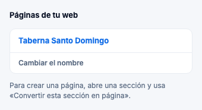
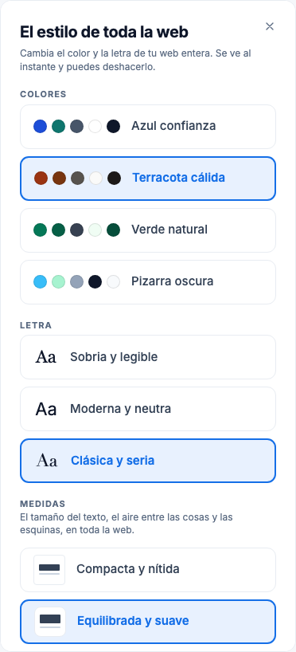
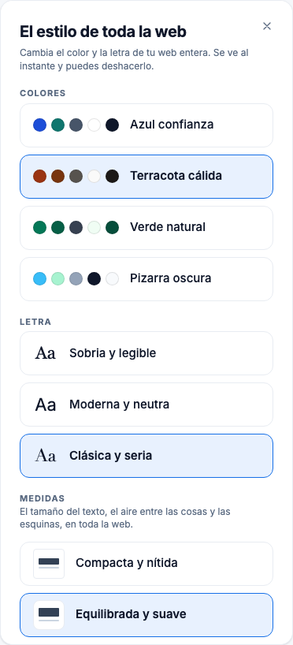
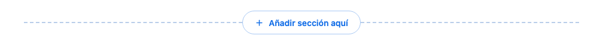
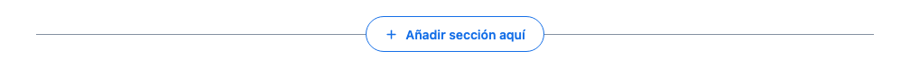
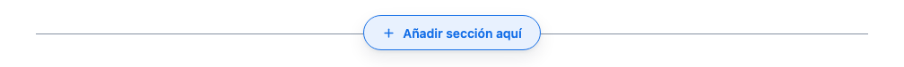

# Review of the phase 1 design handoff

**Date:** 2026-09-23 · **Reviewed against:** `docs/protocolo.md`, `docs/dossiers/`, the eleven
ADRs in `docs/decisions/`, and the merged code in `packages/`.

`HANDOFF.md` and the fifteen mockups came from a design session in Claude online. This is the
record of reading them against what the repository already decided: what holds, what does not,
and what was decided to close each gap. Where this file and `HANDOFF.md` disagree, this file is
the later document.

> **The header above is a dated record and the file is not.** The date, the eleven ADRs and the
> fifteen mockups are what the *first* reading was done against, on 23 September 2026; they are left
> as written because a review that silently re-dates itself stops saying when it looked. What has
> grown since, noted here so the numbers do not read as current: there are now **34 ADRs** and
> **19 mockups** — 16 through 19 (modo estudio, la barra y el sistema, negrita y cursiva, cómo se ve
> al compartir) were drawn after this review and are read against it rather than by it. Entries
> below carry their own dates, and the ones added in sprints 9 through 13 are the live half of this
> file. Last added to: **2 October 2026, closing sprint 13.**

## What the screens get right

Checked one by one, not assumed:

- **The five questions,** their order, and that only the first two are required (ADR 0010).
  Questions 3 to 5 carry a `Saltar` button and say what skipping costs.
- **The ten launch sectors plus "Otro sector"** (ADR 0010), with a search field above the grid.
- **Question 3's suggestions start unticked**, with "Marca solo lo que hagas de verdad" — the
  rule ADR 0010 gives for not promising services the business may not offer.
- **Question 4 feeds "Horario y ubicación"** and offers "No tengo local: trabajo solo online o a
  domicilio", saying plainly that then no city is named. That is `{ciudad}` having no value
  (ADR 0010).
- **Question 5 feeds the main button** and asks for the data the action needs on the same screen.
- **The palette comes from the logo** (mockup 06, and the dossier's own promise), and the logo is
  optional. **Since 13 October 2026, without a logo's choice the three proposals start in the
  neutral palette** — black and Retorika's blue — and the owner picks a colour afterwards in
  «Estilo» ([ADR 0041](../decisions/0041-the-proposals-start-neutral-and-the-palette-is-chosen-afterwards.md));
  the sector's default palette is no more.
- **Sample photos** are placed by the generator, not asked for (ADR 0011).
- **`Descargar` is the editor's primary action,** and there is no hosted destination anywhere
  (ADR 0008).
- **No properties panel**, editing on the element itself, a floating toolbar with few actions,
  `Guardado` instead of a save button.
- **The price is `XX €`** on every screen (protocol: a Stripe Price object, not a number in code).

## The five conflicts

### 1. The prototype did not navigate

All 23 links pointed at files that do not exist — `Main.dc.html`, `P2-Sector.dc.html`,
`Editor.dc.html`, `Descarga.dc.html` and the rest, artefacts of the export. The protocol's next
step is *a navigable prototype tested with two real businesses*, so this was a blocker, not a
detail.

**Resolved:** the links were rewritten to the real filenames.

### 2. Mockup 15 promised a preview link the CEO withdrew

The screen read: *"Antes de pagar puedes compartir un enlace de previsualización con una marca
discreta de Retorika."* **ADR 0008** retired exactly that: the preview with the Retorika mark is
seen **only inside the app**, and there is no public URL to share. The handoff's own D2 replaced
the two-destination publish screen but left this line standing.

**Resolved:** the line now says what the app does — the preview is inside the app, there is no
link to share.

### 3. Deleting a section: D8 against ADR 0003

D8 draws no confirmation dialog at all: the section goes, a dashed placeholder marks the gap, and
a toast offers `Deshacer`. **ADR 0003** says confirmation *is* asked when the section holds
content the user actually wrote.

**Decided by the product owner (2026-09-23):** never a dialog, but the toast does not fade when
the section held the user's own writing. Recorded in **ADR 0014**, which amends ADR 0003.

### 4. The example business told two stories at once

Questions 1 to 6 used `Huellitas Felices`, a dog groomer, while the sector ticked was
`Peluquería y barbería` and the services were barbering (`Corte de caballero`, `Arreglo de
barba`). On top of that, ADR 0010's launch sectors do not include dog grooming: it goes through
`Otro sector`, so the screens were demonstrating a path the product will not take.

**Decided:** rename to **`Barbería El Corte`**, the `siteName` the repository's own fixtures
already use (`fixtures/documents/barbershop-cover.json`,
`fixtures/documents/cover-and-services.json`). Name, sector and services now say the same thing,
and the preview copy changed with them.

### 5. D9's premise is wrong; its cardinality is not

D9 says a single card would be *"a lone card stranded in a four-column grid"*, leaving *"a large
empty gap"*, and proposes that the renderer pick a composition from the card count.

**Measured against the merged renderer**, at 1280, in the list of `fixtures/documents/cover-and-services.json`:

| Cards | List width | Card widths | `grid-template-columns` as computed |
|---|---|---|---|
| 1 | 1184px | 1184 | `1184px 0px 0px 0px` |
| 2 | 1184px | 584, 584 | `584px 584px 0px 0px` |
| 3 | 1184px | 384, 384, 384 | `384px 384px 384px 0px` |

`repeat(auto-fit, minmax(min(100%, 16rem), 1fr))` collapses the empty tracks, so one card already
takes the full width, two take half each and three a third. **D9's table is what the stylesheet
does today**, and the renderer does not need to choose anything: a renderer that picked a
composition from the content would also mean the same document renders differently as the user
ticks boxes, which is not how compositions work here — the composition is a variant in the
document (rule 1).

Reproduce it by rendering that fixture with `items` sliced to 1, 2 and 3 and measuring
`li` widths in a browser at 1280.

**What was real in D9** is the cardinality, and it closes the two questions ADR 0010 left open.
**Decided:** minimum 1, maximum 6, and zero cards means the section is not generated at all.
Recorded in **ADR 0013**. The "featured card with the photo beside it" is **not** adopted: it
needs images inside list items, which the "Qué hago" task excluded on purpose.

## The editor shell, as drawn

Kept here rather than in an ADR: these are measurements that will move the first week
`apps/editor` exists, and an ADR would make nudging a bar a formal amendment. ADR 0015 holds the
part that must not move — the interface tokens and their separation from the published site.

- **Top bar, 58px:** the mark, the site name with a chevron, centred page tabs, a device toggle
  (view only in phase 1), undo and redo, a green `Guardado` tick, and `Descargar`.
- **Left rail, 80px:** four icon buttons — `Secciones`, `Estilo`, `Páginas`, `Fotos`. The
  advanced-module dossier describes these four with the design tools switched off. **A fifth,
  `Compartir`, shipped on 2 October 2026 and is in no mockup before 19** — see the entry below.
- **Canvas:** the rest of the screen. Selection is a 2px blue outline with four corner handles.
- **Floating toolbar** above the selection, four to seven actions: `Aa`, a size stepper, bold,
  alignment, a colour swatch, link, then move, duplicate and delete.
- **Section insertion** happens in the gap between sections, as a dashed rule broken by a pill
  reading `Añadir sección aquí` — never a list in a side panel.

## `Compartir`: a rail item no earlier mockup draws, and the download dialog it stayed out of

Added 2 October 2026 with [ADR 0029](../decisions/0029-what-a-published-page-says-about-itself.md)
and **mockup 19**, which is the drawing the assessment below was made from.

**Why a rail item at all.** The two fields — the sentence a shared link shows, and the origin the
site will live at — belong to the whole site, like the theme and the pages, and the rail is this
editor's only site-wide navigation. The `Estilo` panel is scoped by mockup 13 to colour, type and
measures, and these are none of those.

**It takes the rail to six with the design tools on, which this file already flagged as a question.**
That is a real cost and is not waved away; what makes it worth paying is that the alternative
homes are each wrong for a reason, and the one that is only wrong *by a little* is the download
dialog, which is the next entry.

**«¿También en el diálogo de descarga?» — asked by David, drawn in mockup 19 band 3, and answered
no.** The moment is right: an owner usually knows their domain exactly when they are about to
download. What rules it out is what surrounds that moment. **The download path is where phase 1's
ten-minute criterion is measured**, and every gate on it today exists to stop or warn about
something that is wrong — too many photos, a colour nobody can read, something overflowing at
320px. An empty address is explicitly none of those: ADR 0029 makes it optional and says «vacío no
es error y no bloquea nada». A form there would be the first thing to interrupt a download that is
already correct, paid for by everybody so that a minority can fill it in.

What answers the worry underneath — that nobody finds the field — is the **name**. `Compartir` is
the word an owner already has in their head when the link is what they care about, and the help
line closes the sequence: «si la cambias, vuelve a descargar».

~~**What would reopen it:** a fourth usability session showing that nobody opens `Compartir`. That is
evidence this decision does not have, and the mockup says so rather than implying the question is
settled forever.~~

**Rewritten 2 October 2026 —
[ADR 0031](../decisions/0031-usability-is-judged-by-david-and-the-sessions-are-cancelled.md)
cancels the sessions**, and a reopening condition that names one would hold this closed forever.
Mockup 19 band 3 even says «y **no antes**», which was a guard against revisiting a decision on a
hunch and becomes a lock once the hunch is all there will ever be.

**What reopens it now:** David opening the editor, looking for where the site's address goes, and
not finding it — written down when it happens. It is weaker evidence than watching a stranger, and
saying so is the point of this paragraph rather than a hedge: the decision was taken on the shape of
the download path, which has not changed, and the thing a session would have added was the one fact
nobody inside can supply.

## Still open

- **Two things the advanced-module dossier §5 describes that this product cannot do.** Recorded
  here on 30 September 2026, with mockup 16 and [ADR 0025](../decisions/0025-studio-mode-starts-now-and-its-switch-is-not-in-the-document.md),
  because a source comment is not where a deviation from an approved artefact belongs:
  - **«Al escalar se guarda una versión.»** There is no named version history. `autosave.ts` keeps
    one session and no history, so within a session the undo stack is the version and across a
    reload there is none. **Mockup 16 does not promise a saved version**, and neither may the
    interface: what it promises instead is true — the return puts every text and photo back in its
    exact slot, because `escalate` keeps the element ids.
  - **«El panel de secciones marca las diseñadas a mano.»** There is no sections panel: `Secciones`
    *is* the canvas (`EditorShell.tsx` says so). The mark is a pill drawn on the section itself, as
    injected chrome, so it can never reach a published page.

- **The left rail is ~~five~~ *seven* items with the design tools on.** `HANDOFF.md` and this file both justify
  the four-item rail as the advanced dossier's «Apagado» column, which was right and is now only
  half the story: with the tools on it gains `Diseño`. The switch itself is **not** a rail item — it
  sits at the rail's foot, separated — and ADR 0025 records why it is not in the top bar, which is
  the measurement sprint 7 day 7 took of that row overflowing.
  **Re-counted 4 October 2026: five became six with `Compartir` (sprint 12) and seven with `Listas`
  (sprint 14).** The number is corrected rather than the entry deleted, because the entry's point was
  never the number — it was that the rail's length is a cost nobody had priced. **Sprint 14 priced
  it**: the seventh item pushed the design-tools switch to 43 pixels from the bottom-left corner at
  720px tall, where browser chrome gathers, and two `e2e` tests started failing on it. `backlog.md`
  carries the measurement. This is the question becoming a number.

- **Mockup 16's switch question is overruled, and the shipped wording is not what it draws.**
  Mockup 16 band 1 draws **«¿Montas webs para otros?»**, from the advanced dossier §4's point that
  «ante "básico o avanzado" mucha gente miente hacia arriba». That is true about *levels* and the
  remedy does not follow from it: a question about **who somebody is**, answered to obtain a
  capability, is answered yes by everyone who wants the capability — so it filtered nobody while
  looking as though it did. Session 3 watched a car workshop's owner read it, answer «Sí,
  enciéndelas» and carry on, and nothing was lost by that, because ADR 0025 §1 is kept by the press
  rather than by the wording.

  **Amended by [ADR 0025](../decisions/0025-studio-mode-starts-now-and-its-switch-is-not-in-the-document.md)'s
  own amendment, accepted by David on 1 October 2026 and built the same day.** The question now
  describes the tools — **«¿Quieres colocar tú cada elemento?»** — so the answer is accurate rather
  than aspirational. The mockup is left as drawn: it is the record of what was specified, and this is
  the file where an ADR overrules it.

  **The same amendment puts «Diseñar a mano» inside the `Diseño` panel**, beside the sentence that
  says you need it. The panel used to render «Diséñala a mano **desde su cabecera**» as a bare
  paragraph — a dead end naming its own exit — which is how an owner who had turned the tools on, and
  been told by that very panel that the grid existed, still asked for «más libertad en la posición».
  **ADR 0025 §7 is not amended**: escalation stays per section and `escalate` moves no element, which
  is exactly what makes a second door to the same offer safe.

- **`Páginas` and `Fotos` are phase 2, and mockup 08 draws them.** Organic pages and photo
  upload both belong to phase 2 in the protocol, and ADR 0011 says a phase 1 site carries sample
  photos only. The mockup now draws both dimmed and marked `Fase 2`, so nobody implements them by
  reading the screen. What, if anything, they do in phase 1 — swapping one sample photo for
  another, say — is decided when the editor task is written.

  **Answered by the shipped editor, 26 September 2026.** No editor task file was ever written;
  `apps/editor` was built directly (ADR 0017). `EditorShell.tsx` therefore holds decisions that
  diverge from mockup 08, recorded here because a source comment is not where a deviation from an
  approved screen belongs:
  - **No second page tab and no `+`.** The mockup shows `Inicio`, `Servicios` and an add-page
    control. The document has exactly one page, and a button that adds a page nothing can hold is
    the dead-button mistake sprint 1 kept refusing. `Inicio` is drawn alone.
  - **No site-preview nav bar inside the canvas card.** The mockup's `Inicio Servicios Galería
    Contacto Reserva` strip is a real multi-page site's own navigation. The generator produces no
    such navigation, so drawing it would advertise links that go nowhere.

  **`Estilo` was dimmed too, from 26 September to 28 September 2026** — the mockup dims only
  `Fotos` and `Páginas`, but protocol Part 14 put "Estilo global" in phase 2 alongside them, and
  the mockup predates that being pinned down. **No longer true**: sprint 4 day 2 gave the rail a
  live `Estilo` item and the panel behind it, once phase 1's acceptance criterion was measured
  and the same usability session named the gap. ~~`Páginas` and `Fotos` stay dimmed — organic pages
  and a real photo upload are both still unbuilt, not merely undecided.~~
  **Corrected 4 October 2026, closing sprint 14: both shipped, and the stale half of this entry sat
  inside an entry that was already correcting itself.** `PagesPanel.tsx` and `PhotosPanel.tsx` exist,
  the `e2e` suite drives both, and `EditorShell` records that the grey shade for «this exists but not
  yet» lost its last caller in sprint 6. Somebody read this line, fixed the sentence above it and left
  the one below — which is the shape of rot this file is most prone to, because a corrected entry
  looks like a checked one.
- **Resolved, 28 September 2026 — mockup 13's palettes and typefaces are not the ones in the
  code.** The claim was that the screen offers `Azul confianza`, `Verde natural`, `Coral cercano`
  and `Neutro elegante`, plus Inter, Poppins and Source Serif, while `packages/tokens` ships
  `classic-blue`, `warm-terracotta`, `forest-emerald`, `dark-slate` and the three type pairs — and
  that the reconciliation would be naming and ordering, not re-inventing. It was, and the Estilo
  panel now ships with these names, in `packages/tokens/src/locales/es.json`, which until then had
  no locale file at all: the `nameKey` every palette and pair declared resolved to nothing,
  unnoticed because nothing had ever displayed them.

  | Code | Shown as | Where the name comes from |
  |---|---|---|
  | `neutral` | **Neutra** | Added 13 October 2026 (ADR 0041), listed first: the palette every proposal starts in without a logo's choice — black ink, Retorika's blue, white surfaces |
  | `classic-blue` | **Azul confianza** | Mockup 13, unchanged |
  | `forest-emerald` | **Verde natural** | Mockup 13, unchanged |
  | `warm-terracotta` | **Terracota cálida** | The mockup's warm palette is `Coral cercano`, drawn around `#F2704B`. Ours is `#9A3412`, a deep brick. "Coral" would name a colour this palette does not contain |
  | `dark-slate` | **Pizarra oscura** | The mockup calls it `Neutro elegante`. It is white text on near-black, and the one thing an owner needs to know before clicking is that it is dark. A name that hides that is not a translation of it |
  | `modern-sans` | **Moderna y neutra** | Mockup 13's own words for Inter |
  | `classic-display` | **Clásica y seria** | Mockup 13's own words for Source Serif |
  | `editorial-serif` | **Sobria y legible** | No mockup counterpart: serif headings over a plain sans body, which is neither of the other two |

  **Typefaces are named by character, never by font**, which is the mockup's other divergence and
  the deliberate one. Issue #9: Inter and Playfair Display fall back to something else on a machine
  without them, and ADR 0001 forbids downloading either — so "Inter" as a label promises a font
  that may never arrive, while "Moderna y neutra" is true whichever one resolves. The `Aa` specimen
  beside each name is rendered in that pair's real stack, so what it shows *is* what this machine
  will give, fallback included.

  **Order follows `PALETTES`, not the mockup**, which differs only in swapping the second and third.
  Both put the safe blue first and the dark one last, and the accessibility matrix iterates
  `PALETTES` — reordering the catalog to match a mockup exactly would churn that output for nothing
  an owner could see.

- **No mockup draws «Precios» either, and a carta of several courses reads as several sections.**
  The dossier's nine include it («Tarifas o planes») and it shipped on sprint 4 day 6, but no
  screen shows one. Two decisions are recorded here because they are about how a page reads:

  **A price list is drawn as a list, not as a card grid.** Every other section that holds a list
  holds cards, and the generic `.rb-list` rule flows them three abreast, which is right for
  services and opinions. A twelve-dish carta drawn that way came out as four rows of three, which
  nobody reads top to bottom. One rule — `.rb-prices .rb-list { grid-template-columns: 1fr }` —
  rather than a second list drawing, since the only thing that differs is how many across.

  **Three courses still read as three sections, and that is measured rather than asserted.**
  Building «Entrantes», «Carnes» and «Postres» by duplicating gives each 48px of its own padding
  with 76px of page between them: **172px of empty space between the last dish of one course and
  the heading of the next**, with transparent backgrounds and nothing framing them as one menu. It
  is usable — a small restaurant's carta often is one section — but it is not a carta.

  The cheap lever, not taken: a rule closing up two adjacent sections of the same preset. It is
  left open because it is a general question rather than a price-list one — it would apply to two
  «Opiniones» in a row just as much, and whether adjacent sections of one kind should read as one
  thing is a design decision rather than a rendering detail.

- **No mockup draws «variantes de sección», and it shipped on sprint 4 day 4.** Protocol Part 14
  names it as a phase 2 item and the catalog has carried the compositions since sprint 2 — thirteen
  of them, two or three per section, built and tested and unreachable — but no screen in
  `docs/design/mockups/` shows a control for choosing one. Mockup 13 is global style; mockup 08's
  floating toolbar is about a selected *element*. So the placement was development's to decide, and
  it is recorded here rather than in a source comment:

  The control is a **sixth button in the per-section action cluster**, opening a small menu of the
  compositions by their Spanish name («Foto a la derecha», «En dos columnas»), with the one in use
  marked. It follows the pattern the insertion pill established — chrome injected into the preview
  frame, anchored to the thing it acts on — for the same reason: only the frame knows where a
  section sits. The menu names what does not change, «El texto y las fotos no cambian», because
  that is rule 1 and it is the first question anyone would have.

  **The button is drawn conditionally**, which is new for this cluster: a section carrying its own
  layout gets none, because for a hand-designed section the variant id decides nothing
  (`build.ts` reads `section.layout ?? preset.layoutFor(…)`), and a button that lights up and moves
  no pixel is the dead-button mistake in a new costume. `setVariant` in the schema refuses that case
  outright as a backstop.

  **Selection and the open menu now survive the preview's re-render**, which they never did before.
  Every action replaces the iframe's whole `srcDoc`, so the outline, the handles and the cluster
  were destroyed and rebuilt each time — one click to get back, which nobody noticed because you
  rarely delete the same section twice. Composition is the first action anyone repeats on purpose,
  and re-selecting between tries would have been the whole friction of the feature. It improves the
  other five buttons as a side effect.

- **No «+ Añadir página», and mockup 08 draws one.** The mockup's top bar has two page tabs, a
  `PÁGINAS: FASE 2` badge and a `+` labelled `Añadir página`. The shipped editor has the tabs and
  **not** the `+`, because the concept dossier §6 says a page is born by converting a section —
  «Cualquier sección puede convertirse en página» — and that «pedir al usuario que elija entre "una
  página" y "varias páginas" es pedirle una decisión técnica antes de que sepa qué va a contar».
  Where the concept exists to avoid asking a question, a screen that asks it is the screen that is
  wrong, and `CLAUDE.md` puts the dossiers above the code. Decided in
  [ADR 0022](../decisions/0022-a-page-is-born-by-converting-a-section.md), which also carries what
  would reopen it: an owner who looks for a way to make a page and does not find one.

  A second consequence worth having here rather than only in the ADR: **there is no empty page.**
  The insertion pill is drawn *between* sections (`Editor.tsx`, `wireInsertion`), so a page with
  none would have nowhere to click — the dead end the `+` would have led to.

- **The site's own menu, which this review previously ruled out, now exists.** The entry above says
  the mockup's `Inicio Servicios Galería Contacto Reserva` strip was not drawn because «the
  generator produces no such navigation, so drawing it would advertise links that go nowhere». That
  stopped being true with [ADR 0023](../decisions/0023-the-menu-and-the-footer-are-derived-chrome.md):
  the menu is derived from the home page's sections and the document's pages, and it is emitted from
  three entries upwards. The strip in the mockup is drawn inside the canvas card as part of the
  *preview*, which is exactly what it now is.

  **Two divergences from that strip, built on sprint 5 day 5 and recorded here rather than only in
  a source comment:**

  - **«Inicio» appears on every page except the home page**, where the mockup draws it always. On
    the home page a link to the page you are already reading does nothing, and a link that does
    nothing is the thing this product refuses everywhere else. Off the home page it is not
    decoration: a site whose every home section has been converted would otherwise offer, from one
    of those pages, a strip of other pages and no way back. ADR 0023 settles what the menu
    *contains* and says nothing about what it looks like from another page; this is that gap filled.
  - **No `Reserva` entry.** The mockup's last item is the main call to action repeated in the
    strip. The menu is derived from sections and pages, and the booking button is neither — it is a
    slot inside the contact section. Putting it in the menu would mean the menu knowing about one
    particular slot of one particular preset, which is the opposite of deriving.
  - **Dos tiras donde la maqueta dibuja una, desde el 16 de octubre de 2026** (sprint 23,
    [ADR 0043](../decisions/0043-the-menu-splits-in-two-and-the-owner-chooses.md)). Las páginas del
    sitio y las secciones de la página que se está viendo son dos menús, con sus dos nombres,
    «Páginas» y «Secciones». **En un sitio de una sola página el visitante no nota nada**, porque
    el menú de páginas no se dibuja cuando no hay a dónde ir: la división solo aparece el día que
    existe una segunda página. Fue elección de David entre cuatro opciones puestas delante, con lo
    que se entrega a cambio escrito en el ADR — y lo principal que se entrega es que convertir una
    sección deja de ser invisible para el visitante, porque su entrada se muda de una tira a otra.

- **Not implemented, and not planned: mockup 13's «Avanzado: colores exactos y tamaños».** The row
  at the foot of the style panel opens a free colour picker and size controls. There is no such
  control in the shipped panel and there is not meant to be. This review already said "a palette
  that is not contrast-tested cannot ship"; the protocol says it more strongly still, that a palette
  with bad contrast cannot even be declared. A picker is a machine for producing exactly that, and
  a site built with one is a site that gets published. It is the same warn-or-block line the rest of
  the product draws — marker text warns, a dead destination blocks — applied to colour, where the
  damage is invisible to the person causing it.

  **Amended by [ADR 0026](../decisions/0026-the-switch-is-the-line-between-references-and-exact-values.md)
  — and the picker stays refused.** What that ADR admits is not this row's free picker: it is
  document rule 6's own second arm, `{exact, exception: true}`, offered **only with the design tools
  on**, and only behind the pre-publish contrast review the advanced dossier §4 promised and nobody
  had built — blocking below 3:1, warning between 3:1 and 4.5:1, with the one-click fix being to
  drop the exception and go back to the reference. The sentence this row rests on stays true, and
  the ADR quotes it: an exact colour with no net is exactly what was refused here.
  **The exact value and that review shipped together**, in one merge, which is what the ADR's §2
  asks for by name.

  Two corrections to this entry, both true from sprint 9 onward. «Tamaños»: the style panel now
  offers three scales, by reference and named by character, which is the system the dossier §6
  always described — so that half of the mockup's row is answered without a picker. And **an exact
  `fontSize` is still refused**, which the ADR's own table records: not for contrast, but because
  the same §4 sentence promises the check covers «desbordes por debajo de 320 píxeles», nothing
  measures that yet, and a size is the one value in this vocabulary that can cause one.

  **The second of those two stopped being true on 1 October 2026**, sprint 10 day 6: the editor
  measures each page at 320 pixels before a download and warns with the sections that run past the
  edge, so an exact `fontSize` shipped in that same merge. **The picker is still refused** — that is
  the sentence this entry rests on and nothing has touched it. What exists is rule 6's marked
  exception, behind the design tools, behind a review; what is still refused is a free colour
  control with nothing in front of it.

  **Accepted by David on 1 October 2026, not by direction** — see the ADR's own header for what
  that does and does not mean. This entry is amended by a decision direction has not looked at.

- **Five swatches per palette, but not the mockup's five.** The mockup draws five circles; our
  palettes hold six colours. The one left out is `color.accent`, and that is a fact about the code
  rather than a preference: **no rule the renderer emits reads `var(--color-accent)`**, and it is
  the only colour whose contrast is asserted nowhere — in `classic-blue` it is 3.19:1 on surface,
  under AA. Showing it would advertise a colour that appears nowhere on the page and carries no
  guarantee. Pinned by `packages/renderer/test/theme-css.test.ts`, which fails if a rule ever starts
  reading it; the fix then is a contrast pair first, not a relaxed test.

- **Resolved, 28 September 2026 — the editor's top bar names the variant, where mockup 08 names the
  business.** Found by walking the editor, and not caused by that day's work: it had been true
  since the editor existed, because `Editor`'s `title` prop is the variant caption and the shell
  rendered it as `siteName`. Direction settled it for the mockup: **the bar shows the business
  name.** The button around it still goes back to the three variants, and the variant's own caption
  still names the preview frame, where "which of the three am I in" is the useful thing to say.
- **The mockups load Inter from Google Fonts.** Fine for a prototype opened on a laptop. It must
  never happen in a published site (ADR 0001): a client's site has no network dependency.
- **Resolved, 26 September 2026 — the Spanish interface strings.** They were the source for
  `apps/editor/src/locales/es.json` when that app existed; that file now exists and every visible
  string is read from it. No Spanish user-facing literal lives in a `.ts` or `.tsx` file.
- **Resolved, 26 September 2026 — `SERVICES_ITEMS`.** It said 2..6 when this review was written;
  `packages/catalog/src/services.ts` now declares `{ min: 1, max: 6 }`, which is what ADR 0013
  decided. The claim above had outlived the code and is corrected here rather than deleted, so the
  record of what was once open survives.
- **Superseded, 1 October 2026 — mockup 17's «Negritas y cursivas» card.** That mockup draws the
  control struck through, with the reason «ninguna de sus dos condiciones de despertar se ha
  cumplido». The third usability session met the second condition on 30 September and a second owner
  asked for both marks, so
  [ADR 0024](../decisions/0024-formatting-inside-a-text-is-designed-and-waiting.md) stopped waiting
  and [mockup 18](mockups/18-negrita-y-cursiva.html) draws the control that replaces the struck one.
  **The rest of mockup 17 stands**, its other three struck cards included — alignment, typography
  and per-element move/duplicate/delete are all still out, for the reasons it gives.
  Mockup 17 is not edited: it is the record of what sprint 9 decided, and a dated artefact that
  gets rewritten stops being evidence of anything.
  **Amended by [ADR 0027](../decisions/0027-a-mark-moves-with-the-text-under-it.md) in one further
  clause**, which is not a design matter but is recorded here because it changes what mockup 18 may
  draw: ADR 0024 forbade one run overlapping another, which read literally made bold *and* italic on
  the same words impossible — the first thing the owner named. Different marks may now overlap;
  identical ones merge.
- **Diverged since sprint 10 and recorded only now, closing sprint 12 — mockup 18's band 2, first
  state.** The mockup says that with nothing selected the `B` and `I` buttons **are not drawn**, and
  says it in as many words: «no se dibujan apagados». `Editor.tsx` draws them and disables them, and
  its comment argues for that on purpose — «"No door" and "the door is here, pick some words first"
  are different things, and removing the buttons as the selection collapses would make them
  flicker».
  **The reasoning in the code is good and it is still a divergence from an approved mockup**, which
  is what this file is for. It shipped in sprint 10 and nothing wrote it down for two sprints; the
  sweep that closes sprint 12 is what found it, by reading the mockup against the code rather than
  against memory.
  ~~**Left as it is, pending a word.** Changing a control two usability sessions have not yet met is
  not a tidy-up, and the flicker the comment names is a real cost that the mockup, drawn before the
  bar existed, could not have weighed. What is refused is the current state: a product doing one
  thing while an approved drawing says another, with nobody told.~~

  **Closed in favour of the drawing, 2 October 2026, by David, and built in sprint 13 day 3.** Without
  a selection the two buttons are not drawn — and the whole `Resaltar` group goes with them, because a
  caption over nothing is the empty row this bar refuses everywhere else.

  **The code's argument was good and lost on its merits rather than on authority.** «"No door" and
  "the door is here, pick some words first" are different things» is true, and the flicker is real.
  What decided it is that the bar already answers this question the same way everywhere else — «a
  control that does not apply is not drawn, not drawn greyed out», which is `textToolbar.ts`'s own
  rule and ADR 0025 §6's — so the disabled state was the single exception to a rule the rest of the
  bar keeps. The comment is kept in the code saying why it was discarded.

  **And the sentence above about «two usability sessions» stopped being a reason**: [ADR 0031](../decisions/0031-usability-is-judged-by-david-and-the-sessions-are-cancelled.md)
  cancels them, so «a control the sessions have not met» describes every control there will ever be.
- **Half superseded, 2 October 2026 — mockup 17's struck `Aa` card.** That card strikes two things
  at once, and only one of them comes back. Its text, word for word:

  > «La tipografía, entera — ni el `Aa` por elemento ni «tipografías propias». Incidencia #9:
  > `modern-sans` y `classic-display` caen a la fuente del sistema en máquinas sin Inter ni Playfair,
  > **y el ADR 0001 prohíbe descargarlas**. Ofrecerla sería prometer una letra que el visitante puede
  > no ver nunca.»

  **Both clauses of that reason were measured false in sprint 11**, which is why this is a premise
  that expired rather than a change of mind:

  - «el ADR 0001 prohíbe descargarlas» — a relative `@font-face` **loads and renders from `file://`**,
    measured at 385px against 411px with the file missing, in Chrome 154 and Firefox 155 by
    double-click. The double-click promise survives a shipped face, which is what let
    [ADR 0028](../decisions/0028-typography-needs-a-decision-from-direction.md) ship the two faces at
    all.
  - «caen a la fuente del sistema» — [#9](https://github.com/dnarram/retorika-builder/issues/9) closed
    on 1 October 2026. The faces travel in the ZIP with their OFL text beside them, and `buildSite`
    refuses a bundle with a face and no licence.

  So the per-element `Aa` is built, in sprint 13 day 5, as
  [ADR 0032](../decisions/0032-typography-per-element-with-the-faces-that-travel.md): a «Letra» group
  of two buttons offering the two families the theme already carries, behind the design-tools switch,
  **named «Titular» and «Texto» — by role and never by font**, which is issue #9's own rule and the one
  the `Estilo` panel has followed since sprint 4.

  **«Tipografías propias» stays struck, and its reason has not expired**: a family the owner types is
  a face the ZIP does not ship and a letter the visitor may never see, which is exactly the promise
  this card refused. ADR 0032 §2 makes it **unexpressible** rather than merely unoffered — `fontFamily`
  is the one style property with no exact arm, in the type as well as at runtime — so there is no rule
  for a later control to remember.

  **Answered on 18 October 2026, in the one form that reason allows** —
  [ADR 0046](../decisions/0046-the-gallery-ships-the-faces-so-the-letter-can-be-named.md), sprint 24
  día 6. The `Estilo` panel now offers **eight families by their real names**, folded away under the
  three pairs, with headings and text chosen separately and each specimen drawn in the very file the
  ZIP will carry. This is not the struck card coming back: a family the owner **types** is still
  unexpressible, and nothing above changes. What changed is that there is now a third possibility the
  card did not consider — **a closed gallery whose faces we send** — so «una letra que el visitante
  puede no ver nunca» is not true of these eight. The floating toolbar's two buttons keep their role
  words and name the chosen family in their accessible name only. The sprint's full entry is below,
  under sprint 24.

  **The switch is this file's business and is recorded as an open question rather than as a reading of
  the drawing.** Mockup 17 puts typography in «lo que no lleva», not in the «Encendido» half, so there
  was no drawing to follow; it went behind the switch because [ADR 0026](../decisions/0026-the-switch-is-the-line-between-references-and-exact-values.md)
  draws that line at «a design choice about one loose element». **Reversible in a line** if seeing it
  says otherwise.

  Mockup 17 is not edited, for the reason given two entries above: it is the record of what sprint 9
  decided *and of the reason it decided it*, and a dated artefact that gets rewritten stops being
  evidence of anything. Its line 157 — «La otra mitad, «tipografías propias», no entra en este sprint:
  la incidencia #9 sigue abierta» — is now true of one half and stale about the issue, and stays as
  written.
- **Not built, and that is the decision — 2 October 2026, mockup 06, «Estamos montando tu web».**
  The only approved phase-1 screen with no code and no locale keys, and after measuring what it would
  cover, there is nothing there to cover.

  It draws five progress lines — «Elegidas las secciones…», «Escritos los textos…», «Sacada la
  paleta…», «Colocando las fotos…», «Preparando las tres versiones» — under «Tarda unos segundos. No
  cierres esta ventana». **Measured, the whole of generation takes a median of 0.12 ms** (60 runs,
  min 0.07 ms, max 3.57 ms on the first cold call): `generateVariants` is synchronous and runs in the
  browser, the logo's palette was already extracted back at question 1, and the photo bank's bytes
  arrive *after* the three cards are up, filling in over the grey markers. So there is no moment
  between the last answer and mockup 07 for this screen to occupy.

  **Drawing it would mean faking all five lines and making a false statement in the sixth** — «tarda
  unos segundos» is three orders of magnitude out, and there is no window somebody must not close. A
  progress bar that reports nothing is the kind of claim this file exists to refuse; the honest
  version of this screen is its absence.

  **The premise is guarded rather than trusted.** The `e2e` suite measures the real time from
  pressing «Crear mi web» to the three cards and fails above two seconds, with the failure message
  saying what to do about it: if generation ever grows something genuinely slow, that test goes red
  and mockup 06 should be built rather than the number raised. The same test asserts the screen's own
  words appear nowhere, so «not drawn» cannot quietly become «drawn for a tenth of a millisecond».
  Mockup 06 is not edited; it stays as the record of what was expected before anything was measured.
- **Built, with one clause of its text refused — 2 October 2026, mockup 11's in-canvas notice.**
  Mockup 11 draws **two** things for one delete and only one of them had ever been built: the dark
  toast with «Deshacer», shipped in sprint 4, and a `2px dashed` panel in the flow of the page reading
  «Aquí estaba «Opiniones»» over «El hueco desaparecerá solo en unos segundos.» The second is now
  built — sprint 13 day 6 — because it says the thing the toast cannot: **where.** A section deleted
  below the fold leaves a page that silently reflows while «Deshacer» sits at the bottom of the window
  pointing at nothing the person can see.

  **The second line is not the mockup's when the toast has no timer, and the drawing loses that clause
  on its merits.** [ADR 0014](../decisions/0014-deleting-a-section-never-asks.md) gives
  a section the owner had edited **no timer at all** — its toast waits until it is undone or dismissed
  — so for that section «desaparecerá solo en unos segundos» is a promise the product does not keep.
  It reads «El hueco se queda hasta que deshagas o cierres el aviso» instead. **The mockup is not
  wrong so much as earlier**: it was drawn before the two-speed toast existed, and the clause is the
  only part of it that the later decision contradicts. Mockup 11 is not edited.

  The notice is injected chrome, like every other `rb-` node in the canvas: the section is gone from
  the document the instant it is deleted (rule 3's own exception, ADR 0003 — there is no trash inside
  the document), so there is nothing for the renderer to draw and nothing that could reach a published
  page.
- The handoff's own open list stands: the price, who issues the invoice and how VAT is handled,
  and the photo bank's actual images.

## What building the prototype surfaced

The three variants shown in screen 07 are now generated from documents written by hand for the
two businesses (`prototype/`). Filling those documents surfaced the following. None of it was
improvised: each one is recorded here and left as it is.

**Product decisions nobody has taken:**
- **There is no third cover composition.** The catalog has two (`image-right`,
  `image-background`); the mockup's "Tipográfica", everything centred with the name large, does
  not exist. The three variants are therefore combinations: `image-right` + `stacked`,
  `image-background` + `side`, `image-right` + `split`. **At thumbnail size the first and third
  are hard to tell apart**, because they share the cover and differ only in the "Qué hago" block.
  That weakens the dossier's promise that the three "cambian de composición", and a centred cover
  would be a catalog task of its own.
- **A free section's heading level follows the `catalogId` it declares:** `cover` gives `h1`,
  anything else `h2`. The prototype's "Contacto" declares `services` so that its title is an
  `h2`, which is right by accident rather than by design.
- ~~**The main button has nowhere to point.** The renderer emits no `id` on a section, so an
  in-page anchor like `#contacto` does not resolve. In the prototype the button reads `Visítanos`
  and goes nowhere, and that will have to be decided for real when the questionnaire's fifth
  answer becomes a link.~~
  **Corrected 4 October 2026: it does.** `packages/renderer/src/build.ts:474` emits the section's own
  id — «deliberately the section's own id rather than a slug of its Spanish name», because this package
  may not import the catalog — and `packages/schema/src/destinations.ts` counts the anchors pointing at
  it, which is what the delete toast's «un botón de tu web llevaba aquí» reads. The entry outlived the
  code by several sprints.
- **`location`'s `split` composition leaves a hole when `hours` is absent.** The right-hand
  column places `hours` at row 2 and `map` at row 3, so with no hours the map sits alone under an
  empty row rather than moving up. Seen building `fixtures/documents/contacto-y-horario.json`
  (`docs/tasks/catalog-horario-y-contacto.md`), which deliberately left `hours` out to exercise
  the optional slot. Fixing it means deciding a composition rule — whether an absent optional
  slot should collapse the row beneath it, generally or just here — which is a decision that task
  did not have to take. Recorded, not resolved in passing.

**What is ours rather than the product's, and is disclosed to the owner during the test:**
- **The cards were chosen by us.** The owner never ticked anything in question 3.
- **The palette was chosen by us, knowing which business it was** — terracotta for the
  restaurant, blue for the shoe shop. In the product the palette comes from the logo, and neither
  business gave one. This is exactly the knowledge the generator will not have, so a compliment
  about the colours would measure our taste, not the product. The script does not ask about
  colour.
- **The photos are placeholders** labelled "Tu foto aquí". The bank of ADR 0011 does not exist,
  so nothing about photos is being tested.
- **The main action was set by us** to "come to the premises", because no phone number or email
  enters the repository.

**Smaller things, recorded so they are not rediscovered:**
- The map's coordinates are approximate, and a map publishes as a link, not a map (ADR 0004).
- Taberna Santo Domingo has four cards and Conchi three, which exercises the cardinality of
  ADR 0013 with real content.
- Chrome will not render a `file://` page inside an `iframe` of another `file://` page, so
  screen 07 shows screenshots of the real sites and links to the sites themselves.
- `scripts/build-sample-site.ts` now also takes a path to a document, so these stay out of the
  golden corpus. It is the only code this work touched.

## The two businesses for the usability test

D13 names them, and they are the next step after this review: **Restaurante Taberna Santo
Domingo** and **Conchi**, both in Ronda, both without a website on their Google listing, both
exactly the target user. The absence of a website is confirmed on contact, since a listing can
simply be incomplete.

---

## Two screens with no mockup, and what stands in for one (4 October 2026, sprint 15)

`docs/protocolo.md:971` makes the mockups the interface specification — «la maquetación, los textos
en castellano, los colores y los gestos ya están decididos» — and **there is no mockup of a landing
page and none of a login.** There never was: the concept dossier's «Seis pantallas y ninguna más»
describes the journey from the first question to the download, and its first screen is «sin registro
previo».

[ADR 0034](../decisions/0034-the-account-arrives-at-the-end.md) §20 decides what to do about that:
**no mockup is invented and none is back-dated.** For these screens the ADR and the sprint's pull
requests are the specification, Spanish copy included, which is this file's own mechanism — an ADR
overruling the design handoff — applied to a gap rather than to a disagreement. If a mockup is ever
drawn for them, it inherits from there.

**What the screens are, so this file says it rather than only the ADR:**

| Route | What it is | Why it is not a seventh screen |
|---|---|---|
| `/` | The landing: what Retorika is, «Empezar», and «Ya tengo cuenta» | It sits *before* the dossier's six, and asks for nothing. The six are unchanged and still start at «¿Cómo se llama tu negocio?», now at `/empezar` |
| `/entrar`, `/entrar/recuperar`, `/entrar/nueva-contrasena` | Coming back to a web already saved | Not a way in. The account is created at the end (§2), so nobody on their way to a first website meets any of them |
| `/mis-webs`, `/mis-webs/[id]` | «Tus webs guardadas», and opening one | **«Guardadas», never «publicadas».** ADR 0008 gives the editor no hosted-publishing entry point, and a list on our domain that said «publicadas» would imply we host them |
| `/cuenta` | The copy you take with you, and the way out | Protocol Parts 15 and 16 |

**And one correction to this sprint's own record, found by a test that failed for the right
reason.** ADR 0034's context table claimed `es.json:7` — «Sin registro, sin tutoriales» — was the
visible promise on screen. It is not: every questionnaire step supplies its own footer caption, so
that string's `??` fallback is unreachable and it has been dead copy since the per-step footers
arrived. The ADR carries the correction and an amendment; the promise now has a visible home on the
landing, and the e2e asserts the promise itself — no password field anywhere in the five questions —
rather than a sentence about it.

---

## El cromo del editor gana un sistema visual (5 de octubre de 2026)

Dirección pidió modernizar el cromo del editor — «los paneles se ven estilo años 2000» — con
**sombreado, contraste y transiciones**, y usando el hover para dirigir la mirada, sin tocar los
colores de marca. Esta sección es el registro, porque es aquí donde va: el **ADR 0015 se excluye a
sí mismo** de la apariencia del cascarón, con todas las letras —

> «The editor's shell — the bar heights, the rail width, the toolbar's contents — is **not decided
> here**. It is drawn in the mockups and written down in `docs/design/REVIEW.md`, where it can
> change as the editor is built without amending an ADR.»

— mientras que **los valores de color sí son suyos**. De ahí la forma del trabajo: ni un color de
marca cambia; lo que cambia es la forma, la profundidad, el movimiento, el foco, y **qué color se
pone sobre cuál**.

### Lo que dibujaban las maquetas, y lo que no

La maqueta 08 dibuja el raíl de 80px con sus iconos de 46×46 en recuadro, la barra de 58px y la
tarjeta del lienzo. **Esa geometría no se toca y sigue siendo la especificación.**

Lo que las maquetas **no** dicen, y es el hallazgo que ordena todo lo demás: **la maqueta 08 no
tiene ni una regla `:hover` ni una `transition`**. Ninguna de las diecinueve las tiene. Son dibujos,
no especificaciones de interacción, y el código heredó esa ausencia: una sola `transition` en toda
la aplicación y cero `:focus-visible`. Así que el movimiento y los estados **no contradicen ninguna
maqueta**; rellenan un hueco que nunca se rellenó. Ninguna maqueta se edita.

### Lo que se midió antes de tocar nada

| Hecho | Medida |
|---|---|
| Radios distintos en el cromo | **13**, siete de ellos dentro de un rango de 9px |
| Sombras | **6**, improvisadas, de una capa; la de diálogos con alfa 0.28 |
| `transition` en toda la aplicación | **1** |
| `:focus-visible` | **0** |
| `--ui-border` como linde de un control | **1,19:1** (WCAG 1.4.11 pide 3:1) |
| Pestaña de página activa (`#156FE7` sobre `#E8F1FE`) | **4,14:1** — falla AA para texto normal |
| Borde de «Guardar en mi cuenta» | `rgb(15,23,42)`, casi negro: `border-ui-line` **no existe** como token |

### El sistema, y de dónde salen sus números

**Cuatro radios** donde había trece, y **no son inventados**: son los de la propia tabla del ADR
0015 —«radius 20 for dialogs, 11–14 for controls»— que el código incumplía en ambas direcciones.
`--ui-radius` pasa de 14 a 12; nada consumía `rounded-ui`, así que nada se mueve con él.

**Tres niveles de profundidad, de dos capas cada uno** (sombra de contacto + ambiental), sobre la
tinta pizarra que ya era la convención.

**Una curva y dos duraciones**, con **tope de 200ms** — que es una restricción de un test, no un
gusto: el guard de paneles espera 350ms a que el lienzo se asiente.

**`--ui-border-strong: #8490A1`**, el color más claro de la familia de `--ui-muted` que supera 3:1
sobre **las dos** superficies (3,24:1 sobre blanco, 3,02:1 sobre `#F5F7FA`), resuelto y no elegido a
ojo. `--ui-border` se queda para lo que solo separa; el nuevo es para cuando el linde **es** la
información.

**Y `prefers-reduced-motion`, que no existía en todo el repositorio.** Añadir movimiento sin él
habría sido arreglar un problema de accesibilidad creando otro.

### El raíl, que es lo que cambia hoy

**Un elemento en reposo deja de tener recuadro.** Antes los siete llevaban el suyo, estuvieran
elegidos o no: siete cajas por el borde de la pantalla pidiendo atención que no habían ganado, y un
estado elegido que se reducía a «la caja se pone azul». Enrecuadrar lo no elegido es la costumbre
que envejece una barra de herramientas más rápido que ningún color.

Ahora el cuadrado se dibuja **solo** cuando el elemento está elegido o el puntero está encima, y el
elegido lleva **tres señales, no una**: la superficie de marca, la tinta de marca y una regla en el
canto interior del raíl. Cualquiera de las tres basta por sí sola, que es lo que lo mantiene legible
para quien no separa el azul del gris.

El interruptor de herramientas: el pulgar **se desliza** en vez de teletransportarse (antes se movía
con `justify-start`/`justify-end`, que no deja nada que animar), y su carril apagado pasa de 1,19:1
a 3,02:1 — antes era un interruptor cuyo «apagado» no se veía.

| | antes | después |
|---|---|---|
| El raíl |  |  |

Y los dos estados que antes no existían: [el hover](review/2026-10-05-el-cromo/rail-hover.png) y
[el foco de teclado](review/2026-10-05-el-cromo/rail-foco.png).

### Dos cosas que solo se vieron mirando la pantalla

1. **La regla indicadora no se dibujaba.** Estaba colocada a `-left-3.5`, fuera de la caja que el
   raíl recorta. Una señal que no se pinta es exactamente el fallo del botón muerto con otro traje.
2. **El anillo de foco se dibujaba dos veces**: uno alrededor del icono y otro cruzando los 80px del
   botón entero. La causa es de cascada y merece quedar escrita: **el CSS sin capa gana a cualquier
   regla en capa**, sea cual sea su especificidad, y todas las utilidades de Tailwind están en capas
   — así que un `:focus-visible` global sin capa no se puede sobrescribir en ningún sitio. Ahora
   está en `@layer base`.

### Lo que queda, y cuándo

Día 2 la barra superior y las pestañas de página (incluido el contraste de 4,14:1 y el borde
invisible); día 3 los seis paneles derechos; día 4 el cromo del lienzo. **Fuera por decisión de
dirección: la barra flotante y el conmutador PC/móvil** — «el cliente dijo que le encanta cómo
transiciona de vista pc a vista móvil»—, cuyos radios quedan nombrados como excepción permanente en
`apps/editor/test/chromeScale.test.ts`.

### Día 2: la barra superior y las pestañas de página (5 de octubre de 2026)

| | |
|---|---|
| antes |  |
| después |  |

**La pestaña activa fallaba AA y era justo lo que dirección señaló.** Era `text-ui-brand` sobre
`bg-ui-brand-surface`: el azul de marca sobre su propio tinte, **4,14:1**, por debajo del 4,5 que
WCAG pide a un texto de 14px semibold. Los títulos de página son las palabras del propio dueño y lo
único en esa barra que dice dónde está, así que era el peor sitio del cromo para ese fallo.

**No cambia ni un color de marca.** La tinta sobre el chip mide **15,06:1**, y el azul se muda al
indicador, donde es un gráfico a 4,71:1 sobre blanco — muy por encima del 3:1 que se le pide. El
arreglo fue **qué color va sobre cuál**, no qué colores existen.

**El indicador se desliza**, uno para toda la tira en vez de uno por pestaña, con `transform` y
`width` y nunca `left`, así que no reflota nada mientras viaja. Medido: `translateX` 0 → 186px y
ancho 180 → 134px al cambiar de página, con 0,18s de transición. **Con `prefers-reduced-motion`
cae a 1e-05s** y llega en vez de viajar, que es el ajuste que pidió dirección.

**Y un bug que no era estilo.** `border-ui-line` **no existe como token**: Tailwind no emitía color
para esa clase y el `border` a secas caía en `currentColor`, así que «Guardar en mi cuenta» llevaba
un contorno **casi negro** — medido en Chromium como `rgb(15, 23, 42)` donde se quería una línea de
pelo. Ahora `rgb(232, 236, 242)`. Una clase que se resuelve en silencio a nada falla igual que el
token que falta: sin error en ninguna parte, solo lo que no era en pantalla.

Cuatro valores sueltos más pasan a token: el galón `#94A3B8`, el rojo `#BE123C` —el cuarto rojo
distinto del repositorio—, el azul deshabilitado `#8FB4E9`, y el verde `#03D26E`, que estaba escrito
a mano **al lado del token `--ui-ok` que ya tenía ese mismo valor**.

Deshacer, rehacer, el nombre del negocio y los dos botones ganan hover, foco y pulsación. **El
conmutador PC/móvil no se toca**, y sus tres radios siguen nombrados como excepción permanente.

Y una cosa que solo se vio en la captura: con la pestaña activa y la pestaña bajo el puntero las dos
sobre `--ui-bg`, **los dos estados eran casi idénticos**. La activa lleva ahora un paso más de gris:
«dónde estoy» no puede parecerse a «dónde está el puntero».

### Día 3: los seis paneles derechos (5 de octubre de 2026)

| | antes | después |
|---|---|---|
| «Páginas» |  |  |
| «Estilo» |  |  |

**Lo que estaba mal, contado y no sentido.** Tres de los seis se dibujaban como tarjeta —«Estilo»,
«Compartir», «Diseño»— y tres no se dibujaban en absoluto, dejando sus filas sueltas sobre el gris
—«Páginas», «Fotos», «Listas»—. Abrir dos iconos distintos del raíl daba **dos clases de objeto
distintas**. Las esquinas de fila venían en **cuatro radios** según en qué panel estuvieras: 10px,
11px, 9px y `rounded-md`. Existían **dos componentes `SmallButton`** separados, en desacuerdo sobre
tamaño, grosor, color y sobre si `disabled` era siquiera una prop. Y había **cuatro rojos distintos**
donde ya existía un token.

Nada de eso fue una decisión. Es lo que pasa cuando seis pantallas se construyen en seis sprints y
nada las sujeta entre sí, y es la mayor parte de lo que «años 2000» quería decir.

`apps/editor/src/editor/panelKit.tsx` es esa cosa que faltaba: una tarjeta, una fila, un hover, un
seleccionado y un botón pequeño. Son cadenas y un componente diminuto a propósito, no un `<Panel>`
envolvente: los seis difieren en su **contenido** de maneras que ningún envoltorio sobreviviría.

**Y el mismo fallo de contraste del día 2, otra vez, en otros cinco sitios.** La fila seleccionada
de «Estilo» y dos estados de «Diseño» eran `text-ui-brand` sobre `bg-ui-brand-surface`: los mismos
**4,14:1**. Se arregla igual —la tinta al texto, el azul al borde y al fondo— y la fila elegida pasa
a **15,68:1** sin cambiar un color. Además, un botón deshabilitado de «Diseño» usaba `text-ui-border`
sobre blanco, **1,19:1**: no es que fuera poco legible, es que no se veía.

**Lo que destapó la guarda al ensancharse.** `chromeScale.test.ts` solo miraba `EditorShell.tsx`; el
día 3 pasa a mirar los ocho ficheros del cromo, y aparecieron **cuatro radios más** fuera de escala
que llevaban todo el tiempo fuera de su alcance mientras el test pasaba en verde. Una guarda que
mira poco pasa igual que una que no falla.

El trinquete queda ya **solo con el conmutador PC/móvil**, que es permanente por decisión de
dirección.

**Lo que sigue fuera y conviene decir:** `FieldsPanel` —el formulario de campos que se abre al elegir
una sección— **no es uno de los seis** y sigue siendo un cajón `fixed` **que se pinta encima del
lienzo**, que es justo el defecto que «Compartir» dejó de tener. No entra aquí porque no se abre
desde el raíl; queda nombrado para que no se descubra.

### Día 4: el cromo del lienzo (5 de octubre de 2026)

| | |
|---|---|
| antes |  |
| después |  |
| con el puntero encima |  |

**Lo que la maqueta 08 dibuja aquí es «una regla discontinua rota por una píldora», y eso se
mantiene como idea.** Lo que cambia son sus valores, y el motivo está medido: el borde de la
píldora era `#A9C9F4`, **1,70:1** sobre el blanco que el propio hueco pinta detrás, y la regla era
`#B9CDEA`, **1,62:1**. Los dos **por debajo del 3:1** que la WCAG 1.4.11 pide a aquello cuyo aspecto
es lo que identifica un control. «Añadir sección aquí» llevaba desde que se dibujó siendo un botón
que se podía no ver.

**Y el plan de este día proponía empeorarlo.** Decía dejar las píldoras «casi invisibles en reposo»
y hacerlas florecer con el puntero. Dirección lo rechazó, y la razón queda como regla: **un control
que solo aparece bajo un puntero no existe para quien no tiene puntero.** El reposo es ahora el azul
de marca a **4,71:1**, y el realce va **encima de un estado que ya pasa**.

**El realce vive dentro de `@media (hover: hover)`**, así que una pantalla táctil —que en unos
motores reporta un hover permanente falso y en otros no reporta ninguno— recibe siempre la versión
visible. Y `:focus-visible` recibe el mismo realce fuera de esa consulta, porque al teclado también
se llega a esta píldora y no tiene puntero con el que guiar.

La regla pasa de `2px dashed` a **1px sólido** a 3,24:1: más silenciosa de mirar y más medible. Lo
discontinuo era lo más datado que había en pantalla.

**El problema de los dos documentos, y cómo queda resuelto.** Este cromo vive **dentro del iframe**,
cuyo documento escribe `packages/renderer` y que nunca ve `globals.css`. Antes eso significaba una
segunda copia a mano de cada número, y ya había divergido: el lienzo usaba esquinas de 13, 11, 9 y
7px mientras el otro lado se había asentado en cuatro. `apps/editor/src/editor/chromeScale.ts` es
ahora la transcripción, y `test/chromeScale.test.ts` lee **los dos** y falla si un solo valor
discrepa.

**Y lo que no se toca: `.rb-toolbar*`.** Vive en este mismo fichero y es la barra flotante que
dirección excluyó. Se ha tocado por selector, nunca por bloque.

`pnpm test:golden` sigue en **21 sin moverse**, que es la prueba de que nada de esto llega al ZIP de
un cliente (ADR 0001).

### Corrección: la barra superior repartía mal su ancho (6 de octubre de 2026)

| | |
|---|---|
| antes |  |
| después |  |

Dirección vio, tras el rediseño del cromo, que el extremo del logo se sombreaba a lo ancho de una
zona vacía enorme y empujaba las pestañas hasta sacar una barra de desplazamiento.

**Las dos mitades eran una sola causa.** El botón del logo llevaba `flex-1`, así que **crecía hasta
tragarse cada píxel sobrante**. Mientras no tenía fondo, eso no se veía; darle un fondo al pasar el
ratón en el día 2 dibujó el vacío. Medido en Chromium a 1280 con una página: **395px de botón para
unos 250px de marca y nombre**. Y bajo presión el mismo `flex-1` corría al revés: con cuatro páginas
había devuelto todo y se quedaba en **12px**, con la marca y el nombre desaparecidos — y la tira se
desplazaba igualmente.

Ahora el botón tiene suelo y techo, y **la tira es la que crece**. Con `flex-auto` y no `flex-1`,
para que la tira conserve su contenido como base: así empuja cuando necesita sitio, y el logo cede.
La primera versión de este arreglo usaba `flex-1` y **empeoró 1024** — dejó de caber una sola
página —, lo que se vio midiendo y no razonando.

| ventana | 1 página | 2 | 3 | 4 |
|---|---|---|---|---|
| 1024 | sin barra | sin barra | sin barra | **barra** |
| 1280 | sin barra | sin barra | sin barra | **barra** |
| 1440 | sin barra | sin barra | sin barra | **barra** |
| 1600 | sin barra | sin barra | sin barra | sin barra |

Que es la regla que puso dirección: «sin barra a no ser que existan 4 o más páginas».

**Y el ancho de una pestaña no es un número medido, que es la corrección que hizo falta.** La
primera versión lo fijaba en 124px, afinado hasta que tres cupieran: pasaba aquí y **falló en CI**,
porque el margen que dejaba era cero — tres pestañas medían 395px dentro de una tira de 395px, y un
runner cuyas métricas de texto difieren en un píxel lo tumba. Un número al que se llega afinando es
un número que solo se sostiene en la máquina donde se afinó.

El tope es ahora `(100% - 14px) / 3`: la aritmética de la propia regla. Tres pestañas más sus dos
huecos de 6px **son** la tira, mida lo que mida la letra, y una cuarta no cabe por construcción. Eso
es además lo que hace que **1024 pase a admitir tres páginas**, cosa que no hacía ni antes ni con la
versión afinada — aunque allí cada pestaña se queda en unos 57px, así que se leen muy cortadas. A
1024 el remedio de verdad sigue siendo el grupo de la derecha.

**Lo que no se puede arreglar colocando cajas, y es decisión de dirección.** El grupo de la derecha
mide **673px fijos** y a 1024 deja 219px para las pestañas, donde dos nombres de página no caben a
ningún tamaño. Desglose medido:

| | |
|---|---|
| «Guardado en este navegador» | **200px** |
| «Guardar en mi cuenta» | **183px** |
| «Descargar» | 106px |
| Conmutador PC/móvil | 74px |
| Deshacer y rehacer | 60px |

Las dos primeras son **383px, más de la mitad del grupo**. La frase de guardado la alargó el ADR
0012 a propósito, «precisely so nobody reads a cross-device guarantee into it», así que acortarla no
es una decisión de maquetación. Queda nombrado aquí en lugar de dejarse descubrir.

### Dos correcciones: el interruptor invisible y una etiqueta que se partía (6 de octubre de 2026)

**El aviso del interruptor de herramientas de diseño no se veía, y lo rompí yo.** Se dibujaba
`absolute … left-full`, justo fuera del borde derecho del raíl, y eso funcionó hasta que la PR #172
dio al raíl `overflow-y: auto` para que sus propios elementos se pudieran alcanzar en una ventana
baja. **El desbordamiento recorta en los dos ejes**: `overflow-y: auto` calcula también
`overflow-x: auto`, así que la tarjeta seguía ahí —300×267 en el DOM— con **303px fuera de la caja
que la recorta**, invisible y sin nada que desplazar, porque no está en el flujo. Para el dueño eso
era un interruptor muerto.

`position: fixed` es lo que escapa del desbordamiento de un antepasado, así que la tarjeta se coloca
contra el rectángulo **medido** del interruptor y no contra su padre.

**«+ Añadir línea» se salía de su píldora, y eso no lo trajo el rediseño.** Caja de 30px declarada y
etiqueta libre de partirse: medido, **texto de 48px en una caja de 30**, 9px pintados fuera. La
regla es del **28 de septiembre** y ningún día de este trabajo la tocó. Lo que hizo el rediseño fue
ponerla al lado de «Añadir sección aquí», que ahora parece deliberada — y eso es lo que hizo que
esta pareciera rota. `white-space: nowrap`, y de paso el mismo suelo de 3:1 que la otra píldora.

**Lo que ninguna guarda podía cazar, y es la parte útil.** El recorrido de desbordamiento de botones
de la PR #169 lee `button, a, [role="button"]` en el documento **del editor**, y el cromo del lienzo
vive en otro, dentro del iframe. Ahora hay un recorrido que cruza esa frontera.

**Y ese recorrido nació vacío.** Copiado del otro, saltaba cualquier elemento con un antepasado que
recorta — y el cromo inyecta `html, body { overflow-x: clip; }`, así que **todos** lo tienen: el
recorrido no examinaba ni un botón y pasaba en verde. Quitar el arreglo que lo motivó no lo hacía
fallar. Ahora mira solo el desbordamiento del propio elemento, y **cuenta cuántos examina**: cero
examinados es un fallo con su propio mensaje, porque un recorrido que no miró nada y uno que no
encontró nada son el mismo array vacío.

### La barra de «Diseñada a mano» vuelve al flujo, y la maqueta 16 ya lo decía (7 de octubre de 2026)

**Reportado desde dirección en la vista de móvil**: la barra «Diseñada a mano / Portada / Volver a
la original» se dibujaba **encima** de la sección tapando contenido editable, y sus botones se
salían de ella.

**Lo medido, a 320px de lienzo:** barra de 272px, su contenido pidiendo 282 —**10px de
desbordamiento**, y lo que se salía era «Volver a la original»— y **31px de la fotografía de la
portada tapados** (`el-image`). En ordenador no pasaba ninguna de las dos cosas, que es la razón por
la que llevaba semanas sin verse.

**La causa no era un ajuste mal puesto: era una divergencia de la maqueta 16 que nadie había
escrito.** La maqueta dibuja la barra como una **cabecera en el flujo**, en columna, con el contenido
de la sección debajo (`flex-direction: column`, y luego el div de las franjas). El código la hizo
`position: absolute; top: 0; left: 0; right: 0; z-index: 5` sobre la sección. De ahí venían los dos
síntomas: tapaba porque estaba encima, y se salía porque encima no tenía sitio propio al que
envolver.

**Su propia fila, no una cabecera dentro de la sección**, y la diferencia importa. En el DOM real la
sección *es* la tarjeta que la maqueta dibuja, así que la lectura literal —meter la cabecera dentro—
empujaría el contenido del cliente hacia abajo **dentro de su propia sección**, y la vista previa
dejaría de mostrar la altura que esa sección va a tener publicada. Puesta antes de la sección, la
caja del cliente queda intacta. El patrón ya existía: `.rb-gap`, la fila de «Añadir sección aquí»,
son 76px en el flujo desde el día que se construyó.

**Lo que la maqueta no puede decidir, decidido por dirección el 7 de octubre de 2026.** La maqueta
dibuja un ancho (~600px) y a 320 los tres controles no caben en una línea. **Nada se recorta:** el
distintivo y «Volver a la original» son unidades atómicas, así que el botón **pasa entero a una
segunda línea** en vez de cortarse o de acortar su texto. Acortarlo a «Volver» se consideró y se
descartó: el dossier §5 habla de *prometer la vuelta*, y un botón que dice menos de lo que hace
promete menos. El nombre de la sección es lo único que puede envolver.

Medido después: en ordenador 1168×44 en una línea; en móvil 320×75 en dos. Cero desbordamiento y
cero solape a los dos anchos.

**Y lo que ninguna guarda podía cazar, que es la parte útil.** El recorrido de desbordamiento *dentro
del lienzo* —el que se añadió en la PR #179 precisamente para «+ Añadir línea»— corre a **un solo
ancho (1440×900) y con las herramientas de diseño apagadas**, así que `.rb-handmade` no existe
cuando mira. El recorrido equivalente del lado del editor corre a 320, 375, 768, 1024 y 1280. Esa
asimetría es el agujero, vale más que esta barra, y queda para su propia PR por decisión de
dirección: el recorrido del lienzo a 320/768/1440 con las herramientas encendidas, y lo que
encuentre se trae medido antes de arreglarlo.

**Un efecto secundario que conviene anotar.** Hasta hoy, escalar una sección no cambiaba ninguna
altura del flujo, porque la barra era absoluta. Ahora una sección diseñada a mano es de 44 a 75px más
alta, así que el punto de lectura que conserva `restoreReadingPosition` (PR #189) deja de estar
anclado por precaución y pasa a estar anclado por necesidad. Su guarda «el punto de lectura se
conserva, también con una sección a mano por encima» ya cubría este caso exacto tres días antes de
que existiera.

## La portada deja de deber su alto a la foto (9 de octubre de 2026)

Los mockups dibujan la portada con una fotografía de proporción cómoda y no dicen qué pasa con una
que no lo sea. El código respondía «la que traiga la foto»: `.rb-section img` daba `width: 100%` y
`height: auto`, así que la sección medía lo que midiera la imagen. Medido en Chromium a 1440×900,
con la foto a doce columnas («Con foto grande»):

| Fuente | Alto de la sección |
|---|---|
| 1024×1024, los cuadrados del banco de muestras | 1440 px |
| 1536×2048, una foto de móvil en vertical | 1888 px |
| 1170×2532, una de móvil más reciente | 3005 px |

Tres pantallas de portada en una ventana de 900 px, a partir de una fotografía que el dueño hizo
bien en subir. **Divergencia respecto a los mockups**: la portada recorta. Dos proporciones, cada
una medida contra lo que tiene al lado — **4/3** junto al texto, donde la columna de palabras mide
545 px y la foto queda en 498, y **3/2** a sangre, donde deja la imagen en 896 px, una pantalla.
`object-position: center`, escrito y no heredado.

Con eso el alto de la portada es el mismo con cualquier fuente: 594 px en «Clásica» y «Compacta»,
992 px en «Con foto grande» a 1440; 618 y 589 a 400. Antes iba de 594 a 3005.

**Lo que esto abre y no cierra**: en cuanto se recorta, el dueño no elige qué parte de su foto
sobrevive. Está en `docs/tasks/backlog.md` con su medida.

### Los cuatro tiradores de las esquinas se retiran (10 de octubre de 2026, sprint 17 día 2)

**La maqueta 08 los dibuja y el editor los dibujaba. Dejan de dibujarse, y esto es la negativa
escrita donde se lee** — regla del ADR 0026: «un ADR que no dice qué descartó invita a rediseñar lo
descartado en tres sprints como si fuera nuevo».

Lo que había: `select()` colgaba un `span` de cada esquina de la sección elegida, con el aspecto de
un asa de redimensionado. Cuatro, desde el sprint 2. **Llevaban `pointer-events: none`**, así que no
eran un listener a medio escribir: eran un control que rechazaba el puntero.

Cuatro razones, las cuatro comprobadas hoy contra el código y no recordadas:

1. **No hay nada que redimensionar.** Las asas se cuelgan del `[data-section]`, y una sección no
   tiene ancho, alto ni span en el modelo: `sectionLayoutSchema` es
   `{grid: {columns}, placements, breakpoints}`. La **regla 4** es el motivo — las posiciones son
   relativas a la rejilla de la sección —, así que lo que tiene tamaño es un **elemento**, nunca la
   sección.
2. **La maqueta las dibuja alrededor de otra cosa.** `HANDOFF.md` las pone en el mismo aliento que
   la barra flotante, que va «above the selected **element**»: «Selection is drawn with a 2 px blue
   outline and four corner handles». El contorno sobrevivió al cambio de sujeto —de elemento a
   sección— y las asas no podían: su sujeto nuevo no tiene la propiedad que ellas editan.
3. **Si redimensionar en la rejilla es una función de verdad, ya existe y es accesible.** La
   familia `Colocación` del panel `Diseño` mueve `column`, `columnSpan`, `row` y `rowSpan` con
   botones de verdad, y `setPlacement` rechaza lo que la regla 4 no permite: una columna fuera de
   las doce, un span que las pase, y **toda colocación sobre una sección que dibuja el catálogo**,
   que lanza con «design it by hand first». Unas asas sobre una sección del catálogo estaban
   muertas por construcción.
4. **Cablearlas costaría dos o tres días y su propio ADR.** Sería la primera interacción de
   arrastre del editor: geometría de rejilla medida dentro de un iframe, imán a doce columnas, un
   equivalente de teclado que este mismo sprint exigiría, un paso de historia por arrastre, y una
   decisión sobre qué significa arrastrar en la vista de móvil, donde la regla 7 solo permite
   ocultar, reordenar y estrechar.

**Lo que no se toca: el contorno de 2px y el grupo de seis acciones.** Retirar los agarres no era
retirar la selección. Cuatro adornos inertes se van y seis botones que funcionan se quedan, y la
caminata «no dibuja tiradores en las esquinas, y el lienzo sigue sin desplazarse» asevera las dos
mitades.

**Y una medida que sale de aquí.** `overflow-x: clip` sobre `html, body` del iframe se añadió en el
sprint 8 porque elegir cualquier sección desplazaba el lienzo 4px: `.rb-handle-tr` y `.rb-handle-br`
estaban en `right: -4px` sobre una sección a sangre sin margen que absorbiera el sangrado. Con las
asas fuera, la caminata se ejecutó una vez **con esa línea borrada** y pasó: hoy nada más del cromo
sangra. La regla se queda como guarda de la próxima pieza dibujada un píxel fuera, no porque haga
falta ahora; lo que la medición abre —que un `clip` ahí también tapa el desbordamiento del contenido
**del propio dueño**, mientras el diálogo que lo mide usa su propio marco— queda en
`docs/tasks/backlog.md` con su número al lado.

### El lienzo se maneja con el teclado (10 de octubre de 2026, sprint 17 día 3)

**Seis verbos que solo alcanzaba el ratón, y los botones nunca fueron el problema.** Subir, bajar,
composición, duplicar, campos y borrar son `<button aria-label=…>` desde el sprint 2 y se usan
perfectamente con el teclado. Lo que no podían hacer era **existir**: el grupo lo dibuja `select()`,
y `select()` solo corría desde un `click`.

**No hay panel donde ponerlo, y este mismo documento lo dice:** «There is no sections panel:
`Secciones` *is* the canvas». Así que la ruta tenía que ser el lienzo, que es un `<iframe srcDoc>`
cuyo documento escribe `packages/renderer`.

**Lo adoptado:** `tabindex` móvil —`0` en la sección que tiene el teclado y `-1` en el resto, así
que el lienzo es **una** parada de Tab y no cinco a nueve—, ↑/↓ entre secciones, Intro elige, Esc
suelta.

#### El ajuste de David, que me corrige, y por qué tenía razón

Yo había propuesto `aria-label` sobre `[data-section]`. **Está mal y es comprobable:** el renderer
emite `element("section", …)`, y un `<section>` **con nombre accesible es un landmark `region`**.
Nombrar de cinco a nueve habría añadido de cinco a nueve regiones al árbol de accesibilidad del
editor: ruido para quien navega por landmarks, y solo mientras se edita.

Lo que entró: **`role="group"` con el nombre en español** de `sectionDisplayName` —el mismo que usan
la barra de «Diseñada a mano», el aviso del hueco y tres paneles, así que un lector de pantalla no
puede llamar a algo distinto de lo que lo llama el panel de al lado—. `group` anula el rol implícito
de `region`, así que la sección se nombra sin convertirse en un sitio.

**Medido el mismo día con axe, que es la otra mitad del ajuste.** Los landmarks del marco antes de
tocar el teclado y después de elegir una sección son **idénticos**, y el sabotaje lo confirma: al
quitar el `role="group"` la aserción se pone en rojo.

#### Cómo se anuncia la sección elegida: las dos cosas, porque responden preguntas distintas

David permitía `aria-current` **o** una región en vivo. Entran las dos, y la razón es que no hacen
lo mismo:

- **`aria-current="true"` es el estado.** Quien llega a esa sección más tarde oye que es la elegida,
  y eso importa porque la sección elegida es sobre la que actúan los seis botones. `true` y no
  `page`: `menu.ts` explica esa distinción donde usa `page`, y una sección no es una página.
- **La región en vivo es el suceso.** Elegir no mueve el foco, así que quien ya estaba en la sección
  no oiría nada ocurrir.

#### El anillo de foco no es el contorno de selección

Dónde **está** el teclado y qué sección está **elegida** son dos hechos distintos que a menudo
coinciden y a veces no: las flechas mueven el teclado sin elegir nada. El anillo es `3px dashed`
`#0F172A` —unos 15:1 sobre blanco, y la WCAG 1.4.11 pide 3:1 de lo que identifica un control—,
hacia dentro y discontinuo contra el contorno sólido de la selección, así que los dos se distinguen
incluso en un solo color. `:focus-visible` y no `:focus`, porque un clic de ratón también enfoca y
dibujarle un anillo de teclado es el ruido que `:focus-visible` existe para evitar.

**Y la selección sobrevive al foco, que la primera versión no lograba.** Llevaba además
`[data-section]:focus { outline: none }` como cinturón sobre el anillo del navegador —innecesario,
porque un motor moderno lo dibuja solo para `:focus-visible`— y `[data-section]:focus` y
`[data-section].rb-selected` tienen la misma especificidad, así que ganaba la última: **al hacer
clic en una sección se elegía y acto seguido se le borraba el contorno.** Lo cazó la caminata del
día 2, que asevera que el `outlineWidth` es de `2px` tras un clic, un día después de escribirse.

Cuando las dos cosas coinciden, el anillo de foco sigue siendo un `outline` y la selección pasa a
ser un `box-shadow` hacia dentro. El orden es deliberado: un indicador de foco tiene que sobrevivir
al modo de colores forzados, donde el `box-shadow` se descarta y el `outline` se conserva, así que lo
que no puede desaparecer se dibuja con la propiedad más robusta.

#### El mapa de teclas: dentro del lienzo, al llegar el teclado

Las otras dos casas se midieron y se descartaron. La barra superior de 58px tiene el grupo derecho
fijado en 673px con un guarda medido en navegador sobre sus anchos; la fila que sostiene el lienzo
es un flex cuyo ancho un `ResizeObserver` convierte en el factor de zoom. Poner una leyenda en
cualquiera de las dos es cambiar una maqueta medida para documentar un teclado.

Así que se dibuja dentro del marco, como el resto del cromo, y aparece cuando una sección toma el
teclado. **No es la trampa del hover que este documento ya rechazó** —«un control que solo aparece
bajo un puntero no existe para quien no tiene puntero»—: es el caso contrario, aparece *para* el
teclado, no es un control, y Tab es el gesto universal de «qué hay enfocable aquí», así que lo que
lo revela es lo que documenta.

#### El grupo de acciones pasa a ir primero en el DOM

Es `position: absolute`, así que en pantalla no se mueve nada. Lo que cambia es el orden de Tab:
añadido al final, el teclado tenía que recorrer cada `contenteditable` de la sección —en una portada,
titular, subtitular, cuerpo y dos botones— antes de llegar a los verbos. **El coste, dicho:** un
lector de pantalla oye el cromo antes de las palabras de la sección. En un editor es el orden
correcto —vienes a actuar sobre esta sección y lo que puedes hacerle es la noticia— pero es un
juicio, y revertirlo es mover una línea.

#### Dos fallos de realm, y el proyecto ya lo sabía

Mi primera versión preguntaba `focused instanceof HTMLElement` sobre un elemento del marco. **Este
manejador cierra sobre el documento del marco pero corre en el realm de la ventana padre**, y el
marco tiene el suyo: medido en Chromium, `false` desde aquí y `true` contra el constructor del
propio marco. Así que la comprobación daba `null` siempre, `keepsItsOwnUndo(null)` respondía `false`
y **escribir dejaba de ganar**: una flecha a media palabra movía el teclado a otra sección. Lo cazó
la caminata «escribir gana», que existe exactamente para eso.

Lo que hay que registrar es que **el propio fichero ya avisaba dos pantallas más arriba**, en dos
comentarios de `wireEditing`. Y al arreglarlo apareció un tercero, preexistente: el cierre del menú
de composiciones probaba `target instanceof Element` y por tanto **era código muerto desde que se
escribió**. Nada dependía de él —medido: el `e2e` completo pasa con la guarda funcionando—, porque
lo que de verdad impide que un clic en el menú cierre el menú es el `stopPropagation` de `action()` y
de cada opción. Se arregla en vez de borrarse porque una guarda que parece sostener algo y no lo
sostiene invita a quitar la que sí.

#### Lo que axe encontró en el editor, mirándolo por primera vez

`pnpm test:a11y` lleva verde desde el sprint 2 y «a11y en verde» se ha leído como si cubriera esta
aplicación. No la cubre: la raíz de ese proyecto es `packages/renderer`, así que lo que escanea son
**páginas publicadas**. El cromo con el que se edita no se había escaneado nunca.

Con una sección elegida: **39 comprobaciones pasadas, cero violaciones serias o críticas**, y dos
cosas por debajo de ese umbral que quedan anotadas en `docs/tasks/backlog.md` con su selector:
`region` (moderada, ×3) sobre `.inline-flex`, `.pt-1\.5` y `.gap-3` —cromo del editor fuera de
cualquier landmark, y la respuesta no es nombrar las secciones sino que el armazón tenga los suyos—
y un `color-contrast` que axe **no pudo medir** sobre `.rb-sample`, el botón «Cambiar esta foto»
dibujado encima de una fotografía.

### Los verbos se usan con el teclado y sobreviven al uso (10 de octubre de 2026, sprint 17 día 4)

El día 3 hizo que los seis verbos **existieran** para el teclado. Este hace que se puedan pulsar y
que el foco acabe donde una persona lo espera cuando el documento se ha reconstruido debajo.

#### Una regla para los cinco verbos, en vez de cinco casos

Subir, bajar, duplicar, «convertir en página» y borrar cambian la página de maneras distintas, y los
cinco tiran el marco y lo vuelven a parsear. El diseño obvio son cinco casos. La regla que los
sustituye cabe en una frase:

> **Sigue a la sección sobre la que se actuó. Si ya no está en esta página, toma lo que ahora ocupa
> su sitio.**

| Verbo | Qué pasó | Dónde aterriza |
|---|---|---|
| subir / bajar | la misma sección, otro índice | en ella, en su índice nuevo |
| duplicar | el original sigue ahí, la copia debajo | en el original |
| convertir en página | la sección se fue, un avance tomó su índice | en el avance |
| borrar | la sección ya no está | en la que subió a ocupar el hueco |
| borrar la última | no hay nada después | en la nueva última |
| borrar la única | no hay nada | en ninguna parte, honestamente |

**Duplicar se queda en el original y no salta a la copia**, y es el único caso que merece defensa.
La copia es nueva, así que «enfoca lo que el verbo produjo» es defendible — pero es idéntica al
original, nombre incluido, así que un lector de pantalla oiría el mismo nombre dos veces sin saber
que se ha movido. La región en vivo dice qué ha pasado, la copia está a un `ArrowDown`, y la regla
sigue siendo una frase.

Y luego, dentro de esa sección, **el mismo verbo otra vez** si sigue ahí y sigue pulsable: tres
pulsaciones de «subir» son tres pulsaciones en el mismo sitio, que es lo que una persona hace con un
verbo así. Si el botón está ahora desactivado —la sección llegó arriba— el foco cae en la sección,
nunca en un botón que no se puede pulsar, porque la mayoría de motores le niegan el foco y así es
como se acaba en el `body`.

#### Lo que la regla del día 3 tuvo que estrecharse, y por qué

El manejador del lienzo preguntaba al ref «¿de qué sección es el teclado?» y rechazaba la pulsación
solo si tenía el foco un `contentEditable` o un `<input>`. **Los seis verbos son botones dentro de la
sección**, así que con el foco en «bajar» el ref seguía nombrando la sección, la pulsación no estaba
en una caja de texto, y el `Enter` se tomaba como «elige esta sección»: **el verbo no se podía pulsar
en absoluto.** Lo cazó la caminata «mueve una sección dos veces», pulsando Enter sobre el botón y
encontrando la página igual.

Preguntar en cambio **qué tiene el foco de verdad** resuelve todos los casos a la vez, y es la regla
que cualquier componente compuesto tiene: las teclas del lienzo son del lienzo solo mientras el
lienzo es lo enfocado. Un verbo, un texto, un enlace de la página o nada en absoluto: en los cuatro
casos la pulsación no es nuestra. De paso, la comprobación explícita de «escribir gana» quedó
inalcanzable y se ha **quitado** en vez de dejarla ahí: una guarda que no puede dispararse es una
trampa para quien se fíe de ella después, que es justo lo que este sprint encontró el día 3.

#### Un verbo que cambia el número de secciones produce dos documentos, y el primero se tira

Esto costó tres intentos y lo resolvió la instrumentación, no el razonamiento.

Un verbo cambia `html`, así que el `srcDoc` del marco en vivo se reemplaza y ese documento se
cablea. Si además cambia **cuántas** secciones hay cambia `chromeKey` —que es un carácter por
sección—, así que se abre también el intercambio con doble búfer: se parsea un **segundo** documento
en el otro marco, se cablea, y se promueve. Mover no cambia ni el número ni el `source` de ninguna
sección, así que nunca intercambia: por eso mover funcionaba y duplicar, borrar y convertir no.

Mi primera explicación fue que el marco entrante es `inert` y no puede tomar el foco. **Falsa:** el
registro mostró el foco aterrizando en el botón correcto, con `took=true` e `inert=false`, y después
una segunda pasada de cableado sin nada pendiente, y después el foco en el `body`. El intento se
estaba gastando en el documento que iba a morir.

La segunda fue que bastaba con comprobar «este documento es el del marco en vivo». También falsa, y
con número: durante el duplicado el registro leyó `isLive=true buffered=1 frames=2`. El documento en
vivo también se descarta cuando hay un intercambio en vuelo.

Lo que quedó: el intento sobrevive a una pasada de cableado, se reaplica en cada documento, y **se
gasta solo cuando no hay ningún intercambio en vuelo** —preguntado al DOM por la presencia del marco
con `data-buffered`, no al estado, porque esto corre dentro de un cierre que puede ir un render por
detrás—. El efecto posterior a la promoción es donde acaba gastándose.

Y ese mismo efecto, que existía para devolver el foco al marco tras un intercambio, ahora prefiere
el sitio del verbo: enfocar el marco pondría el teclado al principio de la página, que es
exactamente lo que este día existe para evitar.

#### El nombre del verbo sobrevive al documento

Cada botón lleva `data-action`. Es el asidero: el mismo verbo sobre la misma sección se encuentra en
el documento que reemplazó al que la persona pulsó. El `aria-label` no podía hacerlo, siendo prosa en
español que un cambio de copia movería.

### Lo que los verbos abren también responde al teclado (11 de octubre de 2026, sprint 17 día 5)

Tres cosas que los seis verbos abren, y ninguna respondía a un teclado. No porque su contenido sea
inaccesible —son botones y campos— sino porque nada movía el foco dentro, nada lo devolvía, y Escape
no hacía nada. **Un popup que un teclado puede abrir y no puede abandonar es peor que uno que no
puede abrir.**

#### Qué significa Escape en un menú que no es modal

Ni el menú de composición ni la oferta de diseñar a mano llevan trampa de foco, y la razón es la
misma que da el propio `useFocusTrap`: `aria-modal` es la afirmación de que el resto de la página no
está disponible, y aquí sería falsa. Están encima de la sección, cualquier clic fuera los cierra, y
el teclado tiene que poder irse.

Así que **Escape es la única tecla que significa «he terminado aquí»**, y Tab se deja en paz. Quitar
el popup por debajo de un Tab dejaría huérfano el foco que ese Tab estaba calculando: el navegador
decide su destino con el documento tal como está, y si el popup desaparece a mitad, el destino ya no
existe. El popup se queda hasta un Escape o un clic, que es lo que ya hacía para el ratón.

#### Las flechas sí dan la vuelta aquí, y entre secciones no

La contradicción es aparente y las dos razones son distintas. Una página son secciones leídas de
arriba abajo: responder «abajo» con «vuelta al principio» desorienta justo a quien no puede ver que
ha pasado. Un popup es un anillo corto de alternativas sin arriba ni abajo —tres composiciones, o sí
y no— y cualquier menú de cualquier plataforma cicla. Una regla cada uno, cada una por su motivo, en
vez de una regla aplicada donde no encaja.

#### El foco entra en la opción que ya está en uso

La composición que la sección lleva puesta, marcada `aria-pressed="true"`. Es de donde parte quien
lee el menú, y dice lo que tienes antes de ofrecer lo que podrías tener.

#### Elegir una composición devuelve el teclado **dentro** del menú

El menú se reabre tras elegir: eso ya era así para el ratón, porque `compositionMenuOpen` lo trae de
vuelta «so the next try is one click». Para un teclado el siguiente intento tiene que ser una
**pulsación**, y eso solo es cierto si el teclado sigue dentro del menú cuando reaparece —y sobre la
opción ahora en uso, que además es la respuesta a «¿qué ha hecho eso?».

Esto obligó a generalizar el destino del foco del día 4: era «el mismo verbo otra vez» y pasa a ser
**un selector dentro de la sección**. El grupo de acciones no podía expresar «la opción marcada
dentro del menú reabierto».

Y destapó dos cosas al construirlo:

- **El menú reabierto venía inerte para el teclado** desde que el menú existe. Se reabría en el
  bloque de restauración sin cablearse: sin foco, sin flechas, sin Escape.
- **Mi propia restauración lo destruía.** `select()` limpia `.rb-compositions` de todas las
  secciones, así que llamarlo ahí borraba el menú que la restauración acababa de reabrir. Ahora solo
  se llama cuando la sección no es ya la elegida, que es el caso para el que existía: un borrado,
  donde la sección que ocupa ese sitio no se había elegido nunca.

#### «Campos de esta sección» cruza la frontera de los dos documentos

Es el único sitio de este sprint donde los dos documentos son una diferencia y no un inconveniente:
el botón está **dentro** del iframe y el panel que abre está en el documento del editor. El panel
toma el foco él mismo al montarse —es un componente de React y puede—, y **volver es trabajo del
editor**, porque aquello a lo que hay que volver es un botón que `wireInteractions` dibujó dentro de
la vista previa y el panel no sabe nada de él.

El foco aterriza en el `<aside>` y no en su primer campo: un formulario que se abre con el cursor ya
en una caja de texto se ha saltado su propio encabezado, y el encabezado es lo que dice de qué
sección es esto. Escape lo cierra, sin trampa: Tab se va al lienzo y vuelve, y atrapar el teclado
dentro de un formulario que alguien abrió para rellenar sería lo contrario de ayudar.

#### El diálogo de revertir: confirmar y cancelar necesitan respuestas distintas

`useFocusTrap` devuelve el foco a lo que lo tenía, y lo que lo tenía era el `<iframe>` —enfocarlo
restaura el elemento que el documento del marco sigue teniendo, que es «Volver a la original» en la
barra—. Eso es correcto al **cancelar** y falso al **confirmar**: revertir devuelve la sección al
catálogo y la barra se va con ella. Revertir también cambia el `source` de la sección, así que el
`chromeKey` cambia y la reconstrucción pasa por el intercambio con doble búfer: tiene que ser el
intento que sobrevive a dos documentos, no un `.focus()` ahí mismo.

#### Un fallo del día 4 que este día corrige

`handmade` estaba en el conjunto de verbos que reconstruyen, y **no reconstruye nada por sí mismo**:
solo abre la oferta. Pulsarlo armaba una vuelta que la siguiente edición de texto habría gastado.
Encontrado leyendo los tres abridores, no por un fallo rojo. Las vueltas de los tres se arman ahora
desde dentro de lo que abren, que es donde está la información.

### El recorrido entero sin tocar el ratón, y el axe de cierre (11 de octubre de 2026, sprint 17 día 7)

**Una caminata, sin un solo gesto de puntero**, que es la aceptación del sprint: «monta una web, la
edita, le da estilo y descarga el ZIP sin tocar el trackpad». Todo lo que construyeron los siete días
está en ese camino y nada más: Tab encuentra el lienzo porque el `tabindex` móvil lo hace una sola
parada (día 3), los verbos existen porque Intro elige una sección (día 3) y sobreviven a pulsarse
porque el teclado vuelve tras la reconstrucción (día 4), lo que abren responde a las flechas y a
Escape (día 5), y el diálogo de la puerta de descarga se puede abandonar porque tiene trampa de foco
(día 1).

#### La afirmación está guardada, no aseverada por mí

`apps/editor/test/keyboardOnly.test.ts` lee el bloque entre dos marcas del fichero de caminatas y
falla si contiene una llamada de puntero. Nada en Playwright impide que alguien añada un `.click()`
el día que la caminata se ponga roja: seguiría pasando, seguiría llamándose «sin ratón» y no probaría
nada.

**Y prohíbe también `fill`, `check` y `selectOption`**, que es la parte que merece explicación.
Ninguno es un ratón. Los tres **se saltan el foco** que la caminata existe para demostrar: `fill`
mete texto en un campo sin el Tab que llegó a él, `check` marca un radio sin la flecha que se movió
hasta él. Una caminata que los usara sería «sin ratón» en el sentido literal y no probaría nada en el
sentido que importa.

La guarda corre en el `pnpm test` normal, sin navegador y sin servidor, así que falla en segundos y
no al final de una suite de cuatro minutos. Tres sabotajes la ponen en rojo: un clic dentro del
bloque, un `fill` en lugar de escribir, y la caminata vaciada a un muñón.

#### Tres cosas que el recorrido descubrió sobre la propia interfaz

Ninguna es un fallo; las tres son cómo están nombrados los controles, y las tres hicieron fallar la
primera versión de la caminata:

1. **Las casillas de los servicios no llevan nombre accesible propio.** `CheckboxCard` es un
   `<label>` alrededor de un `<input>` visualmente oculto y un `<span>` con las palabras, así que una
   casilla enfocada se lee como `value: "on"` y nada más. El nombre está ahí, un nodo más arriba, y
   el lector de la caminata ahora mira el `<label>` que la envuelve.
2. **Las paletas del panel «Estilo» usan `name={useId()}`.** No hay nombre de grupo estable que
   buscar, así que la caminata alcanza «la primera opción del panel» por forma y no por nombre.
3. **Lo que cambia al pulsar una opción depende del grupo**: una paleta cambia los colores, un par
   tipográfico las fuentes, una escala los tamaños. La caminata compara una **huella** de los ocho
   tokens que el renderer escribe en `:root` y asevera que se movió, que es «le da estilo» sin tener
   que saber en qué grupo aterrizó.

   **La primera huella medía lo equivocado y pasó por una razón falsa**, y lo cazó el CI el 12 de
   octubre: leía el fondo de la portada —transparente, así que una paleta no lo mueve— y la familia y
   el tamaño renderizados del titular. Localmente se puso verde porque Playfair terminó de cargarse
   entre la lectura y la espera, así que la huella cambió por el reloj y no por la flecha. El CI, más
   lento y con la fuente ya cargada, dijo «the arrow changed nothing in the rendered page», que era la
   verdad. Los tokens de `:root` son valores declarados, no renderizados, y la caminata espera además
   a `document.fonts.ready`, así que ya nada en ese bloque depende del tiempo.

   Y una segunda cosa, encontrada al arreglar la primera y **mal diagnosticada antes de medirse**:
   elegir una paleta reemplaza el `srcDoc` del marco, y durante una muestra el documento vivo no
   tiene `documentElement`. `getComputedStyle(null)` lanza, y `expect.poll` no reintenta ante una
   excepción. La primera explicación escrita fue «la trampa de realm por cuarta vez», y era falsa:
   un realm no cambia entre ejecuciones y aquello fallaba una de cada cuatro. La medida —tres de
   tres con una muestra nula— está en el backlog junto a la retractación.

#### El axe de cierre llega a un estado que el del día 3 no podía ver

El del día 3 escaneó el editor con una sección elegida con el teclado, y fue la primera vez que algo
mirara el cromo de esta aplicación. Lo que ese pase no podía ver es **un diálogo**, porque un diálogo
necesita un recorrido para abrirse: la puerta de descarga necesita una web con una de nuestras
fotografías dentro, y la oferta de cuenta necesita que haya una cuenta configurada.

Dos formas y no una, porque fallan distinto: una alerta con botones y un encabezado, y un formulario
con campos etiquetados. Las dos llevan `aria-modal`, las dos recibieron su trampa de foco el día 1, y
una trampa es exactamente la clase de cosa que puede estar bien construida y dejar un control sin
nombre.

**Resultado: cero violaciones serias o críticas con cada uno abierto.** Y dos aserciones más que no
son de axe y que conviene que estén: **un diálogo tampoco añade un landmark** —la misma corrección
que David hizo sobre las secciones el día 3, porque una `region` dentro de algo que dice ser el único
sitio que existe es un sitio al que navegar dentro de ese sitio— y **todo campo del formulario tiene
nombre**, dicho en voz alta para que un fallo de axe ahí no sea una sorpresa.

## Sprint 18 — «casi comercial, sin cobrar» (12 y 13 de octubre de 2026)

Siete días, siete PR (#219 a #225), con un arreglo bloqueante entre el primero y el segundo (#220).
Lo que la interfaz ganó, día a día, y lo que los ADR deciden sobre ella.

### El producto avisa cuando se rompe, y hoy no avisa a nadie (día 1, PR #219)

Sentry cableado en el editor y en las rutas, con el número de versión en cada error y una limpieza
que quita de todo evento el documento, las fotos y cualquier correo; **inerte** sin
`NEXT_PUBLIC_SENTRY_DSN`, probado en el `e2e` contra un error real sin capturar. La pregunta a
dirección —tercer encargado del tratamiento, residencia en la UE, su DPA y una frase nueva en el
aviso de privacidad— va en el cuerpo de la PR y **sigue sin respuesta al cerrar el sprint**, así que
el día 7 no lo activa y el aviso sigue nombrando a dos encargados, que es lo cierto.

**El arreglo bloqueante (#220):** `next.config.ts` importaba un módulo del proyecto; `next build`
lo resolvía y `next start` no, y producción cayó al desplegar. Reproducido en local antes de tocar
nada; ahora el config no importa nada, una prueba lo prohíbe y CI arranca el servidor compilado y le
pide la landing, cosa que ninguna puerta había hecho.

### Lighthouse, medido por primera vez (día 2, PR #221)

La Parte 8.5 pedía «95 o más» desde el sprint 2 y nadie lo había medido. `pnpm lighthouse`: un sitio
generado de restaurante, servido desde memoria, auditado en el Chromium de Playwright, preset móvil,
tres composiciones. **100 / 100 / 96 / 100** las tres; el 96 de buenas prácticas es un solo hecho,
el `favicon.ico` que el navegador pide y el paquete no lleva, que `publisher.md` deja en fase 2.

### La galería del banco (días 3 y 4, PR #222 y #223, ADR 0039)

Una web generada de un sector con banco lleva una galería de **cuatro** fotos tras los servicios:
sorteo sin reemplazo con el `avoid` del ADR 0036, ninguna portada de la pantalla de tres en ninguna
galería, pies de foto con el `alt` revisado del registro. **La condición de David** —el riesgo de que
un hostelero publique platos ajenos como propios— se trata en el §2 del ADR: tope de cuatro, insignia
«Foto de ejemplo» sobre cada una, el aviso de descarga contándolas una a una y un pie que describe la
escena en vez de reclamarla. Verificado el día 4 donde lo ve el dueño: cuatro insignias visibles,
«5 de 5 fotos todavía no son tuyas», «Tu web tiene 5 fotos de ejemplo» con cinco «Cambiar», el ZIP
con los cinco ficheros y la página abierta desde el disco sin una sola insignia.

**Lo que la galería costó y se devolvió:** las cuatro fotos competían con la portada en 4G simulado
y Lighthouse bajó a 96–97; toda foto fuera de la primera sección de su página lleva ahora
`loading="lazy"` (nunca la primera, donde está el LCP), el corpus golden se movió en tres imágenes
de dos páginas, y la medida volvió a **100 / 99 / 99**. Y dos defectos que el día encontró: la
píldora acuñaba el id `sec-<catalogId>` y habría lanzado «already taken» al añadir una galería a una
web de restaurante (acuña con `mintSectionId`); y `Variants.tsx` sustituía el documento de la vista
previa una vez por foto, cinco veces seguidas con la galería (ahora una vez por tarjeta).

**Una pregunta de contenido que el ADR nombra y no decide:** dos de las nueve fotos aprobadas son
platos. Si el banco puede contener un plato reconocible es una regla para la lista del revisor, y
es de David.

### El intermitente del sprint 13 tiene mecanismo (día 5, PR #224)

Una sonda inerte en el editor y las tres caminatas del bloque con la cuenta del editor en su mensaje
de fallo. Seis fallos en una noche, **seis cuentas iguales**: las fotos del banco sustituían el
`srcDoc` 13 ms después del primer documento, antes de que ese documento estuviera cableado; la
búsqueda anticipada del segundo `html` cableaba el *primero* y paraba; el segundo llegaba sin cromo
y esperaba a `load`. La corrección es una palabra en una función pura (`lookAheadStep`): cablear y
**seguir mirando**. Dos ejecuciones completas limpias después, donde la noche anterior hubo una de
cinco. No se consiguió forzar en una caminata determinista, y se dice.

### Lo que falta para el primer euro, en un fichero (día 6, PR #225)

`docs/tasks/lo-que-falta-para-el-primer-euro.md`, sin juicio: las seis preguntas de facturación, los
tres documentos legales, los DPA, el precio, las copias, el plan de Render, el barrido, la producción
de fotos (diez sectores vacíos, la exención que caduca el 1 de noviembre, dieciséis PNG en la raíz),
las firmas, Google y el `noindex`, y una enmienda al ADR 0029 para el sitemap en el ZIP, redactada
para firmar o rechazar. Tres registros obsoletos cerrados con fecha y con cuánto tiempo estuvieron
mal.

### El recorrido como un desconocido (día 7)

Una caminata entra por `/`, pulsa «Empezar», responde las cinco preguntas, ve tres tarjetas con tres
portadas distintas, abre el editor con la galería de cuatro insignias, edita un titular, cambia la
paleta, guarda en una cuenta cuyo Supabase responde la propia prueba (y comprueba que las fotos del
banco no se suben), pasa por el aviso que cuenta cinco y descarga: el ZIP lleva las cinco fotos, las
caras y sus licencias, **y ningún `sitemap.xml`**, porque la enmienda no está firmada y la caminata
asevera lo que es cierto; abierto desde el disco, cinco fotos decodificadas, la letra enviada
utilizable, el titular editado, ninguna insignia, ninguna petición fallida y ninguna que saliera de
la máquina en todo el viaje.

**Lo que este sprint no activó, y por qué:** Sentry (la pregunta del día 1 sin respuesta) y el
sitemap (la enmienda del día 6 sin firma). Las dos esperan en `lo-que-falta-para-el-primer-euro.md`.

## Sprint 19 — «una página por ficha, y tres cosas que ya tienen respuesta» (13 de octubre de 2026)

Siete días, nueve PR (#227 a #234, con #230 entre ellas por el despliegue), y una decisión de
David al abrir el sprint: cerrar las colecciones. Lo que la interfaz ganó, día a día, y lo que los
ADR deciden sobre ella.

### Sentry activo y el sitemap en el ZIP (día 1, PR #227 y #228)

Dos respuestas de David al planificar: Sentry aprobado con DSN, y la enmienda del ADR 0029
firmada. **La condición sobre la frase del aviso —«no puede prometer más de lo que el conjunto,
código más proyecto, garantiza»— encontró que el SDK instalado es la versión 11, donde
`sendDefaultPii` ya no existe**: el código lo llevaba como una opción muerta y los valores por
defecto de `dataCollection`, todos `true`, habrían pedido a Sentry que infiriera la IP y habrían
mandado la IP en cada sesión sin pasar por el limpiador. Cada categoría apagada por su nombre, y la
frase, en `account.save.privacy`: «Si la aplicación falla, el error se envía a Sentry (Functional
Software, Inc., con los datos en la Unión Europea) para que podamos arreglarlo. Ese aviso no lleva
tu web, tus fotos, tu correo ni tu dirección IP: solo qué ha fallado, en qué versión y desde qué
navegador.» La cláusula del navegador espera al primer evento real (runbook §8). El sitemap costó
una línea en la ruta de descarga: el publisher lo emitía desde el sprint 3 cuando recibía
`baseUrl`. La ayuda de «Compartir» lo dice.

**El despliegue que no abrió puerto (#230):** tras fusionar #229, `next start` estuvo quince
minutos sin abrir puerto ni escribir una línea, la forma del 29 de septiembre. Reproducido en local
con DSN: arranca en dos segundos. Un redespliegue del mismo commit abrió puerto: la instancia, dos
de dos. Lo que se cerró fue un hueco: producción difería de todas las puertas en una variable, y
ahora `editor-build` compila y arranca con un DSN cuyo host nunca resuelve.

### El ADR 0040 y el esquema (día 2, PR #229)

**Una página por ficha es derivada, nunca almacenada**: una colección puede tener una página
enlazada, que vive en el documento, cuenta como una de las cinco y nunca se emite como ella misma;
el publisher la dibuja una vez por entrada. El §2 del ADR 0033 aplicado a páginas, y «derived,
never copied» del ADR 0022. La aritmética que el 0033 tenía delante había cambiado: por su propio
§8 una colección tiene como mucho doce entradas, no cuarenta. Cada entrada gana un slug acuñado del
campo titular una vez y para siempre, que sobrevive a borrar la página. Cinco invariantes,
migración `0010` con conjunto afectado cero, y un hallazgo de la prueba: el slug propio de la
plantilla nunca es un fichero, así que un enlace a él está muerto.

### El renderer y el publisher dibujan N páginas (día 3, PR #231)

La opción `entryId`; el `<title>` «<titular> — <sitio>»; las fichas fuera del menú (enmienda al
0023) y **el titular de cada tarjeta enlazando a su ficha**, derivado del slug; `pagePaths`
expandiendo la página enlazada; el sitemap listándolas. **`pnpm size` pesaba solo la portada**:
ninguna segunda página había entrado nunca en el presupuesto de página. Ahora pesa cada fichero
emitido y el paquete escala a 4 KB por página después de la primera, medidos: 1,7 KB una ficha
dibujada, 3,1 KB la página más pesada de la muestra generada. Un fixture de doce fichas, un golden
nuevo y ninguno movido.

### El editor crea la página y la enseña (día 4, PR #232)

«Crear una página por ficha» en «Listas», junto a una lista que alguna sección muestra, con la
elección del campo titular solo cuando el catálogo llama titular a más de uno. La página nace con
una portada cuyas hojas leen la ficha, en la composición de la portada de la web. «Ver sus
páginas» y «Quitar la página de ficha». En «Páginas», «por ficha · N» y el selector **«Viendo:»**,
que es elección del editor y nunca del documento. **Las dos cuentas por separado, el ajuste 3 de
David**: «2 de 5 páginas.» es lo que limita el tope y «Al descargar saldrán 4 páginas: una por
cada ficha de «Qué hago».» es lo que escribe la descarga.

### Editar en la ficha, el enlace fuera del cursor, y el ZIP (día 5, PR #233)

Escribir en un texto enlazado de la ficha edita la ficha, con «aparece en 2 sitios» delante.
**Lo que la caminata encontró: el enlace del titular rompía el cursor dentro del lienzo**,
medido en el DOM: al enfocar se selecciona todo el titular, `End` no colapsó una selección que
cubre un ancla, y lo tecleado sustituyó las palabras: «Comidas» quedó como «del día». El ajuste 2
de David tomado al pie de la letra: `wireEditing` desenvuelve el enlace antes de hacer el titular
editable; en el lienzo es texto plano, el clic edita, y el enlace existe en la página publicada.
`canvasLinks.ts` decide qué hace el lienzo con un enlace pulsado: una página mueve el lienzo, una
ficha escrita a mano lo mueve a esa ficha, lo demás nada. La puerta cuenta una vez la foto de
marcador de la plantilla. Lighthouse gana la ficha como cuarto sujeto.

### El circuito del banco como herramienta (día 6, PR #234)

`pnpm photos:intake` y `pnpm photos:approve`: el prompt leído del XMP del PNG (donde estaba
desde siempre, `e485ffa`), el alfa aplanado sobre blanco (ajuste 3), nunca ampliar, WebP VP8
simple a 75, los rechazos por su nombre, y la revisión como `git mv`. `sharp` solo en el paquete
del banco. El README y el backlog aprenden el suelo de 1344 × 896 que les faltaba desde el 9 de
octubre. **El 25 de octubre es de David**, comando a comando en el fichero del primer euro.

### El recorrido como un desconocido, con fichas y sitemap (día 7)

De `/` a un ZIP abierto sin red: lista, página por ficha, una ficha editada en su página, la
dirección declarada en «Compartir», y el ZIP con `sitemap.xml` nombrando las fichas, un fichero
por ficha y ninguno para la plantilla, cinco fotos, las caras y sus licencias; desde el disco, la
ficha con su `<h1>`, «Inicio», la letra, ninguna insignia, y el titular de la tarjeta llevando de
verdad al visitante a su ficha. Ninguna petición salió de la máquina.

**Lo que este sprint deja a David:** ~~firmar el ADR 0040~~ (firmado el 13 de octubre, por
instrucción, tras fusionar #235); la opción de IP en el proyecto de Sentry
y la lectura del primer evento real; las nueve fotos antes del 25 de octubre; los DPA de Supabase
y Render, que siguen sin respuesta.

## La pantalla de construcción al descargar (13 de octubre de 2026)

David, tras cerrar el sprint 19: al pulsar «Descargar», una animación derivada del logotipo
—el martillo golpeando los bloques— que diga que se está construyendo la web, y que desaparezca
cuando el archivo esté listo y se descargue. Dos decisiones suyas al aprobar: **un mínimo de unos dos
segundos** aunque el ZIP esté antes, «para que el momento se perciba»; y el velo sobre todo el
editor. Dos ajustes: pedir a Retorika el vector original antes de trazar a mano; y el contenedor del
editor **inerte** bajo el velo, para que Tab no alcance nada que cambie la web mientras se construye.

**Por qué esta pantalla sí y la maqueta 06 no.** La maqueta 06 no se construyó porque la
generación mide 0,12 ms y no había nada que cubrir; aquí hay trabajo real entre la pulsación y el
ZIP —la medida de desbordes, que hasta hoy corría con el botón activo y sin ninguna señal, las
fotos reunidas, la petición y el ZIP— y la caminata lo mide e imprime cada vez que corre. **El
mínimo de dos segundos es una espera añadida a propósito, por decisión de David, y se dice así.**
Lo que la pantalla no hace es prometer una duración: ni «unos segundos» ni «no cierres esta
ventana», las dos frases que las maquetas 06 y 11 enseñaron a cortar. Dice «Estamos construyendo
tu web» y «Preparamos los archivos. La descarga empieza sola en cuanto estén listos», que es cierto
en cada instante en que se lee.

**Lo que es, y lo que no.** Un `role="status"` con `aria-live` y `aria-busy`, nunca un diálogo:
no pregunta nada y no se cierra. La tarjeta toma el teclado al aparecer, porque el botón que lo
tenía se desactiva; el resto del editor lleva `inert` mientras tanto, y al terminar el teclado
vuelve a «Descargar», activo. El velo es la misma línea de los avisos de descarga y nunca se
solapa con ellos: `requestDownload` lo retira antes de abrir un aviso, porque comparten capa.

**La marca animada es el logotipo trazado del PNG, medido, y no un dibujo a ojo.** El plan
aprobado trazaba a mano hasta que llegara el vector de Retorika; esa misma tarde David pidió sacar
el SVG de los dos PNG entregados, «muy fiel a esas dos imágenes», y así se hizo, con
`pnpm brand:vector` (`scripts/brand-vector.ts`, sin dependencias nuevas: el `potrace` de npm arrastra
un `jimp` de 2020 con cinco avisos de auditoría y el CI bloquea por eso). Lo que salió y lo que se
midió está en `docs/design/brand/README.md`: los contornos a una décima de píxel; «Retorika» en su
azul marino plano, «Builder» y los tres bloques con su degradado lineal; y el color de la «R», que
ningún degradado explica —cian en la esquina, un azul claro por el brazo y la cabeza, el azul hondo
por el tronco y el mango—, guardado como el propio campo de color del PNG a un cuarto de resolución
bajo el recorte vectorial. Dibujado por Chromium al tamaño del original, el SVG de la marca queda a
un nivel de media por canal del PNG tal como se muestra. `BuildingMark.tsx` toma todo de
`buildingMarkPaths.ts`, que ese script escribe: la «R» partida en letra y martillo por una línea
que pasa por la muesca de la garra, el pivote donde el mango sale de la panza, y los cinco grupos
(`letter`, `hammer`, `block-sky`, `block-blue`, `block-rose`) que un vector oficial, si llega,
sustituirá por dentro sin tocar la animación. Colores del logotipo tal como el navegador los
muestra, no de la interfaz; el rosa es un bloque pequeño, que es el «accents only» que el ADR 0015
pide del fucsia; la marca sola, grande por un momento, es lo que ese ADR permite dentro del
producto. Un ciclo de 1,6 s: el martillo se levanta y golpea, los bloques se asientan uno tras
otro. Con movimiento reducido, la regla global deja cada animación en una iteración de 0,01 ms y la
marca descansa en su estado final, que es el logotipo.

**Un hallazgo de paso, corregido:** los dos PNG entregados vienen etiquetados Display P3, y
`brand:assets` escribía los servidos sin la etiqueta, así que el navegador los leía como sRGB: el
azul de la marca en la cabecera del editor y en la landing era dieciséis niveles por canal más
pálido que el entregado, medido en Chromium. Ahora el script conserva los trozos `iCCP` y `cICP` y
los servidos se muestran idénticos al original (diferencia cero sobre la tinta).

**Las caminatas** aseveran lo que se puede aseverar: el velo cubre la medida y no está cuando abre
el aviso; la frase y el rol; el martillo animado y el bloque rosa pasando por varias opacidades; el
ZIP nunca antes de 1 900 ms desde la pulsación; el velo fuera y el foco en «Descargar» al llegar el
ZIP; doce tabulaciones bajo el velo sin alcanzar nada del editor; y con movimiento reducido, la
pantalla igual y la marca quieta. Las diecinueve descargas de las caminatas anteriores no cambian y
la suite crece unos cuarenta segundos.

**Lo medido**, en cinco pasadas locales de la caminata del restaurante el 13 de octubre de 2026: la
medida de desbordes entre 144 y 842 ms; de la pulsación al ZIP entre 2 035 y 2 047 ms, es decir, el
mínimo manda y el trabajo real cabe dentro; el ZIP, 259 800 bytes. Sin el mínimo, la pantalla duraría
menos de un segundo en esta máquina y más en un portátil cargado o en el CI, que ya vio la medida
pasar de cinco segundos: ese rango es exactamente lo que el mínimo iguala.

## Sprint 20 — «Las barras se mueven, los verbos hablan y la marca es vector» (14 de octubre de 2026)

David, tras fusionar el logotipo vectorial: dos encargos para el lienzo y una pregunta. Las barras
flotantes —el grupo de verbos de la sección y la barra de texto— se podrán arrastrar cuando tapen
algo que se quiere editar, recordando su sitio por sección mientras dura la sesión; los iconos
azules y rojos del lienzo crecen y dicen qué hacen; y los SVG de la marca pasan a servirse en lugar
de los PNG. Solo los iconos del lienzo: el raíl, la barra superior y los paneles no se tocan.

### Los verbos crecen y dicen su nombre (día 1)

«Los iconos se ven muy pequeños y no consigo diferenciarlos fácilmente y además es difícil saber qué
hacen exactamente.» Medido, tenía razón dos veces. **26 px menos el aro blanco de 2 son 22, y dentro
un glifo de 13**: ocho siluetas que de un vistazo son ocho marcas grises. Y ninguno decía su nombre
en ningún sitio salvo el `aria-label`, que solo oye quien no mira.

Ahora miden **32 px con el glifo a 16**, y al pasar el ratón o al llegar el teclado crecen a **36**
y aparece una palabra debajo: Subir, Bajar, Aspecto, A mano, Duplicar, A página, Campos, Borrar. El
tamaño nunca lo decidió nadie —las maquetas no dibujan este grupo, y el 26 parece heredado de los
botones cuadrados de la barra de texto, que no llevan aro— así que ahora vive en `VERB_SCALE`
(`chromeScale.ts`), de donde lo leen el CSS, los ocho iconos y las caminatas. **Una medida copiada a
mano en una prueba es una medida que acabará dando por bueno lo que el producto ya no hace**, que es
la condición que puso David al aprobar el sprint.

**La palabra es hermana del botón, nunca hija**, y esa colocación es la decisión. El barrido de
320 px examina cada `button` con texto y mide si sus palabras caben en su caja; estos ocho siempre
se saltaron por ser solo icono, y una palabra *dentro* metería ocho discos de 32 px en una prueba
sobre texto desbordado —fallando, con razón, y sin que nadie lo hubiera pedido—. Además `focus()`,
en las caminatas, lee `data-action` de lo que tenga el foco: el asidero tiene que seguir en el
elemento enfocable. Lleva `aria-hidden`, porque el botón ya dice «Subir esta sección» y un lector
que además leyera «Subir» diría dos veces lo mismo, la segunda más corto. Es para los ojos.

**El crecimiento es `transform`, nunca ancho.** Un botón que creciera cambiando su caja empujaría a
sus vecinos de lado, justo bajo un puntero que ya va camino de uno de ellos: así se pulsa «Borrar»
habiendo apuntado a «Campos».

**El énfasis del ratón va dentro de `@media (hover: hover)`** y el del teclado fuera, que es la regla
que dirección fijó para las píldoras: una pantalla táctil recibe siempre la versión visible, por lo
que el reposo tenía que ser el legible primero. Y **los ocho ganan anillo de foco**, que no tenían:
`globals.css` dibuja uno desde el sprint 15 y las píldoras del marco lo recibieron el mismo día; a
estos se los saltó, así que un teclado se quedaba con lo que Chromium pinte por defecto sobre un
disco azul. Es tinta y no azul de marca, porque el anillo tiene que verse *contra* el azul en siete
de los ocho.

El azul y el rojo salen de `CHROME_SCALE` en vez de los `#156FE7` y `#DC2626` escritos al lado, que
eran los mismos valores por suerte y no por referencia. Los dos hex de hover más oscuros se van: con
el tamaño y la sombra diciendo «estás en este», un color que solo servía para eso no tenía ya nada
que decir.

**`role="group"` con nombre, y no `role="toolbar"`.** El patrón WAI-ARIA de barra promete al teclado
una parada de Tab para el conjunto y las flechas moviéndose entre sus controles. Aquí no se cumple
ninguna de las dos: cada verbo es su parada —contra eso están escritas las caminatas del sprint 17
día 4— y las flechas son del lienzo, para cambiar de sección. Un rol que anuncia un contrato que las
teclas no honran es peor que un grupo con nombre, que es justo lo que faltaba: ocho botones que un
lector alcanzaba sin que nada dijera de qué eran ocho. (`.rb-toolbar` sí lleva `toolbar` sin ese
contrato; queda anotado en el backlog, no se toca hoy.)

**Dos hallazgos que nadie buscaba, los dos medidos.**

El primero, la sonda que faltaba y que este mismo documento pedía sin añadir: «si el grupo de iconos
se saliera de su sección a 320 px, nada lo mediría». Ocho botones 6 px más anchos cada uno son 48 px
más de grupo, así que dejó de ser hipotético. Con `flex-wrap` y un ancho máximo el grupo cabe —
medido: sección 320 px, grupo 248— y ahora hay caminata que lo dice.

El segundo lo encontró esa sonda al mirar la portada: **a 320 px el grupo mide 212 px y la chapa
«Foto de ejemplo» 116 en la esquina contraria de la misma franja, y se solapan 74 px**. La chapa
lleva `z-index: 6` y el grupo no llevaba ninguno, así que la chapa pintaba encima de «Subir» y
«Bajar» **y se quedaba con sus clics**: dos botones muertos, y muertos ya antes de este día, cuando
el solape era de unos 38. El grupo pasa a `z-index: 10` —encima de la chapa, debajo de los menús que
él mismo abre (20) y de la barra de texto (30)— y la caminata pregunta por el punto y no por el
número: `elementFromPoint` en el centro del primer verbo tiene que devolver el verbo. Lo que importa
no es qué capa gana, sino qué recibe el dedo.

**Y un guardián que se arregló en vez de esquivarse.** `chromeContrast.test.ts` comprobaba que el
énfasis de la píldora estaba tras `@media (hover: hover)` buscando **la primera** aparición de esa
consulta en el fichero y mirando 400 caracteres por delante. El día que un segundo control gana
énfasis de hover —hoy— ese guardián habría fallado sobre la píldora, que no ha cambiado, mandando a
quien lo leyera a buscar al sitio equivocado. Ahora lee todos los bloques y pregunta si la regla está
en alguno. **Una prueba que se rompe por el orden de reglas que no le incumben es una prueba que
enseña a mover código para contentarla.**

El menú de composiciones cuelga del grupo, que es 6 px más alto: su `top` se calcula desde
`VERB_SCALE` y queda a 4 px del borde inferior del grupo, alineado a su derecha. Medido, no supuesto.

**Y un tercer hallazgo, este lo encontró el CI y no yo.** La palabra se escondía con `opacity: 0`
sola, y un elemento transparente **sigue siendo texto compuesto de la página**: `innerText` de una
portada volvía con «Subir Bajar Aspecto A mano Duplicar Campos Borrar» pegado delante del nombre del
negocio, que es como se puso roja una caminata que compara el texto de una sección antes y después
de un relevo de marcos. Sacar la palabra del botón no bastaba: seguía dentro de la sección. Lo
importante no es la caminata: **un Ctrl+F del propio dueño habría encontrado «Duplicar» dentro de su
restaurante**. Con `visibility: hidden` debajo de la opacidad —y el retardo que mantiene el fundido—
la palabra sale de la página hasta que se enseña. Medido en Chromium el 14 de octubre de 2026:
`opacity: 0` lo recoge `innerText`, `visibility: hidden` no. Hay guarda unitaria y la caminata lo
asevera en los dos sentidos: callada no está, enseñada sí.

### El grupo de verbos se mueve, con un asa (día 2)

El día 1 dejó el caso medido: a 320 px el grupo y la chapa «Foto de ejemplo» se solapan 74 px, y
alguien tiene que perder la esquina. Esto es lo que lo resuelve sin decidirlo por nadie — el grupo
se aparta, y lo aparta quien está mirando.

**La posición es del editor y nunca del documento.** Vive en un `Map` por id de sección dentro de un
`useRef`, se vuelve a aplicar en cada `select()` —que es lo que corre después de cada reconstrucción
del marco— y muere al recargar. «Por sección, mientras editas», que es lo que pidió David. Escribirla
en el proyecto habría hecho que el documento se volviera a serializar por algo que no forma parte de
él (`INV_4`), habría viajado en el ZIP y habría metido un empujón de barra en el historial de
deshacer al lado de las palabras del dueño. **No hay paso de historial**: mover una barra no es un
cambio de la web.

Se guarda **sin recortar** y se recorta al dibujar, así que una barra puesta a la derecha del todo en
una ventana ancha vuelve a su sitio exacto después de un viaje por la vista móvil, donde hubo que
dibujarla en mucho menos espacio.

**Un asa, y no una barra que se arrastra entera.** Es la decisión que hace posible el teclado: una
barra que se agarra por su fondo no se puede mover sin puntero, y una que se agarra por un botón se
mueve con las teclas de ese botón — así la regla que este documento se puso a sí mismo, que un
arrastre trae su equivalente de teclado el mismo sprint, es una línea de código y no un segundo
diseño. Es además lo que impide que un arrastre empiece sobre un verbo: pulsar «Borrar» y mover un
poco la mano tiene que seguir pulsando «Borrar».

**El asa va la última de la fila**, y eso deja intactos todos los recuentos de Tab del repositorio:
los catorce de `tabToVerb`, los ciento sesenta hasta «Estilo» del recorrido sin ratón, y las
caminatas del sprint 17 que cuentan pulsaciones hasta un verbo con nombre. Delante los habría movido
todos sin ganar nada. Los verbos son la noticia; un asidero es cromo sobre el cromo.

**Tres maneras de moverla, un solo camino.** Un clic la manda a la esquina siguiente; las flechas la
empujan dieciséis píxeles; `Inicio` la devuelve y olvida que se movió. Intro y espacio **no** son
teclas que `gripKeyAction` conozca: en un `<button>` disparan un clic, que es el ciclo de esquinas,
así que el ratón y el teclado recorren la misma implementación en vez de dos que haya que mantener
de acuerdo.

**El zoom resultó no ser una pregunta, y está medido.** El lienzo se dibuja con `transform: scale()`
cuando la ventana es estrecha, así que la posición de un puntero en pantalla y la misma posición
dentro del marco son números distintos. El arrastre suma **recorridos** —el de la mano, leído dentro
del marco— a una posición también leída dentro del marco, con lo que la escala se cancela sola y
nada en el código conoce el factor. La caminata abre «Estilo» a 1024 px, comprueba que el lienzo está
de verdad a escala (**0,737864**) y mide cuánto se separa el asa del puntero: **0 px**. La primera
versión de esa caminata leía la escala del padre del marco, encontraba 1 y se daba por buena sin
haber probado nada de lo que su nombre dice; ahora sube por los antepasados hasta el que la lleva y
**falla si el lienzo no está a escala**.

**Lo que el grupo abre va con él**, o sería un menú suelto. Y ahí esta caminata corrigió a su propio
autor: la primera versión encerraba el menú dentro de la sección en los dos ejes, como se encierra la
barra. Medido, el menú de composiciones mide **230 px dentro de una «Comidas» que mide 230**, así que
«dentro» significaba encima del botón que lo abre. Estos menús llevan desde el sprint 2 pudiendo
colgar por debajo de su sección —la propia hoja de estilos lo hace— así que ahora solo se recorta el
eje horizontal. Un menú sobre la sección siguiente es corriente; un menú sobre su propio botón es un
defecto.

**Dos cosas que las caminatas enseñaron al escribirlas.** La primera aseveraba que un clic en el asa
cambiaba `left`; viniendo de abajo a la izquierda, la esquina siguiente es **arriba** a la izquierda,
así que la esquina cambiaba y el número no. Medir la coordenada que no se mueve es no medir nada. Y
la segunda: `replacingTheDocument`, el ayudante que todas las caminatas usan para esperar a que una
edición rehaga el marco, leía `doc.documentElement.dataset` sin preguntar si había `documentElement`
— un marco cogido entre «reemplazado» y «analizado» no lo tiene, y entonces la caminata no fallaba
sino que **reventaba**. `backlog.md` lleva ese choque contado tres veces desde el sprint 18. Ahora
pregunta, y lo que era un choque es una vuelta más del sondeo, que es justo para lo que está el
sondeo.

### La barra flotante del texto se mueve, y recuerda un desplazamiento (día 3)

La otra barra que flota sobre el lienzo, y la que más tapa: se dibuja justo encima de las palabras
que edita, que es exactamente donde están las palabras de al lado. Mismo asa que el día 2, con una
diferencia que importa.

**Lo que se recuerda es un desplazamiento, no una posición.** Esta barra se calcula de nuevo para
cada texto que toca —vuelca arriba o abajo, se recorta—, así que guardar «estaba en 340, 96»
obligaría a arrastrarla otra vez en cada uno de los cinco textos de una portada, y congelaría una
barra cuyo trabajo es seguir a las palabras. Un desplazamiento dice lo que la persona quiso decir:
*en esta sección, más a la derecha y más abajo de donde iría*, y esa frase sirve para el párrafo
siguiente. Medido en el navegador: el titular pasa de 28 a 135 con un clic en el asa, y el
subtitular, que se calcula en 149, abre en 256 — el mismo desplazamiento de 107.

**La aritmética del volteo sale de `wireToolbar` y pasa a `barPosition.ts`, sin cambiarla.** Eran
cuatro líneas dentro de una función de cuatrocientas y **nadie las había llamado nunca** salvo ellas
mismas; la única vez que estuvieron mal lo estuvieron de una forma que parecía bien —medían el
elemento contra la página en vez de contra su sección, y el error empujaba cada barra a la rama del
volteo, que la devolvía arriba más o menos lo mismo—. Dos errores anulándose, encontrados por una
caminata en la segunda sección y no por nada que se pudiera llamar desde una prueba. Ahora se puede,
y tiene seis.

**El asa, tres maneras y un solo camino.** Un clic la pasa **al otro lado del texto**, que es la
única mudanza grande que esta barra tiene —no hay esquinas que recorrer—; pulsado otra vez vuelve.
Donde no hay otro lado —un titular con el relleno de la sección y nada más encima— el clic deshace
lo que hubieran hecho las flechas, así que la pulsación siempre significa «ponla donde le toca» y
nunca significa nada. Las flechas empujan, `Inicio` olvida, e Intro y espacio son el clic del propio
botón.

**Arrastrarla no cuesta ni el foco ni las palabras elegidas**, que es lo que la haría inútil: una
barra de texto se mueve para seguir escribiendo, no para empezar de nuevo. Lo que lo sostiene ya
estaba — el `mousedown` delegado de la barra impide el cambio de foco en cualquiera de sus botones —
y ahora hay caminata que lo asevera, con las palabras elegidas intactas y la barra volviendo a su
sitio después de que «negrita» rehaga el documento entero.

**Un hallazgo que la caminata destapó, y que sí se arregla: la barra no la alcanzaba un teclado.**
No el asa: **ninguno** de sus catorce controles, desde el sprint 9. La barra se añadía al final de su
sección, así que Tab desde un texto recorría los textos que quedaban, la chapa de la foto y la
llamada a la acción antes de llegar a ella — y no llegaba, porque el foco en la chapa es el foco
fuera de las palabras y la barra se cierra ahí, con razón. Medido mientras se escribía la caminata:
«la barra se cerró a las 3 tabulaciones». La regla de este repositorio dice que un arrastre trae su
equivalente de teclado el mismo sprint, así que esto no se podía anotar y seguir.

**Se arregla en dos movimientos y con una decisión.** La barra pasa a ir **al lado de las palabras**
—detrás de la rama de la sección que contiene el texto, no detrás del elemento, porque un pie de foto
dentro de una `.rb-line` convertiría esa línea en su `offsetParent` y toda la aritmética mide contra
la sección—. Nada se mueve en pantalla: es `position: absolute`, no es un elemento del grid, no ocupa
ninguna de las doce columnas y ya era hija directa de la sección; lo único que cambia es su índice, y
con él el orden de Tab.

Y la decisión: **una sola parada de Tab, que es el asa.** Ponerla al lado y dejar sus quince
controles en el orden costaría quince pulsaciones cada vez que alguien pasa por un párrafo —medido
también: la caminata del recorrido sin ratón se quedó sin sus ochenta—. `role="toolbar"` lleva en
esta barra desde el sprint 9 prometiendo exactamente una parada y flechas por dentro, y no cumplía
ninguna de las dos mitades. Ahora cumple la primera: el viaje de un teclado crece en **uno**, el
arrastre tiene su equivalente, y los catorce controles no están peor que ayer —ayer tampoco se
alcanzaban, y el ratón los pulsa igual—.

**La otra mitad del contrato es un día entero y queda dicha.** Las flechas entre los controles son la
parte fácil; la difícil es sobre qué actúan: «B» necesita las palabras que la persona eligió, y salir
del texto con Tab deshace la selección que las eligió. Esa es la razón de que esta barra naciera
siendo de ratón, y la razón de que no se resuelva de pasada en el día del arrastre.

**Y dos cosas más que las caminatas enseñaron.** El tope también es la regla: la primera versión
empujaba la barra hacia abajo desde el último texto de una portada, donde el recorte solo dejaba
cuatro píxeles de los treinta y dos, y midió eso. Y un ayudante que preguntaba por el estado «a
través de» la barra se quedaba treinta segundos esperando a un elemento que ya no existía cuando el
foco salía de los textos; ahora pregunta a través del `body` y dice a las cuántas tabulaciones se
cerró.

### El teclado tras insertar una sección, que se perdía desde el sprint 17 (15 de octubre de 2026)

Aparte de los días del sprint, porque es un aviso que bloquea y va en su propia rama: «insertar una
sección deja el teclado en la que acaba de aparecer» se puso roja en CI por tercera vez —PR #226,
#240 y #242—, siempre sobre cambios que no tocan ese camino y nunca en una máquina de desarrollo.

**Se reprodujo frenando la CPU veinte veces** y repitiendo la inserción: siete pérdidas en noventa y
dos intentos. Con la cuenta del propio editor encendida, lo que parecía una carrera resultó ser
**tres preguntas mal hechas en el relevo de marcos**, cada una tapando a la siguiente — la segunda
solo se vio al arreglar la primera, y la tercera al arreglar la segunda. El relato completo, con los
números, está en `docs/tasks/backlog.md`; lo que importa para el registro del diseño es la forma de
las tres:

1. **Lo que se pide no se retira.** `promote` corre desde un cierre que puede ir un render por
   detrás, así que se ejecuta dos veces para un mismo documento entrante; la segunda vez volvía a
   preguntar y apagaba la petición de devolver el teclado. Ahora es un pestillo.
2. **La pregunta era la equivocada.** «¿Estaba el teclado en el marco vivo?» — y cuando un relevo se
   confirma, el teclado está en el **que entra**, que además está fuera de pantalla y nunca recibe el
   foco de verdad del navegador. La forma honesta de la pregunta es si queda una intención sin
   gastar.
3. **Y lo que se devolvía se volvía a quitar.** El último recurso del efecto, `frame.focus()`, solo
   se saltaba si la intención ya se había *gastado*, y `takeCanvasFocus` se niega a gastarla mientras
   hay un relevo en vuelo, que es justo cuando ese efecto corre. Lo que importa es dónde está el
   teclado, no si una referencia quedó ordenada.

**La caminata que lo encontraba una vez al mes ahora corre su inserción con la CPU frenada**, donde
el código roto fallaba una de cada trece veces. Es una guarda probabilística y se dice así; lo que
cambia es que una regresión aquí se ve en días y no en semanas. Y el editor graba dos cosas más en su
sonda —si el relevo llegó a pedir el teclado, y si el foco aterrizó—, que son exactamente las dos
preguntas que costaron un día entero de no poder responder.

### La marca se sirve en vector (día 4)

La pregunta de David al abrir el sprint —«¿es mejor servir los SVG o seguir con los PNG?»— con la
respuesta hecha. El lockup pesaba **137 KB para dibujarse a 190 o 232 píxeles**, cuatro o cinco veces
más píxeles de los que la caja pinta, y la landing lo pedía `eager` en la página que menos paciencia
tiene porque ya tiene un arranque en frío que disculpar. Ahora son **21 KB por el cable**, y la marca
de la barra del editor 9 en vez de 41. Se dibujan de formas, así que además dejan de verse blandos en
una pantalla densa.

**El favicon se queda en píxeles**, y es decisión y no olvido: Safari no dibuja un favicon SVG, y 32
píxeles no es un tamaño donde un vector gane nada. Es lo único de este logotipo que la aplicación
sirve ya en PNG, y por eso `brand-assets.ts` conserva el recorte del fondo blanco que necesitaba.

**Un escritor por directorio.** `brand-vector.ts` sabe qué *es* el logotipo y no sabe dónde guarda la
aplicación sus ficheros; `brand-assets.ts` sabe dónde los guarda y no sabe trazar. El segundo copia
los vectores que el primero escribió, y nada más. Dos scripts escribiendo `public/` serían dos
opiniones sobre el mismo logotipo, que es exactamente la deriva contra la que el README de la marca
avisa.

**Lo que no se tocó, dicho:** la marca de la barra del editor se dibuja a 30×30 siendo 244×252, un
tres por ciento de aplastamiento que ya tenía el PNG. Corregirlo cambia el ancho de la barra
superior, que tiene su propia caminata, y «el logotipo mide ahora un píxel más» no es un cambio que
quepa dentro del que cambia el formato del fichero.

**Y una guarda que no existía.** Las tres colocaciones viven en tres ficheros distintos y los
ficheros que nombran los escribe un script; entre unas y otros solo había la costumbre de mantenerlos
de acuerdo. Una cuarta colocación escrita el mes que viene contra el nombre viejo daría 404 en
producción **sin que nada lo dijera**: la caminata de desbordes mide rectángulos, y una imagen que
falta sigue teniendo el que su `width` y su `height` reservan. `brandAssets.test.ts` pregunta ahora
si lo que se pide es lo que se sirve, si cada SVG trae el tamaño del que un `` reserva su caja,
y si alguno pide algo de fuera — porque un SVG cargado por `` es un documento cerrado y el color
de la «R» viaja dentro como `data:` URI; un `href` a cualquier otro sitio dibujaría un agujero en el
logotipo en todas las pantallas menos en la que se probó.

### El cierre: lo que las dos barras movidas dejan igual (día 5)

Los días 2 y 3 hicieron que las barras del lienzo se aparten. Este pregunta qué queda cuando alguien
las ha apartado de verdad.

**El recorrido entero sin tocar el ratón mueve la barra**, y eso es la mitad que este repositorio le
exige a cualquier arrastre: el paso está **dentro de las marcas** del recorrido, donde
`keyboardOnly.test.ts` falla si aparece un gesto de puntero. Tab hasta el asa, Intro para la esquina
siguiente, una flecha para el paso, y sigue hasta «Estilo» como siempre.

**axe con las dos barras movidas** no encuentra nada serio ni crítico, y el árbol de landmarks es el
mismo antes y después: mover cromo no añade sitios a los que navegar. (De paso, el ayudante de axe
deja de estar copiado: eran tres copias con tres redacciones distintas del mismo fallo, que es
exactamente el tercer uso en el que la regla de la casa dice que se extrae.)

**El grupo movido sobrevive al viaje a móvil y vuelve a su sitio exacto.** Es lo que demuestra la
decisión del día 2 de guardar la posición **sin recortar** y recortarla al dibujar: en móvil la
posición ancha no cabe y se dibuja donde quepa; al volver se dibuja la que se guardó. Si se hubiera
guardado recortada, el viaje de ida habría borrado el sitio.

**Y con un dedo**, que pidió David al aprobar el sprint: un toque en el asa cambia de esquina y un
arrastre mueve las dos barras, el mismo recorrido que hizo la mano, sin llevarse las palabras
elegidas del texto. Lo hace posible una línea —`touch-action: none` en las dos asas—, y ahora hay dos
caminatas que lo notarían si desapareciera. Lo que no cubren, dicho: un aparato de verdad, y dos
dedos a la vez.

**Lo que la caminata táctil encontró de paso, y no es de este sprint.** Encadenar las dos barras en
una sola página falla, y al medirlo resultó no tener nada que ver con el dedo: **elegir una sección,
hacer clic después en un texto de otra y pulsar cualquier botón de la barra flotante tira el foco al
`body` y cierra la barra** — «B» no pone negrita y la barra desaparece bajo el puntero. Reproducido
con ratón, y reproducido también contra el editor **anterior al día 3**, así que es viejo y no de
aquí; ninguna caminata lo había visto porque todas pulsan el texto primero. Está en
`docs/tasks/backlog.md` con lo medido y con lo que queda descartado, y la caminata que lo encontraría
en una línea está escrita allí para quien lo tome.

### Lo que este sprint deja a David

Nada que firmar. Cinco días: los verbos crecen y dicen su nombre, el grupo se aparta con un asa, la
barra del texto también y además un teclado por fin la alcanza, la marca se sirve en vector, y el
cierre. Fuera de los días, un sexto cambio que tuvo que ir aparte porque bloqueaba: el relevo de
marcos dejó de perder el teclado que le pedían llevar, un intermitente de tres rojos de CI con su
mecanismo por fin medido.

Queda en el backlog, con sus números: la otra mitad de `role="toolbar"` (las flechas entre los
controles, y qué hacen cuando Tab ha deshecho la selección), el defecto de arriba, y servir los SVG
donde todavía no se sirven —que es ninguno, porque el día 4 los sirvió todos salvo el favicon, que se
queda en píxeles a propósito.


## Sprint 21 — «La aplicación cabe en un móvil» (15 de octubre de 2026)

David, tras fusionar el cierre del sprint 20: «quiero que al abrir la aplicación web de Retorika
esta se adapte al tamaño de pantalla… que ningún elemento de la landing sobresale, ningún texto
sobresale de su botón y ningún elemento termina cortado por la pantalla», y eso para las preguntas,
las tres propuestas y el editor entero —cabecera con «Descargar», raíl, paneles, barras flotantes,
verbos de sección, lienzo. Su ejemplo: las tres propuestas «se acortan tanto para ajustar la
pantalla que no permite que se vean las previsualizaciones». Es la aplicación, no el sitio
publicado: el renderer pasa el desborde a 320, 768 y 1280 desde el sprint 2 y no se toca.

**Medido antes de planificar, en la aplicación desplegada, con Chromium emulando un móvil:**

| Pantalla | 390 (iPhone 13) | 320 | 768 |
|---|---|---|---|
| Landing | cabe | cabe | — |
| Las cinco preguntas | rejillas de tres columnas con `height: 56`: «Que me manden un correo» pinta tres líneas, dos fuera de la caja | «Peluquería y barbería» se sale | cabe |
| Las tres propuestas | cada tarjeta 60px; la miniatura enseña el **17 %** de la web | 37px, el **10 %** | 186px, el 52 % |
| El editor | el grupo derecho de la cabecera mide 673px fijos y la página se abre a **822px**: «Descargar» y «Guardar en mi cuenta» fuera, el lienzo a escala 0,36 | igual, 0,27 | la cabecera 53px más ancha que la pantalla; lo demás a 0,69 |
| El editor con «Estilo» | el lienzo 257px fuera por la izquierda | igual | cabe |

Y la razón: `apps/editor` no tenía **ni una** media query de ancho. Lo único que respondía al
tamaño era `MIN_STUDIO_WIDTH = 1024`, escrito para no ofrecer las herramientas de diseño (ADR 0025
§5), y un comentario del e2e que llamaba «no soportado» a todo lo que hubiera por debajo. Nadie había
decidido eso. El ADR 0042 lo decide: tres clases —teléfono ≤ 720, tableta 721–1023, estudio
≥ 1024— con los dos números que ya existían, el del renderer y el del ADR 0025, y ninguno nuevo.

Dos elecciones de David entre opciones puestas delante: las propuestas pasan a **carrusel** en un
móvil (una tarjeta al 85 %, la siguiente asomando) en lugar de apilarse, y la cabecera del editor
pasa a **tres filas** en lugar de mudar «Guardar en mi cuenta» al panel «Compartir». Dos añadidos al
aprobar: **todo campo con letra de 16px o más** en la clase teléfono, para que Safari no amplíe al
enfocar, y una lista corta al final para recorrer la aplicación en un iPhone de verdad.

### El arnés, los números y las cinco preguntas (día 1)

**El arnés primero.** «Nada sobresale en un móvil», en el e2e: tres dispositivos emulados (320×568,
390×844, 768×1024, cada uno con `isMobile`, dedo y densidad 2) y un recorrido por cada uno desde la
landing hasta el diálogo de la cuenta, pasando por las cinco preguntas, las tres propuestas, el
editor con cada panel abierto, una sección y un texto elegidos y las dos vistas. En cada pantalla
cuatro cosas: la página se abre al ancho del dispositivo y no se desplaza en horizontal; ningún
elemento visible queda fuera; ningún texto se sale de su botón (el sondeo por `Range` de octubre,
izado a ámbito de módulo junto con el del lienzo); y **ningún elemento queda cortado** por un
ancestro que no se pueda desplazar. La cuarta es la que faltaba: la miniatura de una propuesta
recortada por su caja no sobresale de nada y no saca texto de ningún botón, y enseña el 17 % de la
web. En la clase teléfono, además, todo `input`, `textarea` y `select` visible con letra computada
≥ 16px. Las propuestas y el editor están como `it.fails` con el día que los arregla escrito al lado,
de modo que CI no se relaja y cada día convierte exactamente uno en `it`.

**Lo que el arnés encontró en su primera pasada, que la medida de la mañana no había visto:** a
320, en el paso 3, la fila del servicio propio con su botón «Añadir» medía **370px** y abría la
página entera a ese ancho, porque un `<input>` no se encoge por debajo de su ancho intrínseco
(unos 180px). `minWidth: 0` en el campo y `flexWrap` en la fila. Y a 768 el editor pasó entero en la
primera pasada cuando por la mañana había medido 821: la frase «Guardado en este navegador» llega
medio segundo después que el editor, y el recorrido medía antes. Ahora la espera, porque es 200px
de la cabecera que mide.

**Las preguntas, sin un solo breakpoint.** Las rejillas de opciones dejan de ser «tres columnas» y
pasan a «tantas columnas de 180px como quepan» (220 en el paso 5, por «Que me manden un correo»;
270 en el paso 3): tres en la tarjeta, una en un móvil, y nada que pinzar en un test. `ChoiceCard`,
`CheckboxCard`, el botón de «Siguiente», el de subir el logo, el de «Añadir» y «Usar esta» de las
propuestas tenían `height` fijo: **seis cajas** que el escáner de `buttonText.test.ts`, extendido
al cuestionario, marca en rojo contra `main` y en verde ahora. La primera versión del escáner
extendido pilló dos cuadrados —un icono de 18 y una casilla de 19— y se dejó tres botones cuyo
`cursor` quedaba fuera de su ventana de 240 caracteres; la ventana es de 400 y los cuadrados quedan
fuera. `NavRow` estaba exenta por nombre «por fiel a las maquetas»: una maqueta dibujada a un ancho
no es razón para recortar a otro. Los títulos pasan a `clamp()`; los cinco campos del paso 5 y el
del paso 3 que pedían 15px pasan a 16, y `TextField` aplica el suelo pida lo que pida quien lo use.

**Lo que CI encontró en la PR, que en local no se había corrido:** la caminata del sprint 7 que
exige que elegir un sector no mueva la rejilla la vio moverse **6,5px**. `Shell` centra la tarjeta
en vertical, así que cualquier cambio de alto la recoloca; el `height: 56` fijo lo impedía por la
fuerza, y con `minHeight` la tarjeta elegida —que añadía su hueco de 10px y su marca de 18px solo al
elegirse— pasaba «Restaurante y bar» a dos líneas y crecía una. La marca reserva ahora su sitio
siempre, con `visibility`, igual que el aviso de ese mismo paso. Y de paso la aritmética: con 180px
de mínimo entraban **cuatro** columnas en los 816px interiores de la tarjeta, no tres; son 200.

**Lo que queda en su sitio y por qué:** `MIN_STUDIO_WIDTH` y el ADR 0025 §5 (las herramientas
siguen ausentes bajo 1024: el editor de teléfono es el editor sencillo); la frase del ADR 0012, que
no se recorta ni se oculta en ningún ancho; el renderer y los goldens, que no cambian un byte, y
`pnpm test:golden` lo dice. La raíz del editor pasa de `h-screen` a `h-dvh` y la meta `viewport`
gana `viewport-fit: cover`, sin `maximum-scale` ni `user-scalable=no`: la forma de que Safari no
amplíe un campo es darle 16px, no quitarle el pellizco a todo el mundo.

**Lo que el ADR dice del lienzo:** los textos de la vista previa son del sitio, a la escala
tipográfica del sitio, y el editor no los cambia para acomodarse a sí mismo. Una línea de cuerpo de
14px seguirá siendo de 14px y en un iPhone tocarla puede ampliar la página; titular, subtítulo y
botones están por encima del umbral en todas las escalas. Queda nombrado, va en la lista del iPhone
del último día, y lo que David mida allí va al backlog con su número.

### Las tres propuestas caben, y se comparan (día 2)

El ejemplo de David al abrir el sprint: «cuando se proponen al usuario las 3 propuestas de web
estas se acortan tanto para ajustar la pantalla que no permite que se vean las previsualizaciones».
Medido el día 1: a 390 cada tarjeta medía 60px y la miniatura enseñaba el **17 %** de la web; a
320, el 10 %; a 768, el 52 %. La causa eran dos constantes: tres columnas a cualquier ancho, y una
miniatura que dibujaba la web a 1280×900 y la encogía siempre a 0,28 —lo que una tarjeta de 358px
necesita en la fila de 1180 de la maqueta, y nada más— dentro de una caja de alto fijo con
`overflow: hidden`. La caja recortaba lo que no cabía, y lo que no cabía era la web.

**La miniatura se mide.** Un `ResizeObserver` sobre la caja —el mismo patrón que el lienzo del
editor— da el ancho que la tarjeta tiene de verdad, la escala es ese ancho entre 1280 y el alto
sale de ahí: la caja es siempre exactamente la web encogida, más sus dos filos de 1px. `srcDoc` no
cambia con la escala, así que redimensionar no recarga el marco. En la fila de la maqueta la escala
medida es la de siempre (0,27 para 348px a 1280 de ventana), y el escritorio no se mueve.

**Bajo 900px la fila es un carrusel** —elección de David del día 15 frente a apilarlas: la
tarjeta ocupa el 80 % de la fila, la siguiente asoma por el borde, y el desplazamiento encaja
tarjeta a tarjeta (`scroll-snap`). Abre en «Con foto grande», la marcada «Elegida», centrada; tres
puntos debajo dicen cuál está a la vista, `aria-hidden` porque la lista sigue siendo la estructura
que un lector recorre. Los laterales del 10 % son lo que permite centrar también la primera y la
última. Por encima de 900 las tres columnas de la maqueta, intactas. El umbral se lee con
`matchMedia` a través de `viewport.ts`, el único sitio donde la aplicación pregunta por su ancho,
y la aritmética —escala, alto, centrado, qué punto encender— está en `proposalsRow.ts`, puro y con
su test, para que una constante mal puesta falle en milisegundos y no tras cuatro minutos de e2e.

**Medido, no supuesto, en Chromium emulando los tres dispositivos:** a 390, tarjeta de 274px en
una fila de 343 (el 80 %), miniatura entera a 0,19; a 768, tarjeta de 550 y miniatura a 0,41; a
320, tarjeta de 225. En los tres, el marco interior mide exactamente la caja menos sus filos, que
es lo que el arnés del día 1 exige con «nada cortado». La fila de 1280 sigue en tres columnas de
350. El `it.fails` de las propuestas pasa a `it` en los tres dispositivos; quedan en rojo esperado
los tres del editor, que son de los días 3 y 4.

**Dos correcciones sobre la marcha, las dos medidas.** La primera cuota de tarjeta decía 85 % y
dibujaba el 64 %: el porcentaje se aplicaba a la caja de contenido de la fila, que los laterales ya
habían estrechado, así que encogía dos veces. La tarjeta es ahora la caja de contenido entera y los
laterales son lo que deja. Y con el 85 % asomaban 14px de la siguiente a 390 —un lateral del 7,5 %
menos el hueco de 12— que no se leen como «hay otra»; con el 80 % asoman 27. La barra de
desplazamiento de WebKit, que el editor dibuja a propósito en sus paneles, no se dibuja bajo el
carrusel: la vecina asomando ya dice que hay más, y la regla solo toca el pseudoelemento de WebKit,
no `scrollbar-width`, que `scrollbar.test.ts` sigue manteniendo fuera.

### El editor cabe en un móvil y en una tableta: la cabecera en filas, el raíl abajo, el lienzo en móvil (día 3)

**Lo que había.** El grupo derecho de la cabecera —conmutador, deshacer, rehacer, la frase de
guardado, «Guardar en mi cuenta», «Descargar»— medía 673px fijos, `shrink-0` a propósito desde el
sprint 7 para que la frase del ADR 0012 no se recortara nunca. A 1280 eso deja 575px al resto y
funciona; a 768 la página se abría a 821px, y a 390 a 822: «Descargar» fuera de la pantalla, el
lienzo a escala 0,36, y «Guardar en mi cuenta» sin poder pulsarse porque otro elemento recibía el
toque. El raíl de 80px se llevaba un cuarto de una pantalla de 320.

**La cabecera, por clases de ancho (ADR 0042 §2).** Bajo 1024 el grupo derecho se disuelve
(`display: contents`) y sus piezas pasan a ser hijas de la barra, que ahora puede partirse en
filas con `order` y `basis`. En tableta cae solo el estado —la frase y «Guardar en mi cuenta»— a
una segunda fila, alineado a la derecha; en teléfono la primera fila es la marca, deshacer, rehacer
y «Descargar», la segunda las pestañas de páginas y el conmutador, y la tercera el estado, con
«Guardar en mi cuenta» como botón de texto y la fila partiéndose en dos líneas cuando la frase
lleva un recuento. Es la elección de David del día 15 frente a mudar la cuenta a «Compartir». Nada
se oculta, nada se recorta: la frase se mueve y se parte. A 1024 y más la barra es la de siempre,
58px y una fila, byte a byte en sus clases.

**El cajón de campos lee la altura de la cabecera.** `FieldsPanel` es `fixed` y empezaba a 58px,
que era verdad mientras la cabecera tuvo una fila; en tableta ahora tiene dos y el cajón habría
tapado la fila de estado con «Guardar en mi cuenta» dentro. La concha mide su cabecera con un
`ResizeObserver` y la publica como `--editor-header`, y el cajón empieza ahí: 58 en escritorio, 99
en tableta. Medido, no supuesto, como el ancho del lienzo.

**El raíl es una barra abajo en teléfono.** Fija al borde inferior, a todo el ancho, los mismos
cinco botones en fila con icono y palabra, sobre el indicador de inicio (`viewport-fit: cover` ya
estaba desde el día 1 para que `env(safe-area-inset-bottom)` no fuera cero). Nada se añade ni se
quita con la mudanza: los dos elementos del estudio y el interruptor ya estaban ausentes bajo 1024
por el ADR 0025 §5. La fila del lienzo le deja su sitio.

**El lienzo abre en «Ver en móvil» en un teléfono**, decidido una vez al montar con `matchMedia`
y no a través de `changeDevice`, que animaría el primer pintado como si fuera un cambio. A 320px
de lienzo en los 374 que deja un teléfono de 390 la escala es 1: la página se ve como la verá el
visitante, y la vista de escritorio sigue a una pulsación, escalada como siempre. La leyenda de
teclas del lienzo no se dibuja donde no hay teclado (`hover: none` y `pointer: coarse`), y el aviso
de borrado cabe en el ancho y se aparta de la barra.

**Medido en Chromium emulando los dispositivos, con la frase de guardado ya en pantalla:** a 1280
nada cambia (cabecera 1280×58, raíl 80, lienzo 1008 solo y 788 con «Estilo»); a 768 la cabecera
mide 99, el lienzo 496 a 0,69 y 276 a 0,38 con «Estilo»; a 390 la cabecera mide 135, la barra
390×57 pegada abajo, y el lienzo 320 a escala 1 en un área de 374; a 320 la cabecera mide 159 y el
lienzo 304 a 0,95. Esa cabecera de 320 medía 203 en la primera pasada: la marca, con `basis: auto`,
no se encogía sino que hacía saltar «Descargar» a una fila propia —una fila que se parte coloca
primero cada pieza a su ancho máximo—, y ahora es `flex-1` hasta 150px. El editor pasa a `it` en
tableta; en teléfono sigue como `it.fails` hasta mañana, porque con «Estilo» abierto el panel de
340px deja al lienzo 10px —los paneles como hojas son el día 4.

**Dos cosas que el recorrido necesitó, y que son suyas.** El lienzo vuelve a medir el sitio que le
deja un panel un fotograma después de que el panel entre; una mirada tomada en ese fotograma ve el
ancho viejo dentro del área nueva y canta un recorte que un fotograma después no existe. El
recorrido espera a que la tarjeta quepa en su área antes de mirar, que es además lo que asevera. Y
el indicador «N» de `next dev`, fijo abajo a la izquierda, tapaba «Secciones» en la barra: en
producción no existe, así que se apaga solo cuando la suite dice que es la suite
(`RETORIKA_E2E=1`), y quien desarrolla lo conserva.

### Los paneles son hojas, el lienzo se asienta de verdad, y los campos no amplían Safari (día 4)

**Lo que quedaba en rojo tras el día 3:** con «Estilo» abierto a 320/390, el panel de 340px se
dibujaba junto al lienzo y le dejaba 10px de ancho. Los seis paneles del raíl y el cajón de campos
pasan a ser **hojas desde el borde inferior** en la clase teléfono: `fixed`, a todo el ancho,
ancladas exactamente al hueco que la barra inferior reserva —`calc(56px + env(safe-area-inset-bottom))`,
la misma expresión que ya usaba la fila del lienzo, no un número redondeado aparte—, con tope de
70% de la altura dinámica para que siempre se vea lienzo por encima. En tableta y escritorio no
cambia nada: siguen siendo la tarjeta de 340px junto al lienzo.

**Dos paneles no se podían cerrar.** «Páginas» y «Fotos» no tenían `onClose`: en escritorio el
raíl siempre está a mano para cambiar de herramienta, pero en teléfono el raíl es la barra que la
hoja tapa, así que no había forma de volver a «Secciones» salvo recargar. Los dos ganan su cierre.
Y de paso, un botón de cierre repetido a mano cinco veces —tres paneles ya lo tenían, cada uno con
su propio SVG— se extrae a `PanelClose` en `panelKit`, que ahora usan los seis. Al juntarlos
apareció un error de verdad: el de «Compartir» anunciaba «Cerrar los campos», la etiqueta del
cajón de campos, copiada y nunca corregida. Nadie lo había oído, porque una pulsación con vista no
llega nunca a esa etiqueta.

**Lo que el arnés real encontró, en tres capas, cada una real y no supuesta:**

1. **El arnés no sabía que `position: fixed` escapa del recorte de un ancestro sin `transform`.**
   La primera pasada marcó los seis paneles como «cortados» por `canvas-and-panel`, que tiene
   `overflow-hidden`. Las capturas, a la vez, mostraban las hojas enteras y sin recortar. El
   recorte de `overflow` sigue la cadena de bloque contenedor, y un elemento `fixed` sin ningún
   `transform`/`filter`/`perspective` de por medio rompe esa cadena y ancla contra el viewport
   directamente —exactamente por qué las hojas se dibujan sobre el lienzo en vez de dentro de su
   rendija. El arnés deja de atribuir recorte en cuanto cruza un `fixed`.
2. **Un hueco real en el lienzo, no del arnés.** Con la vista móvil abriéndose sola a una ventana
   de 320, la tarjeta del lienzo necesita a veces escalarse por debajo de 1 incluso en su propio
   modo móvil —algo que antes del día 3 nunca pasaba, porque nadie abría el editor a ese ancho. El
   envoltorio de la vista previa pedía un suelo de `60vh` pensado para la ventana de escritorio;
   en una tarjeta ya comprimida ese suelo pedía más alto del que había, y `overflow-hidden`
   recortaba en silencio **146px** de la web real. `phone:min-h-0` deja que la tarjeta decida su
   propio alto, como ya hacía para el ancho.
3. **El propio recorrido necesitaba esperar a dos cosas que no esperaba.** Cambiar de dispositivo
   anima el ancho y la transformación en 260ms (`ui-reflow`) pero el alto —un simple porcentaje—
   salta al instante: medido una vez, 769px de tarjeta en un área de 342. Y abrir un panel lo
   anima con `translateX(14px)` a `none` en 180ms, que no mueve nada del lienzo y por tanto nada
   que la primera versión de «asentado» comprobara: medido exactamente a esos 14px, la cifra que
   apareció como «fuera de la pantalla». La comprobación de asentado ahora mira los cuatro bordes
   de la tarjeta, no solo los dos horizontales, y espera además a que el panel deje de moverse,
   con el mismo criterio de «dos lecturas seguidas e iguales» que el cambio de dispositivo ya usa
   en otra caminata del repositorio.

**Los campos de los paneles ampliaban Safari.** Siete cajas de texto y dos `<select>` —el
renombrado de página y de lista, la URL y la frase de «Compartir», los dos campos del cajón,
titular y página de una ficha— estaban a 13 o 12px, el tamaño pensado para 340px de escritorio.
`phone:text-base` los lleva a 16 solo en la clase teléfono; a partir de tableta quedan como
estaban. Es la cuarta comprobación del ADR 0042 §7, y el arnés la hace en cada campo visible.

**Revisado por lectura, no recorrido en vivo:** los cinco diálogos de la descarga
(`DownloadGateDialogs.tsx`). Dos no tenían ni `max-h-full` ni `overflow-y-auto`; se les añade,
como ya tenía `RevertDialog`. Y el de la advertencia de fotos tenía el error contrario: declaraba
`overflow-y-auto` en su lista pero le faltaba `min-h-0`, sin el cual un hijo flexible no cede
altura aunque el padre la tenga topada —así que esa lista nunca llegaba a desplazarse de verdad
por debajo de los 85vh que el diálogo se permite. Los otros dos diálogos, los de contraste y
desborde, ya tenían el patrón correcto y sirvieron de referencia. Generar el documento que
dispara cada uno de los cinco no entraba en el día; la corrección es la misma que el arnés sí
comprobó en los seis paneles, aplicada por lectura cuidadosa del mismo patrón.

**El recorrido «nada sobresale en un móvil» queda verde en los tres dispositivos, sin ningún
`it.fails`.** `pnpm typecheck`, `pnpm lint`, `pnpm test` (129 ficheros), invariantes y golden sin
cambios.

### El cierre: axe a 390, los comentarios que mentían, y la lista del iPhone (día 5)

**axe en la clase teléfono.** El recorrido «nada sobresale en un móvil» pasa axe a 390 —el ancho
que un iPhone tiene de verdad— en la landing, el paso 2, las tres propuestas, el editor en vista de
móvil y el editor con la hoja de «Estilo» abierta. A 320 y 768 camina el mismo marcado; lo que
cambia entre anchos es la geometría, y eso ya lo mide cada mirada.

**Y la primera pasada encontró dos contrastes en la landing**, que nunca había tenido axe a ningún
ancho: la frase bajo «Empezar» a 4,43:1 (`#64748B`, el gris de las maquetas que el cuestionario ya
cambió en el sprint 1 por este mismo motivo y esta página no) y el enlace «Ya tengo cuenta» a
4,39:1 (el azul de marca como texto de 15px sobre el gris de la página). Pasan a `#5B6B82` (5,06)
y al azul secundario de la paleta, `#105CB1` (6,14; ADR 0041 §3). Y tres más en las tres
propuestas, que tampoco habían visto axe: el subtítulo a 4,43, la píldora «Elegida» a 4,14 (azul de
marca sobre su tinte) y «Volver a empezar» a 4,39; los mismos dos colores los dejan en 5,06, 5,79
y 6,14. Los pies de tarjeta sobre blanco ya daban 4,76 y se quedan. Medidos, no supuestos, y ahora
axe los vigila a 390 en cada ejecución.

**Dos comentarios del e2e decían que el editor no soportaba menos de 1024, y citaban el ADR 0025
§5 como razón.** Nunca fue la razón: ese umbral decide si se ofrecen las herramientas de diseño,
no si el editor cabe. Reescritos los dos, y los bucles de anchos que se escudaban en ellos —el
diálogo de la cuenta y el cromo del editor en una ventana de escritorio encogida— empiezan ahora en
320 en vez de en 768 y 1024. Son la misma barra que el recorrido del móvil mide bajo `isMobile`,
medida además como la ve quien estrecha la ventana de un portátil.

**Lo que no se decide hoy, nombrado:** el ADR 0042 sigue `proposed` hasta que David lo firme; los
textos del lienzo por debajo de 16px son del sitio y pueden ampliar un iPhone al tocarlos (§7 del
ADR), y lo que David mida en el teléfono va al backlog con su número.

### Lo que este sprint deja a David

**Una firma:** el ADR 0042, «la aplicación cabe en un móvil», con las dos elecciones que tomó el
día 15 —carrusel y cabecera en tres filas— y los dos añadidos al aprobar el plan, los campos de
16px y esta lista.

**Un recorrido en un iPhone de verdad, con Safari**, que Chromium emulando un móvil no puede
hacer por él. Cinco cosas, y lo que encuentre va al backlog con la medida:

1. **El zoom al enfocar**: tocar cada campo de las cinco preguntas, del diálogo de la cuenta y de
   los paneles «Compartir» y «Páginas»; ninguno debería ampliar la página. Tocar después un texto
   de cuerpo del lienzo: ese sí puede, y es lo que §7 del ADR dice.
2. **La barra inferior y el indicador de inicio**: los cinco botones enteros por encima de la
   franja del sistema, con «Secciones» y «Fotos» pulsables en las esquinas.
3. **`dvh` contra la barra del navegador**: desplazar el lienzo para que la barra de Safari se
   esconda y aparezca; la cabecera del editor y la barra inferior no deberían dar un salto ni dejar
   una franja.
4. **El carrusel de las tres propuestas**: abre en «Con foto grande», se desliza con el dedo
   encajando tarjeta a tarjeta, los tres puntos siguen el dedo, y «Usar esta» responde.
5. **La descarga del ZIP** desde «Descargar» en el editor: Safari lo guarda en Archivos, y el
   `index.html` de dentro abre desde ahí.

Queda en el backlog, con sus números: los cinco diálogos de la descarga, corregidos por lectura y
no recorridos en vivo; la fila de «Fotos» que a 320 parte su etiqueta en cinco líneas, que es la
regla de «se parte, no se recorta» funcionando en menos sitio del que se dibujó para ella; y el
indicador de `next dev`, apagado solo para la suite.


## Sprint 22 — «Se mueve lo justo» (16 de octubre de 2026)

David, tras fusionar el cierre del sprint 21: «una mejora visual de la landing page, de las páginas
de cuestionario para el usuario y de la página donde se muestran las 3 propuestas. La idea es dar
apariencia de movimiento y modernidad con los colores de Retorika **pero sin abusar para no
distraer al usuario**… que dé un aspecto moderno de página creada en 2026. Explora imágenes en
movimiento, bucles estéticos, pulsómetros, sensación de movimiento al pasar el ratón o hacer hover,
colores en movimiento. Siempre con lógica, aplicando la paleta de Retorika y acorde a los objetivos
del proyecto.»

**Medido antes de planificar.** Las tres pantallas previas al editor no tenían **ni una transición
ni una animación**, salvo el punto del carrusel que el sprint 21 dejó. Tampoco es un olvido de las
maquetas: ninguna de las diecinueve tiene una regla `:hover` ni una `transition` — «son dibujos, no
especificaciones de interacción», como ya se escribió el 5 de octubre al darle al cromo del editor
su sistema. Y van casi enteras en `style={{}}` con hexes literales: los tokens `--ui-*` existían y
apenas los consumían.

**Tres elecciones de David entre opciones puestas delante, el 15 de octubre:**

1. **El héroe de la landing es una web real**, generada por nuestro propio renderer, en un marco de
   dispositivo que pasa de ordenador a móvil — la transición del editor que dirección señaló.
2. **El fucsia solo donde ya estaba**: el bloque rosa de la marca. Ningún elemento nuevo lo usa, que
   es el «nunca en fondos amplios» del dossier.
3. **En las propuestas, la tarjeta se eleva y el borde de la miniatura se enciende**, sin transformar
   el iframe ni desplazar la página de dentro.

Y tres ajustes al aprobar el plan: medir la landing **antes y después** del héroe con Lighthouse
móvil; montar el iframe **después de la primera pintura**; y nada de snapshot por hash del HTML de
muestra, que fallaría con cualquier cambio legítimo del renderer.

### El vocabulario, y el presupuesto que lo sujeta

Cinco piezas con nombre en `globals.css`, encima de los estilos en línea que ya había. Sin
librería, sin `filter: blur`, sin animar maquetación.

| Pieza | Qué | Tiempo |
|---|---|---|
| `ui-reveal` | una superficie que llega: opacidad y `translateY(6px)`, escalonada por `--ui-reveal-delay` | `--ui-slow` 260 ms |
| `ui-lift` | un píxel de subida y `--ui-shadow-2` bajo el puntero, tras `@media (hover: hover)` | sobre `ui-interactive`, 120 ms |
| `ui-ring-once` | un anillo que crece desde el azul de marca y se apaga, en un `::after`, **una iteración** | 700 ms, retardo 500 |
| `ui-drift` | dos discos radiales derivando 24 px a la derecha y 18 arriba | 24 s, infinito |
| `--ui-stagger` | el único hueco entre dos cosas que llegan, con tope de siete escalones | 40 ms |

**El presupuesto de contención, que es la mitad del encargo que se degrada sola:**

- Bucles infinitos: landing **uno**; cuestionario **cero**; propuestas **cero**.
- Pulsos de una vez: **uno por pantalla** como máximo, y **ninguno** en el cuestionario, donde lo
  que debe tener la atención es la pregunta.
- Nada anima la maquetación. Ninguna transición pasa de 200 ms. Ninguna pantalla tarda más de
  600 ms en estar en reposo.
- `prefers-reduced-motion` retira el movimiento, nunca el contenido.

`test/motionBudget.test.ts` lo guarda con diecinueve aserciones, mitad sobre la hoja de estilos y
mitad sobre los componentes de cada pantalla. Un cuarto nombre en la lista de lo que puede girar en
bucle es una decisión sobre cuánto distrae esta aplicación, y pasa por este documento. **Desde el
sprint 36 (día 2) el presupuesto tiene dos registros**: el de siempre, 200 ms, y `--ui-scene`, 400 ms,
para dos escenas con nombre y ninguna más — está escrito en el sprint 36, abajo.

**Dos tokens nuevos, ninguno un color nuevo.** `--ui-brand-deep: #105CB1` es el azul oscuro que el
dossier ya daba para «títulos y estados pulsados» y que el ADR 0041 §3 pone en la paleta «Neutra»:
estaba escrito a mano en tres sitios porque el azul de marca mide 4,39:1 sobre el fondo de la app y
falla. Medido con la aritmética de `packages/tokens`: **6,59:1** sobre panel, **6,14** sobre el
fondo, **5,79** sobre el tinte. `--ui-stagger` es el ritmo. Ninguno llega al lienzo: la copia de la
escala que vive dentro de la vista previa los excusa por nombre, porque el único azul que es de
Retorika y no del cliente no puede pintarse en la página del cliente (ADR 0015).

### El vocabulario: una entrada, una elevación, un anillo (día 1)

Las tres piezas, el token y la guarda. `questionnaire/ui.tsx` deja de repetir la paleta en hexes
—dieciocho literales pasan a sus tokens— y los controles responden: el botón primario de `NavRow`,
cada tarjeta de elección y cada casilla se elevan; los puntos de progreso deslizan su ancho;
«Volver» y «Saltar» toman su color de clases y no de `style`, porque **un `color` en línea gana a
cualquier regla y una transición que no puede repintar es una transición que miente**.

**`backwards`, nunca `both`, y esa es la decisión del día.** Una animación que rellena mantiene bajo
su control las propiedades que nombra *después de terminar*, y una animación gana a cualquier
declaración normal. Con `both`, una tarjeta se revelaría bien y después **se negaría a elevarse bajo
el puntero**, en silencio, justo en los elementos a los que este sprint añade hover.

Medido en Chromium a 1280: cero animaciones en marcha con el foco en un campo; el punto de progreso
transicionando a 180 ms y a 0,00001 s con movimiento reducido; una tarjeta elevándose a
`matrix(1, 0, 0, 1, 0, -1)`; y el alto de la rejilla **idéntico** con el puntero encima, 263 px,
que es lo que garantiza que nada de esto mueve lo que el recorrido de desbordes mide.

### La landing enseña una web de verdad que pasa de PC a móvil (día 2)

El héroe es `generate()` y `render()` al construir, sobre «Taberna del Puerto» — el negocio de
muestra que ya pesa el presupuesto y ya audita Lighthouse, para que haya **un** sitio de muestra en
este repositorio y no tres que mantener plausibles. La página de dentro no se cambia ni se vuelve a
renderizar: se estrecha su ventana, así que su propio `max-width: 720px` salta a mitad de camino.
Medido, el `innerWidth` de la página cada 22 ms durante un viaje:

```
1271 1172 1055 762 655 517 443 420 395 391 390
```

Once fotogramas distintos, con el salto de 720 cruzado **entre 762 y 655**: por el medio del
recorrido, donde hay alguien mirando. Reutiliza `ui-reflow`, que ya era «ancho y transform, curva
simétrica, 260 ms», escrito para el lienzo haciendo esto mismo.

La landing **sigue prerenderizada**: `landingSample.ts` no lee sesión ni base de datos. El iframe se
monta tras la primera pintura, así que el titular y «Empezar» no esperan, y la cadena de 12,9 KB
(3,2 comprimidos) **no aparece en el HTML servido** — viaja una vez en los datos que React ya manda
en lugar de dos, la segunda escapada dentro de un atributo. Un `IntersectionObserver` retiene la
carga y la demostración hasta que un tercio del marco se ve.

**La medición antes y después, que David pidió.** Lighthouse móvil sobre `/`, cuatro builds del
mismo commit; accesibilidad **1,00 en las cuatro**:

| | rendimiento | CLS | LCP | bytes | peticiones |
|---|---|---|---|---|---|
| sin héroe | 0,95 | 0 | 2789 ms | 784 KB | 25 |
| héroe, demostración al cargar | 0,90–0,93 | 0,144 | 2121–2788 ms | 1128 KB | 32 |
| héroe, sin demostración | 0,98 | 0,008 | 2135 ms | 1128 KB | 32 |
| **héroe, demostración al entrar en vista (lo que va)** | **0,90** | **0,145** | 2799 ms | 1128 KB | 32 |

La última fila sale igual que la segunda porque Lighthouse emula un teléfono de **823 px de alto**,
donde el héroe entero cabe en pantalla al cargar: el filtro es correcto para un teléfono real y no
cambia la auditoría. **Todo ese 0,144 es la demostración**, y la mayor parte no es el marco
moviéndose: son las secciones de la muestra recolocándose dentro, que es el efecto. En la landing no
se mueve nada más, porque el alto del marco no cambia nunca. El LCP está entre 2,1 y 2,8 s también
sin héroe: es de la landing, no suyo.

**La palanca queda escrita y es de David:** quitar la demostración automática y dejar el botón
recupera **0,136 de CLS y unos siete puntos de rendimiento**, con el viaje intacto al pulsar. Eligió
movimiento al llegar cuando eligió este héroe, así que eso es lo que va. La Parte 8.5 pone el 95
sobre el sitio publicado del cliente, no sobre la aplicación, que no tiene presupuesto escrito: esto
es un número registrado, no una puerta cruzada.

Un hallazgo: el borde de 1 px del marco dejaba la página de dentro a **1276** píxeles en vez de 1280
y a 386 en vez de 390, porque todas las cajas son `border-box`. Lo encontró el e2e pidiendo 1280
exacto. Ahora es una sombra interior, que no ocupa maquetación.

### Los orbes, la marca que se asienta, y las preguntas que llegan (día 3)

**Dos discos de color de marca** derivan tras la página en 24 segundos: el único bucle de esta
pantalla. Necesitaron **cuatro paradas de color y no dos**: `transparent 70%` deja una pendiente
constante contra una plana, que es donde el ojo inventa un borde, y una captura a cuatro aumentos
enseñaba un anillo perfectamente circular cruzando el titular. Se vio mirando, no deduciendo.

**La marca se construye una vez.** Lo que está en pantalla sigue siendo el lockup entregado —mismo
fichero, mismo ancho, mismo `alt`—, pero su mitad izquierda se oculta con `clip-path` y
`BuildingMark` se dibuja exactamente ahí. Funciona porque las dos trazas son el mismo dibujo diez y
cuatro píxeles aparte: `M178.5 113.68` en la marca y `M188.5 117.68` en el lockup, Béziers
idénticas. Medido a 232 de ancho: la marca cae a 63,03 × 65,09 contra 63,04 × 65,10 de aritmética y
el offset es exacto; contra el lockup liso, 2,15 % de píxeles distintos, todo antialiasing, y uno al
lado del otro son indistinguibles. Cuesta que el recorrido de desbordes salte ese ``, porque
ignora todo lo que lleva `clip-path`; está dicho donde se lee.

`once` son dos propiedades en línea y no una utilidad: cuál de dos utilidades propias gana depende
del orden en que Tailwind las emita, y un estilo en línea gana siempre.

Las cinco preguntas: la tarjeta de cada una llega y sus opciones la siguen en onda, con tope de
siete escalones — once sectores terminan a 0,28 s + 0,26 de recorrido, dentro del presupuesto. El
tick se funde sin tocar su hueco reservado. **Nada gira ni pulsa mientras se contesta.**

**Anotado y no arreglado:** al filtrar en el paso 2, la rejilla pasa de 263 px de alto a 56 y, como
`Shell` centra la tarjeta, **el propio campo donde se escribe baja 7,9 px** (302,13 → 310,02). No es
una animación y es anterior a este sprint: cero animaciones en marcha en los tres estados. Tiene su
fila en el backlog. Tocarlo mueve las cinco preguntas y las tres pantallas de entrar contra unas
maquetas que las dibujan centradas.

### Las tres propuestas llegan, y la elegida lo dice una vez (día 4)

Llegan de izquierda a derecha, 40 ms aparte, la última en reposo a 340 ms, sobre un montaje de
**72 ms** — los 2000 ms de la maqueta 06 siguen intactos. La elegida suena una vez y conserva sus
3 px de tinte. Al pasar el ratón, la tarjeta se eleva, el borde de su vista previa se enciende y la
flecha de «Ver a tamaño real» se asoma dos píxeles.

**Nada se escala, y es la decisión del día.** Un `transform` sobre la caja que hay encima de un
`<iframe>` vivo hace que Chromium vuelva a rasterizar ese marco en cada fotograma: tres sitios
generados a la vez, en la pantalla que el dossier llama la más importante del producto. El e2e
asevera que el `transform` del contenedor es **idéntico** antes y después del hover.

Dos defectos que solo aparecieron midiendo en el navegador. **La tarjeta elegida no hacía su
entrada**: un elemento lleva una sola propiedad `animation`, así que `ui-ring-once` pisaba a
`ui-reveal` y la recomendada aparecía de golpe mientras sus vecinas se deslizaban. El anillo pasa a
un `::after`, donde las dos se componen. Y **el borde de la miniatura no se encendía**: el `border`
en línea le ganaba a la regla de hover, que es el mismo trampolín que el día 1 ya había documentado
para otro control.

### El cierre: teclado, axe, las medidas y el registro (día 5)

axe corre a 390 sobre la landing, el paso 2 y las tres propuestas dentro de «nada sobresale en un
móvil», sin hallazgos serios ni críticos — y las cuatro auditorías de Lighthouse del día 2 dan
accesibilidad 1,00.

**El hallazgo del día, que axe no puede ver.** Una tarjeta de sector es un `<label>` con un radio
visualmente oculto dentro, que es lo que permite que la tarjeta entera sea el control. El anillo de
foco se dibujaba sobre ese radio, y medido con Tab en Chromium el radio reporta una caja de **1 × 1**:
dos píxeles de anillo alrededor de uno, detrás de un `clip` que lo esconde de todas formas. **Quien
recorriera los once sectores con el teclado no podía ver en cuál estaba** — WCAG 2.4.7, anterior a
este sprint, e invisible para axe, que no evalúa qué aspecto tiene un anillo.
`.ui-choice:has(:focus-visible)` lo pone sobre la tarjeta; la prueba mide **la caja además del
anillo**, porque «hay un outline» era verdad antes también.

El resto del recorrido pasa: en la landing, «Empezar», «Ya tengo cuenta» y el conmutador del héroe
en ese orden, los tres con su anillo, y Enter acciona el conmutador; en las propuestas, cada control
con el anillo sobre una caja de verdad — una elevación es un `transform`, que no recorta un
`outline`.

**Y lo que el propio sprint le hizo a CI, que solo se vio al final.** Las dieciséis caminatas que
estos cinco días añadieron a `critical-flows.e2e.test.ts` llevaron el trabajo `e2e` a su límite: la
PR del cierre lo vio **cancelado a los 15m05s con los 186 tests ya en verde**, el resumen impreso y
el paso muerto durante la limpieza, que `gh pr checks` presenta como un fallo. No había nada roto;
la suite se había quedado sin presupuesto. Se arregló primero la mitad barata —los tres recorridos
del día 4 que solo leen la misma pantalla comparten ahora un viaje en vez de contestar las cinco
preguntas cuatro veces, de 20,5 s a 11,4— y después se le dio al trabajo el presupuesto que
necesita: 20 minutos, con la medición escrita en el propio `ci.yml`. En local el fichero entero
pasó de 471 s antes del sprint a 778 durante él.

**Las medidas que deja el sprint:**

| | |
|---|---|
| Landing, documento comprimido | 28,4 KB — la tabla del día 2 tiene el antes y el después, medidos sobre el cable |
| Landing en reposo, 10 s | 6 recálculos de estilo, **0 maquetaciones**, 0,015 s de CPU |
| Paso 2, la última de once tarjetas | 0,28 s + 0,26 de recorrido |
| Propuestas, de «Crear mi web» a tres vistas previas | 72 ms |
| Propuestas, tarjetas en reposo / anillo terminado | 340 ms / 1260 ms |

Los dos orbes no cuestan **ninguna maquetación** en diez segundos, que es lo que `transform` sobre
una capa propia compra y la razón por la que no hay `blur` en ninguna parte.

### Lo que este sprint deja a David

**Ninguna firma nueva.** No cambian los colores de marca ni el modelo de documento, y el ADR 0015
delega el cromo en este documento; `--ui-brand-deep` es un color que la paleta ya poseía (ADR 0041
§3), registrado arriba como promoción a token con sus tres ratios medidos.

**Una decisión, con el número delante:** la demostración automática del héroe cuesta 0,145 de CLS y
unos siete puntos de rendimiento en Lighthouse móvil sobre la landing. Quitarla y dejar el botón los
recupera, con el viaje intacto al pulsar. Es una decisión de producto sobre la puerta de entrada
pública, y es suya.

**Y lo de antes, que sigue ahí:** el ADR 0042 del sprint 21 continúa `proposed`, sin firmar, y la
lista del iPhone de verdad sigue sin recorrerse.

## Sprint 23 — «El héroe cabe y el menú lo decides tú» (16 y 17 de octubre de 2026)

David, tras fusionar el cierre del sprint 22, con dos problemas y una pregunta de criterio:

> «1. En la landing page la maqueta de web que cambia de pc a móvil **debería aparecer en el lado
> derecho junto al texto** cuando la pantalla es amplia y debería adaptarse cuando es pequeña. He
> visto que la maqueta aparece demasiado cortada — no me importa que se corte, pero **se corta en
> extremo** hasta el punto de que prácticamente lo único que se ve es parte de la imagen de portada
> sin visualizar un botón o texto. Luego, cuando la maqueta pasa de pc a móvil y viceversa, a veces
> **se queda el marco que la contiene ampliado sin que tenga contenido**. El marco siempre debe
> estar ajustado a la maqueta que se muestra.
>
> 2. El menú de la página en creación **debería ser editable por el usuario**. El usuario debería
> ser capaz de decidir si una sección no debería aparecer en ese menú. Además me gustaría que como
> experto des soluciones a los menús híbridos: ¿un menú igual, solo las páginas, solo las secciones
> de la página actual, o dos menús distintos?»

**Las tres causas, medidas antes de planificar.** Ninguna se dedujo:

1. **El recorte era un número contra otro.** La ventana del héroe eran **800 píxeles de página en
   los dos estados**, y la portada de la muestra mide **939** de alto a 1280 de ancho, con su botón
   «Reservar mesa» acabando en **891**. Se cortaba 91 píxeles antes del botón: la foto y nada más,
   exactamente como él lo describió. En móvil la portada acaba en 640 y sobraban 160, que es por qué
   una captura del sprint 22 parecía correcta.
2. **El marco vacío tenía dos mecanismos.** El alto del marco salía de un `aspect-ratio` en CSS y el
   tamaño dibujado de la escala en JavaScript, y **nada derivaba uno del otro**: coincidían solo
   mientras `scale === anchoDelHueco / 1280`. Y `heroScale` devuelve 0 ante un ancho de cero con la
   puerta de render en `scale > 0`, así que **una sola entrada del `ResizeObserver` con ancho cero
   desmontaba el iframe** mientras el hueco conservaba su alto reservado. Eso es, literalmente, «el
   marco ampliado sin contenido».
3. **La columna única estaba escrita en cuatro sitios** y `page.tsx` no tenía **ni una** media query.

**Y el menú, antes de tocarlo:** no es una sección y no está en el documento. Es cromo derivado
(ADR 0023, dossier §6: «el menú se escribe solo»). El editor **no tenía ninguna interfaz de menú**:
la única manera de quitar una sección de él era dejarla sin encabezado, que también lo borra de la
web — un efecto colateral que nadie adivinaría. El propio ADR 0023 nombraba esta reapertura: «an
owner wants a page kept out of the menu… which is a different decision, with a place in the document
to store it».

**Las cuatro decisiones de David, el 16 de octubre.** Entre opciones puestas delante:

1. **El marco se ajusta siempre a la maqueta y la página de debajo se mueve**, sabiendo que el
   contenido inferior salta cuando el marco cambia de estado.
2. **Dos menús: uno entre páginas y otro dentro de la página.** Se le recomendó lo contrario — un
   solo menú híbrido, que es lo que ya existía — y eligió la división con los costes delante. Están
   escritos en el ADR 0043 y resumidos abajo.
3. **El dueño decide solo si un destino aparece o no**, sin nombre propio y sin reordenar.
4. **El umbral de tres se queda si no lo ha tocado; en cuanto lo toca, el menú se dibuja con los
   destinos que haya.**

**Y tres ajustes al aprobar el plan**, los tres en el producto final: durante la demostración
automática el hueco reserva el alto mayor y se ajusta solo cuando el visitante pulsa, con **el CLS
medido de las dos formas**; con **cero destinos no se emite ningún `<nav>`**; y una prueba que
asevere que `inMenu: false` no cambia el id de la sección ni hace que `listDeadDestinations` marque
como roto un enlace que apunte a ella.

### El héroe se pone al lado, enseña la portada entera y nunca queda vacío (día 1, PR #256)

Ventanas nuevas, una por estado y las dos medidas: **1040 en escritorio y 844 en móvil** — la
portada entera con su botón, más una franja de «Qué ponemos» para que el marco se lea como el
principio de una página y no como una foto. 844 es además el alto de la ventana de un iPhone 13.
`heroWindow` no tiene red de seguridad aritmética, así que una prueba de navegador vuelve a medir la
portada y su botón contra las dos ventanas y falla si alguno se sale.

Dos columnas desde 1024 — la clase `studio` del ADR 0042, el mismo número con el que el editor
decide que tiene sitio para las herramientas de diseño — **por colocación en rejilla, nunca
reordenando el marcado**, porque el recorrido con teclado pinza el orden «Empezar», «Ya tengo
cuenta», «Ver en móvil», que es el orden del DOM. El alto del hueco sale ahora de los mismos dos
números que dibujan la página, como `thumbnailHeight` ya hacía en las propuestas, y un ancho de cero
deja de ser una medición: se conserva la última escala buena.

**La regla del hueco, medida de las dos formas** — desplazamiento sin interacción, una demostración
entera:

| | hueco reservado (lo que va) | hueco siempre ajustado |
|---|---|---|
| 1280 × 900 | **0,0747** | 0,1530 |
| 900 × 1300 | **0,1313** | 0,1698 |
| 768 × 1400 | **0,1324** | 0,1724 |

Trazado a 900 × 1300: con reserva el hueco se queda en 574 y «Cómo funciona» en 1212 todo el viaje;
sin ella van 574 → 470 → 574 y 1212 → 1108 → 1212. Ciento cuatro píxeles, dos veces, por una
demostración que nadie ha pedido. La regla lo parte por la mitad.

Dos consecuencias atendidas: el centrado del titular pasó de estilos en línea a clases, porque un
`text-align` en línea gana a la regla que tiene que cambiarlo; y el segundo orbe se ancla por abajo,
porque dos columnas llevan la página de **1611 a 1091** píxeles a 1440 y un `top: 760` fijo lo habría
empujado fuera del borde inferior.

### El menú se parte en dos (día 2, PR #257, y el ADR 0043)

- **El menú de páginas** es propiedad del documento: la misma lista en todas las páginas, en el orden
  que dan los avances de la portada, con las páginas que nadie señala al final, «Inicio» delante solo
  donde el visitante no está ya en casa y `aria-current` en la que está. Una página por ficha no
  aporta nada (ADR 0040 §5).
- **El menú de secciones** es propiedad de la página que se dibuja, donde antes era la de la portada
  estuvieras donde estuvieras. **Así toda ancla es local**, y `./index.html#sec-x` — una forma que
  existía solo porque una tira tenía que servir a todas las páginas — desaparece de la salida
  publicada.

Tres reglas que la división sacó a la luz: **la sección que lleva el `<h1>` no presta ancla** (sin
ella, una página convertida de una sola sección publicaría una tira con un enlace cuyas palabras son
su propio titular y cuyo destino es el principio de la página que estás leyendo), `headings.ts` es
nuevo y es el único sitio que decide cuál es esa sección; **dos avances a la misma página dan una
entrada**; y **el umbral cuenta los dos menús juntos**, porque tres *por menú* es una regla que
ningún sitio real sobrevive — el único fixture multipágina del corpus tiene dos páginas y una
sección con título.

En estrecho se conserva **un solo `<details>`** con las dos listas dentro: dos desplegables apilados
pondrían dos filas de cromo encima del contenido en un teléfono de 390 antes de la primera palabra
del sitio. La matriz de accesibilidad cambió su aserción de «exactamente un punto de navegación» a
**la identidad** «los mismos puntos a los dos anchos, cada nombre una vez, un solo desplegable»,
que es más fuerte que contar hasta uno.

**Lo que se entrega a cambio, escrito y no descubierto después:** convertir una sección deja de ser
invisible para el visitante, porque su entrada se muda de una tira a la otra; hay dos puntos de
referencia de navegación donde el ADR 0023 decidió que habría exactamente uno; y **diverge del
dossier §6**, que describe un menú reflejando las dos cosas. Por esa divergencia el ADR 0043 necesita
la firma de David y no el juicio de desarrollo.

### El documento sabe qué sale en el menú (día 3, PR #258)

`inMenu?: boolean` en **secciones** y en **páginas**, opcional en las dos, en una sola migración.
Ausente significa que aparece, que es lo que significaba antes de que la clave existiera: por eso
ningún documento guardado cambió y **ningún golden se movió**, que es a su vez la comprobación de
que el campo es de verdad opcional. `SCHEMA_VERSION` 1.9.0 → **1.10.0** con la migración `0011` y
sus cuatro preguntas de ida y vuelta.

**Que la clave esté presente es el registro de que alguien decidió, sea cual sea su valor.**
`inMenu: true` no es redundante con la ausencia: dice «he mirado esto y lo quiero», que es un hecho
distinto de «nadie lo ha mirado». Eso es lo que lee el umbral del día 4, así que los verbos escriben
el booleano y nunca borran la clave. `setPageInMenu` se niega en las dos páginas que no tienen
entrada que gobernar — la de inicio, que es «Inicio», y una dibujada por ficha — igual que `movePage`
se niega con la primera página.

**La prueba que David pidió al aprobar**, y la línea de la que va todo esto: `inMenu: false` no
cambia el id de la sección y no hace que `listDeadDestinations` marque como roto un enlace que apunte
a ella. Una sección fuera del menú sigue en la página, sigue respondiendo a su ancla y sigue siendo
un destino vivo, así que la descarga no se niega. Saboteada apuntando el enlace a un ancla
inexistente.

El interruptor vive en los campos de la sección, en bloque aparte encima de ellos porque no es un
campo, y **enseña las palabras que el menú usaría**: «En el menú se lee «Dónde estamos», que es su
título». Un menú que se escribe solo es lo único cuyo texto el dueño no puede ver en ningún otro
sitio.

### Las páginas obedecen, y el umbral se aparta (día 4, PR #259)

`hasMenu` pasa a ser tres preguntas en un orden, y el orden es la decisión: **sin destinos no hay
menú**, lo haya decidido quien lo haya decidido; **curado, uno basta**; si no, **el umbral de tres**
intacto desde el ADR 0023, que es lo que mantiene idéntica la respuesta para todo documento que nadie
ha tocado. «Tocado» se lee de la **presencia** de la clave en cualquier página o sección del sitio,
no de su valor, así que apagar un interruptor y volver a encenderlo deja el documento curado: un menú
que desapareciera justo cuando alguien deshace su propia decisión se leería como que el editor ha
perdido su trabajo.

**El suelo de dos páginas visibles no necesitó aritmética.** En la portada la tira de páginas son
exactamente las otras páginas visibles, así que con una sola queda vacía y no se dibuja; fuera de la
portada «Inicio» siempre está, y «Inicio» lleva a donde el visitante no está — así es como una página
por ficha, y una página que el dueño quitó del menú, conservan su camino de vuelta. **La única tira
que el suelo prohibía no se puede construir**, porque necesitaría que la portada apareciera entre sus
propias entradas. La frase del ADR 0043 §5 se reescribió ahí: leída al pie de la letra quitaba
«Inicio» justo de las páginas de las que es el único camino de vuelta. La decisión no cambió.

**La cuenta en voz alta**, desde un solo objeto (`menuState.ts`) que leen los dos paneles, con cada
número preguntado al renderizador. Dice cuántas secciones le quedan a esta página, cuántas páginas le
quedan al menú, y —solo cuando hay algo que decir— que todavía no se muestra, que no habrá ninguno, o
**que es corto porque lo ha decidido el dueño**. La prueba que sujeta la promesa compara lo que el
editor afirma con el HTML publicado en cinco documentos y en las dos polaridades: un editor con su
propia copia de una regla de tres cláusulas seguiría prometiendo un menú después de que el
renderizador dejara de dibujarlo.

**Convertir se lleva la respuesta; deshacer la conversión no la reparte.** `sectionToPage` sella la
respuesta de la sección en la página que crea, para que un destino podado no reaparezca como página.
La dirección contraria no tiene equivalente honesto: una página contiene cualquier número de
secciones, así que una sola respuesta no se puede repartir entre ellas sin esconder secciones que
nadie decidió esconder. Lo que vuelve dice lo que diga cada sección.

### El cierre: el teclado sobre los dos menús, y una laguna de axe (día 5)

**Los dos menús publicados, con teclado y nada más.** Cuatro pruebas en Chromium real sobre el
fixture de tres páginas: el orden de tabulación recorre las páginas y después las secciones de esta
página; **la copia que el ancho no pide no está en el orden de tabulación**; el `<details>` del
teléfono se abre con Enter y da los mismos destinos; y un sitio curado ofrece su único destino y nada
más. La segunda es la que necesita un navegador: una copia oculta cuyos enlaces siguieran siendo
enfocables daría a quien navega con teclado una ristra de paradas invisibles antes de la primera
palabra del sitio, y se vería perfecta en el marcado y en cualquier snapshot. Sustituido `display:
none` por «invisible pero presente», **tres de las cuatro caen**.

**Y una laguna que el cierre encontró:** el recorrido móvil audita con axe el editor y la hoja de
«Estilo» a 390, pero **nunca abre los dos paneles que este sprint cambió**. La portada no presta
entrada al menú, así que su cajón de campos no dibuja el interruptor; y en un documento de una sola
página la fila de «Páginas» no tiene casilla. Los dos se auditan ahora dentro de la caminata del día
4, que sí ha convertido una sección.

**El hallazgo del día es un error de medición mío, y deja algo sabido.** La primera versión de esa
auditoría esperaba a que el panel dejara de moverse, y axe lo midió a **0,90 de opacidad**: reportó
tres fallos serios de contraste contra colores que no están en ninguna hoja de estilos —`#6a788d`,
`#df3a3a` y `#2a7ce9`, que son `--ui-muted`, `--ui-danger` y `--ui-brand` mezclados con el blanco de
debajo. En reposo esos tres miden **5,43**, **4,83** y **4,71** contra el panel y pasan; a 0,90 miden
4,38, 4,30 y 4,03 y no. El fallo era mío, pero **dos de los tres pasan 4,5 por un pelo**, y cualquier
opacidad sobre ellos los hunde — fila del backlog. Y `axeSerious` imprime desde hoy la razón medida y
los dos colores, como la matriz del renderizador hace desde el sprint 4: el primer movimiento no debe
volver a ser calcular ratios a mano para adivinar qué fondo usó axe.

**Las medidas que deja el sprint:**

| | |
|---|---|
| Sitio publicado de tres páginas con los dos menús | **2,9 KB** por página, presupuesto 88 KB |
| El mismo sitio curado a un destino | 2,8 KB por página |
| Las tres composiciones de muestra | 3,1–3,2 KB por página, presupuesto 60 KB |
| Lighthouse móvil, sitio publicado v1 / v2 / v3 | rendimiento **100 / 99 / 99**, accesibilidad **100** en los tres |
| LCP y CLS de los tres | 1,65 s / 2,18 s / 2,18 s · **0,002 / 0,000 / 0,002** |
| Una página por ficha | 100 de rendimiento, LCP 0,90 s, CLS 0,000 |
| Landing móvil, hoy | rendimiento 0,70 · accesibilidad **1,00** · CLS **0,1565** · LCP 7,3 s |
| Landing móvil, antes del día 1 (`main`) | CLS 0,1442 — el héroe nuevo cuesta **+0,012** por enseñar el botón |
| El trabajo `e2e` de CI | 14m25s el día 3, **16m01s** el día 4, sobre un límite de 20 |

El CLS de la landing **no se ha movido desde el día 1** (0,1566 entonces, 0,1565 hoy), lo que
confirma que los días 2 a 4 no le hicieron nada, aunque el héroe muestre lo que el renderizador
emite. El LCP de 7,3 s es de esta máquina: `main` mide lo mismo, contra 2,8 s del sprint 22 en una
más tranquila.

**El SEO de la landing marca 0,54 y no es un defecto.** Las dos auditorías que caen son
`is-crawlable`, que es el `<meta name="robots" content="noindex, nofollow">` que `layout.tsx` pone
**a propósito** y con su razón escrita — la URL de despliegue es pública y enseña un producto a medio
hacer con el nombre de Retorika —, y `link-text` por el enlace «Empezar», que la lista de textos
genéricos de Lighthouse trae en español. Lo segundo solo importa el día que la página se indexe, y
cambiar ese texto es una decisión de copia sobre la puerta de entrada pública: fila del backlog, no
un arreglo de hoy.

### Lo que este sprint deja a David

**Dos firmas.** El **ADR 0043** está `proposed` y las necesita porque diverge de dos documentos
aprobados: el dossier §6, que describe un menú reflejando secciones **y** páginas, y el ADR 0023, que
decidió «exactamente un punto de navegación a cada ancho». El día 4 reescribió además la frase del
suelo de su §5 —sin cambiar la decisión— y añadió la regla del pliegue; las dos cosas están marcadas
en el propio ADR. Y el **ADR 0042** del sprint 21 sigue sin firmar.

**Una decisión que sigue siendo suya, con el número delante:** la demostración automática del héroe
cuesta 0,145 de CLS y unos siete puntos de rendimiento en Lighthouse móvil sobre la landing.
Quitarla y dejar el botón los recupera, con el viaje intacto al pulsar.

**Y lo de antes, que no se ha movido:** la lista del iPhone de verdad del sprint 21, y los 7,9 px que
el campo se desplaza al filtrar sectores.

## Sprint 24 — «La letra se elige, el elemento se arrastra y el panel no tapa» (17 a 19 de octubre de 2026)

David, tras fusionar el cierre del sprint 23, con cinco peticiones — tres pequeñas y dos grandes:

> «1. Elimina el texto «Las webs de negocios suelen identificar a su titular. Si tienes dudas,
> consúltalo con tu gestoría.».
>
> 2. Cuando en el editor dentro de una sección hago clic en el botón «Campos» se abre un menu/panel
> en el lado derecho del editor que oculta parte de la seccion a editar. Quiero que el menu/panel
> desplegado tras pulsar «campos» siga la misma logica que todas las herramientas de diseño
> avanzadas y no oculte elementos que van a ser editados.
>
> 3. La maqueta dentro de la landing page que aparece en el lado derecho cuando se visualiza la
> landing desde el pc está demasiado arriba y descompensa la landing. Busca que los textos y la
> maqueta este compensado para que todos los elementos se vean de un pantallazo y la landing page
> quede compensada y balanceada. La landing page visualizada desde el movil se ve genial.
>
> 4. En el editor dentro de una sección quiero poder mover cualquier elemnto visual arrastrando con
> el raton sin asas para ajustar su posicion en la pagina.
>
> 5. Quiero poder seleccionar la fuente de letra exacta para la página y/o cualquier texto (ten en
> cuenta que la fuente es uno de los elementos visuales mas importantes del branding corporativo).»

**Las cinco causas, localizadas en el código antes de planificar.** Ninguna se dedujo:

1. **El texto tenía un ADR firmado por el CEO y su redacción *era* la decisión.** El
   [ADR 0019](../decisions/0019-the-footer-offers-the-owners-details.md) dice literalmente «its
   wording **is part of this decision, not a detail of the implementation**» y cita la frase entera.
   Ninguna prueba la aseveraba, y el propio ADR nombraba su reapertura: «the warning's wording is the
   first thing to change».
2. **«Campos» era el único panel que no estaba en la fila.** `EditorShell` hace sitio con flexbox y
   el lienzo se reescala solo; `FieldsPanel` se dibujaba dentro de la tarjeta y era `position: fixed`.
   Y su razón escrita ya no se sostenía: decía que dentro de la tarjeta la página quedaría «a sliver
   wide», cierto de la *tarjeta* y no de la *fila* — `SharePanel` había hecho esa misma mudanza.
3. **La maqueta estaba alta por una línea.** `items-center` y ninguna de las dos columnas declarando
   `align-self`: la de la maqueta medía unos **547 px** contra unos **420** de la de texto, así que su
   borde superior quedaba unos **65 px** por encima del titular.
4. **La rejilla existía y el arrastre no.** `placementSchema` son cuatro enteros, `grid.columns` es
   `z.literal(12)` y `placementStyle` emite solo `grid-column`/`grid-row`: **un píxel libre es un
   error de compilación, no un caso no soportado**. Faltaban dos piezas: el lienzo no sabía elegir un
   elemento, y **todo texto era `contentEditable` de forma permanente**.
5. **La tipografía tenía medio camino hecho y el dossier aprobado prometía el otro medio.** Tres
   parejas nombradas por carácter, nunca por fuente, porque la fuente podía no llegarle al visitante;
   `SHIPPABLE_FAMILIES` era una tabla cerrada de **dos** familias.

**Las cuatro decisiones de David, el 17 de octubre.** Entre opciones puestas delante:

1. **Las cinco cosas en un solo sprint.**
2. **Una galería de fuentes que enviamos**, elegidas por su nombre real, titulares y texto por
   separado, y viajando solo las que la web usa.
3. **Arrastrar con imán a la rejilla**, sin asas y sin tocar la regla 4.
4. **Igualar las alturas** de las dos columnas de la landing.

**Y catorce correcciones al plan, en dos revisiones.** Todas en el producto final:

| | Corrección | Dónde acabó |
|---|---|---|
| 1 | El umbral de 3 px no separa mover de editar: define dos estados explícitos | [ADR 0047](../decisions/0047-a-text-is-chosen-before-it-is-written-in.md) |
| 2 | `preventDefault` en `dragstart` sobre imágenes y enlaces del lienzo | ADR 0048 §2 |
| 3 | Colisiones y límites decididos en el ADR, no descubiertos luego | ADR 0048 §3–§4 |
| 4 | `touch-action: none` solo sobre el elemento elegido, con el lienzo desplazándose con un dedo | [ADR 0049](../decisions/0049-the-arrows-move-it-and-say-so-and-one-finger-still-scrolls.md) §6 |
| 5 | WCAG 2.5.7 citado, y cada movimiento por teclado anunciado | ADR 0048 §7, ADR 0049 §3 |
| 6 | No tapar no basta: la sección editada sigue a la vista tras abrir y cerrar «Campos» | día 3 |
| 7 | «De un pantallazo» es una restricción de pliegue, no de alturas iguales | día 2 |
| 8 | La PR del día 1 espera firma; su entrada en este archivo se escribe al cierre | esta entrada |
| 9 | El anuncio y el foco tienen que sobrevivir al `srcDoc`: región en el documento padre | ADR 0049 §3 |
| 10 | Tres flechas, tres movimientos, sin volver a elegir | día 9, y encontró un defecto |
| 11 | Definición exacta de «ocupada», con dos pruebas unitarias | ADR 0048 §3 |
| 12 | Dos mitigaciones para los dos estados: segundo clic y pista visible | ADR 0047 §3 |
| 13 | Tolerancia ±24 px, no igualdad, y el suelo manda | día 2 |
| 14 | El `contentEditable` va en su propia PR, antes del arrastre | día 7 (PR #270) |

Y tres decisiones que tomó al revisar, no en la PR: **colisión al soltar: rechaza y vuelve**;
**tercera ranura `font.accent`: no**; **la palabra «opcional» junto a los campos del pie: sí**.

### El aviso del titular se va, y el ADR 0044 dice por qué (día 1, PRs #261 y #262)

La clave `editor.footerIdentity` y su único lector fuera, con `footerNeedsIdentity` y el import de
`FOOTER_IDENTITY_SLOTS` que quedaban muertos. Los tres campos del pie ganan «(opcional)» en
`packages/catalog`, decidido por él: no afirma nada sobre la ley y mantiene explicables tres campos
que se quedan sin la única frase del producto que decía por qué existen.

El **[ADR 0044](../decisions/0044-the-editor-stops-advising-about-the-owners-identity.md)** enmienda
al 0019 y **nombra el contexto que acepta con su artículo**: el art. 10 de la LSSI-CE obliga al
prestador a mostrar nombre, NIF y domicilio. Los campos siguen ofrecidos y opcionales; lo que
desaparece es que el producto lo recuerde, y **ese riesgo pasa al cliente**. Está firmado por David,
**no por el CEO**, y así está escrito en el propio ADR.

**Y un defecto de contraste de catorce sprints, encontrado de paso** (PR #261): `.rb-toolbar-caption`
y `.rb-hole-fate` pintaban `#94A3B8` sobre blanco — **2,8:1**, bajo el 4,5 de la WCAG 1.4.3 — en
textos del cromo que nadie había medido porque los grises de la maqueta se habían copiado como
colores de texto. Ahora son `#5B6B82` (4,9:1) y la guarda es una **negativa**: los grises de la
maqueta no pueden usarse como color de texto en ninguna parte de la hoja inyectada.

### Las dos columnas de la landing caben en una pantalla (día 2, PRs #263 y #264)

`HERO_COLUMN_MAX = 420` y el reparto `studio:grid-cols-[minmax(0,1fr)_minmax(0,420px)]` con
`items-start`: los dos topes alineados y la columna de la maqueta con el **suelo de legibilidad
medido** — por debajo de 420 px de marco, el estado de móvil cae de 128 px y deja de leerse como un
teléfono. La aserción que manda es **el pliegue**: el fondo de las dos columnas dentro de la ventana
a 1280×720, 1440×900 y 1680×1050. La tolerancia de ±24 px que él fijó antes de empezar evitó una
parada inútil: en el suelo la diferencia son veinte píxeles invisibles.

**Y una prueba que pasaba bajo sabotaje**: la primera versión pedía `studio:items-start` «en algún
sitio del fichero», y el bloque de secciones de debajo lleva la misma clase. Se asevera el fragmento
entero de la rejilla, y cada mitad se saboteó por separado.

### «Campos» se pone al lado, y la sección no se va de la vista (día 3, PR #265)

`FieldsPanel` deja de ser `position: fixed` dentro de la tarjeta y pasa al hueco `panel` de
`EditorShell`, como los otros seis: el lienzo se encoge y se escala solo, **sin geometría nueva**. De
paso desaparece un peligro latente — `canvas-card` lleva `transform: scale()` y un ancestro
transformado es el bloque contenedor de un `fixed`, así que el panel se escalaba con la tarjeta por
debajo de 721 px — y el botón «Enlace» de la barra de texto pasa por `showFields`, que es la regla de
«una sola superficie».

**Lo que este día enseñó sobre medir:** «la sección no se mueve al abrir el panel» era cierto en
macOS (0 px) y falso en el Linux de CI (174 px). `overflow-anchor` vale `auto` por defecto y el
anclaje de desplazamiento de Chromium absorbe el crecimiento de arriba en una plataforma y no en la
otra. La aserción se retiró y quedó la que importa: **la sección editada sigue visible** tras abrir
y tras cerrar, a 1024, 1280 y 1600. Un número que sale del comportamiento del navegador y no de
nuestro código no se asevera hasta verlo dos veces.

### La licencia de Playfair Display, en cuestión y resuelta (día 4, PRs #266 y #267)

El plan puso una verificación antes de la galería: si los ficheros `*-latin-*.woff2` de `@fontsource`
son subconjuntos, el razonamiento que permitía enviar Playfair Display no se sostiene. **Lo estaba**,
y por una razón que el comentario del repositorio no veía: «unmodified» ahí significaba que *nosotros*
no alteramos el fichero del paquete, y la prueba de la licencia es contra la **Original Version**. El
paquete declara cuatro subconjuntos y la cara 400 completa **son cuatro ficheros**; enviamos uno, en
woff2. OFL 1.1 llama Modified Version a «adding to, deleting… **by changing formats**», y su §3
prohíbe el nombre reservado en una Modified Version sin permiso escrito.

Con los dos costes medidos delante, David eligió **sustituirla por una serif sin nombre reservado** y
**migrar los temas que ya existen**:
[ADR 0045](../decisions/0045-the-serif-this-product-ships-reserves-no-name.md), EB Garamond, migración
`0012` y `SCHEMA_VERSION` 1.11.0. La corrección que hizo falta por el camino: **dije que no había
migración y era falso** — el tema guarda la pila resuelta, así que los documentos existentes nombran
Playfair y dejarían de enviar una cara. Y busqué «Reserved Font Name» en el **cuerpo** de la licencia,
que lo contiene siempre en su propio §3; la declaración está en la línea de copyright y en ningún otro
sitio.

### La galería: ocho familias que viajan (día 5, PR #268)

[ADR 0046](../decisions/0046-the-gallery-ships-the-faces-so-the-letter-can-be-named.md): una familia
se elige **por su nombre real porque la enviamos**. `SHIPPABLE_FAMILIES` pasa de dos filas a ocho,
alfabéticas, cada una en su woff2 latino a 400 y 700 con su OFL al lado. Cuatro filtros, leídos del
`metadata.json` de cada paquete: OFL 1.1, **sin Reserved Font Name**, latino con 400 y 700 reales, y
un nombre que encaje en el patrón que `escape.ts` admite. Los dos pesos son obligatorios, y el coste
está dicho: **la galería no tiene ninguna display**.

**El presupuesto de peso se parte en dos, con los dos números medidos en gzip**: 115 KB de caras en su
propia línea —la peor pareja posible es EB Garamond + Inter, **98,7 KB** con las dos licencias— y
20 KB para lo demás que escribimos, donde el paquete más gordo mide 7,1 KB. Los 80 KB antiguos no
podían disparar nunca.

**Y el medio megabyte generado se midió**: `fontData.ts` pasa de 139,7 KB a 456,6, y el servidor de
descarga arranca igual — «Ready in» 55-58 ms en tres arranques por estado, misma respuesta caliente,
632 KB más en la salida compilada. En el ZIP del cliente, nada.

### El editor elige la letra (día 6, PR #269)

El grupo «LETRA» gana, bajo las tres parejas, la galería plegada: las ocho familias por su nombre, dos
elecciones separadas —TITULARES y TEXTO— y cada especimen dibujado **en la cara que el ZIP va a
llevar**, servida por la ruta `fonts/[file]` y pedida al abrir el grupo. `packages/tokens` gana
`withFamily` (escribe **una** clave) e `identifyFamily` (deduce la marca de la primera familia de la
pila). Donde una pareja ya nombra una familia primero, la pila de la galería **es la de esa pareja**,
para que elegir la letra que ya tienes no borre la marca de la pareja.

La barra flotante nombra la familia en el **nombre accesible** y conserva la palabra del papel en el
botón: «Letra — Titular (Libre Baskerville)». Una barra dentro de una sección tiene el ancho que la
sección le da.

**Tres cosas que solo dijo el navegador:** el editor ya carga Inter por su propia interfaz, así que
`document.fonts` nunca está vacío y la pereza hay que medirla por las peticiones a la ruta;
`document.fonts.check` responde «¿se puede dibujar esto?» y devuelve `true` para una familia no
declarada; y el lema de la portada se compone con la letra de los **titulares**, así que la del texto
se lee en `body`.

### Un texto se elige antes de escribir en él (día 7, PR #270)

`contentEditable` deja de ser permanente, y por petición suya fue en su propia PR antes del arrastre.
Dos estados: **elegido** (un clic, o Tab) y **escribiendo** (segundo clic, doble clic, o Intro). Las
cuatro cosas que el atributo hacía en silencio quedan repartidas a mano, y la segunda es la que nada
habría puesto en rojo: **el `tabindex` que mantiene la parada de tabulación** sin la cual «escribir sin
ratón» habría dejado de funcionar.

**Cuatro defectos de orden de eventos**, todos del navegador: el foco llega en `mousedown`, antes del
clic, así que todo primer clic parecía el segundo; entrar a escribir con el foco ya puesto no dispara
`focus`, donde vivían la captura y el seleccionar-todo; quitar `contenteditable` tira el foco al body
y el `blur` resultante volvía a marcar «elegido»; y la acción por defecto del clic coloca el cursor
**después** de los manejadores, así que el seleccionar-todo se perdía — medido como un titular que
acabó leyendo `UNODOSTCUATRORESCINCO`.

**48 sitios de caminata reescritos a mano**, y la instrucción del editor cambió con el comportamiento:
«Haz **doble clic** en cualquier texto para cambiarlo».

### El primer arrastre sobre el documento (día 8, PR #271)

[ADR 0048](../decisions/0048-the-first-drag-puts-an-element-in-the-grids-nearest-cell.md): se suelta
donde sea y cae en la columna y la fila **más cercanas**, porque él eligió imán. De aquí no sale
ninguna coordenada, así que **la regla 4 no se enmienda ni se puede enmendar desde aquí**. «Ocupada»
tiene su definición exacta —el rectángulo completo, excluyendo al propio elemento— **dentro** de
`dropAt`, para que la exclusión no se pueda olvidar, con las dos pruebas unitarias que pidió.

Rechazar y volver es una regla **de interfaz**, más estricta que el documento, y lo dice: apilar a
propósito sigue en los cuatro botones de «Colocación», que además son la alternativa de un solo
puntero de la WCAG 2.5.7. El fantasma enseña el resultado antes de soltar, también cuando se rechaza,
y **el elemento no viaja bajo el puntero**: el ancho con el que se dibuja un elemento *es* el de su
tramo de columnas, así que uno arrastrado se vería con el tamaño que tiene y no con el que tendría.

**Y el defecto que solo vio la suite entera**: abrir la oferta de «diseñar a mano» en `pointerdown`
rompía la edición — en una sección del catálogo un clic simple la abría y se comía el clic, así que con
las herramientas encendidas no se podía escribir en ningún texto. Siete caminatas en rojo desde seis
sitios. La oferta se abre ahora pasado el umbral, en `pointermove`.

### El teclado lo mueve y lo dice, y el dedo no bloquea el lienzo (día 9, PR #272)

ADR 0049: las flechas mueven el elemento elegido una celda por pulsación y **Mayús+flecha** lo
ensancha o lo estrecha, lo que enmienda el §1 del 0047 **solo en el estado «elegido»**, donde no hay
cursor. Un solo rechazo para la mano y el teclado. El anuncio vive en el documento del editor —su
corrección— y dice «Columna 3 de 12, fila 2», con un contador que hace audible la misma frase dos
veces. En táctil, `touch-action: none` **solo** sobre el elemento elegido, y la caminata mide que un
dedo sigue desplazando el lienzo. En la vista de móvil el mismo gesto **reordena**, porque la regla 7
solo admite ocultar, reordenar y estrechar.

**Su aserción de las tres flechas hizo exactamente su trabajo:** la restauración del día 7 borraba la
elección de todo lo que no fuera texto —leía `EDITABLE_TAGS`, escrito cuando solo un texto podía estar
elegido—, así que la primera flecha movía la foto y la reconstrucción la desElegía: **tres pulsaciones,
un movimiento**. Con una sola habría pasado en verde. Y dos más: `device` quedaba congelado en el
cierre de los oyentes —cambiar a móvil no reconstruye el documento, así que las doce bandas se
dibujaban sobre una página de una columna— y **Escape no liberaba una imagen**.

**Lo que cuesta, dicho en el ADR:** una pulsación que llega mientras el marco se reconstruye se
pierde, así que mantener la flecha pulsada no pasea el elemento. Es la arquitectura del ADR 0001
asomando.

### El cierre (día 10, PR #273)

- **axe a 390** sobre la landing, el paso 2, las propuestas, el editor en vista de móvil, «Estilo»,
  «Campos» y —nuevo— **«Estilo» con la galería desplegada**: dieciséis filas que la pasada anterior no
  veía, porque están plegadas por defecto.
- **Una segunda caminata sin ratón**, con sus propias marcas: elegir una letra por su nombre y mover un
  elemento de celda en celda. `keyboardOnly.test.ts` guarda ahora **todas** las regiones marcadas, no
  una: bolt-on sobre la caminata del sprint 17 habría movido todas las cuentas de Tab que mide desde
  entonces.
- **Y una trampa del teclado, medida y anotada**: el `tabindex` rotatorio lo mueve el `focusin` de los
  hijos de una sección, así que en cuanto el foco entra en un texto la sección pasa a ser la única
  parada… y Tab ya la ha pasado. Hacia delante no se vuelve a alcanzar; **se alcanza con Mayús+Tab
  desde dentro**. Sesenta pulsaciones de `keyboardTo` no encontraban nada, y seiscientas tampoco.
  Está en el backlog, al lado de la pregunta a la que pertenece.

### Lo que este sprint deja a David

**Cinco firmas**, todas `proposed`: **0045** (la serif sin nombre reservado, que él decidió en dos
respuestas), **0046** (la galería), **0047** (los dos estados), **0048** (el arrastre) y **0049** (el
teclado y el táctil). El **0044** está firmado por él ~~y **necesita la del CEO**, porque enmienda un ADR
que el CEO firmó~~ — corregido el 25 de octubre de 2026, al cerrar el sprint 27: **el 0044 está
`accepted` por David el 18 de octubre, no por el CEO**, como dice su propia cabecera; el CEO no lo ha
visto. Y siguen sin firmar el **0042** del sprint 21 y el **0043** del sprint 23.

**Una pregunta abierta que él declinó como remedio pero no como petición:** pedir a los autores de
Playfair Display el permiso escrito que su §3 contempla. No cuesta bytes y devolvería la familia como
una fila más de la galería.

**Y lo medido sin arreglar**, en el backlog con su número: el desplazamiento de 164 px al cerrar un
panel (dependiente de plataforma, dos reparaciones medidas peores), los 7,9 px del filtro de sectores,
los dos colores de marca que pasan el 4,5:1 por los pelos, la pulsación perdida mientras el marco se
reconstruye, y la pregunta del Tab dentro de una sección, que hoy lleva una parada más por cada
elemento colocado.

## Sprint 25 — «Se queda donde se suelta» (20 y 21 de octubre de 2026)

David, tras fusionar el cierre del sprint 24, con una sola petición — grande, y una corrección del
arrastre que ese mismo sprint acababa de entregar:

> «No me convence el arrastre de los elementos visuales mediante rejilla. Quiero que al arrastrar un
> elemento visual este **se quede en la posición donde se deja** (parecido a lo que ocurre al arrastrar
> la barra flotante o los iconos dentro de la sección pero sin asa). Quiero además que las cajas que
> limitan el tamaño del objeto visual (el recuadro azul) sea **ajustable al arrastrar los bordes** bien
> para agrandarlo o bien para reducirlo (parecido a como funcionan los cuadros de texto insertados en
> un documento de Word). Me parece que lo más estándar es un clic de ratón mantenido pulsado sobre el
> elemento arrastra, doble clic permite editar el contenido/escribir y el hacer clic mantenido/pulsado
> en el borde altera el tamaño del recuadro del elemento visual. […] buscamos con el proyecto que todas
> estas ediciones sean **instintivas** (familiar para usuarios de aplicaciones tipo Canva y Word).»

**Lo que choca, dicho antes de diseñar y no después.** La regla 4 —«las posiciones son relativas a la
rejilla de la sección, nunca absolutas»— viene del dossier aprobado (Módulo Avanzado §6) y ya se había
probado dos veces contra dueños reales, Conchi el 27 de septiembre y el dueño del taller el 30; las
dos veces se mantuvo. La propia regla manda un ADR antes de código a la siguiente petición. **Esta
era la tercera, y la hizo el dueño del producto.** Y lo segundo que choca no es una regla sino una
diferencia de medio: **Canva y Word tienen un lienzo fijo y una sección web no** — su ancho es el del
visitante y su alto el de su contenido. «Se queda donde se suelta» es por tanto una decisión sobre
**qué se publica**, no sobre la interfaz, así que se le pusieron tres modelos delante con su coste.

**Las tres decisiones de David, el 20 de octubre:**

1. **Rejilla fina, mano libre.** El elemento sigue la mano y se queda donde se suelta con un ajuste
   imperceptible; los bordes estiran; **la regla 4 no se enmienda: se afina.** No al lienzo fijo tipo
   Canva, cuyo coste estaba delante — texto que se desborda en otra pantalla, una enmienda del dossier,
   una migración total y dos sprints.
2. **Guías de alineación**: el elemento se imanta a los bordes y los centros de sus vecinos, y al
   centro de la sección.
3. **Gestos**: clic mantenido y mover arrastra **sin tener que elegir antes**; clic suelto elige; doble
   clic —o un segundo clic sobre el ya elegido— escribe; **el borde redimensiona también mientras se
   escribe**, como en Word; el cursor cambia en una zona de ±6 px «para que se descubra sin
   explicación»; Esc sale.

Y dos más, el mismo día, cada una con sus condiciones: **los solapes se permiten** (enmienda del §4 del
ADR 0048 — con un paso de ocho píxeles casi cualquier celda toca a otra, y el documento ya apila), con
el orden del documento como apilado, **el aviso de texto sobre texto** y **el móvil sin heredar el
solape**; y **las flechas en unidades** (enmienda del §1 del ADR 0049), con la carrera de pulsaciones
como un solo paso del historial y el anuncio en píxeles.

### Las cuatro condiciones, respondidas con medidas

**1. El paso.** La condición era que el ajuste no se vea. El lienzo del editor no mide 960:
`layoutWidth = max(available, 721)`, y `available` es la ventana menos el raíl de 80 px y los márgenes
de la fila. Medido en Chromium el día 1, con el margen de la fila bajando de `px-24` a `px-6` al abrir
un panel:

| Dónde | Sección | Útil | Paso con 12 | **con 96** | con 48 |
|---|---|---|---|---|---|
| Editor, ventana 1440, sin panel | 1168 | 896 | 74,7 + 16 | **9,3 px** | 18,7 |
| Editor, ventana 1440, panel de 340 abierto | **948** | 676 | 56,3 + 16 | **7,0 px** | 14,1 |
| Publicada a 1280 | 1280 | 1008 | 84,0 + 16 | 10,5 | 21,0 |
| Publicada a 1440 | 1440 | 1168 | 97,3 + 16 | 12,2 | 24,3 |
| Publicada a 1920 | 1920 | 1648 | 137,3 + 16 | 17,2 | 34,3 |

Con las otras dos escalas, a 1440 y sin panel: `compact` 10,1 px, `generous` 7,9 px. **Son 96
unidades**: siete a diez píxeles donde se arrastra. Cuarenta y ocho darían catorce a diecinueve, y eso
se ve. En la página publicada el paso crece con el ancho porque la unidad es proporcional, y ahí nadie
arrastra. La fila es de **8 px fijos** y no derivada del paso horizontal, porque derivarla necesita
`vw` —que arrastra la barra de desplazamiento, 16 px de deriva por cada 100 filas— o una altura
definida, que una sección no tiene.

**2. Los huecos se conservan exactos, y el documento no los ve.** Una rejilla de 96 con `gap` no
conserva el gutter del catálogo: tendría 95 huecos donde el catálogo tiene 11. La sección libre declara
**107 pistas** —96 de contenido y los once gutters como pistas propias— con `column-gap: 0`, y como
`repeat()` no se anida en CSS Grid la lista es
`repeat(11, minmax(0, 1fr) ×8 var(--space-md))` más ocho `minmax(0, 1fr)` — y es `minmax(0, 1fr)`
y no `1fr` por el ajuste 2 de David, porque `1fr` es `minmax(auto, 1fr)` y una palabra larga
inflaría las pistas que cruza. Unos 110 bytes, emitidos una vez y solo si el documento
tiene alguna sección libre. **El documento guarda unidades 1..96 y nunca nombra un gutter**; la
traducción vive en una sola función de `packages/schema` (`fineGrid.ts`) que importan el renderizador,
el editor y el `placedIn` de las caminatas, para que html, dom y pruebas no puedan discrepar. Las
secciones del catálogo siguen en doce y el parche móvil sigue en doceavos.

**3. La vertical.** `grid-auto-rows: minmax(8px, auto)`, `row-gap: 0`, `align-items: start`: soltar
30 px más abajo mueve cuatro filas, siempre, y un texto que no cabe hace crecer sus filas y empuja lo
de debajo en vez de recortarse. **La migración no toca `row` ni `rowSpan`** —una fila con contenido
mide lo mismo bajo `auto` que bajo `minmax(8px, auto)`—; lo único que cambia en una sección libre ya
guardada es `center → start`, y eso **sí mueve**: un titular centrado sube 27 px en
`cover-and-services` y el alto sobrante de una foto que abarca varias filas se reparte entre las filas
de hueco. Es el coste, mueve los dos goldens y el ADR 0050 §3 lo nombra en vez de aseverar lo
contrario. Desde el día 2 **escalar mide la página viva** elemento a elemento en vez de derivar las
filas del ritmo del tema, con el ritmo como reserva por elemento.

**4. Asas solo sobre el elemento elegido, en táctil.** Cuatro esquinas y cuatro bordes, objetivos de
44 px —el número de la WCAG 2.5.5 y el de las dos plataformas—, **solo** sobre el elemento ya elegido y
solo donde el navegador contesta `(pointer: coarse)`. Con ratón no hay asas: la zona de ±6 px y el
cursor. Los cuatro steppers de «Colocación» siguen siendo la alternativa de un solo puntero y el camino
del teclado (WCAG 2.5.7), en unidades finas desde el día 1.

### Ocho ajustes suyos al aprobar el plan, todos en el producto final

| | Ajuste | Dónde acabó |
|---|---|---|
| 1 | La fila no es `y/8`: `rowAt` lee las pistas resueltas, el anuncio se calcula de la caja medida, y editar un texto reajusta su `rowSpan` | días 4, 6 y 7 |
| 2 | `minmax(0, 1fr)` en las 96 unidades — `1fr` es `minmax(auto, 1fr)` y una palabra larga inflaría las pistas que cruza | día 1 |
| 3 | Los umbrales en píxeles de pantalla se dividen por el zoom del lienzo (arrastre, borde, guía) | días 3 a 6 |
| 4 | El override móvil devuelve también `grid-row: auto`, el `row-gap` del tema y `grid-auto-rows: auto` | día 1 |
| 5 | `z-index` mientras dura el arrastre, porque un `transform` crea su propio contexto de apilamiento | día 3 |
| 6 | Asas: por debajo de un tamaño solo esquinas, y en el borde de la sección dibujadas hacia dentro | día 7 |
| 7 | La tabla del paso se mide en Chromium, no se calcula — y 948 con el panel abierto era correcto | día 1 |
| 8 | Zona del borde asimétrica mientras se escribe: 6 px por fuera y 2 por dentro | día 4 |

### La rejilla fina, entera en una sola PR (día 1, PR #274)

[ADR 0050](../decisions/0050-a-hand-designed-section-is-a-fine-grid-and-the-hand-decides-where.md),
esquema 1.12.0 y migración 0013 **en la misma PR que el renderizador**, y eso fue un recorte del plan
hecho el primer día: el esquema en 96 y el renderizador en 12 no pueden fusionarse por separado porque
David redespliega cada día, y una sección libre guardada se publicaría con `grid-column: 9/span 48`
sobre doce pistas. El cambio de modelo va primero y solo, **entero**. El catálogo sigue declarando en
doce, `escalate` convierte ×8 exacto, y el arrastre del editor siguió imantando a doce hasta el día 3
a través de un `coarseBoundary.ts` que existía para ser borrado.

**La regla 4 no se enmienda**, y `docs/document-rules.md` gana su tercera nota bajo la regla: la tercera
petición la hizo el dueño del producto y la respuesta fue **afinar** la rejilla, no abandonarla.

### Escalar mide la página viva (día 2, PR #275)

`escalate(section, preset, gapRows, boxes?)` recibe la caja que cada elemento colocado tenía de verdad
y escribe `row = 1 + round(top/8)`, `rowSpan = ceil(alto/8)`. **El tramo redondea hacia arriba donde la
fila redondea al más cercano, y la asimetría es el punto**: un tramo cuatro píxeles corto hace crecer
sus filas por encima del mínimo y ese empujón se acumula hacia abajo, mientras una fila redondeada se
equivoca como mucho en media fila.

Tres defectos que encontró el navegador, los tres nombrados en la enmienda del ADR: **las cajas no
llegaban nunca** —`liveDoc()` dentro de cromo cableado antes de que su marco sea el visible contesta
con el otro documento, así que la medición volvía vacía y la escalada caía en silencio al ritmo del
tema—; **una tipografía que llega a mitad de la medición** movía el titular de la portada de 46 a 52
píxeles; y **«+ Añadir línea» se autocolocaba en el primer hueco libre a todo lo ancho**, que sobre
filas de ocho píxeles es un hueco *encima* de su propia lista. De ahí la regla que ya se puede escribir:
**el cromo dentro de una sección libre necesita una columna y una fila.**

### El elemento sigue la mano (día 3, PR #276)

Sin fantasma: mientras la mano lo sostiene viaja el elemento mismo, sobre un `transform` que es cromo y
nunca el documento, por la distancia que la mano recorrió, así que el agarre se queda donde se tomó. Al
soltar se escribe una sola colocación, en la unidad y la fila más cercanas a su propia esquina superior
izquierda: la caminata mide el aterrizaje a seis píxeles o menos de donde la mano soltó, que es media
unidad de lado y media fila de alto. **El fantasma del sprint 24 existía porque un imán de doce
columnas movía el elemento a otro sitio; con una unidad de nueve píxeles el elemento es la previa
honesta.**

**Y los solapes se permiten de la forma más fuerte de decirlo**: `dropAt` ya no recibe las demás
colocaciones de la sección y `arrowDrop` tampoco, así que ninguno de los dos *puede* rechazar por
ocupación — lo que el puntero puede soltar encima, el teclado puede pisarlo. Un clic mantenido arrastra
**esté elegido o no**: el movimiento es lo que distingue un arrastre de una selección de texto, así que
la precondición guardaba una ambigüedad ya resuelta cuando importaba.

### Los bordes estiran (día 4, PR #277)

Seis píxeles a cada lado del borde del elemento con el que la mano trabaja, y uno de los cuatro
cursores de la plataforma en esa zona. Cableado **en la sección y en fase de captura**, y las dos
mitades son el diseño: en la sección porque la zona llega *fuera* del elemento —un `pointermove` tres
píxeles más allá de un titular es un evento de la sección, y la primera versión, a nivel de elemento,
tenía la mitad exterior muerta—; en captura porque la pulsación tiene que ganarle a elegir, a escribir,
a cerrar un menú y a armar el arrastre.

La previa es el área de rejilla real del elemento, así que la rejilla refluye mientras la mano se mueve:
un texto reparte sus líneas otra vez y el área de una foto crece sin que la foto se estire.
Redimensionar un texto mientras se escribe en él **vuelca primero las palabras**, luego escribe la caja,
luego recoge la escritura: un gesto, dos actos, en el orden que no puede perder nada.

Chromium corrigió la aritmética una vez: **cada borde toma su propia lectura**, porque la unidad cuyo
borde izquierdo está más cerca y la unidad cuyo borde derecho está más cerca pueden estar a un gutter
de distancia. Una sola lectura para los dos dejaba dos columnas del catálogo en 63 unidades donde se
pedían 64.

### Las guías, y el único solape que avisa (día 5, PR #278)

`guidesFor` toma las líneas vivas de lo que se mueve —las tres por eje de un arrastre, solo el borde
tirado de un redimensionado— y contesta con un desplazamiento y la línea que hay que dibujar. Candidatas:
los dos bordes y el medio de cada vecino en cada eje, más el centro de la sección **en x y no en y**,
porque el alto de una sección es el de su contenido y su centro vertical se mueve mientras lo que se
arrastra está en el aire.

**El aviso**: `overlappingTexts(doc)` lista cada par de textos cuyas colocaciones se solapan en una
sección diseñada a mano, con las palabras de los dos, y la revisión previa a la descarga lo enseña al
final, **sin bloquear** — es la decisión de David, aviso y no bloqueo. Cuatro exclusiones, cada una una
decisión: solo texto sobre texto, solo lo que la página dibuja, solo secciones libres, y cada par una
vez. El diálogo es el **noveno** `aria-modal`, y `modalTrap.test.ts` se negó al cambio hasta que la
cuenta y los cuatro registros que la nombran estuvieron actualizados.

**Y una medida que corrigió a la caminata del día 3**: un tramo de N unidades no es un ancho fijo, es N
unidades más los gutters que le toque cruzar, así que el mismo botón de 24 unidades mide 256 px en la
unidad 1 y 272 en la 38. «Centrado» aterriza dentro de media unidad más medio gutter, trece píxeles, que
es la consecuencia directa de conservar los gutters del catálogo al píxel.

### El teclado cuenta en unidades (día 6, PR #279)

Una unidad por pulsación y ocho con `Mayús`, en las cuatro direcciones — una pulsación es ya lo más
fino que el documento puede expresar, que es lo que hace al teclado igual a la mano sobre una rejilla de
96. **`Mayús` deja de redimensionar**: era el único redimensionado por teclado en el lienzo y una tecla
no puede significar dos cosas, así que el ancho pasa entero a los steppers del panel.

**Una carrera de pulsaciones es un movimiento y un solo paso del historial** (su condición 1):
`arrowRun.ts` las acumula, puro, con el reloj como argumento, y la colocación se escribe en `keyup`,
tras 300 ms de silencio, o en `blur` — la red para la pulsación cuyo `keyup` no llega nunca. Cincuenta
pulsaciones para cruzar una sección serían si no cincuenta documentos y cincuenta «Deshacer» para una
sola intención, **y de paso retira la pulsación perdida del ADR 0049 §4**: no hay reconstrucción hasta
soltar.

**El anuncio es píxeles, desde la caja medida** (su condición 2): «Columna 3 de 12» significaba algo en
la rejilla del catálogo y nada en una de noventa y seis, y «columna 25 de 96» sería cierto e inútil
porque nadie cuenta en noventaiseisavos.

### Las asas que un dedo puede tomar (día 7, PR #280)

`handles.ts` es puro y probado: cuatro esquinas siempre, los cuatro puntos medios **solo cuando la caja
mide dos objetivos de 44 px en las dos direcciones**, y cada objetivo recortado dentro de la sección
para que `overflow-x: clip` no se coma la mitad de uno. **La regla del ancho es obra de la suite**:
preguntar a cada lado por su propio largo enterró un texto de 528×52 bajo sus asas de arriba y abajo
—las dos de 44 px centradas en bordes separados por 52— y la caminata táctil del sprint 24 cazó que el
elemento había dejado de poder arrastrarse.

**Y dos defectos que solo vio CI**, los dos de la misma familia y el segundo peor que el primero. El
primero: `paintHandles` corre *dentro* de una reconstrucción, así que el `doc` que su cierre capturó al
cablear el marco podía ser el de antes de escalar la sección — `layout` era `null` y no dibujaba nada,
permanente y no un parpadeo. Pregunta a la sección por `rb-free`, que es la clase del renderizador y
está en el documento que se va a dibujar. El segundo: **una edición se enseña construyendo la siguiente
versión de la página en un marco con búfer y cambiándola**, así que durante unos milisegundos hay dos
documentos vivos, y una sola referencia con «el pintor del último cableado» pintaba en el del búfer
mientras la persona miraba el visible. Los pintores son un `WeakMap` por documento y `markChosen` pide
el del documento en el que su elemento vive de verdad. **El cambio siempre ganaba la carrera en esta
máquina; CI es más rápida.**

Lo que costó tres rondas de CI y habría costado una: que la caminata diga **de qué documento habla**.
«live:0 buffered:8» en vez de «no hay asa».

### Un aviso que bloqueaba, aparte y primero (PR #281)

Tres avisos de seguridad de `launch-editor` bajo `vitest` ponían en rojo el `security` de la PR del
día 7. Se arreglaron en su propia PR —`"vite@<8.3.3": ">=8.3.3"` en `pnpm-workspace.yaml`—, se fusionó
primero, y después la rama del día 7 se actualizó con `main` por una fusión ordinaria. Un aviso que
bloquea no viaja dentro de la PR de la función.

### El cierre (día 8, PR #282)

**Lo medido, en el orden que la máquina quiso y nada en paralelo.** El portátil se reinició a
propósito antes de este día, porque tres caminatas se habían colgado por paginación el 20 de
octubre: `vm.swapusage` dijo **0,00 M usados sobre un total de 0,00 M** antes de empezar y seguía
diciéndolo al acabar, así que ningún número de abajo está medido sobre una máquina que estuviera
tragando.

- **`RETORIKA_E2E=1 pnpm e2e` entero y solo**: 215 pasadas, 1 saltada, **902 s**. Verde antes de
  tocar nada, que es lo que separa un defecto heredado de uno de hoy. **Y una advertencia sobre esta
  máquina, que es un hallazgo del día tanto como los otros**: las tres pasadas completas de la tarde
  dieron 1 556, 1 362 y 1 313 s —entre un 45 % y un 70 % por encima de esa primera— con **tres, cuatro
  y tres** caminatas en rojo, **diez caminatas distintas en total y ninguna repetida**. Las diez son
  esperas por la respuesta de la aplicación y ninguna una aseveración: «Comidas», «Siguiente», «Que
  reserven», una foto `blob:`, la frase de guardado. Siete de las diez caen **antes** de que existan
  las herramientas de diseño, donde nada de lo de hoy corre. Por el criterio del propio plan —«un
  defecto rompe las mismas caminatas y el ruido se mueve»— esto es ruido, y se midió en vez de
  suponerlo: los tres recorridos del día 7, que son los que más ejercitan el cambio de hoy, tardan
  **16,30 s con el arreglo y 15,50 s sin él**, y pasan de las dos maneras. Vaciar los 2,8 GB del caché
  de `next dev` no cambió nada. La máquina se degrada con horas de Chromium encima, que es exactamente
  por lo que David la reinició antes de este día; **la pasada completa que vale es la de CI, o una
  local tras reiniciar**. **Y CI contestó: las once comprobaciones en verde**, con el `e2e`
  completo en 18 minutos — las cinco caminatas nuevas del día 8, el recorrido sin ratón estirado y las
  tres del día 7 incluidas. Pero contestó a la segunda: **la primera pasada de CI falló una caminata**,
  «agranda el área de una foto por su borde inferior» del día 4, con el `poll` del cursor `ns-resize`
  agotando sus cinco segundos. La repetición del **mismo commit** fue verde.
  **Y eso, perseguido en vez de dado por ruido, le da a la fila de los parpadeos del `e2e` lo que no
  tenía desde el sprint 13: un mecanismo reproducible.** Esa caminata, corrida **sola**, falla **tres
  de tres** — y falla tres de tres **en `main` también**, sin nada de este día puesto, mientras pasa en
  la suite completa en las dos ramas. No es de esta rama ni es nueva: es una carrera que la caminata
  pierde cuando su preparación va lenta, y correrla filtrada es la forma más barata de ir lenta. Un
  sondeo con los mismos pasos y esperas más largas saca `ns-resize` siempre, con el punto medido a 2 px
  del borde inferior de la caja viva y el zoom en 1 — **el producto está bien y el instrumento es
  frágil**, que es la mitad que las tres veces anteriores no pudieron separar. Está en el backlog con
  el comando que lo reproduce y con lo que costaría arreglarlo.
- **`RETORIKA_A11Y=1 pnpm test:a11y`**: 538 pruebas en 7 ficheros, verde.
- **`pnpm lighthouse`**, preset de móvil, las tres composiciones y la página por ficha:
  rendimiento **100 / 99 / 99 / 100**, accesibilidad **100** en las cuatro, buenas prácticas 96,
  SEO 100; LCP 1,65 / 2,18 / 2,18 / 0,90 s, CLS 0,000 / 0,000 / 0,027 / 0,000, TBT 0 ms. El 96 sigue
  siendo el 404 del favicon, que ya tiene su fila. **Y hay que decir lo que esto no mide**: el sitio
  de muestra lo coloca el catálogo, así que ninguna de las cuatro auditorías dibuja una sección
  libre. El peso de la rejilla fina lo miden los goldens y `pnpm size`, no Lighthouse.
- **El peso de la rejilla fina, exacto**: `hidden-and-embed` pasa de 6 079 a 6 627 bytes y
  `physio-free-cover` de 5 547 a 6 099 — **+86 y +90 bytes comprimidos** sobre un presupuesto de
  60 KB por página. Y `cover-and-services`, que no tiene sección libre, es **byte a byte idéntico**:
  el bloque de las 107 pistas se emite solo si el documento lo necesita, y eso ya no es una promesa
  del plan sino una comparación.
- **Goldens: los dos del día 1 y ninguno más**, comprobado contra el cierre del sprint 24 y no
  contra la memoria. El diff entero es la rejilla fina: `rb-free` puesto por el renderizador, las
  107 pistas, las columnas ×8 y las filas convertidas.

**Y tres cosas que salieron de medir, que es para lo que existe un día de cierre.**

**1. A 390 no hay nada que auditar, y el plan del día pedía auditarlo.** El plan decía «axe a 390
sobre un elemento elegido con asas». A 390 no hay asas — y no por un defecto: `designToolsFor`
devuelve `undefined` por debajo de `MIN_STUDIO_WIDTH`, así que **el interruptor de las herramientas
de diseño no está en el DOM** (cero a 390, uno a 1024, medido). Sin interruptor no hay sección
diseñada a mano, y sin sección a mano no hay rejilla fina, ni bordes que estiren, ni guías, ni asas:
**el sprint entero no tiene puerta en un teléfono.** Es ADR 0025 §5 y ADR 0042 funcionando como se
decidió, no una sorpresa, pero nadie lo había escrito y el plan lo dio por supuesto. Así que la
pasada de axe se hace donde la cosa existe por primera vez —**1024 con un dedo**, que es una tableta
o un portátil táctil, el caso duro del día 7— y a 390 queda una caminata que asevera el cero.
Verde: las ocho asas `aria-hidden` no añaden ni un hallazgo serio, que es exactamente lo que había
que comprobar, porque un `aria-hidden` sobre algo enfocable sí lo es.

**2. Escalar desde la vista de móvil deshacía la maqueta de escritorio.** Escalar mide la página viva
desde el día 2, y en la vista de móvil la página viva tiene 320 px: cada elemento es
`grid-column: 1 / -1` y la sección es una pila. Las columnas se salvaban —el ×8 es exacto y no se
mide— pero las filas salían en el orden del teléfono. Medido: el titular de la portada generada
aterrizaba en la **fila 29** en vez de la 4, **doscientos píxeles más abajo** y por debajo de una
foto cuya área salía de **26 filas donde el escritorio mide 50**. En silencio, y «no se mueve nada al
empezar» (ADR 0025 §7) dejaba de ser cierto por una puerta que las herramientas encendidas tienen
abierta todo el rato. `measurePlaced` devuelve ahora `undefined` cuando la sección resuelve **una
sola pista** —se le pregunta a la página y no al estado, que es la lección del día 7— y la escalada
cae en la conversión por el ritmo, que es lo que conserva la maqueta. **Las dos mitades se
aseveran**: desde el móvil el titular vuelve a la fila 1 al lado de la foto, y desde el escritorio
sigue cayendo por debajo de la 1, que es la caminata que caza un `undefined` devuelto siempre.

**3. Las asas no seguían a su elemento cuando la página refluía debajo.** Un asa es una caja
absoluta colocada en la esquina que el elemento tenía **al elegirlo**, y hasta hoy solo se
repintaban en `markChosen`. Todo lo que cambia el ancho de la vista previa sin reconstruir el
documento las dejaba atrás: abrir «Diseño» en una ventana de 1024 lleva la página de 752 px a 721, el
titular de 320 px de ancho a 305, y el asa de abajo a la derecha se quedaba a **15,5 px** de su
esquina; ensanchar la ventana de 1024 a 1280 lleva la página a 788 y la dejaba **18 px corta**.
Permanente, no un parpadeo —medido estable a los 150 ms y a los 3 850— y con los puntos dibujados
todo el rato, señalando a donde no hay nada. Un `ResizeObserver` sobre cada sección lo arregla, y es
un observador y no un oyente de `resize` porque **las dos puertas no son la misma**: abrir un panel
no redimensiona ninguna ventana.

**Y una trampa de la propia caminata, que es la que más vale de las tres.** La primera versión de
esa aseveración pasaba en verde **con el defecto puesto**: `expect.poll(…).toBeLessThanOrEqual(1)`
se da por satisfecho con su **primera** muestra, y la primera muestra tras pulsar «Diseño» llega
antes de que React haya rehecho la fila, cuando la página todavía mide 752 y la deriva es cero. Una
espera por «esto ya está bien» que se cumple antes de que ocurra lo que iba a romperlo no comprueba
nada. La caminata espera ahora **a que el reflujo haya ocurrido** —el ancho de la caja ya no es el de
antes— y solo entonces mira el asa; con el defecto puesto falla diciendo «deriva 15,5 px sobre una
caja de 305 px». Es el saboteo de cada aseveración derivada haciendo su trabajo, en la aseveración
que parecía no derivar nada.

**Y el paseo sin ratón gana un gesto, porque le faltaba uno.** El sprint 25 añadió un gesto nuevo
entero —redimensionar el recuadro— y sus dos puertas son punteros: los bordes con el ratón (día 4) y
las asas con el dedo (día 7). Su camino de teclado son los cuatro steppers de «Colocación», que es
lo que ADR 0050 §6 dice al quitarle a `Mayús` el redimensionado el día 6, y lo que pide la WCAG
2.5.7 — y **ninguna caminata sin ratón los pulsaba**: la del sprint 24 día 10 mueve y no estira. Así
que la promesa «monta una web, la edita, le da estilo y descarga el ZIP sin tocar el trackpad»
cubría desde el día 6 un gesto menos de los que el editor tiene. Ahora el recorrido abre «Diseño»,
despliega «Colocación» y pulsa «Ancho: uno menos» con Enter: **un stepper mueve un número** —una
columna del catálogo de ancho y nada más, con la columna, la fila y el alto intactos— y un
«Deshacer» lo devuelve. Se estrecha y no se ensancha a propósito, porque la flecha que sería
rechazada está deshabilitada y el elemento más bajo de esta portada llega hasta la última unidad.

**Lo medido y no arreglado, que es una pregunta más grande que las asas.** Todo el cromo que el
editor dibuja **dentro** de la vista previa está en los píxeles de la página, así que un lienzo con
zoom lo encoge entero. Medido a 1024 con el panel «Diseño» abierto, donde el zoom es **0,7379**:

| Cromo | En el documento | En pantalla |
|---|---|---|
| Un asa táctil | 44 × 44 | **32,5 × 32,5** |
| Un verbo de sección | 32 × 32 | **23,6 × 23,6** |
| El agarre de la barra flotante | 24 × 26 | **17,7 × 19,2** |

Sin panel el zoom es 1 y las tres miden lo que dicen. El asa es la única cuyo número viene de la
WCAG —44 es el 2.5.5— y es la que **mejor** sale: 32,5 sigue por encima del 24 × 24 que pide la 2.5.8
de la WCAG 2.2. El verbo y el agarre caen **por debajo** de ese 24, y el agarre lleva ahí desde el
sprint 20 con un comentario que cita esa misma cláusula. Los umbrales del gesto sí se dividen por el
zoom —los 3 px del arrastre, los ±6 del borde, los 6 de la guía: el ajuste 3 de David—, y lo dibujado
nunca; que lo dibujado deba compensar también es una decisión que toca los verbos, el agarre y las
pastillas, no solo lo que este sprint añadió. Va al backlog con las tres medidas, no arreglada a
medias en el cierre.

### Lo que este sprint deja a David

**Nueve firmas.** El **ADR 0050** es nuevo y está `proposed`, con sus seis enmiendas de los días 2 a
7 dentro. Y siguen sin firmar los siete de antes: **0042** (sprint 21), **0043** (sprint 23), y
**0045, 0046, 0047, 0048 y 0049** (sprint 24) — ~~más la del **CEO para el 0044**, que es la que enmienda
un ADR que él firmó y la que mueve el riesgo del artículo 10 de la LSSI-CE al cliente~~ (corregido el 25
de octubre de 2026: el 0044 lo aceptó David el 18 de octubre, no el CEO, y está `accepted`). El desarrollo
no firma ninguna.

**Y una decisión con los números delante**: si el cromo dibujado dentro del lienzo tiene que mantener
su tamaño cuando el lienzo está a escala. La tabla de arriba es la medida; el arreglo es el ajuste 3
suyo aplicado a lo dibujado y no solo a los umbrales; el coste es que a zoom bajo un elemento
pequeño perdería sus cuatro asas de borde, porque la regla de «dos objetivos de ancho» empezaría a
contarse en píxeles de pantalla — que es lo que su condición 6 quería decir. La fila está en el
backlog y nadie la toca hasta que él conteste.

## Sprint 26 — «El lienzo que no reconstruye» (22 de octubre de 2026)

David, tras cerrar el sprint 25, con una petición abierta y no una función:

> «Vamos a planificar el sprint 26 teniendo en cuenta la mejora sustancial de las herramientas
> disponibles en el editor de páginas web. Busco mejoras sustanciales de las herramientas ya
> existentes en el editor.»

**Lo que el inventario dijo.** Las siete cosas que nombraron los dueños reales estaban construidas o
rechazadas por ADR; lo medido y sin arreglar se agrupaba en cuatro candidatos con su coste, y David
eligió **uno solo, el que mejora todas las herramientas a la vez**: el lienzo que reconstruía su
documento en cada edición. `Editor.tsx:1056` lo decía en una línea —«every action in this editor
replaces the iframe's whole `srcDoc`»—; el protocolo §3.2 dibujaba `render(doc, "dom")` para el
editor desde el principio y el editor nunca lo había llamado. Coste medido antes de tocar nada: una
pulsación durante la reconstrucción se perdía (ventana de 5,8 ms, 1,5 s con las fuentes retenidas);
dos documentos vivos por edición; unas setenta piezas de maquinaria en `Editor.tsx` y sesenta y nueve
en el e2e que existían para sobrevivir a eso; la región `aria-live` fuera del lienzo porque dentro
no sobrevivía; el intermitente del sprint 18. El backlog lo llamaba «the bigger change» desde el
sprint 12.

**Siete ajustes suyos al aprobar, todos en el producto:** (1) evaluar morphdom antes de escribir el
parche a mano; (2) deshacer mientras se escribe, aplicado al texto con foco con el cursor en su
sitio; (3) el cromo nunca escribe `style` en línea sobre un nodo del renderizador, y un parche en
mitad de un gesto espera a soltar; (4) el destino `dom` construye en un documento inerte para que
una imagen no dispare una petición por render; (5) delegación de eventos, decidida ese día; (6) la
ruta vieja sobrevive tras una llave hasta el cierre del sprint 27; (7) el esfuerzo de la tabla, con
el día 6 en medio-alto.

### Lo que se construyó, día a día

- **Día 1 (PR #283).** El ADR 0051 `proposed`; `render(doc, "dom", { document })` con el documento
  inerte; la paridad `dom ≡ html` como prueba del renderizador (61 casos, saboteada en los dos
  sentidos), que encontró la única diferencia estructural entre los dos destinos — un nodo de texto
  vacío para `""` — y la cerró sin mover un golden; la línea base medida: **1 documento por edición,
  ventana 5,8 ms, pulsación→cableado 10,4 ms**.
- **Día 2 (PR #284, con la #285 aparte por dos avisos del vitest).** morphdom adoptado como
  dependencia del editor y envuelto en `patchCanvas` con las cuatro reglas; el cromo **aparcado**
  durante el recorrido y no cifrado (morphdom empujaba un grupo de verbos del primer hijo al
  tercero); la llave `rb.canvas`; la cola de gestos; el historial aplicado al texto con foco.
  **Medido: una edición de texto cablea 0 documentos; el parche cuesta 0,8–1,6 ms.**
- **Día 3 (PR #286).** La delegación de eventos: todo oyente por nodo —nueve por texto, nueve por
  elemento colocado, cuatro por sección— es un juego por documento despachado por `closest`; las
  refs `*Now` con una guarda por `grep`; el cromo repintado tras cada parche, también los
  estructurales; `chromeKey` por identidad y no por posición. Dos líneas, subir, duplicar, borrar y
  deshacer: **6 parches, 0 documentos, repintado 0,6–2 ms**.
- **Día 4 (PR #287).** Las tres causas reales que la ruta nueva enseñó en CI: el menú no soltaba los
  enlaces viejos (clave por tira y lista), la regla 3 difería la marca de la propia barra (causa
  `mark`), `keepWriting` sin oyente; el interruptor repinta y escalar es un parche; otra página
  empieza arriba; **las fuentes en su propia hoja: de un `loadingdone` por cambio de paleta (10 de
  10) a 0**; la barra flotante reabierta por el repintado con el control bajo la mano.
- **Día 5 (PR #288).** El contrato de las caminatas: `afterTheEdit` sobre el serial vale en las dos
  rutas y sustituye a una espera que bajo `patch` no volvía nunca (38 rojas por eso y solo por eso);
  las tres caminatas del relevo y la línea base aseveran **por ruta**; treinta pulsaciones a 5 ms
  mientras cae la marca del propio texto: **30 de 30**; **`patch` por defecto**, las dos rutas
  bloquean en CI. Y un defecto real más: `applyPatch` leía las fotos de la clausura del render.
- **Día 6 (PR #289, con la #290 aparte por dos avisos críticos de Next).** Nada muere bajo las dos
  rutas, y se dice; la lista de retirada para el 27 día 1 con una prueba que la mantiene honesta;
  la tabla lado a lado. Entre medias, el límite del e2e pasó al **paso** de la suite (25) con 40 en
  el job: `install-deps` tardó once minutos una vez y mató 178 verdes.
- **Día 7 (PR #291).** Treinta y cinco comentarios que razonaban desde la reconstrucción dicen
  «bajo `swap` … / bajo `patch` …»; el comentario huérfano del reancle por ancho dice que nada corre
  al cambiar el ancho; los ADR 0048, 0049 y 0050 enmendados donde se apoyaban en la reconstrucción.

### Las dos rutas, lado a lado

| | `swap` (hasta el 27) | `patch` (por defecto desde el día 5) |
|---|---|---|
| Documentos cableados tras una edición de texto | 1 | **0** |
| Ventana en la que una pulsación no tiene dónde caer | 4,6–5,9 ms | **0 ms** |
| Pulsación → la edición en la página | 10,1–10,5 ms | **6,0 ms** (parche 0,9 ms, repintado 1,2 ms) |
| Cambio de paleta | caras redeclaradas | **`loadingdone` 0**, peticiones 2 → 2 |
| Treinta pulsaciones a 5 ms durante la marca | la ventana se traga una | **30 de 30** |
| Marcos en el editor, alguna vez | hasta 2 | **1** |
| La salida publicada | — | **ningún golden se movió en todo el sprint** |

### El cierre (día 8)

**Lo medido, nada en paralelo.** `pnpm test` 3 061 verdes; `pnpm test:a11y` **538 de 538** en
Chromium real; `pnpm size` todo `ok`, con la portada del restaurante en 3,1–3,2 KB de página, y
**ningún commit tocó `fixtures/golden` en todo el sprint**: la salida publicada no se movió un byte.
Lighthouse sobre las tres composiciones y la página por ficha, perfil móvil:

| Página | Rendimiento | Accesibilidad | Buenas prácticas | SEO | LCP | CLS |
|---|---|---|---|---|---|---|
| restaurante-bar · v1 | **100** | **100** | 96 | **100** | 1,65 s | 0,000 |
| restaurante-bar · v2 | **99** | **100** | 96 | **100** | 2,25 s | 0,027 |
| restaurante-bar · v3 | **99** | **100** | 96 | **100** | 2,18 s | 0,027 |
| una-pagina-por-ficha | **100** | **100** | 96 | **100** | 0,90 s | 0,000 |

El 96 de buenas prácticas es el de siempre —`cache-insight`, `errors-in-console`,
`document-latency-insight`, todos del servidor de pruebas y no de la página— y el umbral del
protocolo (≥ 95 en rendimiento y accesibilidad) se cumple con margen.

**La caminata de cierre**, la misma sesión larga sobre las dos rutas — un texto, una paleta y su
vuelta, el interruptor, una escalada y su vuelta, el apagado, una línea, subir, otra página y volver,
deshacer — trece ediciones: bajo **`patch`, documentos cableados 1 → 1 y el sello puesto al principio
sigue en el documento**; bajo **`swap`, 2 → 17 y el sello se fue con el primer documento**. Las dos
terminan con la página diciendo lo mismo, que es la promesa del ajuste 6. En CI las dos rutas han
pasado la suite entera, 230 caminatas cada una, en cada PR desde el día 5.

**Lo que el sprint 26 no ha cerrado y dice.** La escalada en dos pasos (del editor, en las dos
rutas); `End` sobre la selección repuesta; la marca sobre texto sin volcar; los 164 px al cerrar un
panel; el cromo a escala; Tab dentro de una sección; y una caminata de 320 × 568 que cayó una vez en
un runner lento con la tarjeta del lienzo «recortada» — anotada como posible parpadeo de medida, no
perseguida.

### Lo que este sprint deja a David

**La firma del ADR 0051**, `proposed` con sus siete enmiendas dentro, y las nueve que seguían del
cierre del 25. **La retirada de la ruta vieja** es del sprint 27 día 1, con la lista en
`docs/tasks/swap-route-retirement.md` y el e2e de las dos modalidades delante; la precisión del 21
sobre `chromeKey` y la restauración se confirmó, con una corrección: cuatro refs que se daban por de
`swap` las leen las dos rutas. **Tres hallazgos del editor**, no de la ruta, en el backlog: marcar
texto sin volcar marca el documento; `End` no pliega la selección repuesta; **escalar son dos pasos
con 200 ms entre ellos**, y una mano que escala y arrastra enseguida los encuentra en las dos rutas.
**Dos decisiones tomadas por el desarrollo y dichas**: el límite de los `e2e` (25 en el paso, 40 en
el job) tras cuatro cancelaciones en dos días, y `patch` como ruta por defecto, que el plan fijaba
para el día 5 y el día 5 cumplió. Y lo que este sprint no tocó, por decisión: los 164 px al cerrar
un panel (un reflujo por ancho, en las dos rutas), el cromo a escala, Tab dentro de una sección,
las versiones con nombre.

## Sprint 27 — «El teclado llega a todo, y el cromo mide lo que mide» (desde el 23 de octubre de 2026)

David, tras cerrar el sprint 26: «planifica el sprint 27 primero». Sin tema nombrado, así que el
inventario fue delante y él eligió con cuatro respuestas: **el teclado y el foco del editor** para
los días 2 a 6 —lo que el ADR 0051 dejó fuera a propósito y el backlog lleva cuatro sprints
midiendo—, **el cromo a escala sí mantiene su tamaño en pantalla** con tres condiciones suyas (día
7), **los límites del `e2e` aceptados** tal cual (25 en el paso, 25 → 40 en el job), y **las nueve
fotos antes del 1 de noviembre con una PR de reserva** que mueve la fecha del ADR 0035 si el 30 no
están. Aprobó el plan con seis ajustes y dos notas más; el plan está en
`~/.claude/plans/planifica-el-sprint-27-clever-oasis.md`.

### Día 1 — la ruta vieja se va

**La retirada de `swap`**, por la lista que el sprint 26 día 6 escribió símbolo a símbolo
(`docs/tasks/swap-route-retirement.md`, que desde hoy es el registro de lo hecho y no un plan). El
lienzo es **un `<iframe>` y un `Document` por sesión**: la llave `rb.canvas` y `canvasMode.ts` fuera,
el memo de `html` convertido en un `useState` que nadie vuelve a leer, la ruta de reserva
(`fallback`, `frameHtml`, `frameSerial`, `takeOldRoute`) fuera, `chromeKey` fuera, el relevo
amortiguado entero fuera (`buffer`, `pendingSlot`, `everSwapped`, `slotFrame`, `slotRole`,
`BUFFER_DEADLINE_MS`, `data-buffered`, las dos ranuras del JSX, `promote`, `refocusAfterSwap`, el
color recordado) y la posición de lectura con su grabador, su ancla, su restauración y su segunda
pasada. **Lo único que `patchCanvas` podía rechazar y queda** es `no-body`, que un documento cableado
no puede ser, así que `applyPatch` **lanza**: la regla de la casa para lo imposible, porque la
alternativa silenciosa es un lienzo que deja de responder con la página con aspecto de terminada.

**Números**: `Editor.tsx` 7965 → **7429** líneas, el `e2e` 19295 → **19109**, un job de `e2e` en vez
de dos, 3061 → **3003** pruebas unitarias en 149 ficheros. **Ningún golden se movió** y no se tocó
nada bajo `packages/`.

**Las dos filas condicionales de la lista.** `wireReadingPosition` **se va** con la restauración,
porque el reancle por ancho no se construye este sprint. Y `lookAhead.ts` **se queda, por juicio y no
por el número**, que es la historia de la jornada y conviene contarla entera. La condición era que el
`load` del marco llegara a un fotograma del cableado por anticipación. Medido cinco veces con la
caminata **a solas**, la anticipación gana por **482 a 573 ms**; medido **dentro de la suite
completa**, tras unas doscientas caminatas, **cablea `onload` y el margen es −0,1 ms**, con lo que la
condición de borrado se cumple.

**El medio segundo era Next compilando `fonts/[file]` la primera vez que se le pide**, que es lo que
paga siempre una caminata filtrada —este repositorio ya lo tiene escrito— y se leyó como el número
del producto. La medida aislada medía el servidor de desarrollo, no el editor. Se queda igualmente, y
se dice que es un juicio: lo que vale la anticipación es lo que cuesten los subrecursos del marco
—64,9 ms el 2 de octubre con las fuentes dando 404, 1,5 s con ellas retenidas, nada cuando llegan al
instante—, no puede valer menos que nada, y cuesta una lectura de propiedad por fotograma durante dos
segundos. Borrarla sería cambiar eso por reabrir una clase de defecto que tardó del sprint 7 al 18 en
encontrarse. **La medida que lo zanjaría es el editor desplegado sobre una instancia de Render
dormida**, que es la única de estas cuatro condiciones que un dueño real encuentra.

**Dos cosas que aparecieron al hacerlo.** Un **comentario huérfano**: el bloque de
`replacingTheDocument` seguía en el `e2e`, apilado sobre el de `waitForBankPhoto`, tres días después
de que el día 5 retirara la función que describía. Y, en la rama de reserva del ADR 0035, que **ocho
de las nueve fotos miden 1024 × 1024 y la `.07` mide 866 × 942**: el ADR y el backlog lo dicen bien
desde el 9 de octubre, y el único sitio que lo había aplanado a «las nueve miden 1024 px» era el
documento del que David decide.

**Lo que se queda a propósito**: `keepWriting`, `keepChosenFocus`, `pendingReturn`, `focusTarget` y
`pendingPatch` — los cuatro primeros los leen los `settle*`, y guardan **nombres** y no nodos, que es
la forma que les dio la época de los dos documentos y sigue siendo la correcta porque un parche
sustituye nodos. `data-rb-wired` se queda como la respuesta del propio documento a «¿hay algo que
parchear?».

### Día 2 — el lienzo es una parada (PR #295)

El **ADR 0052** nace `proposed` y el día entrega **solo el cambio de modelo** (§1, §2 y §7), en su
propia PR antes de nada que se apoye en él, para que lo que rompiera se viera aislado. El lienzo es
**una parada de Tab** y lo de dentro de una sección son paradas **solo mientras esa sección tiene el
teclado** (`applyCanvasStops`, con la mitad pura en `rovingTabIndexInside`). Medido en Chromium a
1440 × 900: con las herramientas encendidas, de **unas setenta y cinco paradas a veintidós**; de un
límite de doscientas pulsaciones hasta «Diseño»/«Colocación» a **36 y 37**; volver con Tab a la
sección cuyo texto se tocó, que **nunca** ocurría, en **20**; de «Qué hacemos» al carril, **12**. Una
caminata reescrita (la del sprint 24 día 10, que retrocedía con Mayús+Tab) y tres nuevas.

### Día 3 — la barra que muere (PR #296)

**La causa que cuatro días de notas no habían nombrado: la barra se dibujaba fuera de la pantalla.**
Elegir una sección la enfoca, el foco desplaza el lienzo (`scrollY` 189) y la barra se colocaba
contra la sección, no contra lo visible: arriba en **−31**, y una pulsación allí caía fuera del marco y
cerraba la barra. `toolbarPoint` decide ahora contra la franja visible, **sin dejar de tener el borde
de la sección como suelo** (la primera versión lo perdió y la caminata del sprint 9 sobre «Contacto»
lo cazó en la suite completa). **Marcar vuelca primero** las palabras escritas, y la marca se ve en
sitio con el foco dentro. Y **`End` no es del editor**: en Linux pliega a la primera, en un Mac lo hace
`Cmd+→`; la caminata pulsa la tecla de cada plataforma.

### Día 4 — las flechas de la barra (PR #297)

La segunda mitad de `role="toolbar"`: **← → Inicio Fin** entre controles, **Escape** de vuelta a las
palabras con el cursor donde estaba, **Tab y Alt+F10** desde el texto al asa (la leyenda dice
«Fn+⌥+F10» en un Mac, nota 8), y **una pulsación con teclado vuelve a las palabras, escribiendo, y
actúa ahí**. Lo que la barra recuerda es un registro tomado al cruzar el foco del texto a la barra, en
desplazamientos y con el cursor incluido, nunca un `Range` (ajuste 2). **La nota 7 falló como
anticipaba** y la barra **no** se movió junto al texto —dentro de una tarjeta, un `.rb-line` con
`position: relative`, se dibujaría desplazada—: el orden lo hacen las teclas. **Un hallazgo**: el Tab
nativo desde un texto *en escritura* nunca llegaba al asa (la causa dentro del navegador no está
establecida). Seis decisiones que el plan no recogía, escritas en el ADR 0052 para David; **tomadas
por el desarrollo el 25 de octubre por delegación suya**, todas como estaban.

### Día 5 — escalar ya era un paso (PRs #298 y #299)

**La premisa del día se midió y no se sostuvo**: escalar no son dos cambios del documento a 200 ms,
es **uno** —un parche, una entrada de historial— y lo era desde el sprint 25 día 2. Lo que movía las
cajas eran **la llegada de 180 ms de la barra «Diseñada a mano»**, que empuja 44 px la portada, y
**las fuentes** si se escala nada más abrir; y, al quitar la espera, salió una tercera: **la
transición de 290 ms del ancho del marco al pasar a «Ver en móvil»**. `canvasQuiet` funcionaba porque
400 ms es más que las tres. Las caminatas esperan ahora a cada cosa que se mueve (21 esperas de
silencio → 0); «agranda el área de una foto» pasa sola 3 de 3 **sin tocar su `boundingBox()`**, porque
la hipótesis del backlog no era la causa. Se probó un arreglo en el editor y se quitó: arreglaba el
arrastre y rompía el redimensionado. **El día no dejó nada que tocar**, y se dijo. El mismo día,
`security` en rojo por **cuatro avisos de dependencias** (uno alto en `zod`, que usa el esquema en
producción): en su propia PR, **#299**, fusionada antes.

### Día 6 — el armazón tiene hitos (PR #300)

`<header>`, `<nav aria-label="Paneles del editor">` y `<main aria-label="Área de edición">` en
`EditorShell`; las secciones siguen siendo `role="group"`. **axe `region` de 2 nodos a 0** (eran 3 el 10
de octubre; el plan decía 3) y la pasada asevera ahora `region` y toda regla `landmark-*` con cualquier
gravedad. El `main` **tiene que** llevar nombre: la página del cliente dentro del lienzo tiene el suyo,
y dos sin nombre es `landmark-unique`, medido en cuanto existió el del editor. «Foto de ejemplo» sobre
una foto: el suelo de contraste calculado sobre el blanco puro, **8,86:1 y 14,36:1** con el puntero,
fijado en `chromeContrast.test.ts`.

### Día 7 — el cromo mide lo que mide (PR #301)

El **ADR 0053** nace `proposed` con las tres condiciones de David y los ajustes 1 y 5. A 1024 con
«Diseño» (zoom 0,7379): **verbo 23,6 → 32, asa de la barra 17,7 × 19,2 → 24 × 26, distancias 5,9 → 8,
guía 0,99 px**; con un dedo, abrir «Campos» deja las asas en **44 → 44** (antes 32,5). Las asas se
deciden sobre el tamaño en pantalla: **tres objetivos a lo largo y dos de través** (la regla literal de
tres tapaba el centro de un botón de 272 × 36). **Lo que no se cumple de la condición 1: los
contornos**, que Chromium redondea a píxeles enteros (la selección de 2 px se queda en 1,48 a este
zoom). **Un fallo que encontró la suite**: en un teléfono el primer zoom llega con el marco sin raíz y
el efecto lanzaba un `TypeError` que tumbaba el editor; arreglado con `?.` ahí y en dos efectos más
antiguos. Las tres preguntas para David, **decididas por el desarrollo el 25 de octubre por delegación
suya**: la regla de las asas se queda, los contornos se aceptan tal como Chromium los dibuja (lo exacto
desaparecería en alto contraste) y las exclusiones se quedan.

### Día 8 — el cierre (PR de `test/el-cierre-del-sprint-27`)

**El recorrido del sprint, entero y sin ratón**: de la puerta del lienzo a la portada, elegirla, al
titular, escribir, elegir tres letras, a la barra, «B», y fuera hasta la sección siguiente —
**dieciocho pulsaciones** tras entrar en el lienzo. **Y encontró un defecto**: Escape justo después de
marcar deshacía el lienzo y no el documento —con el ratón volvía a las palabras de antes de escribir,
con el teclado quitaba la negrita, y el documento guardado tenía las dos cosas—, porque revertir
reescribía la cadena con la que empezó la escritura y los días 3 y 4 hicieron que el documento pudiera
cambiar en mitad de una. **Arreglado aquí**: revertir termina la escritura y redibuja el texto desde el
documento. **El ZIP, byte a byte**: los diecinueve documentos del corpus dan el mismo SHA-256 con el
publicador del inicio del sprint (`f4b3350`) y con el de hoy — el sprint no tocó nada bajo `packages/`
salvo fijar `zod`. Y las cuatro menciones rancias del **0044** corregidas: lo **aceptó David** el 18 de
octubre, no el CEO, y está `accepted`.

**Las medidas de cierre.** Lighthouse sobre las tres composiciones del restaurante, móvil:
**v1 100 / 100 / 96 / 100, v2 99 / 100 / 96 / 100, v3 99 / 100 / 96 / 100** (rendimiento,
accesibilidad, buenas prácticas, SEO). En tres pasadas, la primera dio **90** de rendimiento en v1, con
el mismo LCP de 1,65 s y un índice de velocidad de 0,03, y las dos siguientes pasaron enteras: la página
publicada no cambió ni un byte en el sprint, así que se lee como el primer arranque en frío de la
máquina, y se escribe. axe: **538** en la pasada del renderizador, y en el editor `region` 0 y ninguna
regla `landmark-*`. Pesos: el presupuesto sin cambios (`pnpm size` en verde). Goldens: **ninguno se
movió en todo el sprint**. La suite `e2e` completa del cierre: **246 pasan / 1 omitida, 1015,69 s**, a
la primera.

### Lo que el sprint 27 deja abierto

1. **Once firmas**, todas `proposed`: **0042, 0043, 0045, 0046, 0047, 0048, 0049, 0050, 0051, 0052 y
   0053**. Las decisiones que el 0052 y el 0053 dejaban a David las tomó el desarrollo por delegación
   suya; firmarlos sigue siendo suyo.
2. **Las nueve fotos.** Ninguna de las dieciséis PNG de la raíz (del 11 de octubre) llega a 1600 ×
   1072: miden 1024 de ancho. La exención del banco falla desde el **1 de noviembre**; la PR de reserva
   **#293** la mueve al 1 de diciembre y está verde. **Recomendación: fusionarla ya** — no hay fotos
   que puedan aprobarse antes del 30, y esperar al 30 solo deja un margen de un día.
3. **La intermitente de la caminata sin ratón del sprint 17 en CI**: cayó dos veces tras el día 4 —el
   primer intento de la #297 y el primero de la #298 tras actualizarla—, siempre esperando la portada
   tras «Ver a tamaño real», y pasó en las ejecuciones de la #299, la #300 y la #301. Causa no
   establecida; el fallo de montaje del día 7 tiene el mismo síntoma y está arreglado, sin prueba de
   que fuera este.
4. **Los 164 px (o 253, según el instrumento) al cerrar un panel**, sin tocar.
5. **Los contornos a escala**, aceptados como Chromium los dibuja (ADR 0053).
6. **`ontoThePhone`** espera la rejilla de una columna, que llega a mitad de la transición del ancho:
   sus caminatas pasan, y es la siguiente en fallar si algo de antes se acelera.
7. **El Tab nativo desde un texto en escritura** no llega al asa; el editor mueve el foco él mismo. La
   causa dentro del navegador no está establecida.
8. **Desplazar el lienzo con la barra abierta** no la recoloca hasta el siguiente parche, y el grupo de
   verbos no tiene franja visible (del día 3).
9. **El cromo del flujo crece en el marco a menor zoom** y empuja lo de debajo (ADR 0053).

## Sprint 28 — «Lo que ya existe, sin bordes» (desde el 26 de octubre de 2026)

David, con la #302 fusionada: «quiero que reparemos bugs y nos centremos en mejorar lo que tenemos…
dejaremos el añadir funcionalidades para sprints futuros». Tema nombrado por primera vez en cuatro
sprints, así que el inventario fue para elegir *qué* defectos y no qué tema: catorce cosas entran en
ocho días y siete se quedan fuera con su razón. Cuatro decisiones suyas antes de planificar —el héroe
de la landing se queda, los dos colores de texto se oscurecen, «Empezar» pasa a «Crear mi web», y el
favicon del sitio publicado entra acotado con su ADR— y cinco ajustes al aprobar: el suelo de zoom
0,6 para el día 1, `\p{L}`/`\p{N}` y el disco sin letra para el favicon, reponer antes del blur en el
campo exacto, el estado de las nueve fotos en el cierre, y los modelos por día. El plan está en
`~/.claude/plans/pr302-fusionada-y-redespliegue-validated-bengio.md`. La #293 se fusionó el mismo día:
la exención del banco corre hasta el 1 de diciembre, y las fotos siguen siendo compromiso suyo.

### Día 1 — la página no se mueve bajo las manos (PR de `fix/el-panel-no-mueve-la-pagina`)

**La premisa del día se midió y no se sostuvo, igual que el día 5 del 27.** El backlog llevaba desde
el sprint 24 que al abrir o cerrar un panel «la vista previa se remaqueta al nuevo ancho» y la sección
editada se iba 164 px (253 según el instrumento; 174 al abrir en el Linux de CI). El plan proponía
atacar el remaquetado fijando el ancho de maquetación. Antes de tocar nada, una sonda a 1024 y 1280,
con dos secciones y dos paneles: **a 1280 y 1600 un remaquetado de 220 px no mueve nada**, ni al
abrir ni al cerrar, porque el anclaje de desplazamiento del propio navegador se lo come; y a 1024 una
sección del medio de la página tampoco se mueve. Lo que se mueve es la sección cercana al final, y
se mueve **exactamente lo que baja el `scroll` máximo**: la tarjeta mide `100 / zoom %` de alto para
llenar la fila, así que al bajar el zoom a 0,738 el visor del marco crece **de 654 a 909 px de la
página**, el máximo de desplazamiento baja de 1984 a 1754 y el navegador **recorta** el `scroll`
hasta ahí. La sección, en 1895, queda en 166. Al cerrar «Campos» quedaba en 155 porque nadie devolvía
el `scroll` recortado. Las dos reparaciones que el backlog tenía por descartadas reanclaban a través
de un remaquetado que nunca fue la causa; por eso medían peor.

**El arreglo da a la página exactamente el sitio que el visor gana** — `rowHeight × (1 / zoom − 1)`
píxeles del marco, `overscrollFor` (pura, con su prueba) — dibujado como cromo tras la última
sección (`.rb-overscroll`, en el gris de la mesa, nunca en la página publicada), y lo da **antes de
que el navegador maquete el visor nuevo**: el aviso de zoom del armazón es un efecto de maquetación y
el editor escribe `--rb-overscroll` en la raíz del marco antes de leer nada, porque leer el marco
fuerza la maquetación en la que ocurre el recorte. El máximo de desplazamiento sube en vez de bajar
(1984 → 2008), nada se recorta y el anclaje hace el resto: **0 / 0 / 0 en las doce medidas**. A zoom
1 el sitio es 0 y la vista previa acaba donde acaba la página; con «Diseño» abierto a 1024 hay 255 px
de página de gris al final, solo al llegar abajo, y la captura dice que se lee como mesa y no como
página. Ningún desplazamiento horizontal (`scrollWidth` 721 = el ancho de maquetación).

**La caminata del sprint 24 asevera desde hoy ±8 px** —una fila de la rejilla fina— al abrir y al
cerrar a 1024, 1280 y 1600, y antes **el mecanismo**: el sitio al final de la página mide lo que el
visor ha crecido (±2 px). La primera versión comparaba el máximo de desplazamiento antes y después, y
**el Linux de CI la tiró a 1280 por 15 px sin recorte ninguno**: allí la página remaquetada a 788 sale
15 px más corta que a 1008 (en macOS, 10 más larga), así que el máximo bajaba por el remaquetado solo.
La misma diferencia de métricas entre plataformas que la fila registró el 18 de octubre, midiendo lo
que no era.
Saboteando el arreglo apareció un defecto de la propia caminata: su espera guardaba el último ancho
entre llamadas y la primera muestra tras abrir coincidía con la de antes, así que «estable» era
verdad antes de que la tarjeta cambiara (la regla del sprint 25 día 8). Saboteada pasaba al abrir con
el visor aún en 654 y caía al cerrar con el 155 de la apertura. Ahora espera a que el ancho sea
**otro** y después a que ancho y visor se queden quietos; saboteada cae al abrir: «el máximo de
desplazamiento bajó de 1950 a 1754 — el visor creció y la página no recibió el sitio».

**Y una cosa que nadie buscaba: Biome llevaba desde el día 8 del 27 sin leer el `e2e`.** El fichero
cruzó el mebibyte (1 048 576 bytes) que Biome procesa como máximo en `923ed23` —1 054 022 bytes; el día
7 estaba en 1 047 834— y desde entonces `pnpm lint` lo saltaba con una advertencia que no es un
error, así que CI seguía en verde sin leerlo. Apareció al confirmar un cambio que solo tocaba ese
fichero: el gancho de Biome «no procesó ningún fichero» y se negó. `files.maxSize` pasa a 2 MiB en
`biome.json`, y lo que Biome no había formateado en el día 8 son 24 líneas, formateadas aquí. Partir el
fichero sigue fuera del sprint, como decía el plan; el número que lo hará volver es 2 MiB.

**El ajuste 1 de David, medido y no construido, por decisión suya.** El ancho fijo no arregla el
salto; compra que un texto no refluya entre estados del panel (filas de 8 px estables, ADR 0050).
Su precio: el zoom con panel a 1024 pasaría de 0,738 a **0,707** (sobre su suelo de 0,6), y a 1280
y 1600 de 1 a **0,782** y **0,834**, donde hoy la página se ve a tamaño real con un panel abierto.
Su respuesta: «el día 7 mide el síntoma, no la elegancia» — una sección a mano con «Diseño» a 1280,
un texto de dos líneas y un elemento colocado justo debajo, cerrar el panel y medir en píxeles de
pantalla cuánto se separa o se monta; ≤ 8 px, fila del backlog con sus tres zooms; más, defecto del
ADR 0050 y PR aparte en el colchón con la enmienda al sprint 24 día 3.

### Día 2 — el cromo sigue a la vista (PR de `fix/el-cromo-sigue-a-la-vista`)

**Medido antes de tocar, y las dos premisas se sostuvieron.** A 1440 × 900, con la barra abierta sobre
un texto de «Comidas», la rueda del ratón lleva las palabras a 12 px del borde superior del marco y la
barra se queda en **−34**: el defecto del 15 de octubre, alcanzado con la rueda en vez de con el foco,
porque desde el día 3 del 27 la barra se colocaba contra la franja visible solo al abrirse y tras cada
parche. Y el grupo de verbos de la portada, elegida y desplazada 200 px por encima del borde, en
**−192** con sus cuatrocientos píxeles inferiores delante de la persona. No hacía falta una sección más
alta que el marco, como decía la fila: basta con que el borde superior de cualquiera salga de la vista.

**El arreglo es uno y va donde la fila decía.** `Bounds` lleva la franja visible como ya la llevaba
`ToolbarGeometry`, y `clampToHost` sujeta el punto dentro de la franja además de dentro de la sección
—con la sección como suelo y como techo cuando la franja la sobrepasa, con el borde visible ganando
cuando queda menos sección a la vista que alto tiene la barra, e ignorando una franja que no toca la
sección, porque un grupo de verbos flotando sobre la sección de al lado sería peor que uno fuera de
pantalla con la suya—. Las esquinas, las flechas y el arrastre responden dentro de la franja sin tocar
una línea suya. Un único oyente `scroll` en la ventana del marco, pasivo y agrupado por
`requestAnimationFrame`, vuelve a colocar el grupo y la barra abierta, y **solo escribe si el punto
cambia**: la posición que la mano dio se sujeta, nunca se sobrescribe, y al volver el scroll el grupo
está donde lo dejaron (la caminata lo asevera con dos flechas desde el asa). La esquina de la hoja de
estilos sigue siendo la de nacimiento de un grupo que nadie movió y cuya esquina está a la vista, así
que `style.left === ""` sigue significando «nunca movido» para `anchorPopup` y para las caminatas del
sprint 20. Saboteado el oyente, las dos caminatas caen con los números de antes: −34 y −192.

**El cromo del flujo a menor zoom, medido y decidido «como está»** (enmienda del ADR 0053 del 26 de
octubre). A 1024 con «Diseño» (0,7379): la barra «Diseñada a mano» pasa de 44 a **57,9** px del marco
(44 → 42,7 en pantalla) y empuja lo de debajo 13,9 px más; el hueco de una sección borrada de 94 a
**125,6** (138 → 185,2 con sus márgenes, 47,2 más); la píldora «Añadir» de 30 a **40,7** (30 → 30 en
pantalla, 14,2 más con su margen). Lo de debajo empieza exactamente tras la caja y su margen inferior
en los dos estados. El 1,3 px en pantalla no es la división sino la letra: cada caja de línea con
`line-height: normal` pierde alrededor de un píxel de pantalla al zoom menor porque Chromium redondea
las métricas de la fuente a píxeles enteros, la misma familia que el contorno del día 7 del 27. Se
quedan a tamaño de pantalla porque las tres llevan un control o palabras —en píxeles del marco, «Volver
a la original» mediría 23,6 px a 0,7379, por debajo del 24 del 2.5.8 que el ADR existe para cumplir—,
el coste está acotado a un panel abierto (diez a treinta y cinco píxeles de pantalla por pieza) y nada
se mueve bajo la mano por ello: la barra abre su sitio por su alto medido, y una pieza por encima de la
vista crece detrás del anclaje del navegador que el día 1 midió. La caminata se queda aseverando la
regla del §1 sobre el cromo del flujo, con los dos píxeles que cuesta la letra.

### Día 3 — lo pequeño de cada día (PR de `fix/lo-pequeno-de-cada-dia`)

**El campo del buscador de sectores ya no se mueve, y los 7,9 px eran lo menos que se movía.** Medido
antes de tocar nada, con «rest», en seis tamaños: 0 a 320 × 640 y a 390 × 844 —la tarjeta es más alta
que la pantalla y no se centra—, 7,9 a 1280 × 720 (la medida del sprint 22), 31,9 a 1024 × 768, 97,9 a
1440 × 900 y **159,9 a 768 × 1024**; «zzz» a 390 × 844 dejaba caber la tarjeta y la bajaba 5,5. La
causa era la escrita: la rejilla pintaba solo las coincidencias, su alto iba con ellas y `Shell` centra
la tarjeta. Ahora cada sector está siempre en la rejilla y la búsqueda esconde los que deja fuera con
`visibility: hidden`, detrás de «Otro sector» con `order`, así que la rejilla guarda su alto entero en
cada ancho y con cada salto de línea sin que nadie lo calcule. Los escondidos no se ven, no reciben el
foco ni los lee un lector de pantalla; las flechas recorren solo los visibles, en su orden. 0 en los
seis tamaños, con las dos búsquedas, en una caminata nueva; saboteada, cae con los 5,5. Lo que cuesta,
dicho: con una búsqueda estrecha queda sitio vacío entre las tarjetas y «Siguiente». La prueba del
sprint 22 que aseveraba que la rejilla se encogía —era verdad y era el defecto— asevera ahora que el
filtro deja fuera tarjetas.

**Escape en un campo de píxeles exactos ya no escribe lo que se tecleó.** Los dos campos numéricos de
la barra se guardan en `change`, y volver a las palabras es un `blur`, que lo dispara: «120» tecleado y
Escape escribía 120 px, lo contrario de «volver sin hacer nada» (ADR 0052 §3). Caminado primero, en
rojo. El Escape de la barra devuelve al campo su `defaultValue` —el valor en vigor cuando se construyó
la barra— antes de mover el foco, y `change` ya no tiene nada que contar. La caminata pone 48, teclea
120, pulsa Escape y comprueba que el campo vuelve a decir 48, que el documento sigue en 48 y que **un
solo «Deshacer» llega al tamaño de antes del 48**: ninguna entrada nueva, ni la de 120 ni un segundo
48 encima del primero. El campo de color no entra: su Escape es el del selector del navegador.

**Los textos en azul y en rojo son ya los oscuros** (decisión de David del 26 de octubre). El azul de
marca y el rojo pasan 4,5:1 sobre un panel por un pelo —4,71 y 4,83— y a 0,90 de opacidad, que es por
donde pasa la entrada de un panel, se quedan en 4,03 y 4,30. El texto usa ahora `--ui-brand-deep`
`#105CB1`, que ya existía y era ya «el azul de la marca como texto», y un `--ui-danger-deep` `#B91C1C`
nuevo: 5,34 y 5,58 a 0,90. Rellenos, bordes, contornos e iconos se quedan con los vivos, que solo
necesitan 3:1. No es `--ui-brand-text` como decía el plan: un segundo nombre para el mismo `#105CB1`
habría sido dos tokens que coinciden por suerte, que es justo lo que el sprint 22 quitó. Once usos de
texto cambian; tres `text-ui-brand` se quedan, y los tres son iconos sobre su tinte. `chromeContrast`
mide la opacidad y lee los componentes para que ninguna palabra vuelva a los vivos; saboteado con el
aviso de `SharePanel`, lo nombra. **Encontrado de camino:** el nombre del sector elegido era azul de
marca sobre su propia tarjeta `#F1F7FE`, a **4,37:1**, por debajo de AA para 15 px, desde la
transcripción de las maquetas; axe no lo veía porque ninguna pasada de axe elige un sector.

**«Empezar» pasa a «Crear mi web».** Una clave, `landing.start`, que también titula `/empezar`; las
cuatro caminatas que la nombraban la nombran ahora así. Que Lighthouse deje de listarla en `link-text`
lo confirma el cierre, que lo corre.

### Día 4 — el favicon del sitio (PR de `feat/el-favicon-del-sitio`, ADR 0054)

**Una web descargada ya tiene icono en la pestaña:** la primera letra o cifra del nombre del negocio
en el color de superficie sobre un disco del color principal —el par del botón, uno de los cinco que
`packages/tokens` prueba en todas las paletas—, o el disco solo si el nombre no tiene ninguna. «¡Hola!»
es H, «"La Tasca"» es L, «#1 Pizzas» es 1, «Ñandú» es Ñ. La letra es la del sistema de quien visita
(`system-ui`) y no la de los títulos del sitio, y el ADR lo dice: un favicon se carga como imagen y
una imagen no puede pedir fuentes web. 258 bytes; mirado en Chromium a 16, 32 y 96 px en las cinco
paletas, centrado y legible.

**Un archivo y un enlace, y solo dentro de un paquete.** `buildSite` escribe `favicon.svg` en la raíz
y cada página lleva un `<link rel="icon">` tras su `<title>`; todas las páginas viven en la raíz, así
que el mismo enlace relativo vale servido o abierto con doble clic. El enlace sale solo cuando la
página tiene `pagePath`, la regla que el ADR 0029 puso para `og:url`: sin paquete no hay archivo. Por
eso **el corpus golden no se ha movido**, al revés de lo que decía el plan —el corpus se dibuja sin
paquete—; lo que habría enseñado lo asevera `publisher/test/site.test.ts` sobre cada fixture: el
archivo, sus bytes, su tipo y exactamente un enlace por página. La prueba del doble clic aprendió que
un `<link href>` carga y no navega; saboteada, nombra cada página cuyo icono «no es un archivo del
paquete».

**Lighthouse: buenas prácticas 100 en las cuatro auditorías**, donde era 96 desde el sprint 18 —el
404 de `/favicon.ico` era la nota entera—, y ahora se asevera. Rendimiento 100 / 99 / 99 / 100;
accesibilidad y SEO 100. Saboteado, 96 y rojo. `pnpm test:a11y` en local: 538 de 538.

**Lo que queda dicho y no hecho:** si Safari dibuja un favicon SVG no está establecido —las fuentes
publicadas no coinciden y nadie lo ha abierto en un dispositivo—, y es una línea más para la lista del
iPhone; si no lo dibuja, el siguiente paso es un PNG al lado. El logotipo del dueño como icono espera
a un documento que guarde el logotipo.

### Día 5 — la suite espera a lo que se mueve (PR de `test/la-suite-espera-a-lo-que-se-mueve`)

Un día sin nada que ver en el editor desplegado, como decía el plan: se ve en que CI no pida una
segunda ejecución, y en que el siguiente rojo diga su nombre.

**La intermitente del sprint 17 no se reproduce, y ya tiene cuenta.** Primero el registro: los dos
intentos rojos de CI (el primero de la #297 y el primero de la #298) dicen una sola línea, «waiting for
locator('iframe').first()…[data-section="sec-cover"] to be visible», treinta segundos, y nada más —ni
en qué pantalla estaba la página, ni si el editor había montado, ni si su marco tenía documento—. Dos
hechos del código que ninguna nota tenía: la espera tomaba **el primer `iframe` de la página**, y las
tres tarjetas llevan cada una un `iframe` en miniatura del mismo sitio, con portada, `aria-hidden`
porque son imágenes; y el `waitFor()` no decía nada al caer. Ahora la espera nombra el lienzo por lo
que es —el único marco que un lector puede alcanzar, `iframe:not([aria-hidden])`— y al caer lista cada
marco con su título, tamaño, `readyState`, marca de cableado y cuenta de secciones, el encabezado, el
elemento con el foco y la cuenta de la sonda del editor, que la caminata enciende. Reproducir: la
caminata sola, cinco veces, con la CPU a 20× entre «Crear mi web» y la portada (1,3–1,8 s), y cinco
más con la CPU a 20× desde la primera pregunta (8,0–8,4 s): **diez de diez en verde**. No se da por
hecho que fuera el fallo de montaje del día 7 del 27; el siguiente rojo de CI dirá qué marco había.

**`ontoThePhone` espera al ancho antes que a la columna.** La columna única llega a mitad de la
transición de 260 ms del ancho de la tarjeta, porque la consulta de medios dispara a 720 px con el
marco aún en camino hacia los 320. `deviceArrived` pide tres cosas en una muestra, porque cada una
sola se cumple antes de tiempo: el ancho de maquetación de la tarjeta (`getComputedStyle`, que la
escala no toca) igual al destino en dos fotogramas seguidos, la clase `ui-reflow` fuera —el armazón la
quita en el `transitionend` de `width`— y el visor del propio marco en ese ancho, que es el número que
lee la consulta. La caminata de reordenar en móvil del sprint 24 llevaba su propia espera al ancho del
marco desde el día 5 del 27; es la misma premisa y ahora es la misma función. Las tres caminatas,
tres de tres solas.

**Los once `waitForTimeout` sin razón, uno a uno.** Cada uno quitado, la caminata sola tres veces, y
lo que caía dice qué se movía:

- Los dos `intoTheEditor` (cambio de dispositivo; panel y herramientas) repetían el cuestionario y
  dormían un segundo tras la foto. Ahora son `intoTheCanvas` y las animaciones del editor terminadas
  (`motionSettled`): lo que el segundo tapaba era una entrada aún en marcha contada como movimiento
  de la pulsación medida.
- Los dos de «el interruptor» (1000 y 1700 ms) son la ventana de muestreo de su propio
  `requestAnimationFrame` más un fotograma; se quedan, con la razón escrita.
- La cuarta pestaña: la página que hace el verbo es una pestaña más, y se espera a la cuenta.
- El asa bajo zoom: la entrada del panel terminada y la escala **sondeada** por debajo de 1.
- La letra que llega al documento tras pulsar la pista: el serial, con la cuenta de la sonda si no
  llega. La medida de las fuentes del sprint 26: sin pausa tras `fonts.ready`; cada parche ya se
  esperó, y si la suite del día 8 echa algo en falta, lo que caiga dirá qué era.
- Control+Y con el cursor en la caja del panel (una negativa, «el documento no da un paso»): se
  teclea una letra después y se espera a verla; la pulsación de antes se ha atendido cuando la de
  después se ve, y un paso habría borrado el rehacer. Saboteada la guarda de `shortcuts.ts` para los
  `<input>`, cae donde debe: «Rehacer» deshabilitado.
- **Ctrl+Z dentro de un texto nunca deshacía en esta máquina.** La caminata del sprint 26 decía «el
  deshacer del navegador quita lo tecleado» y comprobaba solo el serial tras 400 ms: en macOS el
  deshacer nativo de Chromium es Meta+Z, así que el titular se quedaba en «UnoDos» y la cuenta era
  verdad en el Linux de CI y no aquí. Ahora pulsa la tecla de la plataforma, espera a que «Dos» se
  haya ido y entonces mira el historial. Saboteada la guarda de `contentEditable`, cae: el titular
  vuelve al original por el historial.
- **Y la que el silencio sí sostenía: el clic en una entrada del menú.** Quitar la pausa de 1500 ms
  dejó la caminata en verde tres de tres —y también en verde **con las dos guardas quitadas**
  (`wireLinks` y el `preventDefault` del delegado de textos sobre un `<a>`): la aserción leía
  `page.frames()` antes de que la navegación del marco cargara el editor dentro de sí mismo. Con la
  pausa, el sabotaje caía a los 2,2 s con el tercer marco. Una negativa no tiene suceso propio; lo
  honesto es esperar al suceso que ocurriría sin la guarda, con el mismo límite: un `framenavigated`
  dentro de 1500 ms es el fallo, y saboteada así cae nombrándolo.

**Lo que el día enseña sobre el método**: de once silencios, siete tapaban una cosa medible y ahora
nombrada, uno no esperaba a nada medido y se queda quitado hasta la suite del día 8, dos eran ventanas
de muestreo sin decirlo, y uno —el único sobre una negativa sin suceso propio— era un límite que hacía
falta y no tenía nombre. Ninguna de las once se declaró arreglada por
una caminata filtrada sola: cada conjunto corrió tres veces, los sabotajes de las tres guardas una vez
cada uno, y la suite completa la corre el día 8.

### Día 6 — las puertas en un móvil (PR de `fix/las-puertas-en-un-movil`)

El plan pedía abrir de verdad, a 320 y a 390, los seis diálogos de la descarga que el sprint 21 dejó
«arreglados leyendo y sin caminar», y escribir el `it.todo` de las migraciones contra la `0012`. Las
dos cosas están; la primera encontró un defecto que el registro no tenía.

**Los diálogos de la puerta vivían dentro del lienzo escalado.** Sembrado un documento por puerta
—siete clases, porque el de contraste dibuja el bloqueo y el aviso—, la primera pasada a 320 dio
cinco en verde y una rara: con texto sobre texto, la pista «Haz doble clic…» salía recortada por la
tarjeta del lienzo. La captura enseñaba otra cosa: **el fondo oscuro tapaba la tarjeta y nada más**,
de 171 a 512 px; la cabecera con «Descargar» y la barra inferior seguían pulsables detrás de un
diálogo que dice `aria-modal`, y en el de texto sobre texto «Volver» y «Descargar igualmente» caían
por debajo de la caja blanca. La causa estaba escrita en el propio armazón desde el 13 de octubre: la
tarjeta lleva `transform: scale(zoom)` cuando el lienzo es más estrecho que la página que dibuja, un
`transform` hace del elemento el bloque contenedor de todo `position: fixed` que lleve dentro, y por
eso la pantalla de construcción se mudó a la ranura `overlay` del armazón. Los seis diálogos de la
puerta y el de «Volver a la original» se quedaron en `children`. A 390 el zoom es 1 y no hay
`transform`, por eso nada lo enseñó ahí; **a 1024 con «Estilo» abierto el diálogo entero se dibujaba
a 0,74 dentro del lienzo**, medido antes de mover nada. Ahora los siete van en `overlay`.

**Lo que la caminata asevera**, en las tres pantallas y las siete puertas: el fondo del diálogo es la
ventana, la caja se dibuja a la escala a la que se maquetó, la caja cabe entera en la ventana en las dos
direcciones, y cada botón que no está dentro de su propia lista desplazable cae dentro de la caja. En
los teléfonos, además, los cuatro ojos de siempre de «nada sobresale en un móvil», y axe a 390. A 1024
el `fit` de teléfono lee las filas desplazadas de la hoja de «Estilo» como cortadas por el `main`, que
es el panel y no la puerta, así que esa pantalla lleva solo las cuatro del diálogo — y asevera su
premisa: la tarjeta tiene `matrix(0.…)`, porque con zoom 1 pasaría con el defecto puesto. **Saboteada**
(los diálogos devueltos a `children`): roja a 320 y a 1024 en las siete, nombrando el fondo
(«8,171–312,512, no la ventana») y la escala («0.95», «0.74»); a 390, verde, que es el zoom 1 de
arriba.

**Sembrados y no preparados con el ratón, que es una desviación del plan.** El plan decía preparar el
contraste y el texto sobre texto a 1024 y luego `setViewportSize`. La caminata mide la puerta, no el
camino hasta ella —ese ya lo andan las de contraste y la del sprint 25—, y un documento con el estado
escrito, en un contexto `isMobile` desde el primer píxel, evita la duda de si se mide un móvil o un
escritorio encogido. Dos cosas que el sembrado enseñó: una palabra larga sola no hace saltar el aviso
de desborde, porque el renderer la parte; hace falta el tamaño de 200 px que teclea la caminata del
sprint 10. Y `motionSettled` esperaba `animation.finished`, que **rechaza** con `AbortError` cuando la
animación se cancela: a 1024 con un panel, pulsar «Descargar» cancela una en vuelo y la guarda lanzaba
en vez de contestar. Una animación cancelada ya no se mueve; ahora cuenta como asentada.

**El `it.todo` de las migraciones, escrito.** Se dejó el 29 de septiembre, con la `0002`, «hasta que
una migración mueva datos»; la `0012` fue la primera, el 18 de octubre, y la `0013` la segunda, y el `todo` siguió ahí.
Ahora son dos pruebas. Contra la `0012`, la que pedía el plan: un documento ya en 1.11.0 que aún nombra
Playfair Display —imposible de fabricar con el producto, y por eso es la sonda: repetir el `up` no se
ve en ningún documento que el paso produjo— conserva su pila. Contra la `0013`, la que de verdad
importa: migrar un documento migrado no cambia nada, y sin el salto la columna 41 pasaría a 321 en
una rejilla de noventa y seis. Saboteado el salto de `migrateToCurrent`, las dos en rojo y solo ellas.

**Fuera, y dicho:** el diálogo de «Volver a la original» se mudó por la misma razón y no se camina
aquí con estas cuatro aserciones; la caminata que lo abre, del 30 de septiembre, lo hace a 1280 con
«Diseño» abierto y mira lo que dice, no dónde se dibuja.

### Día 7 — el colchón del 28: una fila es un mínimo (PR de `fix/el-colchon-del-28`)

**Primero la medida de David, antes de tocar nada.** Portada hecha a mano, ventana de 1280 × 900,
«Diseño» abierto: el panel estrecha la sección de 912 a 692 px y el titular pasa a dos líneas (de 52 a
104 px). Confirmado ahí, el reajuste del alto del sprint 25 día 6 escribía **13 filas donde había 7**.
Cerrado el panel, el titular vuelve a una línea, las seis filas de más se quedan vacías y el subtítulo
queda a **52 px** donde iba pegado. Su umbral era 8: defecto del ADR 0050. Y de camino, con el panel
abierto, **una letra más en el titular bajaba el hueco de 48 px a 0**, porque el reajuste ceñía las
filas al texto crecido y se comía las dos filas vacías de debajo — el mismo mecanismo visto del otro
lado.

**Tres arreglos con su precio, y su decisión.** El ancho fijo, que arregla este síntoma y cualquier otro
remaquetado por panel al precio de los tres zooms del día 1; medir el texto al ancho sin panel, que
arregla este síntoma y deja el lienzo remaquetando; o quitar el reajuste y que el contenido empuje,
que revierte su propio ajuste 1 del sprint 25. Eligió el tercero con tres condiciones: `rowSpan` es un
mínimo y el ADR 0050 lo dice así («una fila mide 8 px o lo que su contenido necesite, en el editor y
en la web publicada por igual»); verificar antes de quitar nada que `rowAt`, el anuncio en píxeles y
las guías leen las pistas resueltas y no fila × 8; y las dos medidas de hoy como aserciones, más la de
siempre del arrastre. **Las tres están.** La verificación, escrita en la enmienda del ADR: `rowAt`
anda `gridTemplateRows` resuelto, el anuncio sale de la caja medida, las guías de los rectángulos
vecinos, y el redimensionado pasa por el mismo `rowAt`. Lo que se va: `rowsFor`, el cuarto argumento
de `onEditText`, el `rowSpan` de la acción `editText` y `withRowSpan`; `editText` vuelve a ser las
palabras y nada más. La línea del panel dice ahora «filas de 8 px, o de lo que su contenido necesite».

**La caminata, y lo que vio en rojo.** «sprint 28 día 7 — una fila es un mínimo», 1280 × 900, cinco
aserciones y una premisa: con «Diseño» abierto el titular es de dos líneas (aseverado, porque sin eso no
hay fila crecida que medir); una letra más deja el hueco al subtítulo a menos de una fila del que había;
un cuerpo que crece a cuatro líneas conserva su hueco hasta el botón y lo baja consigo; el botón
soltado 40 px bajo esa fila crecida queda a menos de una fila de la mano y ni un píxel de lado; y
cerrado el panel el hueco vuelve al medido antes de abrirlo. Contra el editor sin arreglar, roja en el
primer hueco con el número medido: «0 px donde estaba en 48». **Saboteada dos veces** después del
arreglo: el reajuste vuelto a poner a mano, la misma roja; `rowAt` leyendo fila × 8, el botón «184 px
más abajo» donde la mano bajó 40 — que es lo que la condición 2 temía, visto. La caminata del sprint 25
día 6 que aseveraba el reajuste asevera ahora que las filas se quedan quietas a través de una edición
larga y su «Deshacer»; sus tres pruebas unitarias, igual.

**Lo que esto renuncia, dicho.** En el editor, las filas bajo un texto que se parte ya no miden ocho
píxeles cada una: las tres del cuerpo de cuatro líneas miden unos diecinueve. Es el precio de una
sección que se lee igual con panel y sin él, y la condición 2 es lo que lo hace seguro.

**Dos trampas de la caminata.** Entrar en escritura selecciona las palabras enteras (ADR 0047), así que
`End` + una letra dejó el titular en «s»: se teclea el titular entero con una letra más. Y el cuerpo de
la portada ya ocupa dos líneas con el panel abierto, así que «más largo» tuvo que ser cuatro líneas para
que la fila creciera de verdad.

**El ancho fijo no se construye, y este síntoma ya no lo pide.** Con el `rowSpan` como suelo, un texto
que se parte distinto entre estados del panel mueve solo lo que tiene debajo, y exactamente lo que
creció. Sus tres zooms se quedan en el backlog por si otro síntoma lo pide. **No se midió** `lookAhead`
en una instancia fría de Render: el plan lo dejaba a que David diera la URL, y no la dio.

### Día 8 — el cierre (PR de `test/el-cierre-del-sprint-28`)

**Las medidas de cierre.** La suite `e2e` completa: **256 pasan / 1 omitida, 1047,13 s**, a la primera,
en batería bajo `caffeinate -i` y con nada en paralelo; es la primera ejecución completa con la
caminata del sprint 25 día 6 reescrita el día 7 y con la del propio día 7. Lighthouse sobre las tres
composiciones del restaurante, móvil: **v1 100 / 100 / 100 / 100, v2 99 / 100 / 100 / 100 y v3 99 / 100
/ 100 / 100** (rendimiento, accesibilidad, buenas prácticas, SEO), y la ficha de
`una-pagina-por-ficha` 100 en las cuatro. Buenas prácticas pasa de 96 a 100 en todas, que es el
favicon del día 4; los dos 99 son el LCP de 2,18 s de las composiciones con la foto de fondo y a la
izquierda (`largest-contentful-paint` 0,95), los mismos que el sprint 27 medía en v2 y v3. axe: **538**
en verde, en local, porque el día 4 cambió la salida del renderizador.

**El `link-text` de la landing, confirmado.** Lighthouse móvil sobre `/`: `link-text` en 1 y sin
entradas, donde el 17 de octubre listaba «Empezar». El SEO de la landing pasa de 0,54 a **0,63**, y lo
único que cae es `is-crawlable`, el `noindex, nofollow` que `layout.tsx` pone a propósito.
Accesibilidad 100.

**El ZIP, contra el del inicio del sprint.** Los diecinueve documentos del corpus, construidos como
descarga con el publicador de `9cb3781` (la fusión de la #302) y con el de hoy. Los diecinueve ZIP
difieren, y la diferencia es exactamente la que el ADR 0054 anunciaba: cada sitio gana `favicon.svg`
(258 bytes; 259 en `edge-long-text-unicode`, cuya letra es una «Ñ» de dos bytes), y cada una de las
**35 páginas** gana una línea, `<link rel="icon" type="image/svg+xml" href="favicon.svg">`, justo
después de `<title>`; quitándola, el HTML es el del inicio byte a byte. Los otros 44 ficheros —letras,
licencias, imágenes— no cambian. El guion de muestra (`pnpm site:sample`) no sirve para esto: no recoge
las imágenes de las listas y se para en `assets/rosario.svg`. El que se usó lee cada `src` del
documento.

**Las nueve fotos, su estado** (el ajuste 4 de David). Nada cambió en el sprint. Las nueve del banco de
`restaurante-bar` siguen bajo el suelo de 1600 × 1072 —ocho a 1024 × 1024 y la 07 a 866 × 942— y
publicadas por la exención del ADR 0035, que deja de valer el **1 de diciembre** (la #293 se fusionó el
25 de octubre). Las dieciséis PNG de la raíz del repositorio son las del 11 de octubre, todas de 1024 de
ancho: ninguna llega al suelo, así que ninguna puede sustituir tal cual a una del banco. Quedan 35 días,
y el remedio sigue siendo regenerar, nunca mover la fecha.

**Lo que el cierre encontró al medir, y deja medido.** El día 7 quitó el reajuste del alto al escribir,
pero escalar mide las cajas vivas (ADR 0050, día 2), así que **escalar con «Diseño» abierto todavía
guarda el ancho del panel**. A 1280, la portada escalada con el panel abierto escribe 13 filas para el
titular (104 px, a dos líneas) y el hueco hasta el subtítulo es de 16 px; al cerrar el panel el titular
cabe en una línea (52 px) y el hueco pasa a **95 px**. Escalada con el panel cerrado, el día 7 midió 52
y 48 en los dos estados. Es la otra puerta del mismo defecto, y lo decidido el día 7 no la cubre: David
eligió quitar el reajuste del alto tras editar un texto, y cambiar cómo mide una sección al escalarse es
otra decisión. Va primera en la lista de abajo.

**Los números del registro, al día.** `Editor.tsx` tiene **8095** líneas al cierre, y el `e2e`
**21 675** (1 118 465 bytes, el 53 % de los 2 MiB que Biome procesa desde el día 1); la suite cuenta
257 pruebas. En CI, el sprint tuvo diecisiete ejecuciones y tres rojas, las tres con causa: el día 1, la
maquetación de Linux en la caminata del panel; el día 2, «pasa por anchos intermedios» una vez; el día 4,
las dos caminatas que comparan la lista exacta del ZIP con el favicon nuevo. La intermitente del sprint
17 no volvió en ninguna.

### Lo que el sprint 28 deja abierto

1. **Escalar con un panel abierto guarda el ancho del panel**: el hueco bajo el titular pasa de 16 a 95
   px al cerrarlo (arriba). Dos caminos con su precio, para David: el ancho fijo del día 1, que lo
   arregla para toda medida del editor al precio de los tres zooms (0,707 / 0,782 / 0,834), o medir
   al ancho sin panel solo al escalar, que arregla esta puerta y deja el lienzo remaquetando.
2. **Doce firmas**, todas `proposed`: **0042, 0043, 0045, 0046, 0047, 0048, 0049, 0050, 0051, 0052,
   0053 y 0054**.
3. **Las nueve fotos**, antes del 1 de diciembre (arriba).
4. **Safari y el favicon**: sin comprobar en un dispositivo. Se suma a la lista de Safari en iPhone de
   la PR #250; si Safari no dibuja el SVG, el siguiente paso es un PNG al lado (ADR 0054).
5. **`lookAhead` en una instancia fría de Render**: sin medir, porque hace falta la URL del despliegue.
6. **El diálogo de «Volver a la original»** se mudó a `overlay` el día 6 y no se camina a zoom menor
   que 1.
7. **El Tab nativo desde un texto en escritura** sigue sin llegar al asa (del sprint 27).
8. **Los contornos a escala**, aceptados como los dibuja Chromium (ADR 0053).
9. **Fuera por el plan, y nombrados en él**: el cambio de diseño a 720 de alto, `overflow-x: clip`,
   los 172 px entre «Precios», `fetchpriority`, el logo como favicon o un PNG, y partir el `e2e` o
   renombrar su `let page`.

## Sprint 29 — «La letra de la marca» (desde el 28 de octubre de 2026)

David, con la #310 fusionada: su jefe quiere que la herramienta tenga «una muy amplia selección de
fuentes» para titulares y textos, que el panel derecho deje de alargarse al crecer la lista, y que
el cliente pueda importar la fuente de su marca cuando no esté. Cuatro decisiones suyas al planificar
—unas cuarenta familias que «se navegan, no se recorren», con la sustituta de cada una escrita en la
encuesta; las de nombre reservado siguen fuera y una línea discreta explica por qué; la fuente propia
en uno o dos archivos y cuatro formatos con cinco condiciones; y la fuente propia viaja con la
cuenta— y siete ajustes al aprobar, todos sobre bytes ajenos: tope de expansión del brotli, sesión en
la ruta que inspecciona, el fichero de licencia también olfateado, el rango real de una variable, una
sesión del diálogo como un paso del historial, la CSP del lienzo para `blob:`, y el tipo del bucket
desde el olfateo. El plan está en `~/.claude/plans/pr310-fusionada-redespliegue-ejecutado-warm-llama.md`.

### Día 1 — el selector, solo (PR de `feat/el-selector-de-letra`)

**Un cambio de modelo de interacción va primero y solo.** La galería dejaba de caber en el panel: dos
grupos de radios, una fila de 48 px por familia y por mitad, dieciséis hoy y ochenta con cuarenta.
Antes de añadir una sola familia, la lista sale del panel y el panel se queda con **dos filas**,
«Titulares» y «Texto», cada una con el nombre de la familia dibujado en su propia cara y un
«Cambiar» (`aria-label` «Cambiar la letra de los titulares» / «…del texto»). Cuando la mitad no
nombra una familia enviada, la fila la nombra por la pareja y nunca por la fuente —«La letra de
«Clásica y seria»»— y se dibuja en la pila del tema, que es lo que esa máquina da (incidencia #9). La
altura del panel ya no depende del número de familias.

**«Cambiar» abre un diálogo en el `overlay`** (`FontChooserDialog.tsx`, el décimo `aria-modal`, con
`useFocusTrap`): título por mitad, un campo de búsqueda con el foco inicial, tres chips de carácter
que son radios nativos («Todas», «Sin remates», «Con remates»; un solo tabulador, las flechas
cambian el filtro), un contador `aria-live` («8 letras», «1 letra», «Ninguna letra se llama así.»),
y la lista: **un** grupo de radios con una fila de 64 px por familia donde **el nombre es el
especimen** —dibujado en su cara a 18 px, sin el `Aa` oculto— y debajo, en la misma cara, **el nombre
del negocio** (`doc.siteName`; «Así se leería tu web.» si está vacío), que es la condición de David.
El pie es «Hecho». Se rechazaron el popover anclado (un `fixed` dentro de `children` lo captura el
`scale` del lienzo, lo que el 28 día 6 acaba de pagar, y a 390 no cabe) y la lista con scroll dentro
del panel (scroll dentro de scroll en la hoja móvil, ochenta filas montadas que descargan cuarenta
caras al desplegar). Radio y sombra solo por tokens `--ui-*`; en móvil, hoja desde abajo a 85dvh.

**La búsqueda no desmonta nada.** `fold()` sale de `Step2Sector.tsx` a `editor/fold.ts` (tercer uso
con el del catálogo): «GARAMÓND» encuentra «EB Garamond». Las filas que no casan llevan el atributo
`hidden` y no el `order:1; visibility:hidden` de la rejilla de sectores: aquí el campo está en una
cabecera que no se desplaza y nada puede saltar, y un radio en `display:none` lo saltan las flechas,
así que las flechas recorren solo los aciertos; el `preflight` de Tailwind pone `[hidden]` con
`!important`, que es lo que deja al `flex` de la fila sin mando. Dicho en el componente, porque la
próxima mano irá a por el truco de la rejilla.

**Las caras llegan por fila** (condición 1 de David). `galleryFaceCss(families)` acepta la lista;
el diálogo monta un `<style>` solo con las familias **reveladas**: las ocho primeras visibles y la
elegida al abrir (`initiallyRevealed`), y después las que un `IntersectionObserver` sobre la lista
(`rootMargin: 240px`) ve acercarse. El conjunto solo crece y se desmonta con el diálogo —por eso un
`<style>` y no la API `FontFace`, que exige que se le diga que olvide—. Con ocho familias la primera
pantalla es la tabla entera, así que lo que la caminata prueba hoy es la cota y no la pereza: nada
servido antes de abrir, todo servido tras bajar la lista hasta el final. El día 2 la misma caminata
deja de ser vacía sin cambiar una línea. Las dos filas del panel declaran solo las caras que dibujan.

**Una sesión del diálogo es un paso del historial** (ajuste 5 de David). Elegir es en vivo —el
`onChange` escribe el token y el lienzo repinta detrás; sin «Aplicar»—, pero cuarenta filas bajo una
flecha serían cuarenta pasos. Tres verbos nuevos en `documentHistory.ts` sobre el mismo `amendable`
con que el tecleo en un campo ya amalgama su paso: `chooseFamily` abre el paso y lo enmienda mientras
la causa sea la misma mitad; `settleChooser` («Hecho») lo cierra; `discardChooser` (Escape) lo quita
y **devuelve la letra que había al abrir**, y no toca nada si no hubo elección ni si la sesión ya se
cerró. Deshacer y rehacer ya apagan `amendable`, así que un Ctrl+Z con el diálogo abierto no se come
un paso ajeno. Nueve tests en `documentHistory.test.ts`; la caminata sin ratón baja cinco filas, pulsa
Hecho y **un solo «Deshacer»** devuelve la letra; baja tres, Escape, y la letra y el historial están
como al abrir, con el foco **de vuelta en «Cambiar»**, que es lo que esa caminata no afirmaba antes.

**Lo que se quitó.** `galleryStartsOpen`, `chosenFamilyText` y la línea «{heading} en los titulares y
{body} en el texto.» con sus tests y sus claves; «Las ocho letras…» pasa a `familiesHelp` con `{n}`
leído de la tabla. `modalTrap` cuenta diez y sus dos registros que lo nombran se corrigieron
(`useFocusTrap.ts`, `el-recorrido-de-la-cuenta.md`); los otros dos de la lista son prosa fechada de
los sprints 17 y 25 y se quedan como estaban.

**Tres cosas que el e2e encontró en el test y no en el producto**, en tres pasadas filtradas: el
diálogo tiene once radios y no ocho, porque las tres chips también lo son (se cuenta el grupo de la
lista por su nombre); el nombre accesible de cada fila incluía la palabra de la especie («Bitter Con
remates»), y la especie es visual —las chips ya la dicen—, así que va `aria-hidden` y el radio se
llama solo por la familia; y «Con remates» resolvía a cinco elementos, la chip y cuatro insignias (se
pulsa dentro del grupo «Qué carácter»). La caminata sin ratón y la de 390 pasaron a la primera.
Saboteos: sin la rama que enmienda, dos tests del historial en rojo; con la hoja ignorando la lista
que se le da, dos de `letterGallery` en rojo. Ambos deshechos por script.

**La caminata sin ratón deja de esperar «Figtree».** «La que sigue a EB Garamond» era Figtree con
ocho familias alfabéticas; con cuarenta es la que admita la encuesta, así que la caminata lee del DOM
la familia del radio siguiente al marcado antes de pulsar la flecha.

**Medidas del día.** `pnpm test` 3096; `test:invariants` 27; `test:golden` 23 sin movimiento (la
salida del renderer no cambia); `renderer:deps`, `schema:guard`, `secrets:scope` (112 módulos, 28 de
cliente, sin cruce) y `size` iguales que ayer; `a11y` local 538 en 30 s; **e2e completo 256 verdes y
1 omitido en 1042 s, a la primera**, tras tres pasadas filtradas del bloque del día (90, 21 y 15 s)
que corrigieron el test y no el producto.

### Aparte, antes del día 2 — Libre Baskerville reservaba su nombre (PR de `fix/la-licencia-de-origen`)

**Lo encontró la encuesta del día 2 antes de admitir una sola familia.** Para medir unas noventa
candidatas, la encuesta leía, como la 0046, el `LICENSE` que trae cada paquete de `@fontsource`. Al
cruzarlo con el `OFL.txt` que google/fonts distribuye junto a esos mismos ficheros, **diez de 92 no
coinciden**: el `LICENSE` del paquete compone su línea de copyright con lo que dice cada fichero de
fuente, y ahí se pierde la reserva de nombre que el titular declara. Una de las diez era **Libre
Baskerville, que enviamos desde el sprint 24**: su `OFL.txt` dice «with Reserved Font Name Libre
Baskerville», y lo que viaja es la porción latina en woff2 con ese nombre, el mismo caso que sacó a
Playfair Display en la 0045. El filtro de la 0046 la dejó pasar porque leía el texto equivocado. Al
preguntar dije «12 de 92»; recontado antes de escribirlo, son diez.

**Las decisiones de David, el 27 de octubre**, en dos rondas de respuestas:

- **Libre Baskerville se retira en esta PR, que se fusiona antes que la del día 2**, con migración.
- **La sustituta es Gelasio**, por las métricas de Georgia: «es lo que menos mueve una web ya
  descargada». Yo propuse primero Source Serif 4 y la retiré antes de escribir código: el `OFL.txt` de
  google/fonts no reserva nombre, pero el `LICENSE.md` del propio Adobe reserva ‘Source’. Se ofreció
  también la hermana de nombre, Libre Caslon Text, y no se eligió.
- **Bitter se queda**, con la lectura fechada: reserva «Bitter Pro» y presentamos «Bitter».
- **La licencia que viaja es la del titular** y vive en el repositorio con el commit del que salió.
- **Una familia entra solo si google/fonts y el repositorio del autor coinciden** en no reservar el
  nombre que presentamos. Si discrepan, queda fuera hasta que alguien lo aclare.

**Lo que cambia.**

- **Migración 0014, esquema 1.12.0 → 1.13.0.** Cambia la pila entera de Libre Baskerville por la de
  Gelasio en cualquiera de las dos mitades, porque la galería dejaba elegirla para titulares o para
  texto. La pila nueva lleva el repliegue de la antigua palabra por palabra (Georgia, Cambria, 'Times
  New Roman', Times, serif), así que un visitante sin la cara ve lo mismo que veía. David escribió la
  pila más corta («'Gelasio', Georgia, serif»); se construyó la de galería, que conserva todo el
  repliegue y hace que una web migrada y una que elija Gelasio a mano publiquen lo mismo. Está dicho
  en la ADR por si no era eso.
- **Los diez tests de la migración incluyen los de la 0012 completos**, como pidió David: la pila
  entera pasa a Gelasio, migrar dos veces da lo mismo y un documento sin ella no se toca. A eso se
  suman cada mitad por separado, el salto sobre un documento que ya es 1.13.0, el `down` y el recuento
  del corpus (ningún fixture la nombra).
- **Las licencias de los titulares, en el repositorio.** `pnpm fonts:licences` trae el `OFL.txt` de
  google/fonts de cada familia enviada a `packages/publisher/licences/`. Lo trae a un commit fijo, y en
  `sources.json` quedan ese commit, el repositorio del autor (el que google/fonts nombra en su
  `METADATA.pb`), el commit al que se leyó su licencia y su línea de copyright. Las ocho de hoy tienen
  las dos lecturas. `fontData.ts` se genera desde esos ficheros, y un test comprueba byte a byte que el
  ZIP lleva la del repositorio y no la de `@fontsource`; hoy difieren las ocho.
- **El filtro compara el nombre reservado con el presentado**, en `packages/publisher/src/licences.ts`
  y con sus propios tests: «Source Sans 3» usa ‘Source’, y «Bitter» no usa «Bitter Pro».

**Para el CEO, por si un cliente pregunta: un ZIP ya descargado con Libre Baskerville no se puede
corregir desde aquí.** El editor no publica en ningún servidor nuestro; una web solo sale de aquí como
descarga, y la que esté en el disco o en el alojamiento de un cliente conserva la letra y la licencia
con que se generó. Si ese cliente vuelve a descargar, la web sale en Gelasio. Las webs que siguen en el
editor, en el navegador o en la cuenta, cambian solas al abrirse.

**Saboteos, siete, todos en rojo y todos deshechos por script:**

1. El generador vuelve a leer el `LICENSE` del paquete: rojo el test byte a byte y el del ZIP.
2. Una reserva añadida al texto de google/fonts de Gelasio: rojo el filtro.
3. Una reserva añadida solo a la línea del autor, la discrepancia: rojo el filtro.
4. Una licencia huérfana `libre-baskerville.txt`: rojo el test que exige una licencia por familia y
   ninguna más.
5. La migración solo en titulares: rojo «cada mitad por separado».
6. La migración sin repliegue: rojo «la pila entera pasa a Gelasio».
7. La migración sin registrar: rojo todo lo que espera la versión actual.

**Lo que cuesta.** Las webs que eligieron Libre Baskerville cambian de letra. En peso no cuesta nada:
Gelasio pesa 40,4 KB con su licencia frente a 41,5, y la pareja más pesada sigue siendo EB Garamond e
Inter, con 98,7 KB. Las ocho licencias y `sources.json` ocupan unos 38 KB en el repositorio. **La
migración del día 4 pasa a ser la 0015 (esquema 1.14.0).**

### Día 2 — la galería se navega: una tabla, veinticinco familias (PR de `feat/la-galeria-se-navega`)

**Lo que ve el CEO.** El selector de letra ofrece **veinticinco familias** en vez de ocho: catorce
sin remates, siete con remates y cuatro de remates gruesos. Hay un chip nuevo, **«Remates gruesos»**,
donde ahora está Bitter, que antes salía en «Con remates». Entre las nuevas están **Montserrat,
Poppins, Roboto y Open Sans**, las que piden los clientes.

**La encuesta, y lo que desmontó.** `pnpm fonts:survey` lee 109 candidatas desde los paquetes
publicados, sin ejecutar nada ni escribir en el repositorio, y admite 78. El filtro 2 se lee de los
titulares: el `OFL.txt` de google/fonts y la licencia del repositorio del autor, con el nombre
reservado comparado con el presentado. Es la regla de la PR aparte de antes de este día, la de Libre
Baskerville. El plan daba por hecho que Montserrat y Poppins reservaban su nombre y que Roboto era
Apache: **no es así** en ninguna de las dos lecturas, y la línea preparada para la galería («Montserrat,
Poppins, Lato y otras no se incluyen…») habría mentido. David decidió que las cuatro más pedidas entren
**dentro del cupo de catorce sin remates**, con la sustituta de Inter, Roboto y Open Sans entre ellas.
Quedan fuera:

- **por nombre reservado:** Lato, Raleway, Lora, Merriweather, Source Sans 3, IBM Plex y PT;
- **por discrepancia entre las dos lecturas:** Playfair Display y Source Serif 4;
- **por no tener 700 real:** Bebas Neue, Anton y Archivo Black.

Para el sprint 30 queda medido cuánto pesaría la cara completa de las reservadas más pedidas (Lato
+11 KB, Playfair +59, Raleway +99, Lora +131, Merriweather +183). Seguiría siendo un cambio de formato,
que no cura el §3. La encuesta entera es el apéndice de la ADR 0055.

**Una sola tabla.** `packages/schema/src/fontGallery.ts` es la única lista escrita a mano: familia,
especie y sustituta. El renderer, los tokens y el publisher la derivan. Las ocho pilas y las dieciséis
fuentes de hoy salen **idénticas byte a byte**, comparadas contra las escritas a mano, así que ningún
documento cambia y ningún golden se mueve. Cada fila lleva su sustituta de la misma especie, ya en la
tabla, como condición de David: retirar una familia queda en una migración mecánica, como la 0014. Un
test lo exige fila por fila, junto con el cupo de catorce sin remates. Las especies son cuatro (sin
remates, con remates, remates gruesos y de cartel), y los chips del selector salen de las que la tabla
tiene: «De cartel» aparecerá sola el día 3, con la primera familia de titular.

**Los bytes, partidos.** `fontData.ts` (467 KB en un solo módulo) pasa a ser `fontData/`: un módulo por
paquete, de 27 a 76 KB, y un índice. En total son 1,3 MB. El generador borra el módulo de un paquete que
la tabla ya no nombra, y un test rechaza un huérfano leyendo el directorio. Las diecisiete familias
nuevas están fijadas exactas en los dos `package.json`, y un test lo comprueba. Sus licencias son las
de los titulares, con su commit.

**El techo de las caras se comprueba solo.** `pnpm size` pesa cada familia como la lleva un ZIP y
falla si el techo queda por debajo de la pareja más pesada. Esa pareja es hoy **Zilla Slab con Libre
Caslon Text, 104,3 KB**; antes era EB Garamond con Inter, 98,7 KB. El techo pasa de 115 a **120 KB**,
con el margen de unos 16 KB de la 0046.

**Un defecto que solo existía con más de ocho filas, y que encontró el e2e.** Con veinticinco familias
la lista ya no cabe en el diálogo. **El `fieldset` que desplazaba la lista no recortaba lo que
pintaba**: Chromium lo maqueta bien (la caja acababa en 800 px de una ventana de 900) y luego pinta sus
filas por debajo, sobre «Hecho», que dejaba de recibir el clic. Se midió en el navegador con
`elementFromPoint` y una captura, y se arregló: el `fieldset` sigue siendo el grupo y la leyenda, y un
`div` a su alrededor hace el desplazamiento y el recorte. Ese `div` es también la raíz del
`IntersectionObserver`.

**La caminata de la galería prueba ahora la pereza, no solo la cota.** Con ocho familias la primera
pantalla era la tabla entera. Ahora el e2e afirma que **abrir el diálogo no pide la cara del pie de la
lista** (Zilla Slab), baja la lista fila a fila como una persona y entonces exige que llegue cada cara.
Saltar de la cabeza al pie con un solo `scrollIntoView` dejaba sin ver las filas del medio, y el
observador hace bien en no pedirlas. La lista de familias del e2e sale de la tabla, con un suelo literal
de 25 y cuatro familias nombradas.

**Saboteos, nueve, todos en rojo y deshechos por script:**

- una sustituta de otra especie;
- una sustituta que es la propia fila;
- una decimoquinta familia sin remates;
- un módulo huérfano `playfair-display.ts`;
- un rango `^5.3.0` en el `package.json` de la raíz;
- los chips escritos a mano en vez de derivados;
- un techo de 100 KB, por debajo de la pareja más pesada;
- un slab que cae a sin remates;
- en el e2e, el diálogo revelando todas las filas al abrir, que dio «Zilla Slab… was fetched by
  opening the dialog».

**Un arreglo a la PR aparte, ya empujado a ella.** Cuando no se localiza la licencia del autor, ahora
manda solo la de google/fonts. Antes la familia quedaba fuera igual, pero con el motivo de
«discrepancia», cuando el motivo era el nombre reservado (Arvo, Passion One).

**Medidas del día.**

- `pnpm test`: 3126.
- `test:invariants`: 27.
- `test:golden`: 23, sin movimiento.
- `typecheck` y `lint`: en verde.
- `renderer:deps`, `schema:guard` («the document's shape is unchanged») y `secrets:scope` (112 módulos,
  28 de cliente, sin cruce): en verde.
- `size`: en verde, con la pareja más pesada en 104,3 KB frente a 120.
- **e2e completo: 257 verdes y 1 omitido en 1052 s.** Antes hubo dos pasadas filtradas: la que encontró
  el defecto del `fieldset` y la del sabotaje.
- Con el arreglo, la hoja a 390 px y el diálogo a 1440 px se miraron en captura, y «Hecho» es el
  elemento que hay bajo su propio centro.

**Lo que encontró la CI y no el local.** Primero, la #313 no tuvo CI hasta que se fusionó la #312: el
workflow solo corre para PR contra `main`, y el cambio de base no lo dispara. Se actualizó la rama con
`main`, con el árbol idéntico al verificado. Después, `unit` cayó por un *timeout*: el test que compara
byte a byte las caras con su origen tardaba 8,7 s en el runner con cobertura (1,3 s aquí), porque
`toEqual` recorre cada `Uint8Array` elemento a elemento y hoy son 1,3 MB. Ahora compara con
`Buffer.equals`, nativo: 4 ms. Se saboteó dos veces (la licencia del paquete y una cara de 700 en el
sitio de la de 400) y las dos dieron rojo. Los otros diez jobs pasaron en la primera vuelta, el e2e
incluido (20 min 55 s).

### Día 3 — cuarenta familias (PR de `feat/cuarenta-familias`)

**Dos decisiones tomadas por delegación de David** («decide como experto en el proyecto»), al abrir el
día:

- **La pila de Gelasio se queda completa** (`Gelasio, Georgia, Cambria, 'Times New Roman', Times,
  serif`). Cumple su propósito mejor que la corta: el visitante sin la cara ve el mismo repliegue que
  antes en cualquier sistema, y una web migrada y una elegida a mano publican lo mismo.
- **La fila «Texto» se corrige hoy.** Una web en «Clásica y seria» con los titulares cambiados a otra
  familia decía de su texto «Una letra que no está en esta lista», cuando es el Charter que la propia
  pareja puso. Ahora cada mitad se nombra por la pareja cuya pila conserva. Si dos parejas comparten la
  pila (la sans del sistema de «Sobria y legible» y de «Moderna y neutra»), la nombra la primera, y es
  cierto de las dos.

**Lo que ve el CEO.** **Cuarenta familias**: catorce sin remates, doce con remates, seis de remates
gruesos y ocho de cartel. Hay un chip nuevo, **«De cartel»** (Oswald, Big Shoulders Display, Bricolage
Grotesque, Syne, Unbounded, League Spartan, Fredoka, Yanone Kaffeesatz), y vuelve una didona: **Bodoni
Moda**, la primera desde que salió Playfair. Bajo la lista, una línea dice **«Lato, Lora, Merriweather,
Playfair Display, Raleway y otras no se incluyen por su licencia.»**

**Las decisiones de juicio del día.**

- **La composición es 14 · 12 · 6 · 8 = 40.** El objetivo del plan (unas 14, 10, 5 y 6) suma 35. Con el
  cupo de sans cerrado ayer, llegar a «unas cuarenta» y al suelo del e2e significa que crecen las otras
  tres especies.
- **Ninguna familia de cartel con remates.** El repliegue de «de cartel» es sans-serif, así que una
  display serif llegaría a un visitante sin su cara en la especie equivocada. Cinzel pasó la encuesta y
  se queda fuera por eso; además es toda mayúsculas, mala letra para el texto. Un test del publisher
  contrasta cada especie con la `category` del propio paquete.
- **La línea de las conocidas no nombra cómo subir una fuente hasta que exista el botón.** El plan la
  hacía nombrar «Importar una fuente…» hasta el día 5; eso es nombrar un control que nadie puede
  pulsar. La cláusula de «Subir mi fuente» llega el día 5 en la misma PR que el botón, y un test impide
  que se adelante. Tampoco nombra a Montserrat ni a Poppins, que se envían desde ayer, y otro test exige
  que ninguna de las nombradas esté en la galería.

**Lo que cuesta en el servidor**, medido como en la §6 de la 0046 (tres arranques de `next start` y la
primera respuesta a una cara, en frío y en caliente):

| | `fontData/` | `.next/server` | «Ready in» | primera 200 | en caliente |
|---|---|---|---|---|---|
| 25 familias | 1380 KB | 57 000 KB | 63, 58, 58 ms | 162–180 ms | 2–3 ms |
| 40 familias | 2224 KB | 58 652 KB | 64, 58, 59 ms | 165–177 ms | 2–3 ms |

**El arranque no se mueve.** Cuarenta familias cuestan 1,6 MB en el servidor construido y nada en el ZIP
de un cliente, porque solo viajan las caras que el tema nombra. La pareja más pesada es ahora Vollkorn
con Zilla Slab, 106,6 KB, bajo el techo de 120, que no se movió.

**Saboteos, cuatro, todos en rojo y deshechos por script:**

1. Bitter archivada como «de cartel»: rojo el test de especie contra `category`.
2. La línea nombrando a Montserrat: rojo «solo nombra las que no están».
3. La línea prometiendo «Subir mi fuente»: rojo «no promete lo que aún no existe».
4. La fila «Texto» de vuelta a la pareja de todo el tema: rojo los dos tests nuevos.

**Medidas del día.**

- `pnpm test:coverage`: 3131.
- `test:invariants`: 27.
- `test:golden`: 23, sin movimiento.
- `typecheck`, `lint`, `renderer:deps`, `schema:guard`, `secrets:scope` y `size`: en verde.
- **e2e completo: 257 verdes y 1 omitido en 1048 s, a la primera.** Con 40 familias, la caminata de la
  galería baja la lista fila a fila, comprueba que al abrir no se pide la cara del pie, que «GARAMÓND»
  encuentra las dos Garamond y que «De cartel» filtra a sus ocho.

### Día 4 — el motor de la letra propia (PR de `feat/la-letra-propia`, ADR 0056)

**Lo que ve el CEO: nada todavía**, como el sprint 24 día 5 antes del 6. El día es el motor y la ADR
0056, «La letra propia viaja como una foto»; el botón, la inspección y la vista previa son del día 5.
Un documento con letra propia que llegara a `/api/download` ese día se rechazaba con «missing the
owner's font bytes»: no se publicaba a medias.

**La decisión de fondo.** Una fuente propia es **una fila que el dueño añadió, no un valor que
tecleó**. La ADR reabre la 0028 por su propia tercera condición, lee la 0032 §2 (sus tres cláusulas
hablan de un nombre tecleado; esto es un fichero que viaja), conserva la 0046 §2 (el documento sigue
sin nombrar un fichero: se acuña del id y del rol) y lee la 0026: no va detrás del interruptor. Escribe
las cinco condiciones de David y su ajuste 4, y la obligación de las plantillas, que también recoge
`document-rules.md`.

**Esquema 1.14.0, migración 0015.** `fonts?`, dos registros como máximo: id de 8 hex, familia leída
del fichero y distinta de la galería **sin distinguir mayúsculas**, caras `[regular]`,
`[regular, bold]` o `[variable]` con formato olfateado y `wght: [min, max]`, declaración `true` literal
con fecha, licencia adjunta opcional. `up` no mueve nada; `down` quita el registro y recorta la
familia de cada pila, con pérdida declarada. **Lo que el esquema no puede comprobar se dijo:** una pila
que nombra una propia ya retirada no se distingue de `Georgia, …`; lo guardan el verbo «Quitar» del
día 5 y el `down`.

**Renderer y publisher.** `cssFontSrc` admite cuatro extensiones con su `format()` y rechaza
`evil.woff2.ttf`, `.svg`, `.ttc`, `.eot` y `.TTF`. Las reglas propias van tras las de la tabla y por id
(INV_5). `buildSite` comprueba la declaración **él mismo**, sobre un documento construido a mano, y
lleva la licencia adjunta en `fonts/LICENCIA-propia-<id>.<txt|pdf>`. `pnpm size` pesa la letra propia
en su propia línea. **Corpus nuevo:** `letra-propia.json`, titulares en «Karla 2» con los bytes de
Karla en `fixtures/fonts/` (400 en woff2 y 700 en woff, para ejercitar los dos `format()`). Es el único
golden que se mueve.

**Medidas del día.** `pnpm test` 3195; `test:invariants` 27; `test:golden` 24 (solo el nuevo); diez
sabotajes, todos en rojo; `a11y` local 538; e2e filtrado al bloque del selector, 4 verdes.

### Día 5 — importar una fuente (PR de `feat/importar-una-fuente`)

**Lo que ve el CEO.** En Estilo, «Cambiar» la letra de los titulares o del texto, y al pie de la lista,
**«Subir mi fuente»**. El cliente elige uno o dos archivos (o los arrastra) y ve el nombre con el que
viajará («Karla» pasa a «Karla 2», y se le dice por qué). Puede adjuntar la licencia, y marca la
casilla. Su letra aparece al instante en el lienzo, primera de la lista con el chip «Propias»; un solo
«Deshacer» lo quita todo, y el ZIP la lleva.

**La decisión de David al abrir el día: el ajuste 2 no se cumple al pie de la letra**, y la ADR 0056 §10
lo escribe así. Pedía la misma sesión que `/api/download`, pero `/api/download` no tiene sesión: es
anónima por la ADR 0034 §2. David eligió **pública con topes**, con tres condiciones:

1. **Mismo origen, con repliegue:** `Sec-Fetch-Site` y, sin ella, `Origin`.
2. **Veinte peticiones por minuto y dirección**, compartidas con `/api/download`.
3. **CPU medida:** 17–19 ms en frío en `next dev`, bajo los 200 ms que mandaban a un `worker_thread`.

**Lo demás, por ajuste.**

- **Inspección en el servidor** (ajuste 1): brotli entero con su tope exacto, y la bomba de 1 KB a 50
  MB, rechazada.
- **CSP** (ajuste 6): el lienzo no tiene ninguna; el e2e lee las caras *cargadas* dentro del marco.
- **Licencia olfateada** (ajuste 3), por el mismo `readFonts` de la descarga.
- **La descarga reolfatea cada cara**: un woff2 declarado `ttf` se rechaza, no se reetiqueta.
- **El cuerpo crece 10 MiB y no 4**, que es el peor caso exacto con los topes.
- **La puerta:** `fontsMissing` bloquea y `heavyFonts` (más de 300 KB) avisa. Los modales pasan a doce.

**La frase de la casilla.** La PR esperaba el visto bueno del CEO a «Confirmo que tengo licencia para
usar esta fuente en mi web» y a la línea de debajo. David la fusionó el 28 de octubre; **el visto bueno
no consta en este registro**, y se lista abajo para que quede escrito.

**Medidas del día.** e2e completo **260 verdes y 1 omitido en 1078 s**, a la primera; dieciocho
sabotajes, todos en rojo. Sin arreglar, solo anotado: la medida de 320 px pide las fotos del banco por
su nombre relativo y les da 404, como ya hacía antes del día. **Hasta el día 6 la fuente no viajaba con
la cuenta**, y se dijo.

### Día 6 — la fuente viaja con la cuenta (PR de `feat/la-fuente-viaja-con-la-cuenta`, #317)

**Lo que ve el CEO.** Sube la fuente de su marca, guarda la web en su cuenta y la abre en otro
ordenador: los titulares salen en su letra y la descarga no se bloquea, la trajera antes de guardar la
web o después.

**Lo que se construyó** (ADR 0056 §12):

- **El bucket.** Migración de base de datos `0004`, bucket privado `fuentes`, el de las fotos con el
  bucket cambiado: 2 MiB (el `MAX_FONT_BYTES`, comprobado contra el SQL), los seis tipos que el editor
  produce y las cuatro políticas. **David la aplicó en desarrollo y producción el 28 de octubre**, tras
  redesplegar.
- **El tipo sale de los bytes**, nunca de `File.type` (ajuste 7). Además se midió que storage-js manda
  el tipo del propio `Blob` en la parte del multipart, no la opción `contentType`; se fijan los dos.
- **La sincronía reutiliza `photoSyncPlan`** y corre tras cada guardado aceptado, también el primero.
  El indicador cuenta **por fuente, no por fichero**: «Guardado en tu cuenta · 1 fuente sin subir».
- **Al abrir desde la cuenta**, se bajan del bucket las caras que faltan y se guardan en el navegador.
- **El barrido** vacía `fotos` y luego `fuentes` antes de la transacción, y se salta la cuenta si
  cualquiera de los dos falla. `photos.ts` pasa a `objects.ts`, con el bucket como parámetro.

**Lo que encontró, y arregló con ello.** Una web guardada desde la sesión —el camino normal, «Guardar
en mi cuenta» al final del viaje— **no reconciliaba nunca**: la reconciliación leía el dueño de las
props, que solo tiene una web abierta *desde* la cuenta. Desde el ADR 0037 día 4, una foto añadida
después del primer guardado no subía, mientras el indicador decía «Guardado en tu cuenta». Para las
fuentes era el caso principal.

**Lo que la suite no puede andar, dicho en la PR.** `/mis-webs/[id]` comprueba la sesión en el
servidor, y en la suite Supabase es un puerto muerto. La mitad «otro ordenador» se cubrió de tres
maneras:

- en la caminata protegida contra un proyecto real, que ahora lleva la fuente;
- con `fetchSiteFonts` probado en unidad;
- y verificada en Chromium contra un Supabase simulado al que llegan el navegador y el servidor.

**Medidas del día.** `test:db` **85** en verde, con cada caso de storage repetido sobre los dos
buckets. e2e completo **261 verdes, 1 rojo, 1 omitido**: el rojo fue la caminata que asevera la frase del
diálogo de la cuenta, que se cambió a propósito; se actualizó y su bloque dio 4 de 4. Trece sabotajes,
todos en rojo. **Un hallazgo de los sabotajes:** quitar solo el dueño del `with check` deja la suite en
verde, porque un `update` que lee la fila comprueba también la fila nueva contra la política `select`.
La propiedad está guardada dos veces.

### Día 7 — colchón y cierre (PR de `test/el-cierre-del-sprint-29`)

**Lo que el día 6 dejó corto, primero.** En una web abierta desde la cuenta, si las caras no llegan
del bucket, la puerta decía «Este navegador ya no tiene los archivos de… Quítala y vuelve a
subirla». Las dos cosas eran falsas ahí: el navegador nunca los tuvo, y quien abre su web en otro
ordenador puede no tener el fichero a mano. Para esa web dice ahora **«No hemos podido traer de tu
cuenta los archivos de {families}. Recarga la página para volver a intentarlo. Si siguen sin llegar,
quítala en Estilo, en la letra, y vuelve a subirla desde el ordenador donde la tengas, o elige otra
letra.»** Se verificó en Chromium contra el Supabase simulado: con el bucket rechazando, sale la frase
nueva; al volver el bucket, **una recarga trae las caras y la descarga deja de bloquearse**, que es lo
que la frase promete. Una web que vive en el navegador conserva la frase de antes.

**Lighthouse, con una fuente propia `.ttf`.** La suite gana un quinto sujeto permanente: la composición
v1 con las dos mitades en un `.ttf` propio. Son Karla 400 y 700, desenvueltas de WOFF a TrueType dentro
de la prueba, así que no hay binario nuevo en el repositorio, y la prueba exige por los primeros bytes
que sean TrueType (saboteado: rojo). Resultados, en móvil:

| sujeto | rendimiento · accesibilidad · buenas prácticas · SEO | LCP | CLS |
|---|---|---|---|
| v1 imagen a la derecha | 100 · 100 · 100 · 100 | 1,65 s | 0,027 |
| v2 imagen de fondo | 99 · 100 · 100 · 100 | 2,18 s | 0,000 |
| v3 imagen a la izquierda | 99 · 100 · 100 · 100 | 2,18 s | 0,027 |
| **v1 en un `.ttf` propio, 53,4 KB de caras** | **100 · 100 · 100 · 100** | 1,65 s | **0,000** |
| una página por ficha | 100 · 100 · 100 · 100 | 0,90 s | 0,000 |

**Y la peor, medida aparte: lo que pesa la letra decide el rendimiento.** Se rellenaron las dos caras
con una tabla que el navegador descarta pero descarga, a varios pesos, sin dejar el relleno en el
código:

| caras, en total | rendimiento | LCP |
|---|---|---|
| 53 KB | 100 | 1,65 s |
| 194 KB | 95 | 2,70 s |
| 294 KB | 89 | 3,30 s |
| 404 KB | 82 | 3,90 s |
| 594 KB (cada cara 297 KB, **sin aviso**) | 73 | 4,88 s |
| 714 KB (cada cara 357 KB, con aviso) | 68 | 5,48 s |

El suelo de 95 del protocolo (Parte 8.5) se cruza hacia los **190 KB de caras en total**. El aviso de
la condición 2 de David cuenta **por fichero a partir de 300 KB**, así que dos ficheros de 297 KB dejan
una web de 73 sin decir nada, y la frase del aviso («Tu web tardará más en abrirse») es verdad mucho
antes de aparecer. No se cambió: el umbral es una condición de David. Va primera en lo que deja abierto.

**La inspección, en el despliegue.** Es la medida que el día 5 dejó como estimación. Con el `curl` del
runbook §9 y un woff2 de 2 032 006 bytes que se expande a unos 8,4 MB (el peor que admiten los topes),
leída de `Server-Timing`:

- **en Render:** la primera petición encontró la instancia dormida y agotó 150 s sin respuesta; las
  siguientes, **462,9 ms y 378,7 ms**, y después 53,5, 48,6, 35,7 y 50,8 ms;
- **en este portátil**, con el editor construido: 5,9–7,2 ms.

**Las dos primeras tras despertar superan los 200 ms** que la condición 3 de David puso para pasar a un
`worker_thread`. La condición se escribió y se midió en el servidor de desarrollo, donde se cumple, así
que la decisión no la dispara el número: es de David. La ADR 0056 §10 recoge la medida con fecha.

**Las demás medidas de cierre.**

- **e2e completo: 262 verdes y 1 omitida en 1086 s, a la primera**, con `caffeinate` y nada en paralelo.
- `a11y` local: **538** en verde, en 30 s.
- `test:db`: **85**, contra un Postgres temporal con contraseña. El Postgres.app de esta máquina
  rechaza la autenticación «trust» de un proceso que no ha autorizado.
- `pnpm test` 3345, `test:invariants` 27, `test:golden` 24 sin moverse. `typecheck`, `lint`,
  `renderer:deps`, `schema:guard` y `secrets:scope` (121 módulos, 29 de cliente, sin cruce): en verde.
- **`pnpm size`, las tres líneas.** Nuestros bytes, por debajo de 20 KB en todos (2,7 KB en
  `letra-propia`). La galería, con la pareja más pesada en **Vollkorn y Zilla Slab, 106,6 KB** de 120.
  Y la letra propia en su línea, **31,7 KB** en el corpus, fuera del techo.
- **Arranques, como los midió la ADR 0055 §8.** `next start` del editor construido, tres veces:
  «Ready in» **59, 56 y 57 ms** (el día 3, 64, 58 y 59). `.next/server` pesa 56 768 KB y `fontData/`
  2 224 KB en 40 módulos. La primera respuesta a una cara se tomó con `curl` (145, 21 y 28 ms; en
  caliente, 2 ms) y no en proceso como el día 3, así que no se compara con aquella columna.

**El ZIP, contra el del inicio del sprint.** Son los diecinueve documentos del corpus, construidos como
descarga con el publicador de `6845389` (la fusión de la #310) y con el de hoy, en un árbol desprendido
con `pnpm install --offline` y el guion del cierre del 28.

- **De 98 ficheros, cambian dos**: `fonts/OFL-EBGaramond.txt` en `menu-curado` y en `menu-y-paginas`.
  Es la decisión de la #312: la licencia que viaja es la del titular. La línea de copyright que
  @fontsource componía, con el nombre de un fichero colgado, pasa a ser la del autor, y el enlace pasa
  de `scripts.sil.org/OFL` a `openfontlicense.org` (4519 → 4398 bytes).
- **Las 35 páginas, todas las caras y todas las imágenes son las del inicio byte a byte.** La fila de
  EB Garamond no cambió de sitio al reordenarse la tabla, que era lo que el plan quería comprobar.
- **El corpus gana `letra-propia`**, con sus diez ficheros.

**La CI del sprint.** Dieciséis ejecuciones del 27 al 28 de octubre:

- **una roja**: el día 2, el *timeout* de la comparación byte a byte bajo cobertura, arreglado en la
  misma PR;
- **una cancelada**: la #312, sustituida por su siguiente empuje;
- las otras catorce, en verde a la primera.

**Los números del registro.**

- `Editor.tsx`: **8244** líneas (8095 al cierre del 28). `Variants.tsx`: 1966.
- El `e2e`: **22 530** líneas y 1 163 177 bytes, el 55 % de los 2 MiB que Biome procesa.
- Del inicio a `213edfc`: diecisiete commits, 193 ficheros, +18 710 / −1 122.

**Las nueve fotos.** Nada cambió en el sprint. Las dieciséis PNG de la raíz siguen siendo las del 11
de octubre, todas de 1024 de ancho, y la exención del ADR 0035 deja de valer el **1 de diciembre**:
quedan 34 días.

### Lo que el sprint 29 deja abierto

1. **El peso de la letra propia contra el suelo de Lighthouse** (arriba): el aviso por fichero a partir
   de 300 KB deja pasar una web de 73. Tres caminos para David:
   - avisar por el **total de caras** que la web envía, hacia los 190 KB;
   - **bajar el umbral por fichero**, hacia los 95 KB;
   - o **dejarlo como está**, porque son bytes del dueño y la web solo tarda más.
2. **La inspección en Render pasa de 200 ms en las dos primeras peticiones tras despertar** (463 y 379
   ms). La condición 3 dice `worker_thread`, y la ADR 0056 §10 ya advertía que un worker en una décima
   de CPU compite por la misma décima. Es decisión de David.
3. **El orden de las cabeceras de dirección en Render**, sin medir: hace falta una segunda red (runbook
   §9).
4. **La frase de la casilla**: confirmar que el CEO dio su visto bueno, que este registro no recoge.
5. **La caminata protegida contra el proyecto real**, con la `0004` ya aplicada: los pasos 5c y 8 de
   `docs/tasks/el-recorrido-de-la-cuenta.md`. Es la única prueba de la mitad «otro ordenador» contra
   Supabase de verdad.
6. **Catorce firmas**, todas `proposed`: **0042, 0043, 0045, 0046, 0047, 0048, 0049, 0050, 0051, 0052,
   0053, 0054, 0055 y 0056**.
7. **Las nueve fotos**, antes del 1 de diciembre.
8. **Sin arreglar, solo anotado:** la medida de 320 px pide las fotos del banco por su nombre relativo
   y les da 404 (día 5). Y `buildSite` acepta un WOFF bajo un nombre `.ttf`: lo vio el sabotaje de
   Lighthouse. Un dueño no puede llegar ahí, porque `/api/download` reolfatea cada cara antes, pero el
   publicador confía en los bytes que le dan.
9. **Del sprint 28, y fuera de este por el plan:** escalar con un panel abierto guarda el ancho del
   panel; Safari y el favicon; `lookAhead` en una instancia fría (la URL ya está en el runbook); el
   diálogo de «Volver a la original» a zoom menor que 1; el Tab nativo desde un texto en escritura; los
   contornos a escala.
10. **Fuera por el plan, y nombrados en él:** familias monoespaciadas, convertir a woff2 en el
    navegador, enviar enteras las de nombre reservado (el apéndice de la ADR 0055 deja los pesos para
    el sprint 30) y las plantillas, cuya obligación ya está en `document-rules.md`.

## Sprint 30 — «La cabecera es del dueño» (desde el 29 de octubre de 2026)

David, con la #318 fusionada: el apartado anterior a la primera sección —el menú de navegación de la
web en creación— dividido en dos, un menú de páginas y un navegador de secciones, los dos opcionales,
y «completa personalización de ambos»: qué aparece, cómo se lee, cómo se ve y dónde va. Cuatro
decisiones suyas al planificar —la etiqueta se deriva del nombre corto del tipo y nunca del titular,
con un «Se lee como…» opcional encima; el orden del menú de páginas es el del panel «Páginas»; marca
con nombre y logo, el logo solo rasterizado hasta que exista un sanitizador de SVG; un botón destacado
opcional—, seis cosas que una cabecera profesional tiene y la petición no nombraba (móvil, sección
activa, desplazamiento suave, cabecera fija, dos `<nav>`, estética por tokens con el contraste
comprobado) y seis ajustes al aprobar: `transparent` exige `padding-top` en la portada y no se fija sin
script; «Saltar al contenido» como primer foco; el nombre largo no rompe los 72 px; el logo sobre fondo
oscuro avisa; el `alt` del logo se deriva y no se guarda; el verbo del botón lo pone el generador por
sector. Tres ADR en el sprint, una decisión cada una: 0057 (la cabecera), 0058 (el primer script),
0059 (el logo viaja como una foto). El plan está en la memoria del proyecto (`project-sprint-30-plan`).

### Día 1 — la cabecera es del dueño (PR de `feat/la-cabecera-es-del-dueno`, ADR 0057)

**El motor, sin interfaz.** El esquema gana `header` (dos menús con la palabra del dueño sobre si se
dibujan, la fila propia o compartida de las secciones y su móvil, un botón, tres disposiciones, la
marca, `sticky`, `hairline`, y `look` y `style` declarados ya para que la migración sea una) y
`menuLabel` en secciones y páginas; versión 1.14.0 → 1.15.0, migración `0016` que sella y no mueve
nada (conjunto afectado cero, contado), `down` con pérdida declarada. Los invariantes rechazan un botón
a una sección o página que no existe, a la portada de la web, a una página por ficha, al pie, a un
avance o a la portada; `deleteSection` y `deletePage` lo retiran, `sectionToPage` lo lleva a la página
que nace y `pageToSection` lo devuelve. `listDeadDestinations`, `listLinksTo` y `listAnchorsTo` lo leen.
El catálogo gana `section.<id>.menuLabel` («Servicios», «Dónde estamos», «Opiniones», «Precios»,
«Galería», «Equipo», «Contacto») y `menuLabelOf`, que lanza para portada, pie y avance.

**El renderer dibuja la cabecera** desde un solo camino: `menu.ts` decide las listas (orden
`doc.pages`, etiqueta `menuLabel ?? menuLabelOf(kind)`, una sección sin titular ya entra), `header.ts`
la barra: `<a class="rb-skip" href="#rb-main">` primero en el `<body>`, `<header>` con marca
(`<span>` en Inicio, enlace fuera; `alt` derivado del nombre y vacío cuando el nombre va al lado),
tira ancha, botón, `<details>` solo con las páginas y una fila de secciones que en móvil se desplaza
en horizontal o se oculta. `<main id="rb-main">` siempre. La CSS de cabecera viaja solo donde se dibuja.

**Los veinte goldens se mueven una vez y el diff se leyó entero**: los dieciocho sin menú pierden las
26 líneas de CSS del nav que nunca usaron y ganan el `id` del `<main>`; `menu-y-paginas` y `menu-curado`
ganan el `<header>`, el salto y la fila; ninguno gana un menú por la regla de las secciones sin
titular. Dos fixtures nuevos: `cabecera-con-marca` (tres páginas, marca, botón a Contacto, «Carta» y
«Dónde» como etiquetas propias, fila propia) y `menu-explicito` (una página, dos destinos bajo el umbral
con «siempre»).

**Tres cosas que el navegador encontró y la lectura no**, todas corregidas el mismo día: (1) la regla
base que oculta la fila cuando comparte barra pesaba (0,3,0) y la del móvil que la enseña (0,2,0), así
que la fila nunca aparecía a 320 — ahora `.rb-header[data-sections] .rb-nav-row`; (2) la marca a su
anchura natural partía la barra en dos líneas a 320 (107 px) — `flex: 1 1 0` en móvil la deja en 56
con «Taberna Santo Domingo» y un logo; (3) un `<details>` que es un ítem flex mide lo que su `summary`
(87 px) y Chromium maqueta su contenido cerrado igual: un título largo de página asomaba 6 px por el
borde derecho de 320 sin verse. El menú abierto cuelga ahora bajo toda la barra (`position: absolute;
left: 0; right: 0; top: 100%`) y su columna no envuelve (`flex-wrap: nowrap`, que envuelta medía su
línea por la entrada más larga: 26 px fuera).

**Lo que cambió para quien edita hoy, sin panel aún**: la frase del cajón de campos deja de decir «que
es su título» (ya no lo es); el e2e nombra las entradas por su tipo. **Tests**: `schema/test/header.test.ts`
(20), `catalog/test/menuLabel.test.ts` (3), `renderer/test/header.test.ts` (26),
`header.browser.test.ts` (4: barra ≤ 72 px a 320×568 con logo, orden de teclado con el salto primero y
la marca segunda, Enter en el salto aterriza en `<main>`), `menu-keyboard` con el salto como primer Tab,
`migrations.test.ts` con el bloque de la 1.15.0. Saboteos: sin la pasada de cabecera en
`listDeadDestinations`, «la acción a una sección borrada es un destino muerto» va a rojo; sin recorte en
`setMenuLabel`, «escribe la palabra recortada» va a rojo.

**Dos cosas que la suite e2e completa encontró y las unitarias no.** (1) El botón de la cabecera se
llamaba `.rb-action`, que es la clase de los verbos del cromo del lienzo dentro del mismo marco: la CSS
publicada les cambiaba la medida y la caminata del sprint 20 día 1 midió un verbo a 36 px donde la
escala dice otra cosa. Se llama `rb-nav-action`. (2) Dieciséis descargas no llegaban: la puerta mide el
desborde a 320 px antes de pedir el ZIP, y la fila de secciones del móvil es `overflow-x: auto` a
propósito — cuatro entradas ponían el último enlace a 380 px dentro de una fila que recorta y de una
página que no se desplaza, y la puerta lo contaba como desborde. `findOverflow` del editor y
`measureOverflow` del renderer ignoran ahora lo que un desplazador horizontal recorta; el contenedor
sigue juzgándose y `scrollWidth` sigue diciendo si la página se desplaza. Sondeado antes de arreglarlo:
el `fetch` a `/api/download` nunca llegaba a salir.

**Un ciclo de importación encontrado al correr los tests**: `document.ts → header.ts → parse.ts →
document.ts` dejaba `headerSchema` sin inicializar a quien entraba por `invariants.ts`; `header.ts`
quedó puro (forma, cotas, `withoutActionTo`, `retargetAction`) y los verbos que acaban en
`parseDocument` viven en `headerVerbs.ts`.

### Día 2 — el primer script, y el aspecto por tokens (PR de `feat/el-primer-script-y-el-aspecto`, ADR 0058)

**ADR 0058 — una página publicada lleva un script, constante y prescindible, y solo donde se dibuja
cabecera.** Tres de los seis puntos de David no se pueden cumplir sin él: Escape que cierra el menú del
móvil y devuelve el foco, la sección a la vista marcada en el navegador, y la sombra de la barra fija al
bajar. `headerScript.ts` exporta una cadena; la diana `html` la escribe como último hijo del `<body>`
solo cuando `headerDrawn`; la diana `dom` nunca (el lienzo lo parchea morphdom, que pelearía cada
atributo que el script escribe): es la única divergencia entre las dos dianas y `parity.test.ts` la
asevera como tal —último nodo, la constante, presente donde y solo donde hay cabecera— y compara todo lo
demás nodo a nodo. **Nada del documento entra en él**: dos documentos, uno con `<script>` en el nombre
del negocio, llevan los mismos bytes. Pesa **0,7 KB gzip** contra 2 KB (un cuarto de los 8 del protocolo
8.5), con línea propia en `pnpm size`, que ahora falla si el número de `<script` de una página no es el
que `headerDrawn` dice: uno o cero. Cuatro escrituras y nada más: `data-rb-js` en `<html>`,
`--rb-header-h` real, `data-scrolled` en la barra fija, `aria-current="location"` en la entrada de la
sección más a la vista (`IntersectionObserver`). Las ADR 0023 y 0043 enmiendan su «costs no JavaScript».

**El aspecto, como atributos que la hoja lee y tokens que la paleta prueba.** `data-bg` (cinco
esquemas), `data-align`, `data-gap`, `data-size`, `data-uppercase`, `data-hover`, `data-sticky`,
`data-hairline="none"`, y `data-phone-row`. **Las parejas se midieron antes de escribirse** sobre las
cinco paletas: `surface` sobre `secondary` 5,47 mínimo (classic-blue) y `surface` sobre `ink` 9,28
(forest-emerald) entran en `CONTRAST_PAIRS`; `ink` sobre `secondary`, lo que decía el plan, mide **1,23**
en dark-slate y se descarta — los tres esquemas de color escriben sus entradas en `surface`, y el botón se
invierte (`surface` con palabras `primary`), porque un botón `primary` sobre una barra `primary` no es un
botón (y mide 1,77 sobre `ink`). **Transparente** (ajuste 1a): la barra sale del flujo y la portada abre
`padding-top: calc(var(--space-xl) + var(--rb-header-h))`. **Fija** (punto 8): `sticky`, `scroll-margin-top`
en toda sección, sombra de dos capas de la paleta al bajar; **transparente y fija no se juntan sin
script** (ajuste 1b): la base la deja `absolute`, `html[data-rb-js]` la fija, y con `data-scrolled` toma
`surface`. **Suave** bajo `prefers-reduced-motion: no-preference`. **Estilo por parte** (regla 6):
`data-part` en marca, navegaciones y botón; selectores de (0,3,0) o más al final de la hoja, después de
todo esquema; la barra lee `color` como su fondo. `styleCss.ts` saca la tabla de propiedades de
`build.ts` porque `header.ts` la necesitaba y `build.ts` importa `header.ts`.

**La revisión previa a la descarga juzga la cabecera.** `listHeaderStyleExceptions` en el esquema;
`reviewStyle` compara las palabras de cada parte contra la barra (la exacta del dueño o el token del
esquema; transparente sobre `surface`) y las del botón contra el botón, que se invierte en barra de
color; el fondo exacto de la barra no es hallazgo. Las lecturas llegan dirigidas a `header` y la parte.

**La matriz a11y gana la cabecera**: cinco esquemas × cinco paletas, y tres disposiciones × dos filas ×
fija o no, sobre el documento del avance con marca y botón (37 documentos, dos anchos, axe con el
contraste medido en lo compuesto).

**Dos cosas que el navegador encontró.** (1) Con `justify-content: flex-end` en una caja que se desplaza
en horizontal, las entradas desbordan por el **principio**, donde ningún desplazamiento llega: la fila del
móvil dejó de desplazarse el día que llegó la alineación; en móvil va siempre `flex-start`. (2) Con el
desplazamiento suave, leer la posición justo después de Enter en «Saltar al contenido» da 101 px: las
aserciones se sondean. **Y una fila en móvil con barra fija**: una fija no puede fijarse a medias, y
barra más fila pasan el 15 %: con `data-phone-row` la barra fija se suelta en el móvil (`position:
static`), y el panel lo dirá el día 4.

**Y dos de la suite e2e completa.** (1) `html { scroll-behavior: smooth }` entraba en el lienzo con la
hoja del renderer, y el editor desplaza el marco por su cuenta y mide en el fotograma siguiente: la
caminata del sprint 20 día 2 midió el asa de los verbos a 39 px de donde la espera. El lienzo lleva
`html { scroll-behavior: auto !important }` en la hoja del editor: la web publicada se desplaza suave; la
herramienta, al instante. (2) El recorrido del sprint 10 aseveraba cero `<script>` en el ZIP abierto desde
disco contra un `<script>` tecleado en un texto marcado; ahora asevera que el único script de la página es
la constante de la cabecera, lo que sigue probando lo mismo y algo más.

**Tests**: `headerScript.test.ts` (5), `header-script.browser.test.ts` (8: marca y medida, Escape y
fuera, sin script el `<details>` sigue, la sección a la vista se mueve, `data-scrolled` y la sombra, el
ancla no queda tapada, transparente fija con script y no sin él), `header.test.ts` (+11),
`styleReview.test.ts` (+5), `contrast.test.ts` prueba las dos parejas nuevas en las cinco paletas,
`landingSample` y `menu.test` pasan de «sin script» a «uno, el de la cabecera». Saboteos hechos y deshechos por script: quitar el guard de `prefers-reduced-motion` → «scrolls smoothly
only for somebody who has not asked for less motion» va a rojo; interpolar `siteName` en el script → «is
one constant» y las cuatro paridades con cabecera van a rojo (nueve). Y una lección repetida que costó
un rato: deshacer el segundo saboteo con `git checkout -- index.ts` devolvió el fichero a `HEAD` y se
llevó el trabajo del día en él; se reescribió desde el diff. La memoria ya lo decía.

### Día 3 — la cabecera se elige en el lienzo, solo el modelo (PR de `feat/la-cabecera-se-elige-en-el-lienzo`)

**El modelo de interacción va primero y solo**, antes del panel que lo necesita (memoria
`feedback-interaction-model-change-goes-first-and-alone`). Tres cosas nuevas en el lienzo:

- **Una entrada de la cabecera lleva a su sección y la elige.** `canvasLinkTarget` gana el destino
  `section`: `#sec-x` en la página que se dibuja, o `./pagina.html#sec-x` en otra; y `./index.html` es
  la primera página se llame como se llame (es su fichero, y la marca enlaza ahí). En la misma página,
  `wireLinks` solo actúa **desde la cabecera**: un botón `#sec-x` del dueño dentro de una sección se
  pulsa para editar sus palabras, y robarle el clic para desplazar sería el editor llevando la contraria
  a la mano. En otra página, la elige el asentamiento del redibujado y `applyPatch` la trae a la vista
  después de poner la página arriba (`scrollToSectionAfterPatch`). Una sección cerca del final no puede
  subir hasta arriba: la caminata asevera «arriba del todo, o el marco en su máximo», medido con
  «Contacto» a 350 px y el marco al fondo.
- **La cabecera se elige** al pulsarla fuera de sus entradas y de su «Menú» del móvil: contorno como el
  de una sección, ninguna sección elegida (sus verbos se van), y se abre «Menú» en el rail. Elegir una
  sección la desmarca. `headerChosen` es un ref aparte de `selectedSection` y no un id de sección
  falso: todo lector de ese ref recorre `[data-section]`. No es parada de Tab propia hoy: sus entradas
  ya lo son, y «Menú» está en el rail.
- **Claves de morphdom para sus partes**: `h:skip` y `h:header` como raíces del `<body>` que van y
  vienen con el menú (con clave, una cabecera que se va no puede convertirse en `<main>` por posición),
  `h:brand` y `h:action` fuera de todo `<nav>`, y `h:row` para separar la fila de secciones de la
  «Secciones» de la barra ancha. Test: las claves no se repiten, y una cabecera que se va deja las mismas
  secciones, nodo a nodo.

**El rail gana «Menú»** (octavo destino, junto a «Páginas»), con un icono de barra y entradas y no el
de tres rayas, que en un móvil promete «abrir un menú». **Decidido por el día y no por el plan**: el
plan lo quería vacío hasta el día 4, pero esta noche se redespliega y un panel que abre sobre nada es un
botón muerto. Enseña, solo lectura, lo que la cabecera lleva —nombre del negocio, entradas del menú de
páginas y del navegador de secciones de la página que se edita, botón destacado— y cada palabra la
pregunta al renderer (`headerState.ts`, con un test que la compara con lo que la página publicada
dibuja). No promete nada: el día 4 cambia cada línea por el control que la cambia. `chromeScale.test.ts`
vigila el panel desde hoy.

**Tres cosas que la caminata encontró, todas de la caminata y ninguna del editor**, sondeadas antes de
tocar nada (un `console.log` temporal y `--silent=false`, quitado por script): (1) «Contacto» no sube
hasta arriba porque la página no puede bajar más; (2) tras «Ver en móvil» el marco aún anima su ancho
(379 → 330 → 320 px, sin ningún parche) y el clic caía donde el `<summary>` ya no estaba: se espera
`deviceArrived`; (3) convertir la sección deja el lienzo desplazado y el `<summary>` 80 px por encima de
la vista del marco, así que el clic caía en el cromo del editor: un clic sintético sobre el mismo
`<summary>` lo abría y nada lo cancelaba; se sube el marco antes de pulsar.

**Medidas.** `pnpm test` 3460 (169 ficheros); e2e completa **263 verdes y 1 omitida a la primera, 1087
s**, con **ninguna caminata existente reescrita** (las del menú de los sprints 5, 7 y 23 pasaron tal
cual); paradas del lienzo con herramientas, 23 (tope 30), sin cambio; `typecheck`, `lint` (0 errores),
invariantes y `secrets:scope` en verde. La salida del renderer no se movió (ningún golden), así que a11y
no hacía falta. Saboteos, deshechos copiando el fichero guardado: sin la clave `h:header` → dos tests
de `patchCanvas` en rojo; una entrada que no elige su sección → la caminata en rojo.


### Día 4 — el panel «Menú» (PR de `feat/el-panel-menu`)

**El panel del día 3 deja de ser de solo lectura.** Cuatro bloques, de arriba abajo, en el orden en que
el dueño decide:

1. **Menú de páginas** — «Automático / Siempre / Nunca» (`shown` ausente, `true`, `false`), y debajo lo
   que eso hace ahora en la página que se edita: «Automático: se dibuja con 4 destinos», «Automático:
   todavía no se dibuja, porque en Inicio el menú tendría menos de 3 enlaces», «Se dibuja con 1
   destino», «No se dibuja, aunque tenga destinos» y, con «Siempre» y nada que mostrar, «No hay nada que
   mostrar…». Debajo, las páginas en el orden de «Páginas» con su casilla —**el mismo `setPageInMenu`
   que la fila de «Páginas», que se conserva**: dos sitios, un verbo, un estado— y «Se lee como…».
   Inicio sin casilla («Inicio aparece cuando no estás en ella») y con su campo, que el renderer lee
   donde dibuja la vuelta; una página por ficha, en gris con su razón.
2. **Navegador de secciones** — el mismo interruptor; «En la página «…»»: todas las secciones, las que
   entran con casilla (`setSectionInMenu`, el de «Campos») y «Se lee como…», las que no en gris con su
   razón («Es la portada», «Abre la página…», «Es el pie», «Es el avance de otra página»); y «En el
   móvil: fila debajo de la barra / no se muestra».
3. **Botón destacado** — «Ninguno», «Una página», «Una sección» de esta página; un botón elegido en otra
   página se sigue viendo elegido, con el título de su página («Contacto (en «Taberna Santo
   Domingo»)»), en vez de un «Ninguno» que no es verdad.
   «Se lee «Contacto»; sale del menú porque ya está en el botón» solo cuando el destino estaba en un
   menú que se dibuja; si no, «Se lee «Contacto».».
4. **Disposición** — tres tarjetas con su dibujo; «Se queda arriba al bajar» con «En el móvil solo la
   barra» o, si el móvil enseña la fila de secciones, lo que el día 2 decidió y el panel debía decir:
   «En el móvil no se queda arriba: con la fila de secciones debajo taparía demasiado…»; con fondo
   transparente, la nota del ajuste 1b; «Línea bajo la cabecera», con su nota en transparente.

**Cada frase la pregunta al renderer**: `headerState.ts` lee `headerSettings`, las entradas,
`actionEntry` y dos funciones que el renderer exporta desde hoy sin mover un byte de su salida
(`headerPhoneRow`, la regla de `data-phone-row`, y `homeMenuLabel`, la palabra de la vuelta a Inicio);
los goldens no se movieron. Lo único que el editor añade es clasificar *por qué* una sección no entra,
después de que el renderer haya dicho que no entra.

**La cuarta cláusula llega a «Campos» y «Páginas».** Su frase sobre el umbral («todavía no se muestra»,
«aparece porque lo has decidido tú») describía una regla que deja de aplicarse en cuanto el dueño elige
«Siempre» o «Nunca» para ese menú. `menuNoteText` pregunta ahora por el menú de su panel: con «Nunca»,
«En «Menú» este menú está en «Nunca»: no se dibuja, quede lo que quede en él»; con «Siempre», nada más
que la cuenta, salvo que no quede nada.

**Tres causas nuevas en el historial**, ninguna de contenido: `setHeader`, `setHeaderAction`,
`setMenuLabel`. **El tecleo en «Se lee como…» amalgama** como un campo del lienzo (`amendable` + misma
entrada): «Carta» es un paso y un «Deshacer». Se despacha en cada tecla que deja una etiqueta válida o
vacía; una letra sola, o veintiuna, no escribe nada, avisa «Entre 2 y 20 letras. Mientras tanto se queda
lo último válido.» y el lienzo sigue con la última válida; al salir del campo vuelve a lo que el documento
tiene. Vacío vuelve a la derivada, que es el marcador.

**Decidido por el día y no por el plan, dicho aquí**: (1) la caminata renombra «Servicios» y no
«Precios»: la web generada de la caminata no tiene precios; (2) la marca sigue siendo una frase hasta el
día 5, que trae su bloque, pero la frase del día 3 («Se ve a la izquierda…») era falsa con «Todo
centrado» y «Marca arriba», y ahora dice «El nombre del negocio se ve en la cabecera y lleva a Inicio»;
(3) `sections.row` («fila propia» en ancho) no tiene control: el plan del día no lo nombra, y queda para
el bloque Aspecto del día 6; (4) las opciones del botón van bajo «Una página» / «Una sección», porque una
etiqueta no dice qué es: en la caminata, «Carta» y «Dónde estamos» eran páginas y «Galería» una sección.

**Mirado en el navegador**, con capturas temporales en la caminata que se quitaron por script: el panel a
1440 entero y la hoja a 390. La frase de la marca y la mezcla de páginas y secciones en el botón salieron
de mirarlo, no de los tests.

**Tests**: `headerState.test.ts` (+13: las cuentas y el estado de los dos interruptores contra el HTML
publicado en cuatro fixtures × nueve parejas de modos × cada página; «Siempre» sin destinos y sin
`<nav>`; «Automático» bajo el umbral; los parches no dejan rastro; filas, razones, el botón en otra
página, «sale del menú» para página y sección), `documentHistory.test.ts` (+7: una palabra un paso;
otra entrada u otra cosa en medio, otro paso; tras deshacer hasta un paso de la misma entrada, paso
nuevo; vacío vuelve a la derivada; interruptor, disposición y botón un paso y ninguno si no cambia;
nada de esto cuenta como contenido), `menuState.test.ts` (+3, la cuarta cláusula). e2e «sprint 30 día
4»: una letra avisa y no escribe; «Carta» en el lienzo al teclear, un «Deshacer» devuelve «Servicios»,
«Rehacer» trae «Carta»; «Carta» en el ZIP; tres páginas convirtiendo dos secciones, «Nunca» en páginas y
solo queda «Secciones»; «Contacto» al botón sale del menú y vuelve con «Ninguno»; a 390 la hoja ≤ 70 % de
alto sobre la barra del rail, se desplaza por dentro, sin desborde y axe sin graves. **Saboteos**,
deshechos copiando el fichero guardado: cuenta que incluye el botón, `drawn` que ignora el cero (dos),
«sale del menú» que ignora el interruptor (página y sección — la de página sobrevivió al primer intento
y ganó su test), «Automático» que escribe `shown`, no amalgamar, amalgamar entre páginas, entre
secciones, o sin mirar `amendable` (los tres últimos sobrevivieron al primer intento y ganaron sus
casos), y las tres ramas de la cuarta cláusula: todos en rojo. En la caminata, no amalgamar la pone en
rojo en el «Deshacer».

**Medidas.** `pnpm test` 3483 (169 ficheros); e2e completa **264 verdes y 1 omitida a la primera, 1094
s**, sin ninguna caminata existente reescrita (la del día 3 pasó tal cual con el panel nuevo);
`typecheck`, `lint` (0 errores), invariantes, goldens (sin cambio), `secrets:scope` y `renderer:deps` en
verde. La salida del renderer no se movió, así que a11y no hacía falta.

### Día 5 — el logo viaja como una foto (PR de `feat/el-logo-viaja-como-una-foto`, ADR 0059)

**El logo de la pregunta 1 se queda.** Hasta hoy se decodificaba a 64×64 para elegir la paleta y se
tiraba; `autosave.ts` lo omitía, el generador consumía un id de paleta, y la ADR 0054 escribió al elegir
la letra del favicon que «el documento no guarda ningún logo». Desde hoy `prepareLogo` lo dibuja en un
lienzo de hasta 512 px de lado y escribe **PNG, siempre** —nunca JPEG, que no tiene alfa y convierte un
logo sobre fondo transparente en una caja blanca sobre una barra `primary` o `ink`—, con el nombre
`logo-<8 hex>.png` acuñado con `crypto.getRandomValues` (nada del nombre del fichero del dueño entra en
él, la regla de la 0056), y **acuñado de nuevo en cada subida** para que ninguna caché enseñe la marca
vieja bajo el documento nuevo. La pregunta 1 lo guarda en el almacén de fotos bajo las tres tarjetas
(`v0`, `v1`, `v2`) antes de que existan, y al generador le llega **un nombre** (`Answers.logoSrc`), como
le llega el id de la paleta y nunca el color: sigue siendo una función pura de sus respuestas, y las
mismas respuestas dan el mismo documento, logo incluido. Si el almacén no lo acepta (ventana privada),
se queda la paleta y se suelta el nombre, y la frase bajo el botón lo dice: ningún documento nombra un
logo que nadie tiene.

**Doce recorredores, una función.** El logo es el primer `src` fuera de `sections[].content`, y doce
sitios recorrían `pages → sections → flattenElements` por su cuenta. Ahora hay una sola,
`imageSourcesOf` en `packages/schema/src/images.ts` (el logo primero, los elementos en orden de
lectura), con `rewriteImageSources` al lado para los dos que reescriben un `src` (el publisher y la
vista previa). La llaman trece: `collectAssets`, `buildSite`, el `referencedPhotoSrcs` de la ruta, el
`referencedPhotos` del editor, `withPhotoUrls`, `listOwnPhotoSrcs` (y por ella `photoSources` y la
reconciliación), `listPhotos`, los dos bucles de `size-budget.ts`, `build-sample-site.ts` y las cinco
suites del publisher que resuelven fixtures. El que importaba era `listOwnPhotoSrcs`: `photoSyncPlan`
borra del bucket lo que el documento no nombra, así que un recorredor que olvidase el logo lo borraba
en el guardado siguiente al que lo subió. **Saboteado** —el logo fuera de ese recorredor— y el test del
plan de sincronía, escrito contra esa función por su nombre, va a rojo.

**Lo que ve el CEO.** Su logo arriba a la izquierda, a 40 px, junto al nombre, enlazando a Inicio en
todas las páginas menos la primera; en el lienzo (objeto URL por `withPhotoUrls`), en el ZIP
(`assets/logo-….png`, `` con el `alt` derivado del nombre en cada
render) y, una vez aplicada la migración 0005, en otro ordenador (sube con cada guardado aceptado como
una foto, con el tipo leído de los bytes). La web generada **nace con cabecera**: el nombre, el logo si
lo hay, y el botón hacia Contacto si existe, que en un restaurante dice **«Reservar»** y en una
peluquería, un centro de estética o un fisio **«Pedir cita»** — el verbo del ajuste 6, escrito por el
generador como `menuLabel` del destino, de modo que si el dueño quita el botón la entrada vuelve al menú
con esa palabra, editable. «Carta» es la sección de precios de un restaurante (así la llama el banco de
textos; la de servicios es «Qué ponemos»), y la web generada no trae precios: la palabra se aplica
cuando el dueño añade la sección desde la píldora, y a `contactSectionFor`, que es la que la píldora
devuelve. Un sector sin palabra no inventa ninguna, con su test.

**El panel «Menú» gana el bloque Marca** encima del menú de páginas: «Nombre del negocio» (casilla),
el logo sobre una muestra del color real de la barra, «Subir tu logo» / «Cambiar» / «Quitar»; la
frase «Lo que marques aquí se ve al principio de la cabecera y lleva a Inicio» o, sin nada, «Sin nombre
ni logo, la cabecera empieza por el menú». «Fotos» lo lista el primero como «Logo», tuyo, y su
«Cambiar» abre el mismo selector. **Un SVG no entra**: el esquema rechaza el nombre, `sniffImage`
reconoce el marcado (`<?xml`, `<svg`, `<!doctype`, `<!--`, tras BOM y espacios) para poder decir «Un
SVG no vale aún; exporta tu logo en PNG» en vez de «no es una foto», y la ruta vuelve a olfatear: un
SVG renombrado `.png` cae por sus bytes.

**El logo sobre fondo oscuro (ajuste 4).** De la misma muestra de 64×64 sale la luminancia media
ponderada por alfa (`meanLuminance`); vive en la sesión del editor junto a `photoUrls`, recalculada de
los bytes al subir o al abrir, nunca en el documento. `reviewLogo` la compara con el color real de la
barra y **por debajo de 3:1 —el mínimo de WCAG 1.4.11 para un gráfico, no el 4,5 del texto— avisa**:
en el bloque Marca («Tu logo se ve poco sobre este fondo») y en la revisión previa a la descarga, en
el mismo diálogo del contraste, con su fila (el logo sobre la muestra de la barra y la ratio) y sin
bloquear. Un PNG blanco sobre `surface` avisa; sobre `ink` no. Es una media, y se dice: un logo de dos
colores a caballo de la barra lee como bien.

**Decidido por el día y dicho en la ADR**: PNG por lienzo siempre, en vez del «tal cual» del plan
para PNG/WebP ≤ 512 px y ≤ 300 KB, porque lo que un lienzo da es la propiedad de la 0018 —sin
metadatos— y un PNG guardado byte a byte conservaría sus chunks `tEXt`/`eXIf`/XMP; lo que cuesta
(un PNG de lienzo no está optimizado) va en la línea del dueño del presupuesto. **La cuenta** del
bucket sí hacía falta: `fotos` admitía solo `image/jpeg`; la migración **0005** reescribe la lista a
`{image/jpeg, image/png}` con un `update` sobre la fila de la 0003, `photoCaps.test.ts` la lee junto a
la 0003 y `storage.pg.test.ts` la asevera contra Postgres. **La aplica David en los dos proyectos**;
hasta entonces las fotos suben y solo el logo se queda fuera («· 1 foto sin subir», runbook §7 B).
Y `menuStateFor` deja fuera de las cuentas que «Campos» y «Páginas» dicen en voz alta el destino del
botón, como hace la tira: con la web generada naciendo con botón, «quedan 2 secciones» junto a una
tira de una era un número que nadie podía casar con la página.

**Tests**: schema `images.test.ts` (6), publisher `site.test.ts` (+1: el logo en `assets/` y el ZIP
rechazado sin sus bytes), generador (+11: la cabecera con que nace, el logo por nombre, un `.svg` que
el generador rechaza, el mismo documento dos veces, los verbos por sector, «Carta», el sector sin
palabra, ningún sector etiqueta portada/pie/avance), editor (+29: olfateo del marcado con BOM y
espacios, `meanLuminance` ×3, propias ×1, inventario ×1, vista previa ×1, ruta ×4, plan de sincronía
×1, `reviewLogo` ×4, puerta ×4, estado de la cabecera ×2, almacén ×2, `menuState` ×1), db (la lista
del bucket). e2e: nueva «sprint 30 día 5» (pregunta 1 con logo y su frase; logo cargado a 40 px junto
al nombre; «Reservar» en el botón y fuera de la tira; precios desde la píldora lee «Carta»; ZIP con
`assets/logo-<hex>.png` PNG de verdad y `alt=""` junto al nombre; «Quitar»; un SVG renombrado `.png`
rechazado con su frase; el logo de vuelta con nombre nuevo; «Fotos» lo lista primero), y **ocho
caminatas reescritas** por la cabecera con que nace la web generada: sprint 6 día 7 (tres imágenes en
el ZIP sin red, el logo cargado; la fila del logo tiene su «Cambiar» y el selector de fotos ya no es
el primero), sprint 11 día 7 (un script, el constante), sprint 23 día 3 y 4 («Contacto» en el botón y
de vuelta como «Reservar»), día 7 (las listas del ZIP), sprint 30 día 3 (pulsa el botón) y día 4 (el
botón nace en «Reservar»); más `PHOTO_INPUT` porque hay dos `<input type="file">` ocultos. **Saboteos**,
deshechos por copia: el logo fuera de `listOwnPhotoSrcs` (dos en rojo, el del plan de sincronía entre
ellos); el generador sin palabra de sector (cuatro en rojo).

**Medidas.** `pnpm test` 3525 (170 ficheros); `typecheck`, `lint` (0 errores), invariantes, un golden
(leído: la línea del ``), `renderer:deps`, `schema:guard` (la forma no cambia), `secrets:scope`,
`size` (el logo en la línea del dueño, 0,4 KB; script 0,7 KB); `test:db` 85 contra un Postgres propio
con la 0005; `test:a11y` local 625. **e2e completa: 264 verdes y 1 omitida en 1100 s**, con una
caminata que fue a rojo por lo esperado (la del sprint 11 aseveraba cero scripts) y se reescribió.
**Lighthouse** con el quinto sujeto, `cabecera-con-marca` **fija y con logo**: performance 100,
accesibilidad 100, best practices 100, SEO 100, **LCP 1,35 s, CLS 0,023**; las tres composiciones 99 /
98 / 98 y la letra propia 99 como el 29. Lo que Lighthouse señala y queda medido sin arreglar: el logo
va con `height` y sin `width` (el documento no guarda sus medidas), así que cuenta como «imagen sin
tamaño» (`unsized-images` 0,5) y es el CLS de 0,023 — por debajo del 0,1 de «bueno» y sin mover la
nota; guardar el ancho, o `aspect-ratio`, es una decisión para el cierre.

### Día 6 — el aspecto de la cabecera, y los exactos tras el interruptor (PR de `feat/el-aspecto-de-la-cabecera`)

**El panel «Menú» gana el bloque Aspecto**, debajo de Disposición. «Fondo de la barra»: cinco opciones
dibujadas con la paleta de la web —la barra con un «Aa» del color que toman sus palabras—: «Como la
página», «Principal», «Secundario», «Oscuro» y «Transparente», esta con un borde discontinuo y, al
elegirla, la frase «La barra va encima de la primera sección de cada página. Sobre una foto no podemos
comprobar que se lea». Después «Dónde van los enlaces» (izquierda, centro, derecha), «Separación entre
enlaces» (poca, normal, mucha), «Tamaño de la letra» (normal, más pequeña), «En mayúsculas», «Subrayar
al pasar» (con la nota de que el enlace no cambia de color: se subraya, también con el teclado) y
«Secciones en su propia fila», que el día 4 no ofrecía, solo cuando el menú de secciones se dibuja.
Todo por `setHeader` con el `look` entero (`lookPatch`): un interruptor apagado quita su clave, y un
`look` vacío la suya, así que encender y apagar «En mayúsculas» deja el documento como estaba. Una
alineación elegida se guarda aunque coincida con la de la disposición: el dueño la pulsó, y una que
siguiera en silencio al siguiente cambio de disposición sería el panel deshaciendo una decisión. En la
hoja del móvil los fondos van en dos columnas; a 390 nada se sale.

**Con las herramientas de diseño, «A mano»**: por cada parte que la página dibuja (barra, marca, enlaces
de páginas, enlaces de secciones, botón; `state.parts`, comprobado contra los `data-part` publicados)
el color exacto con el `<input type="color">` de la plataforma, que empieza en el color en vigor y
nunca en negro, y el tamaño en píxeles (8–200) salvo la barra, cuyo color es su fondo. Los dos escriben
al **`change` nativo** y no al `onChange` de React, que es `input`: arrastrar por la rueda abriría un
paso de historia por píxel, y teclear «120» publicaría una barra de 12 px por el camino. «Volver al
sistema» quita la parte entera en un paso. **«Diseño» → «Fuera del sistema»** lista ahora también las
de la cabecera, como «Cabecera · botón» y su valor, después de las de los elementos, y las devuelve al
sistema con su propio verbo. **Y el «Arreglar» del diálogo de contraste** sobre una parte de la cabecera
llamaba a `setElementStyle` con la sección «header», que lanza: estaba ahí desde el día 2 y era
inalcanzable mientras nada escribía excepciones de cabecera; hoy lo es, y va por `setHeader`. Las
filas del diálogo nombran la parte («Cabecera · botón») en vez de su clave.

**La barra transparente sobre una foto** (`headerOverPhoto`): en cada página cuya primera sección es
una portada `image-background` con la foto sin ocultar, aviso y nunca bloqueo, **dentro del diálogo del
contraste que ya existía** (`lowContrast.overPhoto`, los títulos de las páginas): una fila sin
«Arreglar» —lo que se lee ahí depende de una foto, y la salida es otro fondo en «Menú»— y, si no hay
nada más que decir, su propio título («La cabecera va sobre una foto»). Ningún modal nuevo:
`modalTrap` sigue en 12. `image-right` no avisa: la foto va al lado de las palabras, no bajo la barra.

**Lo que encontró la caminata, y está arreglado en el renderer (ADR 0058, nota del día 6).** En el ZIP
abierto desde el disco, con la cabecera fija, un enlace de sección dejaba su sección **3 px debajo de la
barra**: el script medía la barra una vez, al correr, y en `resize`; la letra propia llega después y
la barra pasa de 66 a 69 px sin que nada lo anuncie. Ahora mide también desde un `ResizeObserver` sobre
la **caja de borde** de la barra. La primera versión observaba la caja por defecto, la de contenido,
que no ve un cambio de relleno: la prueba nueva pasaba fichero a fichero por suerte (la primera entrega
llegaba después del cambio) y la suite a11y completa, más lenta, la puso en rojo; con `box:
'border-box'` verde, y saboteada en la suite completa, roja. 0,8 KB gzip contra 2 KB; los cuatro goldens
con cabecera se mueven en esa línea y en nada más (diff leído).

**Tests**: `headerState.test.ts` (+20: cada fondo, alineación, separación y tamaño llegan al atributo
publicado y a una regla de la hoja; mayúsculas y subrayado con su declaración, y apagados sin rastro;
las muestras contra los pares leídos de la hoja del renderer; la fila propia; las partes que se ofrecen
contra los `data-part` publicados; una excepción que la hoja pinta y «Volver al sistema» sin rastro; el
color en vigor en barra clara y oscura, con el botón invertido), `downloadGate.test.ts` (+4: avisa sobre
`image-background` nombrando la página, no sobre `image-right` con la misma foto, no con la foto oculta
ni bajo un fondo opaco, y la aceptación del contraste lo pasa), `styleReview.test.ts` (la etiqueta de la
parte), `header-script.browser.test.ts` (+1: la barra crece tras el script). **Saboteos**, deshechos por
copia: seis en `headerState.ts` (el par de un fondo, una parte omitida, `false` guardado, el borrado de
la parte, el botón sin invertir, la fila), cuatro en `styleReview.ts` (la variante —que **no** dio rojo
a la primera: la prueba de `image-right` usaba una portada sin foto; rehecha con la misma foto—, la foto
oculta, el «transparent», la etiqueta) y el `border-box` del script. e2e: nueva «sprint 30 día 6» (fondo
«Principal» pintado con la primaria de la paleta y sus entradas en la de superficie; mayúsculas; fija;
el lienzo bajado y la barra en `top: 0`; con las herramientas, el botón a `#5a1a1a` desde «A mano»,
listado en «Fuera del sistema» como «Cabecera · botón» y devuelto al sistema; una segunda página
convertida; el ZIP abierto por `file://` sin ninguna petición fallida: barra `primary` y `sticky`, un
enlace de sección que la deja bajo la barra y no debajo de ella con `data-scrolled` puesto, y a 390
Escape cierra el `<details>` y deja el foco en su `<summary>`). Las cuatro caminatas del sprint 30
verdes, en 32 s. El panel visto a 1440 y a 390 con capturas temporales, ya quitadas: «Botón» salía
cortado como «Bot» junto a «Volver al sistema»; el nombre va ahora en su propia línea.

**Medidas.** `pnpm test` 3549 (170 ficheros); `typecheck`, `lint` (0 errores), invariantes, golden,
`renderer:deps`, `size` (script 0,8 KB); `test:a11y` local 626.

**No hecho, y dicho.** El logo oscuro sobre «Oscuro» (la memoria del día 5 lo pedía para esta caminata)
no se camina en e2e: `reviewLogo` contra el color de la barra ya está cubierto por las pruebas del día 5
y por `headerColorInForce`/`headerBarBackground` hoy; el `rootMargin` del `IntersectionObserver` sigue
tomando el alto de la barra al arrancar (3 px de diferencia en el caso medido, sin efecto visible en
qué sección se marca); y la e2e completa no se ha corrido hoy (el plan la pide los días 3 y 5, y el
cierre del 7).

### Día 7 — colchón y cierre (PR de `test/el-cierre-del-sprint-30`)

**Lo que el día 5 dejó corto, primero: el logo guarda su tamaño.** El día 5 dejó el `` del logo
con `height="40"` y sin `width`, porque el documento no guardaba sus medidas: Lighthouse lo marcaba como
imagen sin tamaño (`unsized-images` 0,5) y el registro lo dejó «para el cierre». El plan del día 5 ya
había escrito ``, así que el cierre lo termina. `header.brand.logo` puede llevar
`width` y `height`, los píxeles a los que `prepareLogo` lo dibujó —enteros de 1 a `LOGO_MAX_EDGE`, 512,
que pasa al esquema para que editor y documento lean una sola constante—, **los dos o ninguno**, y el
esquema rechaza uno solo. El renderer escribe los dos; la hoja lo sigue dibujando a 40 px de alto con
`width: auto`, y el navegador saca la proporción de los atributos antes de que llegue un solo byte. Un
logo guardado entre el día 5 y hoy no lleva medidas y se publica como entonces hasta que su dueño lo
vuelva a subir: el tamaño está en los bytes y una migración no los ve. Esquema 1.15.0 → **1.16.0**,
migración `0017` que sella y no mueve nada; `down` quita los dos números y deja el fichero. La pregunta 1
le da al generador `keptLogo` —nombre y tamaño en un solo valor, para que no exista un tamaño sin
fichero— en lugar de `logoSrc`, y «Menú» y «Fotos» escriben el tamaño con el nombre. Con la petición del
logo retenida 1,5 s, el marcado del día 5 lo dibujaba con 0 px de ancho y movía el nombre 40 px de lado
al llegar; el de hoy lo dibuja a 40 px desde el primer fotograma y no se mueve nada.

**Y lo que encontró al medirlo: el CLS no era del logo.** Con el logo ya medido, el sujeto de cabecera
fija seguía en **0,023**. Se midió en Chromium reteniendo cada petición por turnos (un guion de sondeo
con `PerformanceObserver` sobre `layout-shift` y un `ResizeObserver` en la barra, fuera del repositorio):
retener el logo no movía nada; retener la letra llevaba el desplazamiento justo al momento en que la
letra llegaba. Cada línea de la barra tomaba `line-height: normal`, que es el ascendente y el
descendente de cada letra —18 px en la de reserva, 21 en EB Garamond—, y la barra pasaba de **87 a
90 px** al llegar la cara, empujando toda la página 3 px. Es lo mismo que la caminata del día 6 encontró
como un ancla 3 px bajo la barra y curó volviendo a medir; esto quita el crecimiento. Lighthouse
nombraba como causa raíz al único elemento de imagen de la cabecera, el logo, y el registro del día 5 lo
repitió: **era la letra**. `.rb-header` lleva ahora `line-height: 1.3`, un número, así que cada línea es
su tamaño por 1,3 en la letra que la esté dibujando; 1,3 es el `normal` de EB Garamond, la letra de
titular del corpus, y la barra cargada conserva sus 90 px. Lo que queda (0,0075 en el sondeo) es el texto
de la portada cambiando de alto con la letra, la misma clase de desplazamiento que las composiciones
llevan desde antes de este sprint: es el texto de lectura de la página, no la cabecera. Notas en la ADR
0059 (el tamaño) y en la ADR 0057 (la línea).

**Tests del arreglo**: esquema (los dos o ninguno, las cotas, la reescritura del `src` conserva el
tamaño, el bloque de la 1.16.0 con ida y vuelta y su afirmación sobre el corpus), renderer (los dos
atributos, o solo `height`), generador (nombre y tamaño), y `header.browser.test.ts` gana una prueba
que cambia la letra por una de métricas muy distintas a 1280 y a 390 y asevera que la barra no se mueve,
**con su propio control**: el mismo cambio con la barra devuelta a `normal` tiene que moverla, así que
no puede pasar en una máquina cuyas letras coincidan por casualidad. La caminata del día 5 lee los dos
lados del PNG del ZIP para cada uno de los dos escritores (pregunta 1 y «Menú»). **Saboteos**, deshechos
por copia y cada uno en rojo en su aserción: el renderer, la reescritura, el refinamiento del esquema,
el generador, los dos escritores del editor (e2e) y la `line-height` (rojo en los dos anchos: 87 → 109
y 107 → 129 px con la letra de prueba). Los cuatro goldens con cabecera se mueven en esa declaración y
`cabecera-con-marca` además en el `` (`height="96" … width="96"`); diff leído.

**Lo que la lista del plan pedía ver en el navegador y ninguna caminata había visto.** Se leyó la lista
«en el navegador real» del plan contra todas las suites. Transparente y fija con y sin script, la
sección a la vista, Escape y las anclas ya estaban caminadas en Chromium (`header-script.browser.test.ts`
y la caminata del día 6); cuatro cosas vivían solo en tests unitarios de las funciones de debajo. La
caminata nueva **«sprint 30 día 7»**, sobre la segunda tarjeta (portada `image-background`): un logo
blanco sobre fondo transparente en la barra clara avisa en «Menú» («Tu logo se ve poco sobre este
fondo») y en la descarga con su propio diálogo, **y descarga**; su PNG en el ZIP es RGBA con la esquina
transparente, y sobre una barra «Principal» el lienzo enseña la primaria a través de esa esquina (leída
de una captura), no una caja blanca; «Oscuro» calla el aviso en el panel y en la descarga; «Transparente»
sobre la foto de portada da la nota del panel y «La cabecera va sobre una foto» en la descarga; y «Se lee
como…» con 21 letras avisa y no escribe nada, y vaciado vuelve a «Servicios». `fixtures/logo-blanco.png`
(160×64, 250 bytes) sale del codificador de `scripts/png.ts`. Saboteada cuatro veces, cada una en rojo en
su aserción: un relleno blanco bajo el lienzo del logo, `reviewLogo` callado, `headerOverPhoto` callado y
el tope de la etiqueta subido en cinco.

**El logo de una marca de verdad, medido** (la ADR 0059 lo dejó para hoy: «a real brand kit's PNG is
the thing to measure on día 7»). Los dos PNG entregados de Retorika, por el mismo camino que
`prepareLogo` en Chromium:

| fichero del dueño | sale del lienzo (≤ 512 de lado) | a 3× los 40 px que se dibuja (120 de alto) |
|---|---|---|
| la marca, 244×252, 45,3 KB | 244×252, **53,3 KB** (+18 %) | 116×120, 14,8 KB |
| la marca con texto, 898×254, 149,8 KB | 512×145, **66,3 KB** | 424×120, 48,1 KB |

El PNG de lienzo no está optimizado, y lo que manda es el tope: **512 de lado para algo que se dibuja a
40 px de alto** es 12,8 veces el alto de un logo cuadrado. No se cambió (cambia lo que se guarda y la
cota del esquema); va a lo que el sprint deja abierto.

**Lighthouse, tres ejecuciones** con los cinco sujetos (rendimiento · accesibilidad · buenas prácticas ·
SEO; CLS en rango):

| sujeto | notas | LCP | CLS antes del arreglo (hoy) | CLS después |
|---|---|---|---|---|
| v1 imagen a la derecha | 99 · 100 · 100 · 100 | 1,80 s | 0,027 | 0,000–0,009 |
| v2 imagen de fondo | 98 · 100 · 100 · 100 | 2,33–2,40 s | 0,000 | 0,011 |
| v3 imagen a la izquierda | 98 · 100 · 100 · 100 | 2,33 s | 0,027 | 0,009 |
| v1 en un `.ttf` propio | 99 · 100 · 100 · 100 | 1,80 s | 0,000 | 0,000–0,002 |
| **`cabecera-con-marca`, fija y con logo** | **100 · 100 · 100 · 100** | **1,35 s** | **0,023** | **0,000–0,008** |
| una página por ficha | 100 · 100 · 100 · 100 | 0,90 s | 0,000 | 0,000 |

El CLS se mueve de una ejecución a otra según la letra llegue antes o después de la primera pintura;
por eso tres. `unsized-images` ya no aparece en ningún sujeto. Las tres composiciones están en 99 / 98 /
98 desde el día 5 (100 / 99 / 99 al cierre del 29) y su LCP sube unos 0,15 s: la web generada nace con
cabecera y script desde ese día. Por encima del suelo de 95, y dicho.

**Las demás medidas de cierre.**

- **e2e completo: 267 verdes y 1 omitida en 1120 s, a la primera**, con `caffeinate -i -m`, en batería y
  nada en paralelo.
- `a11y` local: **628** en verde, en 49 s.
- `test:db`: **85**, contra un Postgres temporal con contraseña (la `0005` del día 5 incluida).
- `pnpm test` **3559** (170 ficheros), `test:invariants` 27, `test:golden` 26. `typecheck`, `lint` (0
  errores), `renderer:deps`, `schema:guard` sobre el rango del sprint y `secrets:scope` (123 módulos, 30
  de cliente, sin cruce): en verde.
- `pnpm size`: el script de la cabecera **0,8 KB gzip** contra 2 KB; nuestros bytes, por debajo de 20 KB
  en todos (13,3 KB en `cabecera-con-marca`, el más pesado con cabecera); la galería, 106,6 KB de 120.
- **La barra a 320×568** con «Taberna Santo Domingo» y un logo: **56 px** (8 + 40 + 8), y **65** como la
  lee `header.browser.test.ts` —la cabecera menos la fila de secciones, así que suma el hueco de 8 px
  sobre la fila y el filete—, de los 72 del ajuste 3; el nombre cortado con elipsis y sin desborde. Lo
  mismo con y sin la `line-height` de hoy, medido las dos veces.

**El ZIP, contra el del inicio del sprint.** Los veinte documentos del corpus de `316770f` (la fusión de
la #318), construidos como descarga con el publicador de entonces y con el de hoy, en un árbol
desprendido con `pnpm install --offline` y el guion del cierre del 28.

- **De 108 ficheros, cambian 36, y son las 36 páginas**: ninguna cara, imagen, favicon ni `robots.txt`.
- **Las dieciocho webs sin menú** (y las doce fichas de `una-pagina-por-ficha`) pierden la CSS del nav
  que nunca dibujaban —el bloque de reglas y su parte del `@media (max-width: 720px)`— y su `<main>` gana
  `id="rb-main"`. Nada más.
- **Las dos con menú** (`menu-y-paginas`, `menu-curado`) ganan «Saltar al contenido», el `<header>`, los
  `data-part`, el `<details>` solo con las páginas y la fila de secciones fuera de él, la hoja de la
  cabecera y el script. **La única palabra que cambia** es la entrada de la sección de contacto de
  `menu-y-paginas`: «Te esperamos» (su titular) pasa a «Contacto» (el nombre corto del tipo, decisión 1
  de David). El orden de páginas es el mismo: en estos documentos `doc.pages` y los avances coinciden.
- **El corpus gana `cabecera-con-marca` y `menu-explicito`**, con nueve y seis ficheros.

**La CI del sprint.** Trece ejecuciones del 29 de octubre:

- **dos rojas, por la misma causa**: el empuje a `main` tras la #319 y la primera ejecución de la PR del
  día 2 — los bucles del corpus del publicador pasaban de 5 s en un ejecutor frío (`INV_5` del paquete y
  la descompresión del ZIP); arreglado en la PR del día 2 con 30 s;
- las otras once, en verde a la primera.

**Los números del registro.**

- `Editor.tsx`: **8458** líneas (8244 al cierre del 29). `Variants.tsx`: 2046 (1966). `MenuPanel.tsx`,
  nuevo: 972. `headerState.ts`: 483. `header.ts` del renderer: 637; `headerScript.ts`: 60.
- El `e2e`: **23 338** líneas y 1 209 633 bytes, el 58 % de los 2 MiB que Biome procesa.
- Del inicio a `0ecfb56`: quince commits (nueve sin contar las fusiones), 144 ficheros, +13 221 / −1 352.

**Las nueve fotos.** Nada cambió en el sprint. Las dieciséis PNG de la raíz siguen siendo las del 11 de
octubre, y la exención de la ADR 0035 deja de valer el **1 de diciembre**: quedan 32 días.

### Lo que el sprint 30 deja abierto

1. **Diecisiete firmas**, todas `proposed`: **0042, 0043, 0045, 0046, 0047, 0048, 0049, 0050, 0051,
   0052, 0053, 0054, 0055, 0056, 0057, 0058 y 0059**. Las tres de este sprint llevan nota del cierre
   (0057: la línea de la barra; 0058: la medida que sigue a la barra, del día 6; 0059: el tamaño del
   logo y el CLS mal atribuido).
2. **Las nueve fotos**, antes del 1 de diciembre.
3. **El tope del logo** (arriba): 512 px de lado para algo que se dibuja a 40 de alto. Con la marca de
   Retorika, 53 KB que a 3× el alto (120 px) serían 15. Para David: topar por alto (3× = 120 px) o
   dejarlo, que son bytes del dueño en su línea del presupuesto.
4. **Los logos guardados entre el día 5 y hoy no llevan tamaño** hasta que su dueño los vuelva a subir.
   El editor podría escribirlo al abrir la web (tiene los bytes), pero sería cambiar el documento sin
   que nadie lo pida; no se hizo.
5. **Lo que queda del CLS es el texto de lectura**: el mismo `line-height: normal`, ahora en la portada
   (0,009–0,011 en las composiciones). Darle un número a todo el texto de la web cambia el aspecto de
   cada párrafo publicado; es una decisión de diseño, no un arreglo de cierre.
6. **El rendimiento de las composiciones** bajó un punto desde el día 5 (99 / 98 / 98) y su LCP unos
   0,15 s: la cabecera y su script en la web generada. Por encima del suelo; medido y dicho.
7. **La caminata protegida contra el proyecto real** (pasos 5c y 8 de `el-recorrido-de-la-cuenta.md`)
   es ahora también la única prueba del logo «en otro ordenador» contra Supabase de verdad, con la
   `0005` aplicada por David.
8. **La cabecera no se ha visto en Safari ni en un iPhone**: la barra fija, el `<details>` con Escape, el
   `ResizeObserver` con `box: 'border-box'`. Va a la lista del iPhone (PR #250).
9. **Sin arreglar, solo anotado:** el `rootMargin` del `IntersectionObserver` sigue tomando el alto de la
   barra al arrancar (3 px de diferencia medida el día 6, sin efecto en qué sección se marca).
10. **Del sprint 29, sin tocar por el plan:** el peso de la letra propia contra Lighthouse, la inspección
    en Render, el orden de las cabeceras de dirección en Render, el visto bueno del CEO a la frase de la
    casilla, y lo anotado (la medida de 320 y las fotos del banco; `buildSite` y un WOFF bajo `.ttf`).
    **Del 28:** escalar con un panel abierto guarda su ancho; Safari y el favicon; `lookAhead` en frío;
    el diálogo de «Volver a la original» a zoom menor que 1; el Tab nativo desde un texto en escritura;
    los contornos a escala.
11. **Fuera por el plan, y nombrados en él:** el logo SVG con su sanitizador; el favicon y la `og:image`
    desde el logo (nota en la 0054); la sección activa en el lienzo; el estilo por entrada; un orden de
    menú distinto del de las páginas; desplegables; el parche móvil de la cabecera.

## Sprint 31 — «Cada menú tiene su sitio» (desde el 31 de octubre de 2026)

David, con la #325 fusionada: el menú de páginas y el navegador de secciones, que vivían juntos en la
cabecera (ADR 0057), pasan a ser **dos elementos independientes**, cada uno con su posición en la
página; y el navegador gana disposiciones entre las que elegir, con transiciones propias. Tres reglas
que no se pierden: ninguna web guardada cambia de aspecto hasta que el dueño elija; todo accesible por
teclado y con axe; el menú en móvil se pliega aunque en escritorio vaya en un lateral. Cuatro decisiones
suyas al planificar —un selector de posiciones fijas que son exactamente las zonas de un arrastre
futuro; el lateral como raíl fijo con margen en `<main>`, y **el hueco del editor resuelto antes**; la
marca y el botón van con el menú de páginas tras una casilla; del navegador, solo la columna lateral y
el desplegable «Ir a…», puntos y píldora al backlog con su motivo— y cuatro ajustes al aprobar: la nota
del lateral se deriva de `layoutWidth`; el `top` del desplegable es siempre la suma del alto de la barra
y un espacio, y un test lo pilla si alguien cambia el signo; el desplegable y la leyenda no caen sobre
un raíl derecho; el día 4 baja a Opus. Dos ADR: 0061 (el lienzo a 1280, día 1) y 0060 (cada menú tiene
su sitio, día 2). El plan está en la memoria del proyecto (`project-sprint-31-plan`).

### Día 1 — el lienzo maqueta a 1280 y se escala, solo el modelo (PR de `feat/el-lienzo-maqueta-a-1280`, ADR 0061)

**Por qué el sprint empieza por el lienzo y no por la cabecera.** El lienzo maquetaba al ancho que
dejaban los paneles, con suelo en 721. Medido en Chromium antes de tocar nada:

| Ventana | Hueco sin panel | Hueco con «Menú» (340 px) |
|---|---|---|
| 1024 | 752 | 532 → maquetado a 721, zoom 0,7379 |
| 1280 | 1008 | 788 |
| 1440 | 1168 | 948 |
| 1680 | 1408 | 1188 |

Un raíl lateral que se pliega por debajo de 1024 no se habría visto en el lienzo a 1280 ni con el panel
cerrado, y a 1440 solo con el panel cerrado: el dueño elegiría «Columna izquierda» y vería la columna
plegarse en el momento de elegirla. Lo que David no admitía: que el lienzo enseñe otra cosa sin decirlo.

**El arreglo: el ancho fijo pendiente del sprint 28.** En escritorio la tarjeta maqueta a **1280** —el
ancho al que se mide la web publicada— y se escala al hueco. Abrir un panel cambia el zoom y nada más.
Por debajo del suelo de legibilidad de David (0,6) el lienzo cede ancho y no legibilidad:
`min(1280, max(hueco / 0,6, 721))`, en `desktopLayoutWidth`. Medido después:

| Ventana | Sin panel | Con «Menú» |
|---|---|---|
| 1024 | 1253 px, zoom 0,6, «Vista a 1253 px» | 887 px, zoom 0,6, «Vista a 887 px» |
| 1280 | 1280, zoom 0,7875 | 1280, zoom 0,6156 |
| 1440 | 1280, zoom 0,9125 | 1280, zoom 0,7406 |
| 1680 | 1280, zoom 1 | 1280, zoom 0,9281 |

**Cuando el lienzo no es la página de 1280, lo dice**: «Vista a N px», en el hueco de 24 px sobre la
tarjeta. La primera versión la puso encima de la tarjeta y la captura a 1024 la enseñó tapando la línea
de ayuda del lienzo («Se descarga…»); ahora vive en el hueco, en un envoltorio propio para que la fila
conserve sus dos hijos (las caminatas leen el primero como el lienzo y el último como el panel), y el
área del lienzo mide lo mismo que antes, aseverado: arriba a 82 px, 532 de ancho a 1024 con panel. En un
móvil con la vista de escritorio (721 px) el hueco de 12 px crece a 24 solo mientras se dibuja la nota.

**Lo que se encoge, y lo que se gana.** La vista previa a 1440 sin panel pasa de 1,0 a 0,91, y a 1280
de 1,0 a 0,79. A cambio, un texto deja de refluir al abrir un panel, una sección escalada con un panel
abierto se mide al ancho del visitante —**se cierra el punto 1 abierto del sprint 28**—, y el raíl del
día 2 se verá en el lienzo con el panel que lo elige abierto.

**El espacio tras la página es visible en reposo** (`.rb-overscroll`, sprint 28 día 1). Era cero a zoom 1,
«el caso normal», y el zoom 1 ya no lo es: 78 px del marco a 1440 sin panel, 221 a 1280, 545 a 1024; cero
solo a 1680 sin panel. Gris de mesa tras la última sección, visto solo al llegar al final. Se queda; la
ADR 0061 §4 escribe cómo acotarlo si molesta, y por qué no se predice.

**El redibujado del cromo al redimensionar** (ADR 0053): ahora el zoom cambia con la ventana, no solo con
un panel. Medido: 40 pasos de ventana en 57 ms dieron 2 redibujados de 1,0–1,1 ms. Sin cambios.

**Encontrado y no tocado**: a 1024 con «Menú» abierto la pestaña de la página se queda en «·» en la
barra superior. Es la barra del editor, y el diff de este día no la toca: solo cambia la fila
del lienzo. Queda anotado para quien abra la barra superior.

**Diecinueve caminatas en rojo en la primera e2e completa**, y el plan esperaba una. Cada rojo se
separó antes de tocar nada: ¿suposición de la caminata, o defecto del editor a zoom menor que 1? Un
zoom menor que 1 no es nuevo —1024 con un panel lo tiene desde que el lienzo aprendió a escalar— pero
era el caso que nadie caminaba, y desde hoy es el de todo portátil.

| Causa | Caminatas | Qué se hizo |
|---|---|---|
| Defecto: el área del lienzo se desplazaba por script | cabecera del sprint 30 día 3 | `overflow: clip`; pasa sin cambios |
| Defecto: un redibujado sin edición cerraba lo abierto | barrido de palabras del cromo | el ofrecimiento y el menú de insertar sobreviven; pasa sin cambios |
| Defecto: el mismo redibujado se llevaba el teclado | «Campos de esta sección» lleva el foco, y Esc lo trae | el verbo con el foco se recuerda por su sección y su acción; pasa sin cambios |
| Defecto: escalar a media página movía la sección | «escalar una sección a media página no la mueve» | punto de lectura; pasa sin cambios |
| Premisa falsa por diseño | el mecanismo de «Campos»; la segunda puerta del sprint 25 día 2 | reescritas: el sitio crece al menos lo que el visor; el panel no estrecha y, cerrado, nada se mueve |
| Medían el marco contra números de pantalla | trece: verbos del sprint 20 día 1; grupo de verbos con teclado y ratón; barra del texto con asa y arrastre; los dos dedos del sprint 20 día 5; el arrastre del sprint 24 día 8 y el dedo del día 9; bordes, imán y asas del sprint 25; el arrastre del sprint 27 día 5 | reescritas con el zoom medido desde fuera (`canvasZoom`) y cada valor en su unidad (`nearInFrame`, un píxel del marco de tolerancia, fijado antes de medir) |

**Caminatas reescritas: dieciséis** — las quince de la tabla y la del sprint 28 día 7, invertida antes
de la primera corrida. Ninguna se movió a una ventana donde el zoom vuelva a ser 1: el caso que puede
fallar es el del portátil.

**Los cuatro defectos, con su medida.**

1. **El área del lienzo era desplazable por script.** Bajo un zoom la tarjeta mide en maquetación
   `alto × (1 / zoom − 1)` más que la caja que la contiene, y esa caja era `overflow: hidden`: recorta,
   pero se puede desplazar. El `scrollIntoView` del propio lienzo la desplazaba: a 1440 sin panel,
   **83 px** exactos (868 × (1 / 0,9125 − 1)), la página recortada por arriba bajo la fila del editor
   y la pulsación sobre la cabecera cayendo en la fila. `overflow: clip` pinta igual y no se desplaza.
2. **Un redibujado sin edición cerraba lo que el dueño tenía abierto.** Desde la ADR 0053 un cambio de
   zoom redibuja el cromo, y desde hoy el zoom cambia con la ventana. El ofrecimiento de escalar
   comparte `compositionMenuOpen` con el menú de composiciones y solo se sabía reabrir este (en una
   sección con composiciones se reabría el menú equivocado); el menú de insertar vive dentro de un
   hueco que `drawGaps` repinta de cero. Los dos vuelven tras un redibujado que no cambió la
   estructura de la página, el menú de insertar con lo que había escrito en su buscador.
3. **El mismo redibujado se llevaba el teclado.** «Cerrar los campos» devolvía el foco a «Campos»; al
   cerrarse el panel el zoom cambia (0,74 → 0,91 a 1440), el cromo se redibuja un fotograma después,
   el grupo de verbos de la sección elegida se reconstruye y el botón con el foco se sustituye por su
   gemelo: el foco caía al `body`. **Esta caminata pasó una vez tras el arreglo 1, ganando la
   carrera, y falló siempre después**, sola y en la suite: tres corridas seguidas en verde tras el
   arreglo. `redrawChrome` recuerda el verbo por su sección y su `data-action` y se lo devuelve
   cuando nada más ha tomado el foco.
4. **Escalar a media página bajaba la sección 49 px**, el alto entero de «Diseñada a mano». La
   promesa descansaba en el anclaje de desplazamiento del navegador. Instrumentado: Chromium anclaba
   en un elemento de dentro de la sección (que la escalada mueve hasta una fila de 8 px), y un
   desplazamiento hecho por programa durante la entrada de la barra apagaba el anclaje hasta el
   final de la entrada — reproducido en una página sin editor. **No depende del zoom**: a 1680 × 1050,
   zoom 1, fallaba igual; lo que decide es que la sección quepa en el visor del marco, y el lienzo a
   1280 lo hizo más alto en todo portátil (852 px del marco a 1440 × 900, antes 774). Safari no ancla
   nunca. El editor guarda ahora el punto de lectura antes del parche y lo devuelve antes de enfocar;
   la barra que cae a su altura o por encima entra sin animación. Arriba del todo no se guarda nada y
   la barra sigue llegando a la vista.

**Hallazgo, sin tocar**: en la portada de «Foto a la derecha», con el lienzo a 1280, el centro de la
sección cae en el hueco entre las dos columnas: los textos acaban 7 px a su izquierda y la foto
empieza 7 px a su derecha, de pantalla. El imán del centro solo gana a menos de 1,3 px de él; a
cuatro, por cualquier lado, gana —con razón— la línea del vecino. La caminata del imán pasaba a 1168
porque el empate caía del lado bueno; ahora usa la portada de «Foto de fondo», donde la línea central
de la foto es el centro. Si el centro de una sección partida en dos debe imantar antes que los bordes
de sus columnas es una pregunta de diseño, y queda para quien la quiera hacer.

**Saboteos**, todos deshechos copiando el fichero guardado, nunca con `checkout`: la fórmula vieja del
ancho → la caminata nueva («1168» donde pide 1280) y la del sprint 28 día 7 en rojo; sin punto de
lectura → la escalada vuelve a decir 49 px; el desplazamiento de la barra del texto aplicado a
cualquier sección → la caminata de la barra en rojo; sin el tirón del imán en el arrastre → «no se
imantó», a 4 px; el orden y el umbral de `readingPoint.ts`, cada uno su prueba unitaria en rojo.

**Y un quinto, que solo vio el Linux de CI.** La caminata del sprint 28 día 7 reescrita no conseguía
entrar a escribir en el cuerpo de la portada con «Diseño» abierto. Medido en local antes de tocar nada:
a zoom 0,616 el cuerpo, de una línea, mide 20 px del marco (12,3 de pantalla), y las zonas de estirar
de un elemento elegido entran 6 px de pantalla —9,75 del marco— por arriba y por abajo: quedaba **medio
píxel** libre en el centro. La pulsación de macOS caía en él por un cuarto de píxel; la de Linux, no, y
empezaba un estirado. A un dueño con un portátil de 1280 y un panel abierto le pasaría igual con
cualquier texto de una línea. `edgeAt` limita ahora el alcance interior de la zona a un cuarto del
elemento en cada eje: la mitad central es siempre el elemento, el borde se sigue cogiendo desde fuera
con su alcance entero, y una caja del tamaño de un titular no cambia. Prueba unitaria nueva, saboteada
(sin el tope, roja). La otra roja de esa corrida de CI —«escribe en la cuenta aunque la sesión empiece
con el editor ya abierto»— no pasa por nada de este día, pasó tres de tres en local y en la e2e de CI
de la #327; se vigila en la siguiente corrida.

**Medidas.** `pnpm test` 3573 (171 ficheros: `canvasZoom.test.ts` reescrito, `readingPoint.test.ts`
nuevo con 8, `resizeBox.test.ts` con uno más); `typecheck`, `lint` (0 errores), invariantes y `secrets:scope` en verde. e2e completa
**268 verdes y 1 omitida, 1121 s**, con nada en paralelo y `caffeinate -i`; la primera corrida dio 19
rojas y la segunda una (la carrera del defecto 3). Caminata nueva «sprint 31 día 1». La salida del
renderer no se movió: ni golden ni a11y hacían falta.

### Día 2 — cada menú tiene su sitio: el esquema y el motor del raíl (PR de `feat/cada-menu-tiene-su-sitio`, ADR 0060)

**El motor, sin interfaz.** Cada menú tiene una posición de un vocabulario cerrado: las páginas en la
barra, a la izquierda o a la derecha; las secciones en la barra, en su fila, a la izquierda, a la
derecha o en el desplegable «Ir a…». **Cada palabra es una zona** donde el arrastre futuro soltará un
menú, y la ADR 0060 deja escrito que no habrá posición sin zona ni zona sin posición. Ausente es la
barra, que es la cabecera de hoy. `sections.row` desaparece: `"own"` pasa a `position: "row"`, y
`"shared"` era la barra. Esquema 1.16.0 → 1.17.0 y migración `0018`, que sella y solo mueve esa clave.
El conjunto afectado está contado: un fixture, `cabecera-con-marca`, movido por la propia `up`. La
`down` devuelve la fila y declara lo que pierde: los raíles, el desplegable, la posición de las
páginas, `brandWithPages` y el `fold` del móvil. `schema:guard` en verde.

**El raíl es un mecanismo para los dos menús.** Una columna fija de 240 px, del alto de la ventana,
con `overflow: hidden auto`. Hereda el esquema de la barra, y un fondo `transparent` se dibuja
`surface`. `<main>` y la barra le dejan su ancho. Va dentro del `<header>`, después de la barra y antes
de `<main>`: un solo `banner`, y el teclado recorre salto, barra, raíles y página. Con los dos menús al
mismo lado se apilan con un filete encima del segundo; en lados opuestos son tres columnas. **La barra
conserva todas sus copias**, porque es donde cae un raíl: desde 1024 px los raíles se ven y por debajo
caen todos; con dos raíles, entre 1024 y 1247 cae primero el de secciones. Qué copia se ve lo decide
`display: none`. El raíl está oculto por defecto, así que en una tableta o un móvil no existe para nadie
y la cabecera del teléfono es exactamente la del sprint 30. La CSS del raíl solo viaja en una web que lo
usa.

**La marca y el botón van con las páginas** si el dueño lo marca, y solo donde el menú de páginas se
dibuja en un raíl; si no, la marca se queda en la barra. **La barra que se queda sin nada que dibujar
en escritorio colapsa** (`data-bar="none"`): sin relleno, filete, fondo ni sombra, y ningún ancla le
guarda sitio. Sigue siendo el `<header>` que contiene los raíles.

**El script lee la página entera**: los `<details>` y los enlaces de sección donde estén, también en un
raíl. Mide solo la barra, que con todo en raíles mide 0, y el observador solo se aparta de una barra
fija. Pesa 815 B gzip de 2048; antes, 794. El desplegable `fold` lo dibuja el día 3. Hasta entonces el
renderer lanza un error explícito ante un documento que lo nombre: nada del editor puede escribirlo
antes del panel del día 5, y una caja vacía publicada sería peor.

**Medido en Chromium antes de llamarlo hecho**, con `cabecera-con-marca` con las páginas y la marca a
la izquierda y las secciones a la derecha:

| Ancho | Raíles | Barra | `<main>` | Menús visibles |
|---|---|---|---|---|
| 1440 | izquierda y derecha | 0 px, colapsada | 960 px, desde x=240 | Páginas a la izquierda, Secciones a la derecha |
| 1100 | izquierda | 54 px, desde x=240 | 860 px | Páginas a la izquierda, Secciones en la barra |
| 900 | ninguno | 73 px | 900 px | las dos en la barra |
| 390 | ninguno | 90 px | 390 px | la fila de secciones; las páginas en «Menú» |

Sin desplazamiento horizontal a ningún ancho. **Lo que la mirada encontró y la lectura no**: a 1100,
con el menú de páginas en el raíl, su copia oculta en la barra seguía haciendo de «hermano anterior», y
el filete que separa los dos menús se dibujaba junto a nada. El combinador `+` casa con un hermano con
`display: none`. Arreglado, con su prueba.

**Una web guardada no cambia de aspecto.** Los cuatro goldens con cabecera se mueven en tres líneas
cada uno, y el diff se leyó entero: el texto del script, el selector que oculta la fila
(`[data-sections=shared]` → `:not([data-sections=row])`) y los atributos de la cabecera (`data-pages="bar"`
nuevo, y `data-sections` de `shared` a `bar`, o de `own` a `row` en `cabecera-con-marca`). Los dieciocho
sin cabecera no cambian un byte. El color exacto de «Barra» viste también el raíl, y su selector solo se
alarga en una web con raíl, para que una guardada con estilo propio conserve sus bytes.

**En el editor**, el estado del panel lee las posiciones, y «Secciones en su propia fila» escribe
`position: "row"`; al desmarcarla quita la clave, porque ausente es la barra. Entran tres constructores
de parche con el mismo patrón que `sectionsMobilePatch`, porque `setHeader` es superficial: el de las
páginas, el de las secciones y el de `brandWithPages`. La interfaz «Dónde va» es del día 5.

**Pruebas y saboteos.** Esquema: el vocabulario se acepta, `row` y cualquier palabra fuera de él se
rechazan, y una posición sobrevive a `shown: false`. Migración `0018`: registrada, mueve la fila, sella,
idempotente, `down` con su pérdida nombrada, ida y vuelta, y «la afirmación en que descansa». Renderer:
la matriz de 3 × 4 posiciones con dónde cae cada menú, la marca con las páginas, la barra que colapsa, la
CSS ausente sin raíl, el determinismo sobre la matriz, `~ main` que sigue casando y el error de `fold`.
Saboteos, deshechos copiando el fichero guardado: `overflow: auto` en el raíl y sin el `display: none`
de partida, los dos en rojo. La medida en navegador de esos dos —dos «Páginas» visibles a 390, una
entrada larga dentro del raíl— entra en la matriz del día 3.

**Medidas.** `pnpm test` 3593 (171 ficheros); `typecheck`, `lint` (0 errores), invariantes, golden,
`renderer:deps`, `schema:guard` y `size` (el script en 0,8 KB de 2) en verde. `test:a11y` local 628,
porque cambió la salida del renderer. e2e completa **268 verdes y 1 omitida, 1127 s, a la primera**, con
nada en paralelo y `caffeinate -i`.

### Día 3 — «Ir a…», las transiciones y las matrices del navegador real (PR de `feat/ir-a-y-las-transiciones`, ADR 0060 §7–8)

**El desplegable es un solo elemento con dos sitios.** Un `<details>` con «Ir a…» en la cabecera,
después del botón y antes de «Menú», guarda las secciones de la página. En escritorio, si el dueño eligió
`fold`, flota fijo al lado lejano de la página, **debajo de la barra siempre**: su distancia arriba es el
alto de la barra más `space.md`, con el signo de la errata escrito en la ADR. Con la barra fija queda
debajo a cualquier altura; con la barra en el flujo, debajo arriba del todo. En el móvil, si el dueño
eligió `fold` allí, es una palabra en la barra junto a «Menú», y su panel cuelga bajo toda la barra como
el de «Menú»: una fila, no dos, así que una barra fija sigue fija. Su panel abierto no pasa de la
ventana y se desplaza hacia abajo dentro de sí, nunca de lado. Lleva el esquema de la barra, como el
panel de «Menú». La CSS solo viaja en una web que lo usa. El error explícito del día 2 desaparece.

**El lado lo decide `data-rails`.** Con las secciones en el desplegable, el único raíl posible es el de
páginas, así que el desplegable va al lado que ese raíl deja libre: a la derecha, o a la izquierda
cuando las páginas están a la derecha. El plan escribía además una regla para apartarlo 240 px de un
raíl derecho con otro izquierdo; con las secciones plegadas esa pareja no puede existir, y la regla
sería código muerto. No se escribe, y la ADR lo dice.

**Elegir una entrada lo cierra.** El script cierra el desplegable al pulsar una de sus entradas, y la
página va igualmente a la sección: un panel abierto encima taparía lo que el visitante pidió. Escape y
pulsar fuera lo cierran como a «Menú». Pesa 829 B gzip de 2048; antes, 815.

**Las transiciones**, todas dentro de `@media (prefers-reduced-motion: no-preference)`, 200 ms cada una:

- el subrayado de la entrada actual aparece y se va con un fundido; toda entrada lleva ya un subrayado
  sin color, porque un color se puede animar y `none` no, y en reposo la página es la misma;
- en un raíl, la entrada actual se marca con una barra en su borde en lugar del subrayado, con el mismo
  fundido;
- el panel del desplegable entra desde 4 px más arriba, con una sola animación rellenada hacia atrás.

Un test recorre la hoja entera y exige que toda `transition` y toda `animation` estén dentro de esa
consulta, con su propio control.

**Medido en Chromium antes de llamarlo hecho**, con `cabecera-con-marca` y su logo:

| Caso | Ancho | Barra | «Ir a…» | Panel abierto |
|---|---|---|---|---|
| barra en el flujo | 1280 | 73 px | arriba en 89 = 73 + 16, a la derecha | 1157–1264, bajo el resumen |
| páginas en un raíl derecho | 1280 | 73 px, hasta 1040 | a la izquierda, x = 16 | 16–123 |
| sola en la barra | 1280 | 0 px, colapsada | arriba en 16 | bajo el resumen |
| móvil | 390 | 57 px | junto a «Menú», en la misma fila | todo el ancho, desde 56 |
| móvil | 320 | 57 px | junto a «Menú», en la misma fila | todo el ancho, desde 56 |

**Lo que la mirada encontró y la lectura no**: a 320, con «Taberna Santo Domingo», logo, «Contacto»,
«Ir a…» y «Menú», a los 16 px de hueco de siempre la marca se quedaba en 21 px y su logo de 40 se
montaba 3 px sobre el botón. Con «Ir a…» en la barra el hueco baja a 8 px y la marca tiene 45: el logo
entero y el nombre cortado del todo, que es para lo que está la elipsis. Su prueba lo mide.

**Lo que encontraron las matrices.** El arnés de accesibilidad de la cabecera daba su botón a
«Contacto», la única sección de su página que presta una entrada al menú. Un botón saca su destino de
todos los menús, así que desde el sprint 30 esa matriz no dibujaba ningún menú de secciones, y sus
disposiciones «en su propia fila» no tenían fila. Lo descubrió la prueba nueva al preguntar desde dónde
se anunciaba «Secciones». El botón va ahora a una página, y la matriz crece con los sitios.

**Las matrices nuevas**:

- **axe**: las cinco posiciones de secciones junto a las páginas en la barra y en un raíl derecho, y la
  página de tres columnas y el desplegable sobre los cinco fondos, a 320 y 1280; el subconjunto con raíl,
  además a 1024.
- **Landmarks**: a 1280, 1100, 1023 y 320, cada menú se anuncia una vez, y desde el sitio que pide el
  ancho.
- **Cabecera**:
  - un raíl con logo y diez entradas a 1280×720, de 240 px y sin nada de lado;
  - el mismo a 1280×400, desplazándose dentro de sí y no la página;
  - tres columnas a 1280, con 800 px de contenido, y a 1247 las secciones en la barra;
  - un raíl a 1024, con 784 px de contenido, y a 1023 en la barra;
  - «Ir a…» sin tocar barra, botón, marca ni raíl, cerrado y abierto, a 0 y a 600 px de scroll, con la
    barra fija y en el flujo, y su `top` en píxeles igual a la suma;
  - a 320, la barra en 72 px o menos con las cinco piezas en una fila, sin montarse ninguna;
  - a 390, el panel bajo la barra, con la barra fija y sin fijar.
- **Desborde**: los mismos sitios a 320, 1024, 1248 y 1280, con todo desplegable abierto, y ni un raíl ni
  el panel desplazándose de lado.
- **Teclado**: a 1280 las paradas están en los raíles y a 1023 en la barra, nunca en las dos; «Ir a…»
  se abre con Intro a 1280 y a 390.
- **Script**: «Ir a…» se cierra con Escape, al pulsar fuera y al elegir una entrada, a 1280 y a 390;
  `aria-current` se mueve en un raíl; y un ancla aterriza en el borde de arriba cuando la barra ha
  colapsado en el raíl.

**Saboteos**, deshechos copiando el fichero guardado:

| Saboteo | Lo que se puso en rojo |
|---|---|
| el signo del `top` del desplegable cambiado a menos | 9 pruebas de «Ir a…» a 1280 |
| el raíl con `overflow: auto` | 36 del desborde de los sitios |
| la transición del raíl fuera de su consulta | la prueba que recorre la hoja |
| el raíl sin su `display: none` de partida | 24 de los landmarks |
| el script sin el cierre al elegir | las 2 de elegir una entrada |

**Una web guardada no cambia de aspecto.** Los cuatro goldens con cabecera se mueven en tres cambios
cada uno, y el diff se leyó entero: el bloque de movimiento, que gana la transición del subrayado; la
regla base de una entrada, con el subrayado sin color; y el script, con su cláusula nueva. Los dieciocho
sin cabecera no cambian un byte.

**En el editor**, nada nuevo hoy. La prueba del estado del panel leía la primera regla `.rb-nav a`
de la hoja, que ahora es su transición, y lee la de nivel superior. La frase del panel sobre la barra
fija en el móvil se ajusta el día 5, junto con la opción «Ir a…» que nombraría: hoy esa opción no
existe en el panel.

**La e2e, y una carrera que no era de hoy.** La primera e2e completa dio una roja: «is a sheet on a
phone…», del sprint 24 día 6. axe leía en el panel «Estilo» la etiqueta de cada fila, `--ui-muted`,
como #6a788d sobre blanco: 4,48 de contraste, y ese color no existe en ningún fichero. Lo que se midió:

| Dónde | Rama del día 3 | `main` del día |
|---|---|---|
| e2e completa | roja 3 veces de 4 | verde 1 de 1 |
| la caminata sola, en su bloque o con la CPU seis veces más lenta | verde 7 de 7 | verde 1 de 1 |

Un registrador pasivo de animaciones la atrapó en la tercera roja. Abrir el selector de letra vuelve a
lanzar la entrada del propio «Estilo»: `ui-enter-right` en su `<aside>`, desde opacidad 0, 211 ms.
Empieza entre 16 y 42 ms después de la pulsación, en `main` igual que en la rama. Con el servidor ya
caliente, axe leía las etiquetas a través de esa entrada, a una opacidad de 0,91. La caminata espera
ahora a `motionSettled` antes de axe, que es la regla del propio fichero. Que el panel se vuelva a
desvanecer detrás del velo al abrir el selector es cosa del panel y no de hoy: queda anotado para David.

**Medidas.** `pnpm test` 3604 (171 ficheros); `typecheck`, `lint` (0 errores), invariantes, golden,
`renderer:deps` y `size` (el script en 0,8 KB de 2) en verde. `test:a11y` local 846, antes 628. e2e
completa con la espera, dos veces seguidas: **268 verdes y 1 omitida, 1125 y 1127 s**.

### Día 4 — el raíl se elige en el lienzo, solo el modelo (PR de `feat/el-rail-se-elige-en-el-lienzo`, ADR 0060 §9)

**El lienzo ya enseñaba el raíl donde lo verá un visitante.** El `<iframe>` llena la tarjeta y la página
se desplaza dentro de él, así que una columna o un desplegable fijos en la web publicada lo son igual
en el lienzo. Lo que faltaba era lo que el editor necesita para sostenerlos.

**Las claves del parche.** El raíl izquierdo, el derecho y «Ir a…» tienen clave propia: `h:rail-left`,
`h:rail-right` y `h:fold`. Sin ellas, la marca y el botón que van con las páginas tenían la misma clave
que los de la barra, y morphdom guarda un nodo por clave. La prueba se escribió primero y salió roja; sin
las claves, la marca del raíl y la de la barra comparten clave. Con ellas, pasar de la barra a los raíles
y volver deja la cabecera igual que un render nuevo y las mismas secciones, sin reconstruir ninguna.

**Elegir en el lienzo.**

- Pulsar un raíl o «Ir a…» fuera de sus entradas elige la cabecera, como pulsar la barra: los dos viven
  dentro de ella. El contorno se dibuja también a su alrededor, porque con todo en raíles la barra no
  tiene alto y su contorno no enseñaría nada.
- Una entrada del raíl lleva el lienzo a su sección y la elige, como las de la barra.
- «Ir a…» se abre con su resumen sin elegir nada. Elegir una sección lo cierra, porque la elección
  redibuja la cabecera desde el documento, donde nada está abierto. Escribí una línea para cerrarlo, la
  saboteé y la caminata siguió verde: la quité.
- La leyenda de teclas se aparta del raíl, que es el ajuste 3 de David: a la derecha con un raíl a la
  izquierda, en el centro con dos. Lo lee de `data-rails` y de los anchos del renderer, nunca de una
  medida.

**La caminata «sprint 31 día 4»**, a 1440, con el lienzo maquetando a 1280:

- Con la página «Qué ponemos» convertida, como hace un dueño, y las páginas, la marca, el botón y las
  secciones en un raíl izquierdo: el raíl mide 240, la portada empieza en 240 y mide 1040, y ninguna
  píldora de añadir sección cae bajo la columna.
- Pulsar el raíl elige la cabecera, la contornea y abre «Menú».
- Su «Reservar» lleva el lienzo a «Contacto» y lo elige.
- Tab desde su última entrada llega a la portada, y la leyenda aparece a la derecha del raíl.
- La barra de texto del titular queda dentro de su sección de 1040.
- Con «Ir a…»: debajo de la barra, se abre sin elegir nada, una entrada lleva a su sección y lo cierra,
  y la cabecera elegida lo contornea.

**Saboteos**, deshechos copiando el fichero guardado: sin el contorno del raíl y del desplegable, las
dos caminatas en rojo; sin la regla de la leyenda, la primera en rojo; sin las claves, la prueba de
claves en rojo.

**Lo que la caminata enseñó del modelo de siempre.** Tab desde el raíl entra en la página por la
sección que tiene el teclado, no por la primera, y por el camino pasa por cada píldora de añadir
sección. Es como funcionaba con la barra; la caminata elige la portada antes, como la del sprint 30.

**Medidas.** `pnpm test` 3605 (171 ficheros); `typecheck` y `lint` (0 errores) en verde. La salida del
renderer no cambia: ni goldens ni `test:a11y`. e2e completa **270 verdes y 1 omitida, 1134 s, a la
primera**, con las dos caminatas nuevas. **Caminatas reescritas: ninguna.**

### Día 5 — el panel «Menú»: dónde va cada menú (PR de `feat/el-panel-donde-va-cada-menu`, ADR 0060 §10)

**«Dónde va», por menú.** El menú de páginas ofrece tres sitios y el navegador de secciones cinco, cada
uno en una tarjeta dibujada como la página que deja: la barra arriba, una fila debajo, una columna a
cada lado o una caja que cuelga de la barra. Los sitios de un menú se ofrecen mientras se dibuja, como
sus filas. La casilla «Secciones en su propia fila» se retira: «En su fila» es una de las cinco
tarjetas. En el móvil, las secciones ganan «Desplegable «Ir a…»», y la frase de la barra fija lo nombra
como forma de que se quede arriba también allí, que quedó pendiente del día 3.

**La casilla de la marca solo aparece donde cambia algo.** «La marca y el botón van con el menú de
páginas» se ofrece con el menú de páginas dibujado, en una columna, y con una marca o un botón que
mandar. La condición de David decía «solo si el menú de páginas se muestra»; en la barra el renderer
ignora la clave, y una casilla que no cambia nada al marcarla sería el panel prometiendo lo que la
página no hace. Si las páginas vuelven a la barra, la clave se queda, como `position` bajo `shown:
false`: vuelve a valer cuando puede.

**La nota del lateral sale del ancho al que maqueta el lienzo**, el ajuste 1 de David. El shell le pasa
al editor el mismo ancho que lee su «Vista a N px», y la frase usa los anchos del renderer que escriben
los `@media`:

| Lo que ve el lienzo | La nota |
|---|---|
| 1280 | se ve en pantallas de 1024 px o más, y en el lienzo siempre |
| menos de 1280 y desde el ancho de la columna | a cuántos píxeles enseña la web, y que se ve |
| menos del ancho de la columna | que se pliega, y qué la devuelve: más ventana o el panel cerrado |
| vista de móvil | que allí no hay columna |

Con los dos menús en columnas opuestas, además, el ancho que necesitan dos columnas, 1248. Ninguna
frase lleva un número propio: un test lo exige. Lo que el panel sabe de las columnas y de la barra
vacía se lo dice el renderer, leído de la cabecera que dibuja.

**La revisión previa a la descarga mira también los paneles.** Los paneles de «Menú» e «Ir a…» se
dibujan con el esquema de la barra, nunca con un color exacto pintado en ella. Unos enlaces blancos
sobre una barra casi negra se leían en la barra y desaparecían en el panel, blanco sobre blanco. Ahora
un enlace se juzga contra el peor de los dos fondos: las páginas siempre, porque van en «Menú» en todo
móvil, y las secciones solo detrás de «Ir a…». El hueco existía para «Menú» desde el sprint 30 día 6;
el desplegable del día 3 lo agrandó.

**Visto en el editor real antes de la caminata**, con «Qué ponemos» convertida: a 1440 con el panel
abierto, la columna izquierda en el lienzo y la nota de «siempre»; a 1024 con el panel, «887 px» y «se
pliega»; a 390, la hoja con las tarjetas de dos en dos.

**La caminata «sprint 31 día 5»**, a 1440 con el panel abierto:

- la casilla de la marca no está mientras las páginas van en la barra;
- «Columna izquierda» pone la columna en el lienzo, y la nota dice que se ve siempre;
- a 1024 la nota dice «887 px» y que se pliega, y la columna desaparece del lienzo; a 1440 vuelve;
- la casilla se lleva el logo subido a la columna;
- «Columna derecha» para las secciones: tres columnas, y la nota de 1248;
- el ZIP, abierto desde el disco sin red a 1280: las dos columnas, el logo en la izquierda, `<main>` en
  240 con 800 de ancho, y la columna derecha marcando la sección que se lee al bajar, sin una sola
  petición fallida;
- «Ir a…» para las secciones: el desplegable en el lienzo y su nota;
- a 390, la hoja con las tarjetas de dos en dos.

**Saboteos**, deshechos copiando el fichero guardado:

| Saboteo | Lo que se puso en rojo |
|---|---|
| la nota con `>` en vez de `>=` en el ancho de la columna | la prueba de las notas |
| la casilla ofrecida también con las páginas en la barra | la prueba de la casilla |
| la columna de secciones sin el ancho de dos columnas | la prueba de las columnas |
| sin el cable del ancho del shell al panel | la caminata, en el paso de 1024 |
| la hoja sin las dos columnas del móvil | la caminata, en el paso de 390 |

La revisión de los paneles se escribió primero y salió roja.

**Medidas.** `pnpm test` 3612 (171 ficheros); `typecheck`, `lint` (0 errores), invariantes, golden
(ningún byte distinto: el renderer solo gana una función de lectura) y `renderer:deps` en verde. e2e
completa **271 verdes y 1 omitida, 1139 s, a la primera**. **Caminatas reescritas: ninguna.** El día
entero corrió en Opus 5.5: el plan repartía la mecánica a Sonnet, pero los constructores de parche
existían desde el día 2 y lo demás era el copy y qué se ofrece cuándo.

### Día 6 — el móvil del raíl, la revisión previa y el e2e (PR de `feat/el-movil-del-rail`, ADR 0060 §11)

**Una web en columnas es, en el móvil, la cabecera del sprint 30**, y ahora está medido, no supuesto.
Son tres disposiciones de columnas por los tres sitios del móvil para las secciones, a 320 × 568 y a
390 × 844, todas con la barra fija:

- no hay columna, y la marca y el botón vuelven a la barra;
- la barra mide 72 px o menos, por debajo del 15 % de 568;
- nada se monta sobre lo siguiente de la barra ni pasa del borde;
- la barra fija sigue fija con «Ir a…» y sin secciones, y se suelta con la fila, como siempre.

Sin la regla que estrecha el hueco del móvil con «Ir a…», los tres casos de «Ir a…» a 320 se ponen en
rojo.

**Un solo desplegable abierto, sin un byte.** En el móvil «Ir a…» y «Menú» cuelgan sus paneles de la
misma barra. La pulsación que abre uno es una pulsación fuera del otro, también con Intro o Espacio
sobre un `<summary>`, y el script ya cerraba al pulsar fuera. Medido con puntero y con teclado, con
Escape devolviendo el foco al resumen del que cerró. Saboteado el cierre de fuera, se pone en rojo.

**Lighthouse con columnas.** Un sujeto nuevo: `cabecera-con-marca` con dos raíles e «Ir a…», en el
perfil móvil de Lighthouse, donde no hay columna. Mide lo que cuestan unas columnas a un teléfono que
nunca las enseña:

| Sujeto | Rendimiento | Accesibilidad | Buenas prácticas | SEO | LCP | CLS |
|---|---|---|---|---|---|---|
| barra fija con logo | 100 | 100 | 100 | 100 | 1,35 s | 0,008 |
| en columnas | 100 | 100 | 100 | 100 | 1,35 s | 0,000 |

En columnas aparecen dos auditorías por debajo de la nota completa: CSS sin usar y CSS sin minificar, a
0,5 cada una. Es la hoja de los raíles, que viaja y no se aplica.

**La revisión previa a la descarga y el raíl.** Nada nuevo que hacer: la columna lleva el color exacto
de la barra y una parte se juzga contra él esté donde esté. Ahora hay una prueba que lo dice y que lee
la hoja: el día que la columna deje de llevarlo, se pone en rojo.

**El backlog.** Los puntos y la píldora entran en «Recorded against the thing it challenges», cada uno
con las palabras de David, buscadas en su mensaje y no en el plan. Las dos filas del sprint 28 sobre
el ancho fijo del lienzo, que el día 1 resolvió con la ADR 0061, quedan cerradas apuntando a ella.

**Una línea que sí hacía falta.** El día 4 quité del editor la línea que cierra «Ir a…» al elegir una
entrada, porque la caminata de escritorio seguía verde sin ella. Allí cerraba otra cosa: un redibujado
de la cabecera unos 800 ms después de elegir. En la vista de móvil del lienzo ese redibujado no llega,
el panel se quedaba abierto sobre la sección elegida, y la caminata de hoy se puso en rojo. La línea ha
vuelto; saboteada, esta caminata se pone en rojo. La nota de la ADR y el comentario de la caminata del
día 4 están corregidos.

**La caminata «sprint 31 día 6».** Todo se elige desde el panel: las páginas, la marca y el botón a la
izquierda, las secciones a la derecha, «Ir a…» en el móvil y la barra fija.

- En la vista de móvil del lienzo: ninguna columna, «Ir a…» junto a «Menú», y una entrada lleva el
  lienzo a su sección, la elige y lo cierra.
- El ZIP, abierto desde el disco sin red, a 390: columnas plegadas; una entrada lleva a su sección, a la
  vista y no debajo de la barra, que sigue fija; abierto otra vez, Escape lo cierra con el foco en su
  resumen; ninguna petición fallida.
- El mismo ZIP a 1280: las dos columnas en pie y `<main>` en 240 con 800 de ancho.

**Medidas.** `pnpm test` 3613 (171 ficheros); `typecheck`, `lint` (0 errores), invariantes, golden
(ningún byte distinto: el script solo cambia en su comentario), `renderer:deps` y `size` en verde.
`test:a11y` local 866, antes 846. `pnpm lighthouse` 8 de 8. e2e completa **272 verdes y 1 omitida,
1147 s, a la primera**. **Caminatas reescritas: ninguna**; la del día 4 solo cambia su comentario.

### Día 7 — colchón y cierre (PR de `test/el-cierre-del-sprint-31`)

**Nada de los días 5 y 6 quedó corto**: el colchón no se usó. El cierre mide, compara y escribe.

**El lienzo, en las seis ventanas que pidió el plan**, medido en el editor real con una web generada:

| Ventana | Sin panel | Con «Menú» |
|---|---|---|
| 1280 | 1280 a 0,788 | 1280 a 0,616 |
| 1440 | 1280 a 0,913 | 1280 a 0,741 |
| 1680 | 1280 a 1 | 1280 a 0,928 |

En ninguna aparece «Vista a N px»: las seis están sobre el suelo de 0,6. Antes del sprint, a 1280 con
panel el lienzo maquetaba a 788 y a 1440 sin panel a 1168: cada ventana, una web distinta.

**El raíl y la barra, en la página publicada**, con `cabecera-con-marca`, su logo, las páginas, la
marca, el botón y ocho secciones en una columna izquierda:

| Ventana | Raíl | Barra |
|---|---|---|
| 1280 × 720 | 240 px, diez entradas, 606 px de contenido: cabe | 0 px, colapsada |
| 1280 × 400 | se desplaza dentro de sí, nunca de lado | 0 px |
| 320 × 568 | no existe | 57 px, con logo, botón, «Ir a…» y «Menú» en una fila |

**El script**, 0,8 KB de los 2 de la ADR 0058: 794 B al empezar el sprint, 815 tras el día 2 y 829 tras
el día 3, medidos con la compresión de `pnpm size`. El día 6 no añadió ni un byte.

**El ZIP contra el inicio del sprint** (`3f71552`), construyendo los 22 documentos del corpus con el
publicador de cada árbol:

- cambian **10 de 123 ficheros**: todas las páginas de las cuatro webs con cabecera;
- **las dieciocho sin cabecera no cambian un byte**;
- cada página cambia en los mismos **cinco sitios** y en nada más, y el diff se leyó entero:
  1. el bloque de movimiento gana la transición del subrayado;
  2. la regla base de una entrada lleva el subrayado sin color;
  3. el selector que oculta la fila pasa de `[data-sections=shared]` a `:not([data-sections=row])`;
  4. la cabecera gana `data-pages="bar"`, y `data-sections` pasa de `shared` a `bar`, o de `own` a `row`;
  5. el script, con lo de los días 2 y 3.

En reposo una web guardada se ve igual: los goldens, axe y el desborde lo dicen.

**Lighthouse**, los ocho sujetos en el perfil móvil:

| Sujeto | Rendimiento | Accesibilidad | Buenas prácticas | SEO | LCP | CLS |
|---|---|---|---|---|---|---|
| v1 image-right | 99 | 100 | 100 | 100 | 1,80 s | 0,009 |
| v2 image-background | 98 | 100 | 100 | 100 | 2,40 s | 0,000 |
| v3 image-left | 98 | 100 | 100 | 100 | 2,33 s | 0,009 |
| letra propia `.ttf` | 99 | 100 | 100 | 100 | 1,80 s | 0,002 |
| cabecera fija con logo | 100 | 100 | 100 | 100 | 1,35 s | 0,008 |
| cabecera en columnas | 100 | 100 | 100 | 100 | 1,35 s | 0,009 |
| página por ficha | 100 | 100 | 100 | 100 | 0,90 s | 0,000 |

El sujeto en columnas midió 0,000 de CLS el día 6 y 0,009 hoy: el mismo margen que las composiciones.

**Suites del cierre**, una tras otra y nada en paralelo:

| Suite | Resultado |
|---|---|
| `pnpm test` | 3613 en verde, 171 ficheros |
| `typecheck`, `lint` | en verde, 0 errores |
| invariantes, golden, `renderer:deps` | en verde |
| `schema:guard 3f71552..HEAD` | la forma cambió con su migración, su prueba y su versión |
| `secrets:scope` | 124 módulos, 30 de cliente, ninguno cruza |
| `size` | 27 de 27 dentro, el script en 0,8 KB |
| `test:a11y` local | 866 en verde, 628 al empezar el sprint |
| `pnpm lighthouse` | 8 de 8 |
| e2e completa | **272 verdes y 1 omitida, 1149 s, a la primera**, con `caffeinate -i` |

### Lo que el sprint 31 deja abierto

1. **Diecinueve firmas**: 0042, 0043 y de la 0045 a la 0061, todas `proposed`. La 0060 y la 0061 son
   de este sprint; la 0060 lleva las notas §7 a §11 y una corrección a §9.
2. **Las nueve fotografías a 1600 × 1072**, sin cambios: la exención caduca el **1 de diciembre de
   2026**.
3. **Cuatro decisiones de diseño del sprint, para confirmar o deshacer**:
   - en una columna, la entrada actual se marca con una barra en su borde y no con el subrayado;
   - los paneles de «Menú» e «Ir a…» llevan el esquema de la barra y no su color exacto; la revisión
     juzga cada enlace contra los dos desde el día 5;
   - solo se anima el panel de «Ir a…», no el de «Menú»;
   - la casilla de la marca solo se ofrece con las páginas en una columna, una lectura más estrecha de
     la condición de David.
4. **El lienzo no lleva script**: allí `--rb-header-h` es la estimación de la hoja, y «Ir a…» se coloca
   bajo la barra por ella. Con una barra de una línea coinciden; con una de dos líneas no se ha medido.
5. **Abrir el selector de letra vuelve a lanzar la entrada de «Estilo»**, un fundido desde nada detrás
   del velo del diálogo. Pasa en `main` igual; la caminata lo espera y el panel sigue igual.
6. **Un teléfono carga la hoja de las columnas y nunca la aplica**: Lighthouse marca CSS sin usar y sin
   minificar a 0,5, con todas las notas en 100.
7. **El gesto de arrastrar un menú a su zona**: otro sprint, sobre las zonas que fija la ADR 0060.
8. **La cabecera en columnas no se ha visto en Safari ni en un iPhone**: entra en la lista de la PR
   #250.
9. **Del sprint 30, sin tocar**: el tope del logo, los logos guardados sin tamaño, el `line-height:
   normal` del texto, las composiciones en 99 / 98 / 98, la caminata contra el proyecto real y el
   `rootMargin` tomado al empezar. Del 29 y el 28, lo que lista el backlog, menos el ancho del panel al
   escalar, que cerró la ADR 0061.

## Sprint 32 — «Una web de 2026» (desde el 4 de noviembre de 2026)

David, con la #333 fusionada: la web que sale del editor, con su menú de páginas y su navegador de
secciones, tiene «un diseño arcaico»; las funciones para personalizarlos valen, pero «el estilo y
resultado son arcaicos». Quiere webs y menús «extremadamente modernos y actuales resaltando el
movimiento de las páginas del 2026». Cuatro decisiones suyas al planificar: la estética nueva
**sustituye** a la actual en toda web, guardada o nueva; entran las cuatro piezas (el movimiento de
las secciones al bajar, la transición entre páginas, la portada moderna y la medida de 1200 px); sin
interruptor del dueño, manda solo el `prefers-reduced-motion` del visitante; y el cristal en la barra
fija, medido. Siete ajustes al aprobar: la caja exterior de la barra condensada no cambia; el lienzo no
corre el revelado; la franja de entrada en longitud; la hoja del móvil oculta lo que tapa; el
`line-height` nombrado en su ADR; `animation-timeline` tras el atajo; y la portada bajo una barra
transparente lee la estimación, nunca la medida. Tres ADR: 0063 (la barra, día 1), 0062 (el
movimiento, día 2), 0064 (la medida y el ritmo, día 3). Sin cambio de esquema. El plan está en la
memoria del proyecto (`project-sprint-32-plan`).

### Día 0 — el arnés mide la página asentada, sola y primero (PR #334, `test/el-arnes-mide-la-pagina-asentada`)

Antes de que una sección se mueva, los arneses de navegador abren cada página con
`prefers-reduced-motion: reduce` en el contexto, antes del primer fotograma: axe y el recorredor de
desborde miden lo que ve un visitante que no quiere movimiento, que es también el estado final de todo
lo demás. Los dos tests de cabecera que abren «Ir a…» conservan `no-preference`, porque miden su
entrada. `motion.browser.test.ts` es el gemelo: «Ir a…» se anima bajo `no-preference` y acaba con
opacidad 1 y sin transformación; bajo `reduce` no se anima nada. **Combinaciones cuya medida cambió:
cero.** Golden sin tocar; 3613 y 868. Saboteo: quitar `reducedMotion` del contexto → el gemelo va a
rojo; deshecho restaurando una copia.

### Día 1 — la barra de 2026 (PR de `feat/la-barra-de-2026`, ADR 0063)

**Lo que la aritmética cambió antes de escribir una regla.** El plan ponía los enlaces en tinta y la
marca y el activo en primario. Medidas las mezclas por canal sRGB de cada fondo al 88 % sobre negro y
sobre blanco, en las cinco paletas (el guion de medida se saltó `neutral` la primera vez, que es
justo la paleta del primario más justo, 4,71 opaco):

| Palabras sobre | 0,88 sobre negro | sobre blanco | paleta más baja |
|---|---|---|---|
| tinta sobre superficie | **7,08** | 9,32 | forest-emerald |
| superficie sobre tinta | 10,52 | **6,72** | forest-emerald |
| primario sobre superficie | **3,57** | 5,26 | neutral |
| superficie sobre primario | 6,46 | **3,88** | neutral |

El primario no aguanta como palabra sobre cristal de superficie en ninguna mezcla razonable (4,32 al
0,96). Decisión del día, en la ADR 0063 §5: **la barra de superficie no escribe ninguna palabra en
primario** —entradas, marca y «Menú» en tinta—, el primario queda para el indicador y el botón; y
`primary` y `secondary` se condensan opacas, porque superficie sobre primario al 88 % da 3,88. La
prueba es `glass.test.ts`: cada palabra sobre cada fondo de cristal, sobre los dos extremos, en las
cinco paletas, ≥ 4,5 sin tolerancia; y la ausencia aseverada (el primario falla en `neutral` y
`forest-emerald`). `GLASS_MIX = 0.88` es una constante del renderer escrita en la hoja y comprobada
igual en los dos sitios; `mixHex` vive en `packages/tokens`. Saboteo: `GLASS_MIX` a 0,6 → rojo.

**El vocabulario** (ADR 0063 §2): filete de un décimo de tinta por `color-mix` en barra, raíl y
paneles; entradas en la letra de lectura, en tinta, con la regla bajo la actual en primario; **el
indicador desliza** por posicionamiento de anclas (`anchor-name` en el `a[aria-current]`, el `::after`
del `nav` con `anchor(left)` y `anchor-size(width)`), un nombre por franja, solo en las franjas, bajo
`@supports`, oculto sin activo; sin elemento, sin clave de lienzo, sin escritura del script; botón
píldora 999 px, negrita, que sube un píxel bajo `(hover: hover)`; «Menú» e «Ir a…» sin triángulo del
navegador; «Ir a…» píldora y su panel a `radius-lg`; el raíl con un tinte del 12 % tras la entrada
actual. Los números del motor (`--rb-ease`, `--rb-fast` 200 ms, `--rb-base` 400 ms) en `html`, fuera
del media: son números, no movimiento.

**La condensación y las dos alturas** (ajustes 1 y 7). Con `data-scrolled`, de 721 px en adelante, la
barra fija pasa a `space.sm` de relleno vertical **y gana `margin-bottom: calc(2 * (md − sm))`**, los
dos transicionados juntos: la caja exterior no cambia. La portada bajo una barra transparente lee
`--rb-bar-h`, la estimación estática (`space.sm` en el móvil), y nunca `--rb-header-h`, que queda para
`scroll-margin-top` y el `top` de «Ir a…». Medido en Chromium con movimiento encendido, tras
`scrollTo(0, 400)` y las transiciones acabadas, en `surface`, `transparent` y `primary`: **el primer
hijo de `main` se ha movido exactamente −400 px**, la barra mide 16 px menos y `--rb-header-h` la
sigue. Saboteos: quitar el `margin-bottom` → −384; volver la portada a la variable viva → −384. El
cristal: `backdrop-filter` computado `blur(12px)` y fondo `color(srgb … / 0.88)` en `surface` e
`ink`; `none` y `rgb(…)` opaco en `primary` y `secondary`. El indicador: `left` y `width` del
`::after` a ≤ 1 px de la entrada actual, y bajo la siguiente tras cambiar el `aria-current` y acabar
el deslizamiento; `display: none` sin activo. La barra colapsada (`collapseBar`) pone `margin-bottom:
0`, porque el margen de la condensación bajaba 16 px un ancla con la barra plegada en el raíl.

**Lo que el e2e completo de CI encontró, y la bisección.** Dos caminatas rojas: «la sección editada
no se mueve al abrir «Campos» ni al cerrarlo» (a 1280, al cerrar, la sección se movió **−29 px**;
reproducible en local, verde en `main`) y «nada sobresale en un móvil» a 320 en vista de ordenador
(la tarjeta del lienzo medida sin escalar, 304×742 sobre un área de 330; en local la caminata
filtrada no llega, espera 30 s por la muestra de la landing, en `main` igual). La primera, bisecada
en ocho pasadas de la misma caminata (cada variante restaurada por copia, nunca con `checkout`):

| Variante de la hoja | Resultado |
|---|---|
| control | −29 |
| sin el bloque `@supports (anchor-name)` | 0 |
| sin `position: relative` en el `nav` | −29 |
| sin el relleno de las entradas | −29 |
| sin la transición del `::after` | −29 |
| el bloque bajo `html[data-rb-js]` (que el lienzo no lleva) | −29 |
| solo las líneas de `anchor-name` | 0 |
| solo las reglas del `::after`, con `anchor()` | −29 |
| las reglas del `::after` **sin** `anchor()`, `anchor-size()` ni `position-anchor` | 0 |

**La mera presencia de una función de ancla en la hoja del marco, en reglas que no casan con nada,
rompe el anclaje del scroll de Chromium al remaquetar el marco con otro zoom.** Una puerta por
selector no lo cierra; la puerta es la diana: `buildCss(doc, target)` explícito en cada llamador, y
`headerCss` escribe el bloque de anclas solo para `"html"`. Y el primer pintado del lienzo, que era el
html de la diana publicada (`Editor.tsx`, `srcDoc`), pasa por `canvasHtml` (`previewDocument.ts`):
la hoja publicada se sustituye por la del lienzo, exacta o lanza; los parches siguientes ya la
llevaban. Con la puerta por diana sola la caminata seguía en −29, porque el primer pintado traía la
otra hoja: una pasada más de bisección. El lienzo no lleva script, nada marca allí la sección a la
vista para que la regla se deslice, y la regla de respaldo dibuja los mismos píxeles en reposo. Es la segunda divergencia nombrada entre las dos dianas tras el script (ADR 0058 §4), y se
asevera: la hoja del lienzo no contiene una palabra de ancla y las dos hojas difieren solo en ese
bloque. La segunda caminata (320) pasó en el e2e completo en local (271/272, con la primera aún en
rojo): una carrera de CI, anotada.

**Lo que el arnés encontró.** `row` + `mobile: "fold"` dibujaba **dos copias** de las secciones a
320 (la fila junto al desplegable): la fila oculta bajo `[data-mobile=fold]` y la combinación
`header/fold/row-on-wide` en la matriz, que ahora lo asevera a cuatro anchos. El test de «crece
después del script» de `header-script.browser` leía una barra a medio condensar: su contexto pide
`reduce`, como el día 0 manda. `links.test`: la regla de `[data-hover]` es `text-decoration-color`,
no el color de las palabras, y el bloque de `(hover: hover)` del botón es una regla de estado de la
cabecera que mueve y sombrea sin nombrar un color.

**Medido.** Unit 3641; a11y 883 (868 + 15 de la combinación nueva); golden: cuatro con cabecera
movidos, cada hunk leído, dieciocho sin un byte; `size`: `cabecera-con-marca` 15,0 KB propios de 28
(13,5 antes), script 815 B; `renderer:deps` ok; la muestra de la landing dentro de sus 24 KB.
**Lighthouse 8/8 con el cristal**: cabecera fija con logo **100** (LCP 1,35 s, CLS 0,008), columnas
100, composiciones 99 / 98 / 98 como al cierre del 31 (la condición 4 de David: no cae un punto). El
lienzo enseña la barra en reposo: tinta, el indicador de la página activa, sin cristal (el `dom` no
lleva script); `SCHEME_TOKENS` del editor dice tinta para `surface` y `transparent`, y
`headerState.test` lo lee de la hoja. `[role=button]` de las secciones sigue con `radius-sm` hasta el
día 3: dos días con dos formas de botón, dicho aquí.

### Día 2 — la web se mueve al bajar (PR de `feat/la-web-se-mueve-al-bajar`, ADR 0062)

**El vocabulario, cerrado, sin un byte de script** (ADR 0062). Cada hijo de cada sección a partir de la
primera entra en su propia línea de tiempo de vista (`animation-timeline: view()`), 16 px de subida y
un fundido, con la franja **en longitud** (ajuste 3): `entry 0% entry 160px`, acabada a los 160 px de
asomar mida lo que mida. La portada entra una vez: titular, línea y botón a 80 ms, 400 ms cada uno,
nunca la foto ni el panel. Entre páginas la web funde y la barra se queda (`@view-transition`,
Chromium y Safari; `file://` navega sin más). `[role=button]` sube un píxel bajo el puntero. Los
números del motor (`--rb-ease`, `--rb-fast` 200 ms, `--rb-base` 400 ms) en `html` para toda web,
fuera del media. Todo bajo `prefers-reduced-motion: no-preference`; `motion.test.ts` recorre la hoja
entera, con los atajos y los longhands, sobre los 22 documentos del corpus, y asevera la lista exacta.
**El lienzo no se mueve** (ajuste 2), dos veces: el renderer no escribe nada de esto para la diana
`dom`, y la hoja del cromo del editor (`canvasStillness.ts`) pone `animation: none !important` a todo
hijo de sección, con un test que comprueba que cubre cada selector que el renderer anima.

**Cinco mecanismos medidos en Chromium que el plan no tenía, cada uno con su arreglo:**

1. **La especificidad se comió el retardo.** `animation-delay: 80ms` en `p` perdía contra la regla del
   atajo `:is(h1, p, a[role=button])`, que pesa lo que su argumento más pesado y resetea el retardo a
   0: leyó `[0]` donde esperaba 80. El retardo viaja en `--rb-delay`, que ningún atajo resetea.
2. **Esperar a «todas las animaciones» ya no vuelve.** La `finished` de una animación guiada por
   scroll solo se cumple cuando la página no puede bajar más: la espera de `openFold` y de la barra
   condensada tardaba 60 s. Los tests esperan a las animaciones del elemento que miden o a las de
   `document.timeline` (`timed()`).
3. **Un nombre de transición de vista hace de la barra un contexto de apilamiento.** Con la barra en
   el flujo (sin `z-index`), el `z-index: 2` del desplegable «Ir a…» quedó dentro de ese contexto y un
   párrafo que subía con su `transform` se pintaba encima: Playwright encontró el párrafo
   interceptando el clic. `.rb-header { z-index: 1 }`: por encima de la página allí donde se tocan,
   como ya estaban la fija y la transparente con su 2 (nota del día en la ADR 0063).
4. **Lo que sube no puede ser el ancla del scroll.** La caminata del −400 (ADR 0063 §3), verde el
   día 1, aterrizaba en **399**: con la barra condensándose, el navegador tomaba por ancla una palabra
   de la portada aún entrando y leía su propia animación como movimiento de la página. Primero se
   excluyeron los hijos del revelado (no bastó); luego las palabras de la portada (bastó):
   `overflow-anchor: none` en todo lo que sube.
5. **axe pondera la opacidad en el color.** Con relleno `backwards` y el fundido a lo largo de toda la
   franja, Lighthouse bajó accesibilidad de 100 a **96** en seis sujetos de ocho por `color-contrast`:
   la entradilla y los títulos de tarjeta de la segunda sección, que asoman por el borde inferior del
   teléfono de Lighthouse, estaban a medio fundir. Arreglo en dos partes: **sin relleno** (fuera de su
   franja el hijo es él mismo; bajo el pliegue nadie lo ve) y **el fundido acabado al 15 % de la
   franja**, 24 px, con la subida el resto: un hijo que asoma más de 24 px al cargar está entero. Vuelta
   a 100 en los ocho. Un hijo que asomara menos de 24 px seguiría a medio fundir ese instante; con la
   geometría de estos sujetos ninguno lo hace, y hasta ahí llega la afirmación.

**Medido.** Lighthouse 8/8 con el movimiento encendido: rendimiento 99 / 98 / 98 (composiciones), 99
(letra propia), 100 / 100 (cabecera fija, columnas), 100 (página por ficha); **accesibilidad 100 en
los ocho**; LCP 1,80 / 2,40 / 2,33 s sin cambio; CLS 0,004 / 0,004 / 0,004 (antes 0,008 / 0,011 /
0,000). Unit 3649; a11y 888 (883 + 5 del gemelo); golden 22, cada hunk leído: el bloque de movimiento
en todos y los números saliendo de la hoja de la cabecera en los cuatro con ella; `size`:
`cabecera-con-marca` 15,9 KB propios de 28; `renderer:deps` ok; lint 29 avisos como siempre. El gemelo
(`motion.browser.test.ts`): el revelado en una `ViewTimeline`, el hijo de 1 600 px a 1 / ~0,08 /
~0,5 / 1 en −10 / +2 / +12 / +80 px, la portada con retardos 0 / 80 y la foto quieta, el `pagereveal`
con `viewTransition` para quien no pidió menos y `null` para quien sí, y nada bajo `reduce`. e2e
completo: ver la PR.

### Día 3 — la página tiene medida y ritmo (PR de `feat/la-pagina-tiene-medida`, ADR 0064)

**La medida.** `--rb-measure: 1200px` y el relleno lateral de cada sección `max(var(--space-xl),
calc((100% − 1200px) / 2))`: el fondo a sangre, el contenido centrado, **y a 1280 nada se mueve** (48
con la escala por defecto; el relleno crece desde 1296; `compact` pasa de 32 a 40 a 1280, dicho en la
ADR). La barra lleva la misma medida para que la marca alinee con el texto de las secciones, con una
sutileza medida: el `100%` del relleno de la barra es el del `<body>` y no el del `<main>` que el raíl
estrecha, así que los anchos de los raíles se restan (`--rb-rail-l`, `--rb-rail-r`, escritos junto a
los márgenes de la ADR 0060). Medido a 1680: contenido 1200 ± 1 y centrado, fondo a 1680; con un raíl
izquierdo, `<main>` 1440, contenido centrado en él (360) y la marca a 360; a 1280, 48 en todas.
Saboteos: `max(` → `min(` pone rojos los seis casos nuevos; sin restar el raíl, rojo el caso del raíl.
El plan esperaba que el primero pusiera rojo también el desborde a 320; no lo hace, y es correcto: el
bloque del móvil resetea el relleno con su atajo.

**El ritmo.** Las secciones a `calc(1.5 · space-xl)` arriba y abajo (72 px); el texto de lectura a
`line-height: 1.6` y los titulares a `1.15` con `-0.01em` y `text-wrap: balance`; las fotos a
`radius-lg`; el botón de las secciones es ya la píldora de la barra (días 1 y 2 hubo dos formas de
botón); el panel de la portada es una tarjeta, más separada de las palabras y con una sombra suave de
tinta. El bloque móvil compartido intacto (`mobile.test.ts` verde sin tocar). Cierra dos filas del
backlog: el ancho máximo y el CLS del texto.

**Lo que mueve, mirado en el navegador** (ajuste 5). Los tres documentos del corpus con sección libre o
estilo exacto por elemento, abiertos en Chromium a 1280 antes y después: `physio-free-cover` 459 → 507
px (24 px de relleno y el párrafo de 18 a 26 px de alto desde la misma fila de la rejilla fina: su
distancia al borde del contenido pasa de 166 a 163 por los tres píxeles del titular); `hidden-and-embed`
la sección libre 142 → 190 (el relleno); `estilo-por-elemento` 534 → 582 y 220 → 276. Una composición a
mano con un párrafo encima de otro elemento vería ese elemento empujado por lo que crece el párrafo:
nombrado en la ADR 0064 §3. Las capturas se miraron en local; GitHub no deja adjuntarlas desde la línea
de órdenes, así que la PR lleva las medidas.

**`cover-height`, sus cifras** (sus aserciones se mantienen): a 1440 junto al texto, sección 594 → 588 y
caja 664×498 → 592×444; a sangre, 992 → 944 y 1344×896 → 1200×800; a 400, 611 → 593 y 582 → 563 con las
cajas iguales (las palabras, más juntas).

**Lighthouse, y lo que pide una decisión de David.** Rendimiento 99 / 98 / 98 / 99 / 100 / 100 / 100,
CLS 0,003 en las composiciones (0,004 el día 2). **La accesibilidad de la cabecera fija con logo bajó a
96** (las otras siete, 100; el suelo es 95): el enlace «Ver más» del primer «Avance» de
`cabecera-con-marca` queda en 825–845 px del teléfono de Lighthouse, a caballo del borde inferior, a
medio fundir, y axe lo leyó a 2,53:1. Es el residuo que la ADR 0062 §1 nombró el día 2, materializado
porque el relleno nuevo movió la geometría. **Ningún fundido lo evita por construcción**: la opacidad
mínima a la que cada pareja probada sobre superficie sigue por encima de 4,5 es 0,98 en `neutral`. Dos
salidas: mantener el fundido (el suelo se cumple; axe lee un estado transitorio que depende de dónde cae
el pliegue) o subir sin fundido (100 por construcción, un movimiento más discreto). Queda el fundido
que se fusionó el día 2 hasta que David elija.

**Lo que el e2e completo encontró en el editor.** Dos caminatas rojas, dos causas:

- **«La sección editada no se mueve al abrir «Campos»», −205 px a 1024.** Bisecada en cinco variantes
  de la hoja: solo el `line-height: 1.6` de los párrafos lo produce. Medido dentro del marco: al
  cerrar, el documento mide 3305 con 1152 de ventana, así que el scroll máximo es 2153; el navegador
  se quedó en 2239 hasta ese recorte y **su anclaje no ajustó nada**. El sprint 28 lo había medido
  absorbiendo un cambio de ancho a 1280 y 1600 y se fió de él; con más reflujo, a 1024 en el suelo de
  0,6, no lo hace. El editor cumple ahora la promesa él mismo, como ya hacía tras un parche desde el
  sprint 31 día 1: toma el punto de lectura en cada scroll mientras el ancho está quieto
  (`steadyReading`) y lo repone cuando el ancho nuevo lleva dos fotogramas quieto
  (`keepReadingAcrossWidth`); el paso al móvil de 320 no se toca. Saboteo: sin la llamada, −205.
- **La muestra de la landing**: la portada acaba ahora en 1003 a 1280 (antes 939) y la ventana de
  1040 dejaba 37 px de la sección siguiente donde la caminata pide más de 40. `HERO_WINDOW.desktop` pasa
  a **1104** para conservar los 101 px que el sprint 23 eligió; el móvil (607 de 844) no cambia.

**Medido.** Unit 3649; a11y 894 (888 + 6 casos de la medida); golden 22, el mismo puñado de reglas en
cada uno y la barra en los cuatro con cabecera, ningún marcado; `size`: `cabecera-con-marca` 16,2 KB
propios de 28; lint 29 avisos; e2e completo: ver la PR.

### Día 4 — el menú del móvil es una hoja (PR de `feat/el-menu-del-movil-es-una-hoja`)

**Primero, la decisión pendiente del día 3, tomada por delegación de David.** Con la #337 fusionada,
David: «Se el mejor experto de UX y diseño gráfico y decide las respuestas sobre las decisiones
pendientes para continuar con el dia siguiente del sprint». La pendiente era fundido o subida en el
revelado al bajar. **Decidido: sube y no se funde.** El motivo es lo que ve un visitante: un fundido
guiado por el scroll deja a medio fundir *en reposo* lo que queda a caballo del borde inferior de la
primera pantalla, hasta que el visitante baja; palabras lavadas al pie de la primera pantalla de cada
web, que es además lo que axe midió (2,53:1). Ningún fundido es seguro por construcción (0,98 de
opacidad mínima en `neutral`). La entrada de la portada conserva el suyo: va por tiempo, está en
pantalla desde el primer pintado y acaba en 600 ms. Medido: Lighthouse, accesibilidad **100 en los
ocho**; el gemelo asevera opacidad 1 y la subida en tres puntos de la franja. Escrito en la nota del
día 4 de la ADR 0062 y en la 0064 §5, con la cita; no se firma por David.

**La hoja del móvil** (nota del día 4 en la ADR 0063). «Menú», y «Ir a…» en el móvil, ya no son una
lista colgada de la barra sino **una hoja** que llena la pantalla bajo la barra, con las entradas
grandes en la letra de titulares, la actual marcada por su borde y un tinte como en el raíl, y
**entrando una tras otra** al abrir (40 ms, tope en la séptima, relleno `backwards`, el retardo en una
propiedad propia por la lección del día 2). «Menú» lleva **icono y palabra**: dos barras que se cruzan
en X y «Menú» que pasa a «Cerrar» (`nav.close`); las dos palabras se dibujan y la hoja enseña la que
toca, así que el nombre accesible es la palabra en pantalla. Con «Ir a…» al lado en la barra del
móvil el icono no se dibuja: sus 26 px son el logo a 320. «Ir a…» gana un cheurón que gira, solo en
escritorio. **Lo que la hoja tapa deja de existir** (ajuste 4): `body:has(…[open]) main { visibility:
hidden }` en el bloque del móvil.

**Dos correcciones al plan, medidas.** El plan decía que Tab desde la última entrada «vuelve al
`summary`»: no puede sin script; sale del documento y el siguiente Tab empieza en «Saltar al
contenido». Lo que se asevera es lo que importa: ningún Tab cae bajo la hoja, y con la hoja cerrada la
página vuelve al orden. Y la «pulsación fuera» de los tests del script caía en (195, 600), que ahora es
la propia hoja: en el móvil lo único fuera de ella es la barra, y los tests pulsan ahí.

**Medido** a 320×568 y 390×844: la hoja empieza en el pie de la barra (±1 px) y acaba en el fondo de
la ventana, de borde a borde; `<main>` oculto con la hoja abierta y visible tras Escape; abrir «Ir a…»
cierra «Menú»; la barra con logo sigue ≤ 72 px a 320 con el icono. Con ocho entradas, retardos 0, 40, …
240, 240, la última sin dibujar antes de su retardo, todas en reposo al final; nada bajo `reduce`.
Saboteos: sin el `visibility: hidden`, el teclado cae bajo la hoja (tres rojos); sin `backwards`, la
última entrada se dibuja antes de tiempo. Batería completa: unit 3653, a11y 899, Lighthouse 8/8 con
accesibilidad 100 en los ocho, e2e completo 272/272; goldens, los cuatro con cabecera;
`cabecera-con-marca` 17,4 KB propios de 28.

**La caminata de 320 que CI puso en rojo dos veces** (días 1 y 4: la tarjeta del lienzo «304×742
recortada por un área de 330» en vista de ordenador). No era el editor: era la espera. `settled`
comprobaba «la tarjeta cabe», y su primer sondeo corría antes de que el clic en «Ver en ordenador»
hubiera vuelto a pintar, encontraba la tarjeta aún cabiendo en su ancho de móvil y daba por quieta una
transición que no había empezado. Reproducido en local con la CPU ralentizada 4×: en el instante en que
la espera vieja contestaba, la tarjeta medía **304×742** con `ui-reflow` puesto —las cifras exactas de
CI— y llegaba a 304×330 a los 300 ms. La caminata espera ahora a que el ancho de la tarjeta haya
cambiado, a que su transición haya acabado (la clase sale en `transitionend`) y entonces a que quepa,
en los dos sentidos del conmutador; y si el botón ya era el dispositivo en uso (a 768 el editor abre
en vista de ordenador) no espera un cambio que no llega. **Ese caso se me escapó en el primer arreglo
y lo empujé con la caminata de 768 en rojo**: una orden encadenada siguió después del test. Corregido
en el commit siguiente, con el e2e completo en verde (272/272) antes de empujar. El saboteo (la espera
vieja) no se puso rojo en local ni ralentizado, así que la prueba de la carrera es la muestra y no un
rojo; se dice así.

### Día 5 — el editor dice lo que se mueve (PR de `feat/el-panel-dice-lo-que-se-mueve`)

**Un defecto del día 1, encontrado al comprobar una premisa del plan.** El plan decía que la revisión
previa podía seguir juzgando la barra opaca. Medido antes de escribirlo: con un color exacto del dueño
en la barra, el cristal lo sustituía al bajar (la regla del cristal pesa 0,4,0 y la del color exacto
0,3,0): de `rgb(90, 26, 26)` a la superficie translúcida en `surface`, `transparent` e `ink`; unas
palabras en blanco sobre su granate quedaban sobre casi blanco. Ahora el color exacto de la barra se
escribe también para la barra ya bajada, con el mismo peso y después del cristal, **opaco**. Medido en
cuatro esquemas tras bajar 600 px; saboteado sin el selector, rojo en los tres de cristal. Nota del
día 5 en la ADR 0063.

**La revisión previa juzga sobre el cristal** los colores exactos que el dueño ponga a la marca o a los
enlaces de una barra fija de cristal: sobre la barra opaca y sobre los dos extremos de la mezcla al
88 %, el peor de ellos. Un gris que pasa 4,5 sobre blanco cae a unos 3,6 sobre el cristal con negro
detrás y se avisa; sin barra fija, en un esquema de color o con la barra pintada por el dueño, solo
cuenta la barra opaca. Saboteado sin los extremos, el aviso desaparece.

**El panel «Menú» dice lo que solo se ve al publicar**, sin ganar un control: bajo «Se queda arriba al
bajar», «se estrecha y se vuelve translúcida, con la página difuminada detrás» o «se estrecha y gana
una sombra», leído de la misma lista del renderer que dibuja el cristal (`scrolledLook`); bajo «Línea
bajo la cabecera», «una línea muy fina, en un tono suave del color del texto»; bajo el navegador de
secciones, que al publicar marca la sección que se ve y en el lienzo no; y bajo «Disposición», que al
publicar las secciones suben al aparecer y la web funde entre páginas, que en el lienzo nada se mueve
y que quien pidió menos movimiento lo ve todo quieto. Cada nota dice lo que enseña el lienzo, y un test
lo exige.

**La caminata «sprint 32 día 5»** a 1440: en el lienzo, los enlaces en tinta, ninguna palabra de ancla
en la hoja y ninguna animación sobre la página (el cromo del editor sí se mueve: un verbo y su
etiqueta, que la caminata excluye por nombre); el panel con sus cuatro notas; «Se queda arriba al
bajar» marcado; el ZIP desde el disco, sin red, a 1280: al bajar a la última sección la barra gana
`data-scrolled` y `blur(12px)`, la entrada de esa sección lleva `aria-current` y la raya acaba bajo
ella; en `que-ponemos.html` la página se marca; a 390, «Menú» abre la hoja hasta el fondo, `<main>`
oculto y la palabra «Cerrar». **Dos saboteos, y lo que enseñaron**: con el primer pintado sin la hoja
del lienzo (`canvasHtml` devolviendo la publicada) la caminata siguió verde, porque el editor parchea
al cablear y la hoja del primer pintado no es observable desde una caminata; esa garantía la sostienen
el test de unidad de `canvasHtml` y la caminata de «Campos» del día 1, y la comprobación se quitó de
aquí. Con los parches llevando la hoja publicada, rojo con «the canvas carries the anchored
indicator». **La landing**: el revelado ya solo sube y la muestra no baja dentro de su marco, así que en
el viaje escritorio → móvil no hay nada que parpadee; su caminata sigue verde.

**Caminatas reescritas: cero.** Batería completa: tipos limpios, lint 29 avisos como en `main`, unit
3657, goldens 26 (sin cambio: ninguno lleva color exacto en la barra), a11y 903, Lighthouse 8/8 con
accesibilidad 100 en los ocho, e2e completo **273/273**. Una primera pasada del e2e completo tardó
3340 s y cuatro caminatas de la landing (la muestra, que carga fotos del banco) agotaron su tiempo con
localizadores vacíos; solas pasaron en 90 s y la segunda pasada completa, sin nada en paralelo, fue
verde en los 1150 s de siempre. Ninguna toca nada de este día; se anota como entorno, con las cifras.

### Día 6 — los tres motores (PR de `test/los-tres-motores`)

**Firefox y WebKit de verdad, por primera vez.** Hasta hoy toda prueba de navegador lanzaba Chromium,
que es el motor que tiene todo lo que este sprint usa; una caída por `@supports` que nadie abre en el
motor que la toma es una caída que nunca ha corrido. Dos ficheros nuevos, porque el renderer no puede
importar el publisher: `packages/renderer/test/engines.browser.test.ts` (en `test:a11y`) abre
`menu-y-paginas` y `cabecera-con-marca` a 1280 y 390 en Chromium, Firefox y WebKit;
`packages/publisher/test/engines.browser.test.ts` (en `pnpm lighthouse`, el proyecto de navegador del
publisher) construye el ZIP de verdad, lo extrae con `unzip` y lo abre por `file://` en los tres. CI
solo instala Chromium: allí los otros dos se saltan y la salida lo dice — directo a `stderr`, porque la
ejecución es silenciosa por defecto y un `console.warn` no se habría visto (comprobado con los tres
motores ausentes: 33 y 12 saltados, tres líneas de motivo en cada uno).

**Lo que trae cada motor** (los de Playwright 1.63):

| | `view()` | anclas | `backdrop-filter` | entre páginas desde `file://` |
|---|---|---|---|---|
| Chromium 153 | sí | sí | sí | **funde** |
| Firefox 155 | **no** | sí | sí | no (sin `pagereveal`) |
| WebKit 26.6 | sí | sí | sí (y `-webkit-`) | no funde |

**Lo que se asevera en los tres:** (1) con el movimiento encendido, toda palabra dibujada está a
opacidad 1 al cargar y a cada tercio de ventana hasta el fondo; en Firefox el revelado no corre y la
página está entera; (2) la página actual se marca bajo su entrada con **una sola** marca, la raya que
se desliza donde el motor ancla y el subrayado donde no; (3) la barra fija ya bajada es de cristal
(`blur(12px)`, alfa 0,88) en `surface`, `ink` y `transparent` donde el motor desenfoca, opaca donde no
y en `primary`, y nunca transparente; (4) **la primera sección baja exactamente −400 px en un scroll de
400 mientras la barra se condensa**, en `surface` y `transparent` (Firefox lee −400,000015 en
`surface`, por debajo de su unidad de 1/60 px; la tolerancia es 1/64); (5) desde el disco, la portada y
una segunda página cargan sin error de consola, sin excepción, sin petición fallida, con toda imagen
decodificada y ninguna letra en error; y con `reduce`, ningún motor funde entre páginas.

**Lo que no se puede aseverar con estos motores:** los tres anclan y los tres desenfocan, así que **el
subrayado de reserva y la barra opaca por falta de `backdrop-filter` no los toma ninguno**; los
sostiene la hoja (`header.test.ts`). Se dice en la nota de la ADR 0062.

**Dos cosas que el registro decía y no eran.** (a) La ADR 0062 §3 y el comentario de `build.ts`
decían que desde `file://` no hay transición entre páginas. **Chromium 153 sí funde** entre dos
páginas del ZIP extraído, y el Google Chrome 156 instalado también, en una sonda de dos páginas desde
el disco; WebKit 26.6 no. No rompe nada: es el mismo fundido de 200 ms con la barra quieta que tiene la
web servida, así que en Chrome la web descargada queda idéntica a la publicada. Corregido el
comentario, nota del día 6 en la ADR. (b) Iba a escribir en el test que WebKit no implementa anclaje de
scroll; medido antes: **los tres anclan** (un crecimiento por encima de la ventana mantiene `scrollY` a
la par en los tres). Lo que sí es cierto, y se asevera saboteando: sin el `margin-bottom` de la barra
condensada, la barra en flujo mueve la página en los tres, ninguno lo salva por su cuenta.

**La letra perdida se ve por caminos distintos en cada motor.** Con la carpeta `fonts/` borrada tras
extraer: Chromium y Firefox la delatan en `document.fonts` (estado «error»); **WebKit solo en la
consola** («Not allowed to load local resource»). Por eso el test escucha las dos cosas.

**Saboteos, todos deshechos por script:** el fundido devuelto a `rb-reveal` → rojo en Chromium y
WebKit (8), verde en Firefox, que es el `@supports` haciendo su trabajo; el `::after` sin `content` →
rojo en los tres; `left: 0` en vez de `anchor(left)` → rojo en los tres; el cristal al 0 % → rojo en
`surface` y `transparent` en los tres; `primary` en el selector del cristal → rojo en los tres;
`margin-bottom: 0` en la barra condensada → rojo en `surface` en los tres; el `@view-transition` fuera
del media → rojo bajo `reduce` en Chromium; `fonts/` borrada → rojo en los doce; `assets/` borrada →
rojo en los seis de `cabecera-con-marca` (el logo; `menu-y-paginas` no lleva fichero de imagen).

**Lighthouse 8/8** (perfil móvil), contra el cierre del 31:

| Sujeto | Rendimiento | Accesibilidad | Buenas prácticas | SEO | LCP | CLS |
|---|---|---|---|---|---|---|
| v1 image-right | 99 | 100 | 100 | 100 | 1,80 s (1,80) | 0,003 (0,009) |
| v2 image-background | 98 | 100 | 100 | 100 | 2,33 s (2,40) | 0,003 (0,000) |
| v3 image-left | 98 | 100 | 100 | 100 | 2,33 s (2,33) | 0,003 (0,009) |
| letra propia `.ttf` | 99 | 100 | 100 | 100 | 1,80 s (1,80) | 0,000 (0,002) |
| cabecera fija con logo | 100 | 100 | 100 | 100 | 1,35 s (1,35) | 0,002 (0,008) |
| cabecera en columnas | 100 | 100 | 100 | 100 | 1,35 s (1,35) | 0,004 (0,009) |
| página por ficha | 100 | 100 | 100 | 100 | 0,90 s (0,90) | 0,000 (0,000) |

Ninguna composición por debajo de 98. **El cristal no lo ve Lighthouse**: no baja la página, y el
cristal solo se dibuja con `data-scrolled` (decisión 1 del plan: arriba la barra es opaca, que es lo que
se mide); el suelo del cristal es aritmético (`glass.test.ts`) y, desde hoy, medido en los tres motores.

**El peso** (`pnpm size`): una página sin cabecera pesa 2,0–2,7 KB y una con ella 6,0–6,4 KB (5,3–5,4
al planificar); `cabecera-con-marca` 17,4 KB propios de 28 (15,9 el día 2); el script 0,8 KB de 2, sin
cambio de bytes. Todo dentro.

**La lista del iPhone** (PR #250) crece con dos: el cristal de la barra sobre una foto al bajar, y la
hoja del móvil contra la barra del propio Safari (`100dvh`). WebKit 26.6 en Playwright dibuja el
cristal; ninguno de los dos se ha visto en un dispositivo. Anotado en el backlog, punto 8.

### Día 7 — colchón y cierre (PR de `test/el-cierre-del-sprint-32`)

**Nada de los días 5 y 6 quedó corto**: el colchón no se usó. El cierre mide, compara y escribe.

**El ZIP contra el inicio del sprint** (`8d320fc`, el cierre del 31), construyendo los 22 documentos
del corpus con el publicador de cada árbol:

- cambian **40 de 123 ficheros: todas las páginas de las 22 webs**, y ningún otro (letras, fotos,
  favicon, `robots.txt` y `sitemap.xml` idénticos byte a byte). Es la decisión 1 de David: la estética
  nueva sustituye a la vieja en toda web, guardada o nueva;
- **las 30 páginas de las 18 webs sin cabecera cambian en las mismas 49 líneas** y en nada más:
  1. la medida y el ritmo (ADR 0064): `--rb-measure`, el relleno de la sección, el `line-height` de
     párrafos y titulares, la foto a `radius-lg`, el botón píldora, la tarjeta de la portada;
  2. el movimiento (ADR 0062): las tres constantes del motor, `rb-rise` y `rb-reveal`, el revelado
     bajo `@supports`, la entrada de la portada, la transición entre páginas y el hover del botón,
     todo dentro de `prefers-reduced-motion: no-preference`;
- **las diez páginas de las cuatro webs con cabecera** llevan esas 49 líneas y, además, la barra de
  2026 (días 1 y 4), leída entera:
  1. la barra: `z-index: 1`, la medida en su relleno restando los raíles, el filete de un décimo de
     tinta, marca, entradas y «Menú» en tinta, entradas en la letra de lectura, sin la raya entre los
     dos menús;
  2. el indicador por anclas bajo `@supports`, y su color en los esquemas de color;
  3. el botón píldora en negrita, que sube un píxel;
  4. las dos alturas: `--rb-bar-h` estática para la portada transparente, `--rb-header-h` viva;
  5. la condensación desde 721 px con su `margin-bottom`, y el cristal bajo `@supports`;
  6. el móvil: la hoja de 100dvh, `<main>` oculto tras ella, las entradas escalonadas, la fila oculta
     con `fold`;
  7. el `view-transition-name` de la barra y sus transiciones con los números del motor;
  8. **el único cambio de marcado del sprint**: en las nueve páginas de las tres webs que dibujan
     «Menú», el `summary` gana el icono y las palabras «Menú» y «Cerrar» (`menu-explicito`, de una
     página, no dibuja «Menú» y su marcado no cambia);
- **el script, sin un byte de diferencia** en ninguna página: 829 B, los del cierre del 31.

**Lo que se pidió medir al cierre**, recogido de los días:

| Medida | Resultado |
|---|---|
| Las diez mezclas del cristal (5 paletas × 2 fondos, sobre negro y sobre blanco) | todas ≥ 4,5; la más baja **6,72**, superficie sobre tinta con blanco detrás, `forest-emerald` |
| El primario como palabra sobre cristal de superficie | **no** pasa (3,57 en `neutral`): ninguna barra de superficie lo escribe |
| La barra condensada | 16 px menos (`2 × (md − sm)`), la primera sección se mueve exactamente −400 px en un scroll de 400, en los tres motores |
| La barra a 320 con logo, botón, «Ir a…» y «Menú» | ≤ 72 px; la hoja empieza en su pie y acaba en el fondo de la ventana |
| El contenido a 1680 | 1200 ± 1 px y centrado; la marca alinea con el titular |
| Los tres motores | Chromium 153, Firefox 155 (sin `view()`), WebKit 26.6; todo texto a opacidad 1 en los tres |
| El peso | páginas con cabecera 6,0–6,4 KB, `cabecera-con-marca` 17,4 KB propios de 28, el script 0,8 KB de 2 |

**Lighthouse**, los ocho sujetos en el perfil móvil, contra el cierre del 31:

| Sujeto | Rendimiento | Accesibilidad | Buenas prácticas | SEO | LCP | CLS |
|---|---|---|---|---|---|---|
| v1 image-right | 99 | 100 | 100 | 100 | 1,80 s (1,80) | 0,003 (0,009) |
| v2 image-background | 98 | 100 | 100 | 100 | 2,33 s (2,40) | 0,003 (0,000) |
| v3 image-left | 98 | 100 | 100 | 100 | 2,33 s (2,33) | 0,003 (0,009) |
| letra propia `.ttf` | 99 | 100 | 100 | 100 | 1,80 s (1,80) | 0,000 (0,002) |
| cabecera fija con logo | 100 | 100 | 100 | 100 | 1,35 s (1,35) | 0,002 (0,008) |
| cabecera en columnas | 100 | 100 | 100 | 100 | 1,35 s (1,35) | 0,004 (0,009) |
| página por ficha | 100 | 100 | 100 | 100 | 0,90 s (0,90) | 0,000 (0,000) |

Ninguna nota baja respecto al cierre del 31, con el movimiento encendido; el CLS de las composiciones
baja de 0,009 a 0,003 por el `line-height` de la ADR 0064. Ninguna composición por debajo de 98.
Lighthouse no baja la página, así que no ve el cristal: su suelo es aritmético y está medido en los
tres motores (día 6).

**Suites del cierre**, una tras otra y nada en paralelo:

| Suite | Resultado |
|---|---|
| `pnpm test` | 3657 en verde, 174 ficheros (3613 al cierre del 31) |
| `typecheck`, `lint` | en verde, 0 errores; 29 avisos, los de siempre |
| invariantes, golden, `renderer:deps` | en verde |
| `schema:guard 8d320fc..HEAD` | la forma del documento no cambió: sin migración, el esquema sigue en 1.17.0 |
| `secrets:scope` | 125 módulos, 30 de cliente, ninguno cruza |
| `size` | 27 de 27 dentro, el script en 0,8 KB |
| `test:a11y` local | 936 en verde (866 al cierre del 31; 33 de los tres motores) |
| `pnpm lighthouse` | 8 de 8, y los 12 del ZIP desde `file://` en los tres motores |
| e2e completa | **273 verdes y 1 omitida, 1156 s, a la primera**, con `caffeinate -i` |

### Lo que el sprint 32 deja abierto

1. **Veintidós firmas**: 0042, 0043 y de la 0045 a la 0064, todas `proposed`. La 0062, la 0063 y la
   0064 son de este sprint; la 0062 lleva la nota del día 4 (el revelado sube y no se funde, decidido
   por desarrollo por delegación expresa de David, y no firmado por él) y la del día 6 (los tres
   motores).
2. **Las nueve fotografías a 1600 × 1072**, sin cambios: la exención caduca el **1 de diciembre de
   2026**, dentro de 27 días.
3. **Decisiones de diseño del sprint, para confirmar o deshacer**:
   - el revelado al bajar sube sin fundirse (por la delegación de arriba);
   - una barra de superficie no escribe ninguna palabra en primario: entradas, marca y «Menú» en
     tinta, y el primario solo para el indicador y el botón, porque sobre cristal no pasa AA;
   - las barras `primary` y `secondary` se condensan opacas, sin cristal, por la misma aritmética;
   - el icono de «Menú» no se dibuja cuando «Ir a…» comparte la barra del móvil (sus 26 px son el logo
     a 320);
   - la entrada de la portada conserva su fundido (va por tiempo y acaba en 600 ms).
   Las cuatro del sprint 31, sin cambios.
4. **Dos caídas que ningún motor instalado toma**: el subrayado de la entrada actual donde no hay
   anclas, y la barra opaca donde no hay `backdrop-filter`. Los tres motores anclan y desenfocan; las
   sostiene la hoja (`header.test.ts`), ningún navegador las ha dibujado.
5. **La lista del iPhone (PR #250)** crece con dos: el cristal de la barra sobre una foto al bajar, y
   la hoja del móvil contra la barra del propio Safari (`100dvh`).
6. **Abiertas en el backlog, con su motivo**: fondos por sección (sería una elección por sección bajo
   la regla 6, con su prueba de contraste: otro sprint) y bloquear el scroll del cuerpo bajo la hoja
   (costaría una quinta escritura del script; hoy lo de detrás está oculto y fuera del orden de Tab).
7. **Cerradas por el sprint**: el ancho máximo de la página y el CLS del texto, las dos por la ADR 0064
   el día 3.
8. **Anotado, sin arreglar**: el `rootMargin` del observador es la altura de la barra al empezar, y la
   condensada mide 16 px menos (el plan decía 8); no se ha medido si eso cambia la sección marcada.
9. **Del sprint 31 y anteriores, sin tocar**: lo que lista el backlog.
10. **El sprint 33, sin planificar.**

## Sprint 33 — «Los menús se ven bien y se arrastran» (desde el 5 de noviembre de 2026)

David, con la #341 fusionada, pide tres cosas por orden: un defecto, primero y solo (en el lienzo, con
la vista móvil, «Menú» abre una hoja oscura larguísima y el contenido queda muy abajo); una auditoría
sistemática de cómo se ven los menús, por matriz, en el lienzo y en el ZIP y en los tres motores, con
captura de cada estado que falle; y arrastrar los dos menús hasta su sitio. Cuatro decisiones suyas al
planificar: si el ZIP reproduce el defecto, la página se bloquea sin script bajo la hoja, con
`scrollbar-gutter: stable` y el iPhone como lo primero de su lista; la auditoría abre el documento del
lienzo en los tres motores y el editor real en tres caminatas; el arrastre es a zona, con sus cuatro
condiciones; y el día 6 es colchón de la auditoría. Cuatro ajustes al aprobar: el bloqueo se mide con
la rueda y nunca con `scrollTo`; el cursor anuncia el arrastre; la auditoría se reanuda; y el
documento del lienzo de la auditoría lleva la hoja real del cromo. El plan está en la memoria del
proyecto (`project-sprint-33-plan`).

### Día 1, primero y solo — el lienzo no ejecuta el script (PR de `fix/el-lienzo-no-ejecuta-el-script`)

**Reproducido en los tres sitios antes de tocar nada**, con una web de tres páginas y una portada
larga, barra «Oscuro» y «Como la página», fija y no fija. Lo que pidió David, sitio por sitio:

| | Lienzo del editor, 320 | ZIP, 390 × 844 y 320 × 568, Chromium (móvil y táctil) | El mismo, WebKit de escritorio |
|---|---|---|---|
| Alto de la hoja contra ventana − barra | 670 / 670 y 671 / 671 | 788 / 788 y 512 / 512 | igual |
| `--rb-header-h` en `html` | **95 px, medido por el script** | 56–57 px | igual |
| Rueda de 2000 px sobre la hoja abierta | `scrollY` 2000 | 2000 (gesto táctil de 1500: 1501–1507) | 2000 |
| Lo que queda en el centro tras la rueda, barra no fija | el cuerpo, en blanco | el cuerpo, en blanco | igual |
| Escape y un toque en la marca | **no la cierran** si «Menú» nació en la sesión | la cierran (390 × 844) | la cierran (390 × 844) |
| Fondo de la hoja | `#0F172A` con «Oscuro», blanco con «Como la página» | igual con su paleta | igual |

- **La sospecha del `calc` cae**: `calc(100dvh - var(--rb-header-h))` es válido en los tres sitios y
  la hoja mide exactamente la ventana menos la barra; dentro del marco, `100dvh` es el alto del marco.
- **La del `<details>` abierto con `<main>` invisible ocupando su alto se confirma, y por dos caminos**.
  En los tres sitios la página sigue desplazándose detrás de la hoja: con la barra no fija, la hoja se
  va con ella y queda una página en blanco tan larga como el contenido. Y en el lienzo, además, nada
  cerraba un «Menú» nacido en la sesión. El primero es de la página publicada y lo arregla la PR
  siguiente; el segundo es de este.
- **El oscuro no es una herencia por error**: la hoja toma el esquema de la barra a propósito desde el
  sprint 30 (el panel del móvil cuelga de la barra). Con «Oscuro», la hoja es tinta.

**Y lo que la reproducción encontró sin buscarlo: el script corre en el lienzo.** El primer pintado
del marco es el html publicado, y desde el día 2 del sprint 30 ese html acaba en el script de la
ADR 0058. Medido en el editor: `data-rb-js` en `<html>` al cargar; `--rb-header-h` escrito (70 px, y
54 px al condensarse); con la barra fija desde la carga, bajar el lienzo la condensaba
(`data-scrolled`) y marcaba dos entradas con `aria-current="location"`. Lo que el panel «Menú» le dice
al dueño — «En el lienzo se ve en reposo», «En el lienzo no se marca» — era falso cada vez que la
cabecera estaba ahí al cargar. Y el script solo cableaba Escape y el toque fuera para los desplegables
que el marco tenía al cargar: un «Menú» nacido al añadir la segunda página no lo cerraba nada.

**Lo que hace la PR** (sin decisión nueva: es el código volviendo a la ADR 0058 §4, y lo dice su nota):
`canvasHtml` quita el script del primer pintado como ya cambiaba la hoja, exacto o lanza; el editor
hace él mismo lo que el lienzo necesitaba del script, `wireDisclosures`, delegado desde el documento
del marco para que cubra un desplegable dibujado por cualquier parche: Escape cierra el abierto y
devuelve el foco a su `summary`, y un toque fuera lo cierra. Nada de la página publicada cambia: ni el
script, ni sus bytes, ni un golden.

**Pruebas.** `previewDocument.test.ts`: el primer pintado no lleva `<script`; sin cabecera, es la
página publicada con la hoja del lienzo; un script que no sea la constante, o dos, lanzan (rojas antes,
verdes después). La caminata «sprint 33 día 1 — el lienzo no ejecuta el script»: al cargar no hay
`<script` en el `srcdoc` ni rastro de él en el marco; un «Menú» nacido en la sesión se cierra en la
vista móvil con Escape, con el foco en su `summary`, y con un toque en la marca; y tras recargar con la
barra fija, bajar el lienzo 1400 px no condensa, no mide y no marca. **Saboteos**: con el script de
vuelta, rojo en el `srcdoc`; con ese paso apagado, rojo al bajar (`data-rb-js`, `54px`,
`data-scrolled`, dos marcadas); sin `wireDisclosures`, rojo en la Escape; sin su `pointerdown`, rojo
en el toque. Deshechos restaurando copias.

**Suites.** `typecheck`, `lint` y `test` en verde (3660, tres más que al cierre del 32);
`test:invariants` en verde; el renderer no se toca, así que ni golden ni `a11y` ni Lighthouse cambian.
**e2e completa, a la primera: 274 verdes y 1 omitida, 1163 s. Caminatas reescritas: cero** — las tres
que leen lo que escribe el script (`data-scrolled`, `aria-current="location"`) lo leen en el ZIP, donde
sigue corriendo.

### Día 1 — la hoja del móvil bloquea la página (PR de `fix/la-hoja-del-movil-bloquea-la-pagina`, ADR 0065)

La otra mitad del defecto, la que también tiene la web publicada: la reproducción de arriba midió en
Chromium y en WebKit que una rueda de 2000 px sobre la hoja abierta llevaba la página 2000 px detrás de
ella, y con la barra no fija, la hoja con ella, hasta una página en blanco tan larga como el contenido.
**La ADR 0065** lo bloquea con la hoja de estilo y sin una escritura del script, como decidió David: en
el bloque del móvil, `html:has(<hoja>[open]) { overflow: hidden }` para «Menú» y para «Ir a…», y una
vez `html { scrollbar-gutter: stable }`. Solo se bloquea el desplazamiento del visitante: el de un
script y las anclas de «Ir a…» siguen moviendo la página, y la hoja sigue desplazándose por dentro
cuando sus entradas no caben. La nota del día 4 del sprint 32 en la ADR 0063, que no bloqueaba porque
«no se ve nada detrás», queda corregida con la medida.

**Las dos condiciones de David, medidas.**
- **El ancho, a 720 con una barra de scroll clásica**: el contenido mide 705 px cerrada y 705 abierta;
  sin el `scrollbar-gutter`, 705 → 720. Hicieron falta tres intentos para medirlo bien, y los dos
  primeros quedan escritos en la prueba y en la ADR para que nadie los recoja: una barra con estilo
  `::-webkit-scrollbar` ocupa 15 px pero Chromium 153 no le guarda hueco en la raíz (705 → 720 también
  con el `gutter`), y `clientWidth` de la raíz lee 720 bajo `overflow: hidden` aunque el hueco esté
  guardado. La barra clásica de verdad sale de lanzar Chromium sin `--hide-scrollbars` y, en macOS, con
  la preferencia `AppleShowScrollBars Always` del propio sistema para ese proceso.
- **El iPhone, lo primero de su lista**: el WebKit de Playwright es el de escritorio. Safari en un
  iPhone no respetaba `overflow: hidden` en la raíz bajo un dedo una vez plegada su barra: el bug 240859
  de WebKit, reproducido en iOS 18.7.8 y no en iOS 26.4.2, cerrado el 8 de junio de 2026 como trasladado
  a Safari. En un iPhone anterior a iOS 26 la página puede seguir moviéndose detrás, como antes. La ADR
  lo dice y la lista de la PR #250 lo pone primero.

**Pruebas, todas con la rueda y ninguna con `scrollTo`** (el ajuste 1 de David): `header.test.ts`, las
dos reglas, solo en el bloque del móvil, y el script con su único `<script>`; `header.browser.test.ts`,
la rueda a 390 × 844 con barra fija abierta a 600 y en el flujo abierta arriba, cerrada vuelve a
moverse; un dedo en Chromium por CDP; la hoja de diez páginas a 320 × 568 se desplaza por dentro; el
ancho a 720 con barra clásica; y «Ir a…» sigue llevando a su sección; `engines.browser.test.ts`, la
rueda en los tres motores; y la caminata «sprint 33 día 1 — la hoja del móvil bloquea la página» en la
vista móvil del lienzo, que además asevera las entradas de la hoja en reposo al abrir (el lienzo no
tiene `rb-rise`). **Saboteos**: sin el `overflow: hidden`, rojo por la rueda en todas (2570 en vez de
600, 2000 en vez de 0, el dedo 1506, los motores 667 y 677 en vez de 300, el lienzo 2000); sin el
`scrollbar-gutter`, rojo el ancho (705 → 720). Deshechos restaurando copias.

**Una prueba del editor ajustada a su intención, y se dice**: `scrollbar.test.ts` exigía que el
renderer no contuviera la palabra «scrollbar», para que el estilo de la barra del editor no llegara a
la web publicada. Ahora exige que el renderer no **estilice** ninguna barra (`::-webkit-scrollbar`,
`scrollbar-width`, `scrollbar-color`) y que su única mención sea el hueco de la ADR 0065; saboteada con
una regla `::-webkit-scrollbar` en el renderer, va a rojo.

**Golden**: los cuatro con cabecera ganan las dos líneas y nada más; los dieciocho sin cabecera, sin
tocar; diff leído entero. Ningún documento del corpus pone «Ir a…» en el móvil, así que su bloqueo lo
sostiene `header.test.ts`.

**Suites.** `typecheck`, `lint`, `test` (3661), invariantes, golden, `renderer:deps` y `size` (el script
sigue en 0,8 KB, las páginas con cabecera en 6,1 KB) en verde. **`a11y` local: 945**, las 936 del
cierre del 32 y las nueve nuevas. **e2e completa, a la primera: 275 verdes y 1 omitida, 1171 s.**
Lighthouse no se mide: nada cambia en reposo; el cierre del sprint lo confirma.

**Lo que encontró CI y el Mac no podía ver.** En CI fallaron dos pruebas del sprint 32, no las nuevas:
la hoja llegaba a 305 a 320 y a 375 a 390, donde la prueba esperaba el borde de la ventana. El Chromium
de Linux guarda el carril de 15 px del `scrollbar-gutter` aunque oculte sus barras, y el de este Mac,
que las superpone, guarda 0. La hoja sigue cubriendo la página de borde a borde; lo que cambió es que
la página acaba en el carril, como en todo escritorio con barra clásica en cuanto la página desplaza.
La prueba compara ahora con el borde de la página, que es lo que afirmaba; reproducido aquí con la
barra clásica del envoltorio y las barras ocultas, como en CI: 305 y 375, la hoja con la página. El
resto de CI, e2e incluida, pasó tal cual. La ADR 0065 lo dice en lo que se pierde.

### Día 2 — la auditoría de los menús: el arnés y la pasada en Chromium (PR de `test/la-auditoria-de-los-menus`)

**Qué se construyó.** `apps/editor/audit/menus-audit.browser.test.ts`, bajo el proyecto `audit` de
Vitest, que solo existe con `RETORIKA_AUDIT=1` (`pnpm audit:menus`, bajo `caffeinate -i`, nunca en
CI). Vive en el editor y no en el renderer porque el documento del lienzo es del editor
(`canvasHtml`, `CANVAS_STILLNESS`) y el renderer no puede importar nada suyo (`rootDir`); importa el
arnés del renderer por ruta relativa. **La matriz** (`audit-fixtures.ts`): los 15 pares de posición ×
5 fondos × fija/no = 150 documentos, con el sitio del móvil y la disposición rotados y no
multiplicados (la pasada imprime el reparto: row 50 / hidden 50 / fold 50; brand-left 51 / centered
51 / stacked 48), más tres especiales (marca y botón en la columna de páginas; fila en ancho oculta
en el móvil; fila en ancho con «Ir a…» en el móvil). **Las diez comprobaciones**, en
`packages/renderer/test/menu-checks.ts` para que las lean la auditoría y la matriz de `a11y`: una copia
visible por parte; nada pasa del borde (el recorredor de `overflow.browser.test.ts`, exportado sin
cambiarlo); la barra del móvil ≤ 72 y la hoja de borde a borde, hasta el fondo, con `main` oculto y la
página quieta bajo una rueda; los raíles que están de pie y el hueco que dejan; «Ir a…» bajo la barra
por la altura que la hoja resuelve, en el lado libre; la página actual marcada bajo cada copia (en la
segunda página: la de inicio no tiene entrada propia); la barra fija a 600 px condensada y de cristal
u opaca y la página movida exactamente 600; nada tapa la marca ni el primer titular; el contraste no
se vuelve a medir; y **el lienzo contra lo publicado**, elemento a elemento de la cabecera, en el
mismo motor y ancho, salvo las divergencias nombradas (la barra transparente fija solo con script; la
tinta y el borde de la entrada de la sección a la vista; lo que cuelga de `--rb-header-h`, que se anota
con su número). Por motor, por combinación: la página publicada servida desde memoria a 1680 y
reducida a 1280, 1247, 1024, 768, 390 y 320 (en reposo; bajada; «Menú» abierto; «Ir a…» abierto), la
segunda página a 1280 y a 390 con la hoja, y el documento del lienzo a 1280 y 320 (David, decisión 2),
que lleva `CANVAS_STILLNESS` importado del módulo que `Editor.tsx` extiende (ajuste 4; lo fija
`canvasStillness.test.ts` leyendo las dos fuentes). **Al fallar un estado**, captura en
`.scratch/audit-menus/<motor>/<combinación>/<ancho>-<estado>.png` y una fila en `findings.tsv`; la
combinación sigue, la pasada entera produce la lista. **Y se reanuda** (ajuste 3): una fila `done` por
combinación y motor; `RETORIKA_AUDIT_RESUME=1` las salta diciendo cuántas; `RETORIKA_ENGINE`,
`RETORIKA_AUDIT_ONLY` y `RETORIKA_AUDIT_OUT` acotan una pasada. Saboteos: el raíl a 200 en la
aserción 4 → rojo con captura en cuatro anchos; borrar la fila `done` → la combinación vuelve a correr.

**Lo que el instrumento tuvo que aprender antes de medir bien**, escrito para que no se repita: la
página de inicio no lleva `aria-current="page"` (la marca es el enlace a inicio, ADR 0043), así que la
marca de la página actual se mide en la segunda página; «Ir a…» solo pasa a la izquierda cuando el
raíl de páginas está de pie (desde 1024), no por el `data-rails` a cualquier ancho; y en el lienzo
«Ir a…» cuelga de la estimación de la barra, así que se mide contra la variable resuelta (una sonda con
`height: var(--rb-header-h)`) y la distancia al pie real de la barra se anota como permitida.

**La pasada en Chromium: 153 combinaciones, 825 s, 719 estados en rojo, seis hallazgos.** Por
gravedad, con su medida y su causa leída en `header.ts`:

1. **«Menú» se abre debajo de la pantalla con barra fija y fila de secciones en el móvil** (25
   combinaciones: todas las fijas con `mobile: row`; a 320 y 390; publicado y lienzo). La hoja llega
   con `top` a 844 en una ventana de 844 y la página queda en blanco, porque `main` está oculto y la
   hoja no se ve. Causa: la barra fija suelta sobre la fila con `.rb-header[data-sticky][data-phone-row]
   { position: static }` (sprint 31 día 6), y `static` le quita a la hoja, `position: absolute; top:
   100%`, su bloque contenedor: se coloca contra la ventana. **Tapa contenido**: es el primero del día 3.
2. **A 320, con un botón de trece letras, «Menú» salta a una segunda línea y la barra mide 82 px**
   (153 de 153, en reposo, publicado y lienzo). «Barberí…» + «Dónde estamos» + «Menú» no caben en
   320; el botón es el título de la página destino. El sprint 30 midió el tope de 72 con «Reservar» y
   un logo. Causa: la barra es `flex-wrap: wrap` y nada acota el botón; la marca se recorta a «Barberí…»
   aunque la segunda línea tenga sitio. **Desborda** (en vertical) y el tope escrito no se cumple.
3. **En el lienzo, la hoja se sale por abajo 26–67 px cuando la barra es más alta que la estimación**
   (153 de 153 en `canvas-menu` a 320). El lienzo no mide la barra: `--rb-header-h` es la estimación
   de una línea (56 px) y la barra real, con «Menú» en segunda línea, mide 82 (o 122 con la fila); la
   hoja, `calc(100dvh - var(--rb-header-h))`, es 26 o 67 px más alta que la pantalla y sus últimas
   entradas quedan fuera de alcance. Es el coste de la divergencia que el backlog nombra desde el
   sprint 31 (`:110`) y el panel no dice; cae con el hallazgo 2 en casi todos los casos y queda con la
   fila. **Se ve distinto en el lienzo**: o el panel lo dice o la estimación aprende.
4. **La barra transparente fija no suelta sobre la fila del móvil, y la fila se dibuja sobre la
   portada** (5 combinaciones, a 320 y 390). `html[data-rb-js] .rb-header[data-sticky]
   [data-bg=transparent] { position: fixed }` gana a `[data-sticky][data-phone-row] { position: static }`,
   y la portada se hace sitio con la estimación de una línea (`--rb-bar-h`): la fila «Contacto» queda
   encima de la foto. **Tapa contenido**.
5. **La hoja se queda 1,2–1,4 px corta por abajo, solo con fondo `surface`** (28 combinaciones, «Menú»
   e «Ir a…», a 320 y 390). Causa: la hoja arranca en `top: 100%` del `padding-box` de la barra, por
   encima del filete de 1 px que solo las barras `surface` tienen, y mide `100dvh − offsetHeight`, que sí
   incluye el filete; a eso se suma el redondeo de `offsetHeight`. Una línea del color del fondo en el
   borde inferior. **Estético**.
6. **Nada más**: cero hallazgos de desborde horizontal, de raíles, de «Ir a…», de la marca de la
   página actual, de la barra a 600 px, de lo que tapa la marca o el titular, y **cero diferencias no
   nombradas entre el lienzo y lo publicado** en 306 comparaciones (153 × 2 anchos); las permitidas
   son 385 notas, todas de lo que cuelga de `--rb-header-h`: 3,2 px en «Ir a…» a 1280, 26–68 px en
   la altura de la hoja cerrada a 320.

**Promoción a la matriz de `a11y`** (decisión 3 del plan): las comprobaciones 1 y 8 entran en
`a11y.browser.test.ts` sobre las 56 `headerCombinations` a 320 y 1280, con los desplegables cerrados
y con «Menú» abierto (112 pruebas, verdes). La 3, la hoja, **no se promueve hoy**: con los hallazgos
1, 2 y 5 abiertos pondría CI en rojo; entra el día 3 con su arreglo, y el fichero lo dice.

**Suites.** `test` 3662 (la primera vuelta de `pnpm test` arrastró la auditoría entera, porque el
proyecto `editor` incluye `**/*.test.ts`: `audit/**` queda excluido, como el e2e); `a11y` local
1057 (945 + 112) en 72 s; `typecheck`, `lint`, invariantes, golden (cero cambios), `renderer:deps` y
`size` en verde. e2e no se corre: ni el editor ni el paquete cambian.

### Día 3 — lo que la auditoría midió (PR de `fix/lo-que-la-auditoria-midio`)

**Primero las dos pasadas que faltaban.** Firefox 155 y WebKit 26.6 enteros, sobre el código sin
arreglar, en una carpeta nueva (las filas de esos motores que había en `.scratch` eran de antes del
commit del día 2): 153 combinaciones cada uno, 1811 s los dos, **690 estados en rojo cada uno y los
mismos seis hallazgos que Chromium**, comprobación por comprobación. Lo único que cambia con el motor es
el redondeo del hallazgo 5 a 320: Chromium lo pasa del píxel en 27 estados y Firefox y WebKit no. Ningún
defecto es de un solo motor. Las notas permitidas, iguales en los tres: «Ir a…» a 2,2–3,2 px del pie
real de la barra en el lienzo a 1280… y a **33,6 px en nueve combinaciones**, todas con la disposición
apilada (abajo).

**Los arreglos, por gravedad, cada uno rojo antes y verde después** (`header.browser.test.ts`, «the
phone's sheet hangs from the bar it has», cinco casos a 320 × 568 y 390 × 844 sobre la cabecera del
teaser, sin logo para que la barra tenga decimales):

| Hallazgo | Medido antes | Causa | Arreglo |
|---|---|---|---|
| 1. «Menú» se abre debajo de la pantalla (barra fija + fila en el móvil) | `position: static`; hoja con `top` 844 de 844 | `static` le quitaba a la hoja su bloque contenedor | La barra suelta con `position: relative` |
| 4. La transparente fija no suelta sobre la fila | `fixed` | el `fixed` del script pesa (0,4,1) | `absolute`, como una transparente en el flujo, con peso (0,5,1) |
| 5. La hoja 1,0–1,4 px corta por abajo | 842,8 de 844; 566,98 de 568 | `offsetHeight` redondeado y con el filete que la hoja no tiene encima | `height: calc(100dvh - 100%)` |
| 3. En el lienzo la hoja se sale 26–67 px | 881,6 de 844 sin script y con la fila | la estimación de una línea | el mismo: ya no lee `--rb-header-h` |

**Por qué `100dvh - 100%`**: en una caja absoluta, el `100%` de `top` y el de `height` son del mismo
bloque contenedor, el `padding-box` de la cabecera; la hoja acaba en el borde superior de la cabecera
más la pantalla, que es el pie de la pantalla cuando la barra está arriba — y solo entonces se puede
pulsar «Menú» —, mida la barra lo que mida, con script o sin él, una línea o dos, con fila o sin ella.
Lo dice una nota nueva en la ADR 0063. **Saboteos**, deshechos por copia: la altura de vuelta a
`--rb-header-h` pone en rojo las pruebas nuevas, la hoja en las combinaciones de `a11y` a 320 y la
caminata del móvil en el editor real (3,2 px corta); `static` de vuelta, seis combinaciones fijas con fila de
`a11y` y las pruebas nuevas; sin la regla de la transparente, sus dos casos (`fixed`).

**Seis pruebas del sprint 31 aseveraban el valor del defecto** («the rail on a phone»: `static` con la
fila); ahora `relative`, y lo dicen. `header.test.ts` cambia sus dos literales. **Golden**: los cuatro
con cabecera, exactamente esas tres líneas cada uno; diff leído entero.

**La comprobación de la hoja entra en `a11y`** (la 3b: del pie de la barra al de la pantalla, de borde
a borde, `main` oculto, la página quieta bajo una rueda) sobre las 56 combinaciones con «Menú» abierto a
320. **El tope de 72 px de la barra (la 3a) no entra**: lo rompe el hallazgo 2 en todas.

**El hallazgo 2 no se arregla hoy: es una decisión de diseño, y es de David.** Medido a 320, 360, 375 y
390 con cuatro botones («Reservar», «Dónde estamos», «Pide tu cita online», «Reserva tu mesa hoy!»):
con el botón largo, aunque la barra quepa en una línea, **la marca se queda sin sitio** — con veinte
letras a 375 le quedan 5 px —; y apretar la barra (huecos a `space.sm` y el relleno del botón a
`space.md`) solo mueve el umbral unos 32 px: «Dónde estamos» cabe a 320 con 30 px de marca, veinte
letras siguen saltando. Lo que se pone a elegir, con su coste, va al backlog.

**Las tres caminatas del editor real** («sprint 33 día 3 — el editor real dibuja la cabecera como su
documento»), en Chromium, sobre una web con las páginas a la izquierda, las secciones a la derecha
(«Ir a…» en el móvil) y la barra fija: la vista móvil a 320; 1440 sin panel (1280 a 0,9125); y 1280 con
«Menú» abierto (1280 bajo 1, sobre el suelo de 0,6). Cada una lee la cabecera como la aserción 10 — cada elemento con su caja,
su posición, su `display` y sus colores — y la compara con el documento del lienzo abierto solo al tamaño
del marco, servido en la dirección del editor para que las letras sean las mismas: **cero diferencias en
las tres**. Además: a 320, «Menú» e «Ir a…» del pie de la barra al de la pantalla (±0,5), `main` oculto,
Escape cierra y devuelve el foco al `summary`; a 1440, las dos columnas, ninguna «Ir a…», nada sobre la
marca, y la cabecera elegida por su columna con el contorno alrededor de las dos; a 1280 con panel, las
dos columnas y las notas del panel. **Saboteos**: una regla del cromo que le da 19 px de relleno a la cabecera pone
rojas las tres comparaciones; la altura de la hoja de vuelta, la del móvil.

**Lo que las caminatas enseñaron del instrumento**: el panel de «Ir a…» entra con `rb-fold-in` también
en el lienzo, y medido sin esperar está 4 px más arriba; y el ancho del contorno en pantalla no se
asevera, porque Chromium redondea un `outline` a píxeles enteros del marco (a 0,74, 2,7 px son 2 y
1,48 en pantalla), lo que ya midió «sprint 27 día 7 — el cromo mide lo que mide».

**El panel nombra las divergencias que faltaban** (`es.json`, `MenuPanel.tsx`): bajo el menú de páginas
en la barra, «En el lienzo, la raya bajo la página en la que se está no se desliza de una entrada a
otra; en la web publicada, sí»; y bajo «Ir a…», «En el lienzo, «Ir a…» se coloca según la altura que suele tener la barra; al
publicar, según la que tiene de verdad, y puede quedar unos píxeles más arriba o más abajo» — o, con
«Marca arriba», que en el lienzo queda encima de la segunda línea de la barra y al publicar bajo la
barra entera (abajo). La caminata de 1280 con panel las lee en el panel real.

**Lo que la lectura de las notas permitidas encontró, y no se arregla hoy.** La auditoría anota como
permitido lo que cuelga de `--rb-header-h`, y el día 2 lo resumió en 3,2 px; leídas una a una, **nueve
combinaciones dicen 33,6**: con «Marca arriba» la barra ancha tiene dos líneas y la estimación es de una,
y en el lienzo «Ir a…» queda encima de la segunda línea, tapando medio botón. Una sonda con esa misma
vara sobre las barras transparentes encontró además, **en la web publicada**, la barra transparente
apilada con fila de secciones tapando 30 px de la portada a 768, 1024 y 1280 (la cabecera acaba en
150,4 y la portada empieza en 120), donde la comprobación 8, que mira el centro del titular, no llega;
315 medidas más, limpias. **Los dos tienen una causa**, la estimación de una línea (`--rb-bar-h`), y dos
salidas con coste: que la estimación aprenda la estructura que el renderer ya conoce, lo que mueve el
hueco de la portada en webs guardadas, o que el editor mida la barra y escriba `--rb-header-h` en el
marco como escribe `--rb-zoom`, lo que enmienda la tabla de la ADR 0058. Van al backlog con su captura
como las primeras filas del día 6, por gravedad, y el panel dice la del lienzo.

**La auditoría otra vez, entera, sobre el código arreglado**, en los tres motores: las 153
combinaciones de cada uno medidas, y **lo único en rojo es el hallazgo 2** — el tope de 72 px a 320,
publicado y lienzo, 306 estados por motor —; los otros cinco, a cero. De las notas permitidas
desaparece la altura de la hoja (26–68 px a 320 antes) y queda solo la `y` de «Ir a…» a 1280 en 30
combinaciones, la divergencia que el panel nombra desde hoy. (La pasada se cortó tras Chromium para
correr la sonda y se reanudó con `RETORIKA_AUDIT_RESUME=1`; la parada no la paró — el proceso se llama
`vitest.mjs`, no `vitest run` — y Firefox y WebKit corrieron casi dos veces, a la vez, sobre el mismo
`findings.tsv`. Las 720 filas `done` de los tres motores cuentan dos fallos cada una, los dos de 320, y
ningún estado de más salió en rojo con la carga doble; queda escrito para que la próxima parada se haga
por el PID.)

**Suites.** `typecheck`, `lint`, `test` (3662), invariantes, golden (cuatro, leídos), `renderer:deps` y
`size` (el script sigue en 0,8 KB) en verde. **`a11y` local: 1067** (1057 + 10). **e2e filtrado de
cabecera**: 17 caminatas de los sprints 30–33, verdes, 112 s; la completa espera al día 7, como dice el
plan (el ZIP no cambia de ficheros). **Lighthouse** (cambió la hoja de la
barra fija): 99 / 98 / 98 las composiciones, 99 con letra propia, 100 la barra fija con logo, 100 en
columnas, 100 por ficha — lo del cierre del 32; LCP 1,80 / 2,40 / 2,33. Los tres motores del ZIP
(`engines.browser.test.ts`) en verde.

### Día 4 — un menú se arrastra a su zona (PR de `feat/un-menu-se-arrastra-a-su-zona`, ADR 0066)

**La ADR 0066** recoge la decisión 3 de David con sus cuatro condiciones y el ajuste 2, y lo que el
gesto no hace: no mueve el menú (se mueve un fantasma), no crea sitios (soltar escribe una de las
palabras de la ADR 0060), no existe en la vista de móvil, no sustituye a las tarjetas del panel, y con
un dedo solo con la cabecera ya elegida. Una nota en la 0060 dice que el gesto llegó. **Nada del
renderer cambia**: golden a cero, el publicado byte a byte el de `main`.

**`menuDrag.ts`**, puro y sin DOM como `dragGrid.ts`: `menuOf` (la parte → el menú), `zonesFor` (las
tres zonas de las páginas, las cinco de las secciones, cada una con la palabra del panel, la actual
marcada y el lado que ocupa el otro menú marcado como apilado; **vacío a 720 o menos**), `zoneRects`
(la geometría de cada zona a partir de las constantes del renderer: un lado es `RAIL_WIDTH` por el alto
de la ventana; la barra, su caja, o una tira de `--rb-bar-h` si está plegada; la fila, una banda bajo
la barra; «Ir a…», una píldora a `--rb-header-h + space.md` en el lado que el raíl de páginas deja
libre, donde `foldCss` pone la real), `zoneAt` (la zona bajo un punto; donde dos se solapan gana la
más pequeña: la píldora dentro de la columna derecha, la barra sobre lo alto de una columna),
`dropOutcome` (nada sobre ninguna zona o sobre la actual; si no, **el mismo parche que escribe la
tarjeta «Dónde va»**) y los textos. Trece pruebas en `menuDrag.test.ts` sobre `menu-y-paginas`.

**El gesto, `wireMenuDrag` en `Editor.tsx`**, junto a `wireDragging` y sin verlo nunca: arranca con
una pulsación sobre el fondo de un `nav` (su relleno y los huecos entre entradas), el fondo de un raíl
(con dos menús, el `nav` más cercano al punto), la fila o el `summary` de «Ir a…», y nunca sobre `a`,
`button` o `[data-id]`; con un dedo, solo con la cabecera elegida. Mismo umbral que los elementos
(`DRAG_THRESHOLD / zoomOf`) y mismas dos estados: bajo él la pulsación es un clic; pasado, el clic que
cierra el gesto se traga (`justDragged`). Al pasarlo: captura del puntero, `rb-dragging` en la raíz
(encola los parches, `user-select: none`, la mano cerrada), las zonas dibujadas como cromo fijo en el
`body` (`chrome()`, borde y palabra en píxeles de pantalla, `data-current` en la actual, `data-hot` en
la que está bajo el puntero) y el fantasma con el nombre del menú siguiendo al puntero, con la segunda
línea «Se apila bajo el …» sobre un lado ocupado. Soltar: `dropOutcome` → `onSetHeader(patch)` (un
`setHeader`, un paso de historial) y el anuncio en la región `status` («Menú de páginas: columna
izquierda»); Escape durante el gesto, o soltar fuera, no escribe nada. **El cursor avisa antes**
(ajuste 2): `grab` sobre los cuatro agarres y `pointer` sobre las entradas, solo desde 721 px de
ventana del marco; `grabbing` mientras dura. `patchCanvas.test.ts`: las zonas y el fantasma, cromo en
el `body`, siguen una vez cada uno tras el parche que escribe la suelta.

**La caminata «sprint 33 día 4»** a 1440 (1280 a 0,9125), con dos páginas convertidas para que el
menú tenga un hueco entre entradas, todo con `page.mouse` en la caja dibujada: el cursor `grab` sobre el
hueco y `pointer` sobre la entrada; **el umbral medido lejos del borde**: con la división por el zoom
el umbral es exactamente 3 px de pantalla a cualquier zoom, así que una caminata a 3 lee el redondeo
del navegador (parpadeó una vez en la suite filtrada); se mide con el panel abierto (lienzo a ~0,74),
donde un recorrido a medio camino entre 3·zoom y 3 no arma nada y cuatro dibujan las tres zonas; luego
el gesto entero a 0,9125 (`bar` marcada como actual); sobre la columna izquierda, `data-hot` y el fantasma «Menú de
páginas», la cabecera con `grabbing`; soltar: el raíl de pie, `pages.position = "left"` en la sesión,
el anuncio exacto, la cabecera sin elegir y el panel cerrado (el clic de la suelta no eligió nada), la
tarjeta «Columna izquierda» marcada al abrir el panel; desde el fondo del raíl hacia la derecha y
Escape a mitad → nada; soltar en el gris del centro → nada; **un «Deshacer»** devuelve la barra; un
clic en una entrada navega (la entrada marcada `aria-current="page"` es la pulsada), un clic en el
hueco elige la cabecera y abre «Menú». **Saboteos**, deshechos restaurando el fichero: sin `justDragged`
en la suelta, el clic elige la cabecera → rojo; sin la división por el zoom, las zonas aparecen en el
recorrido intermedio → rojo.

**Lo que costó encontrar**: la caminata arrancaba con la cabecera a −755 px (convertir una sección
desplaza el lienzo hasta ella), así que la primera pulsación caía en la página y no en el `nav`; el
lienzo vuelve arriba antes del gesto. `grip.matches("summary")` es un predicado de tipo en `lib.dom`
y dejaba la variable en `never`: `tagName`. La región de la sesión está vacía antes del primer
autoguardado: se sondea, no se parsea. El botón «Menú» del raíl del editor no cierra el panel: lo
cierra «Cerrar la cabecera». Y tras un parche estructural el orden de los nodos de cromo al final del
`body` cambia (ya lo medía la prueba vecina): se asevera que siguen, no dónde. Y una aserción en el
borde exacto del umbral pasa sola y falla en la suite (memoria: suelo y tolerancia antes de medir).

**Suites.** `typecheck`, `lint`, `test` (3676: 13 de `menuDrag`, 1 de `patchCanvas`), invariantes y
golden (cero cambios) en verde; e2e filtrado de cabecera (sprints 30–33, 18 caminatas) en verde. Nada
del renderer: ni `a11y`, ni Lighthouse, ni `size`.

### Día 5 — el arrastre completo (PR de `feat/el-arrastre-completo`)

Los casos que el día 4 dejó, cada uno con su caminata en «sprint 33 día 5 — el arrastre completo»,
todas sobre una web con dos páginas convertidas y los menús colocados por la sesión:

| Caso | Lo medido |
|---|---|
| **Apilado** (páginas ya a la izquierda, las secciones desde su fila) | sobre la columna, el fantasma «Navegador de secciones» con «Se apila bajo el menú de páginas»; al soltar, `sections.position = "left"`, el anuncio, una columna con `pagesLinks` y luego `sectionsLinks`, la fila fuera; «Deshacer» devuelve la fila |
| **La barra sin nada** (todo en la columna con la marca) | la zona de la barra es una tira de 1040 × 72 entre la columna y el borde; soltar ahí escribe `bar`, la barra deja `data-bar="none"` y vuelve a tener alto; «Deshacer» la pliega otra vez |
| **«Ir a…» y la fila** | de la fila a la píldora: la «Ir a…» real aparece donde estaba su zona, a un píxel en su borde superior y en el derecho; desde el `summary` de «Ir a…» a la banda bajo la barra: `row`, y el `<details>` no se abrió nunca (un oyente de `toggle` puesto antes); de la fila a la barra: `bar` |
| **Zoom bajo 1** (1280 con «Menú», bajo 0,7) | la palabra de la zona y la del fantasma miden 12 px de pantalla; la zona son los 240 px de la columna; el borde, al menos 1,5 px de pantalla (Chromium lo redondea a píxeles enteros del marco, como el contorno que midió «sprint 27 día 7»); la suelta escribe `right` y la tarjeta queda marcada |
| **El dedo** (`hasTouch`, el dedo de `Input.dispatchTouchEvent`) | sin la cabecera elegida, la columna conserva `touch-action: auto` y un dedo que sube por ella desplaza el lienzo y no dibuja nada; tras un toque que la elige, los agarres llevan `touch-action: none` y el dedo lleva el menú a la columna derecha |
| **Vista de móvil** (320) | pulsar y mover sobre la fila del móvil no dibuja ni escribe nada; el cursor no es la mano; el panel, abierto en esa vista, no dice que se arrastra |
| **Bajo el suelo de legibilidad** (1024 con panel: el lienzo a 887) | soltar las secciones en el segundo lado escribe `right`; ninguna columna se ve a 887, y las dos notas «columnFolded» del panel lo dicen |

**Lo que cambió en el gesto al medirlo**:
- **Cancelar no es soltar.** `pointercancel` (un dedo que el navegador convierte en desplazamiento,
  una ventana que pierde el puntero) termina el gesto como Escape, sin escribir: antes contaba como
  soltar y habría escrito la zona por la que la mano solo pasaba. Medido con un `pointercancel` sobre
  la columna derecha.
- **Los agarres de la cabecera elegida se quedan con el dedo** (`touch-action: none`, la regla de la
  ADR 0049 para el elemento elegido): sin ella el navegador decide desplazar en el `touchstart` y el
  dedo no arrastra nunca.
- **La frase del panel**, una vez, bajo el primer «Dónde va», solo en la vista de escritorio: «También
  puedes arrastrar el menú en el lienzo hasta su sitio: cógelo por el hueco entre sus entradas.»

**Saboteos**, deshechos restaurando el fichero: cancelar como soltar → escribe `right` → rojo; sin el
`touch-action` (y sin la aserción directa sobre él) → el dedo nunca enciende una zona → rojo; la zona
de «Ir a…» un `space.md` más abajo → la píldora real queda 16 px por encima de su zona → rojo.

**Lo que no alcanza, medido**: un menú con **una sola entrada** en la barra no tiene suelo que coger —
su `nav` mide lo que su enlace: 0 px² libres, contra los 461 del hueco entre dos entradas (Chromium a
1280, la cabecera del teaser). La condición 1 de David deja el enlace como enlace, así que ese menú se
mueve desde las tarjetas del panel. Es la pregunta de la PR: arrancar también sobre la entrada pasado el
umbral lo alcanzaría. La nota del día 5 en la ADR 0066 lo dice.

**Lo que encontró CI en la primera vuelta de la PR** (dos caminatas de este día, ninguna de antes):
- **El apilado leyó una sesión sin documento abierto.** La espera contaba tres `"slug":"` en la
  sesión, y eso ya lo cumple la que guarda la pantalla de las tres propuestas, con `openIndex: null`;
  en CI llegó antes que el guardado de la conversión y `placeMenus` no encontró el documento abierto.
  Ahora se espera lo exacto: el documento abierto con sus tres páginas. Con la CPU estrangulada 4× no
  se reproducía; la condición era débil por lectura, y se cambió por eso.
- **El dedo sintético no desplazó nada en el Linux de CI**: `Input.synthesizeScrollGesture` táctil dejó
  `scrollY` en 0 durante 5 s, donde en este Mac pasaba de 100. La caminata usa ahora el dedo de
  `touchscreen` de Playwright (`Input.dispatchTouchEvent`), el mismo para las dos mitades, y espera a
  que la tarjeta se asiente tras la recarga antes de medir la columna. Saboteada sin la condición de
  la cabecera elegida (los agarres siempre con `touch-action: none`), el dedo no desplaza → rojo.
- **Y lo que eso dice de una prueba del día 1**: «does not let a finger move it either» usa ese mismo
  gesto y asevera que la página **no** se mueve, así que en un CI donde el gesto no hace nada pasaría
  igual. Aquí se midió en rojo antes del arreglo (1506 px); en CI no se ha probado nunca que su
  instrumento mueva algo. Al backlog: que primero mueva la página con la hoja cerrada.

**Y en la segunda vuelta de CI, tres cosas más**:
- **`placeMenus` esperaba la etiqueta «Guardado en este navegador»**, que está a la vista desde el
  guardado de las tarjetas (`openIndex: null`): la trampa que el comentario de `storedSession` ya
  describe. Cayó en una caminata del sprint 31 («abre «Ir a…» sin elegir nada»), que nunca había
  fallado por ello. Ahora espera a que la sesión tenga un documento abierto, para todas las que la usan.
- **El toque que elige la cabecera no hizo clic**: llegaba con la inercia del deslizamiento anterior
  aún en marcha, y un toque durante una inercia la para en vez de hacer clic. El dedo se queda quieto
  antes de levantarse, y la caminata espera a que el desplazamiento se detenga antes y después de
  volver arriba.
- **El paso e2e se cortó en su tope de 25 min** con la suite entera corrida: 1509 s, contra 1311 s y
  1323 s en las PR de los días 3 y 4. Las siete caminatas del día suman 59 s en CI; el resto es el
  runner. **David decidió el 5 de noviembre subir el paso a 30**; el comentario de `ci.yml` lo dice
  con las tres medidas, y el techo de 40 del trabajo sigue.

**Lo que costó**: la fila de la web generada alinea sus entradas al final, así que su suelo está a la
izquierda (se toma el lado libre más ancho); y tras soltar en la fila, `<details>` ya no está en la
página, así que «no se abrió» se oye con un `toggle` y no se lee después.

**Suites.** `typecheck`, `lint`, `test` (3676), invariantes y golden (cero cambios) en verde; e2e
filtrado de cabecera, sprints 30–33: 25 caminatas en verde, 165 s. Nada del renderer los días 4 y 5:
el HTML y el CSS publicados son byte a byte los de `main`; la e2e completa es del día 7.

### Día 6 — el colchón de la auditoría (PR de `fix/el-colchon-de-la-auditoria`)

El día 3 dejó en el backlog tres filas con captura, las tres decisiones de David, y el día 5 una
pregunta en su PR. **David las decidió el 5 de noviembre al abrir el día**: (1) las dos primeras —una
causa, la estimación de una línea— salen por **la estimación aprende la forma**, con dos condiciones:
una fórmula por forma contrastada con la barra medida a 768, 1024 y 1280 en los tres motores, entre
−1 y +16, y si una forma se sale se corrige la fórmula y no la tolerancia; y la comprobación 8 de la
auditoría se promueve a `a11y` para las transparentes apiladas y con fila. (2) La tercera, el botón
largo a 320: **apretar la barra del móvil**, y un aviso en el panel y en la revisión de descarga pasadas
las 12 letras; el botón dentro de «Menú» va al backlog con su día y su motivo. (3) El día 5: **sí, el
arrastre arranca también sobre una entrada** pasado el umbral.

**La estimación, por forma** (`barEstimate`, nota del día 6 en la ADR 0063): cada línea tan alta como
lo más alto que lleva —el logo, 40; el botón, una línea y `space.sm` arriba y abajo; una entrada, una
línea y `space.xs`; el nombre, una línea—; dos líneas y `space.md` entre ellas con «Marca arriba»; la
fila debajo donde la página la dibuja (`html:has(…)`, porque la hoja es del sitio y una página sin
secciones no tiene fila); el filete donde lo hay; y una banda por `@media` donde una columna se lleva
algo de la barra. **Se midió antes de escribirla**, con una sonda de un uso sobre 4 320 estados en
Chromium (tres disposiciones, seis sitios de los menús, logo, botón, tamaño, tres escalas, dos fondos,
cinco anchos). La primera fórmula se salió en dos formas, y **se corrigió la fórmula**: con «Marca
arriba» y las copias de los menús de pie en columnas, la tira vacía sigue ocupando una línea y su hueco
(16 px); y en el móvil «Menú» es una caja en línea dentro de su `<details>`, cuya línea es la letra de
la página (`1.3 × max(1rem, tamaño)`), que el tamaño pequeño no encoge (2,6 px). Después, **toda barra
que tiene las líneas de su forma queda dentro de la cota**, y las 24 formas transparentes a 1280 son
exactas al píxel:

| Barra transparente (escala por defecto, 1280) | Antes | Ahora = la barra | La portada se mueve |
|---|---|---|---|
| Una línea, botón, sin logo | 72 | 68,8 | 3,2 px arriba |
| Una línea, sin botón ni logo | 72 | 60,8 | 11,2 px arriba |
| Una línea con logo | 72 | 72 | nada |
| Con la fila | 72 | 105,6–116,8 | 33,6–44,8 px abajo |
| Marca arriba | 72 | 97,6–124,8 | 25,6–52,8 px abajo |
| Marca arriba y fila | 72 | 142,4–169,6 | 70,4–97,6 px abajo |

En el móvil la portada baja lo que mide la fila, donde la hay. Las demás barras solo empiezan su
`--rb-header-h` desde un número más cercano antes de que el script lo mida.

**La prueba de David** («the bar's estimate against the bar it measures», `header.browser.test.ts`):
ocho formas, transparente y `surface`, a 768, 1024 y 1280, en Chromium, Firefox y WebKit: 48 en verde.
**Saboteada** con la estimación de una línea de antes: 36 en rojo, todas las apiladas y con fila en los
tres motores (las de una línea caben en la cota también con la vieja, como debe ser). Cada caso
comprueba antes que la barra tiene las líneas de su forma: con las etiquetas largas del teaser, cuatro
casos de una línea caen **por nombre** a 768 («the bar's lines: expected 2 to be 1»), no por la cota.

**Lo que ninguna fórmula puede saber, medido y al backlog**: una línea que se parte porque sus palabras
no caben. Con las etiquetas del teaser y un logo, la barra de una línea se parte a 768 en toda
disposición menos la apilada, y bajo una barra transparente las primeras palabras de la portada quedan
4,8 px debajo (6,6 en la escala compacta, **50,1 en la amplia**, que se parte también a 1024); 548 de los
4 320 estados se parten, 30 de ellos sobre una portada transparente. Sin logo, a la escala por defecto,
el `space.xl` de la portada lo absorbe (6,4 px libres). Tres salidas con coste, para David.

**La comprobación 8 ve el pie de la cabecera** (`menu-checks.ts`): además del centro del titular,
ninguna palabra de la primera sección empieza por encima del pie de la cabecera. Promovida a `a11y`
sobre ocho combinaciones nuevas (`transparentCoverCombinations`: apilada, fila, las dos, y la de la
auditoría con las páginas en columna; fija y no) a 320, 768, 1024 y 1280: 32 en verde. **Saboteada** con
la estimación vieja: 12 en rojo, las apiladas con fila a 768, 1024 y 1280, con la misma cifra que la
fila del backlog: «the header's foot at 150.4 lies over «Tu corte de siempre, sin» at 120.0».

**La barra del móvil, apretada**: `space.sm` entre sus palabras y `space.md` a los lados del botón.
Medido a 320 con el teaser y cuatro longitudes:

| Botón (letras) | Antes: «Menú» | Antes: marca | Ahora: «Menú» | Ahora: marca |
|---|---|---|---|---|
| «Reservar» (8) | en línea | 50 px | en línea | 82 px |
| «Reserva mesa» (12) | en línea | 11 px | en línea | 43 px |
| «Dónde estamos» (13) | **segunda línea**, 82 px de barra | — | en línea | 30 px |
| «Reserva tu mesa hoy!» (20) | segunda línea | — | segunda línea | — |

Doce letras dejan entero un logo de 40 px; trece, no: es el umbral de David, y coincide con lo medido.
**El tope de 72 px entra en `a11y`** sobre las 56 combinaciones a 320; saboteado sin el apretado, las 56
en rojo a 82–83,6 px, el hallazgo 2. La regla que apretaba solo junto a «Ir a…» (sprint 31) se va: ya
es la de todas.

**El aviso del botón largo**: bajo «Se lee como…» de la entrada que es el destino del botón —donde se
escriben sus palabras—, «En el móvil, un botón de más de 12 letras no cabe en la barra; prueba un verbo
corto como «Reservar».»; y en la revisión de descarga, en el diálogo de «Algo se sale en el móvil» con
la misma aceptación, una fila «El botón «…»» con sus letras, y título propio cuando es lo único que
decir. **Aviso, nunca bloqueo**: «Menú» en dos líneas es una barra peor, no una web rota. Los botones
con los que nace una web generada («Reservar», «Pedir cita», «Contacto») no pasan de doce. Caminata «un
botón largo avisa y no bloquea»: doce letras no dicen nada; quince, la nota bajo el campo y el diálogo,
y la descarga sale. Saboteada con el umbral a 20, roja.

**El arrastre desde una entrada** (nota del día 6 en la ADR 0066): por debajo del umbral la pulsación es
el clic que navega; pasado, el arrastre, y el clic que lo cierra se traga. El cursor sobre la entrada
sigue siendo la mano del enlace. La frase del panel dice ahora «cógelo por una de sus entradas o por el
hueco entre ellas». Caminata «un menú se coge también por su entrada», sobre una web con una sola página
además del inicio (su `nav` mide lo que su enlace): cogido por el enlace, las tres zonas; soltado en la
columna izquierda, escrito, anunciado y sin navegar; «Deshacer» lo devuelve; sin mover, navega.
Saboteada con «nunca sobre una entrada», ninguna zona: roja.

**La prueba del dedo que no podía fallar en CI** (backlog del día 5): el dedo es ahora el de
`Input.dispatchTouchEvent` y primero mueve la página con la hoja cerrada. Saboteada sin el bloqueo de
la ADR 0065, el dedo mueve la página 508 px bajo la hoja: roja.

**Lo que cambió en el lienzo y en el panel por la estimación nueva**: la píldora de «Ir a…» se dibuja
desde la barra **sin** la fila cuando se arrastran las secciones (la estimación cuenta la fila y la fila
se va al soltar); la tira de una barra plegada mide la barra a la que vuelve el menú (69,8 en la web
generada, donde era 72) y la caminata del día 5 asevera ahora que la barra devuelta mide la tira al
píxel; la nota del panel de «Marca arriba» («queda encima de la segunda línea») **se retira, porque ya
no es verdad**, y la de «Ir a…» dice cuándo sigue difiriendo el lienzo: «si sus palabras no caben en
una línea y la barra crece».

**Golden**: los cuatro con cabecera, en exactamente esas líneas (la estimación, las reglas `:has` de la
fila en ancho y en móvil, y el apretado); diff leído entero. El script sigue en 0,8 KB.

**Suites.** `typecheck`, `lint`, `test` (3685), invariantes, golden (los cuatro, leídos), `renderer:deps`,
`size` (el script, 0,8 KB), `secrets:scope` y `schema:guard` en verde. **`a11y` local: 1147** (1067 + 32
de la portada + 48 de la estimación en tres motores). **Lighthouse**: 99 / 98 / 98 las composiciones, 99
con letra propia, 100 la barra fija con logo, 100 en columnas, 100 por ficha; LCP 1,80 / 2,40 / 2,33 —
lo del día 3. **e2e completo** (la puerta de descarga cambió para toda caminata que descarga): 288 en
verde y 1 omitida, 1244 s. Capturas del hallazgo nuevo en `docs/design/review/2026-11-los-menus/`
(`barra-partida-768-*`).

**Lo que costó**: un commit con parte del árbol preparada hace que el hook de pre-commit guarde en stash
lo no preparado durante sus comprobaciones, con el e2e corriendo contra ese árbol; esta vez la suite
salió entera en verde, y la regla queda escrita: nada de commits mientras corre. Y el filtro `-t` de
Vitest es una expresión regular sobre el nombre completo: los paréntesis de un `describe` no casan
literalmente.

### Día 7 — colchón y cierre (PR de `test/el-cierre-del-sprint-33`)

**Nada de los días 5 y 6 quedó corto**: el día 6 usó el colchón entero en lo que el día 3 dejó y en
las tres decisiones de David de ese día, y no dejó nada a medias. El cierre mide, compara y escribe.

**El ZIP contra el inicio del sprint** (`46a97ec`, el cierre del 32), construyendo los 22 documentos del
corpus con el publicador de cada árbol (la receta del cierre del 32, `build-corpus.mts`):

- cambian **10 de 123 ficheros: todas las páginas de las cuatro webs con cabecera**, y ninguno más.
  **Las 18 webs sin cabecera salen byte a byte iguales**, y letras, fotos, favicon, `robots.txt` y
  `sitemap.xml` también;
- **ningún cambio de marcado**: solo líneas de la hoja de estilo, y cada una de un día:
  1. día 1 (ADR 0065): `html:has(.rb-nav-narrow[open]) { overflow: hidden }` y `html {
     scrollbar-gutter: stable }` en el bloque del móvil;
  2. día 3: la hoja `height: calc(100dvh - 100%)`, y la barra fija sobre la fila del móvil suelta con
     `relative` (y la transparente con `absolute`);
  3. día 6: la estimación por forma de la barra (`--rb-bar-h`, en ancho y en móvil, con la fila bajo
     `:has` donde la web la dibuja: `cabecera-con-marca` en ancho; `menu-y-paginas` y `menu-explicito`
     en el móvil) y la barra del móvil apretada;
- **el script, sin un byte de diferencia** en ninguna página: el mismo hash, 829 B gzip.

Los días 2, 4 y 5 no tocan la página publicada (la auditoría y el arrastre son del editor y de las
pruebas), y el lienzo dejó de ejecutar el script el día 1 sin cambiar un byte de lo publicado.

**Lo que se pidió medir al cierre**, recogido de los días:

| Medida | Resultado |
|---|---|
| Las tres reproducciones del día 1 (lienzo a 320; ZIP en Chromium a 390 y 320; WebKit) | la rueda de 2000 px sobre la hoja abierta movía la página 2000 en los tres; el `calc` era válido; el oscuro era el esquema de la barra; el lienzo, además, ejecutaba el script. Hoy: la rueda deja la página donde estaba, en los tres motores y en el lienzo |
| La auditoría, al empezar (día 2, Chromium) | seis hallazgos, y los mismos en Firefox y WebKit (día 3) |
| La auditoría, al cerrar (los tres motores sobre el código del día 6) | **153 combinaciones por motor, ningún estado en rojo**, 2640 s |
| Lienzo contra publicado | cero diferencias sin nombre; la única permitida, la `y` de «Ir a…» a 1280, **0,5–1 px** en toda combinación (2,2–3,2 el día 3, y 33,6 con la barra apilada) |
| La estimación de la barra | ocho formas a 768, 1024 y 1280 en los tres motores, entre −1 y +16 de la barra medida; exacta en las 24 transparentes a 1280 |
| El arrastre a zoom 0,9125 (1440 sin panel) | las tres zonas a los 4 px, la columna iluminada al pasar, la suelta escribe la palabra de la tarjeta y «Deshacer» la devuelve en un paso (día 4) |
| El umbral con el panel abierto (zoom ≈ 0,74) | a medio camino entre 3·zoom y 3 px de pantalla no arma; a 4, sí: la división por el zoom (día 4) |
| El arrastre a zoom < 0,7 (1280 con panel) | palabras de zonas y fantasma a 12 px de pantalla; la zona son los 240 px de la columna |
| La barra del móvil a 320 | ≤ 72 px en las 56 combinaciones; doce letras de botón dejan entero un logo de 40 px |
| El peso | páginas con cabecera 6,1–6,4 KB (6,0–6,4 al cierre del 32), `cabecera-con-marca` 17,8 KB propios de 28, el script 0,8 KB de 2 |

**Lighthouse**, los sujetos en el perfil móvil, contra el cierre del 32:

| Sujeto | Rendimiento | Accesibilidad | Buenas prácticas | SEO | LCP | CLS |
|---|---|---|---|---|---|---|
| v1 image-right | 99 | 100 | 100 | 100 | 1,80 s (1,80) | 0,003 (0,003) |
| v2 image-background | 98 | 100 | 100 | 100 | 2,33 s (2,33) | 0,003 (0,003) |
| v3 image-left | 98 | 100 | 100 | 100 | 2,33 s (2,33) | 0,003 (0,003) |
| letra propia `.ttf` | 99 | 100 | 100 | 100 | 1,80 s (1,80) | 0,000 (0,000) |
| cabecera fija con logo | 100 | 100 | 100 | 100 | 1,35 s (1,35) | 0,002 (0,002) |
| cabecera en columnas | 100 | 100 | 100 | 100 | 1,35 s (1,35) | 0,004 (0,004) |
| página por ficha | 100 | 100 | 100 | 100 | 0,90 s (0,90) | 0,000 (0,000) |

**Las mismas cifras que al cierre del 32, una por una.** Lo que el sprint cambia en una página en
reposo — la sala de la portada bajo una barra transparente, que ningún sujeto lleva, y los huecos de la
barra del móvil — no mueve ninguna; ninguna composición por debajo de 98.

**Suites del cierre**, una tras otra y nada en paralelo:

| Suite | Resultado |
|---|---|
| `pnpm audit:menus` | 153 × 3 motores, 0 en rojo, 2640 s |
| `pnpm test` | 3685 en verde, 175 ficheros (3657 al cierre del 32) |
| `typecheck`, `lint` | en verde; 31 avisos, los de siempre |
| invariantes, golden, `renderer:deps` | en verde |
| `schema:guard 46a97ec..HEAD` | la forma del documento no cambió: sin migración, el esquema sigue en 1.17.0 |
| `secrets:scope` | 126 módulos, 30 de cliente, ninguno cruza |
| `size` | 27 de 27 dentro, el script en 0,8 KB |
| `test:a11y` local | 1147 en verde (936 al cierre del 32; las de Firefox y WebKit incluidas) |
| `pnpm lighthouse` | 8 de 8, y los 12 del ZIP desde `file://` en los tres motores |
| e2e completa | **288 verdes y 1 omitida, 1253 s, a la primera**, con `caffeinate -i` (273 al cierre del 32) |

### Lo que el sprint 33 deja abierto

1. **Veinticuatro firmas**: 0042, 0043 y de la 0045 a la 0066, todas `proposed`. La 0065 y la 0066 son
   de este sprint; la 0063 lleva notas de los días 1, 3 y 6, y la 0066 de los días 5 y 6 (la
   condición 1 enmendada por David el día 6).
2. **Las nueve fotografías a 1600 × 1072**, sin cambios: la exención caduca el **1 de diciembre de
   2026**, dentro de 26 días.
3. **Dos decisiones de David, medidas** (backlog, «Sprint 33 día 6»):
   - una línea de la barra que se parte porque sus palabras no caben tapa la portada transparente a
     768 (4,8 px con logo, 50,1 en la escala amplia, con capturas); tres salidas con su coste;
   - el botón dentro de «Menú» en el móvil: un día, y cambia toda web guardada con botón.
4. **La lista del iPhone (PR #250)**, con el bloqueo de la hoja **lo primero**: abrir «Menú» en el
   móvil, arrastrar la hoja con el dedo y ver si la página se movió debajo (bug 240859 de WebKit, que
   en iOS anterior al 26 no respetaba `overflow: hidden` en la raíz con la barra plegada). Después, lo
   que ya llevaba: el cristal de la barra sobre una foto al bajar, la hoja contra la barra del propio
   Safari (`100dvh`), la cabecera en columnas, la barra fija y el `<details>` con Escape, el favicon.
5. **Abiertas en el backlog, con su coste** (la decisión 4 de David al planificar): la zona «bajo la
   portada» (esquema 1.18.0, migración, renderer, móvil y matrices: 1–1,5 días); la línea de progreso
   de lectura en la barra fija (`animation-timeline: scroll(root)`, medio día); y el editor real en
   Firefox y WebKit (un arnés propio, un día).
6. **Cerradas por el sprint**: bloquear el scroll bajo la hoja (día 1, ADR 0065); las tres filas de la
   auditoría del día 3 y la prueba del dedo que no podía fallar en CI (día 6).
7. **Anotado, sin arreglar**: el `rootMargin` del observador, como al cierre del 32.
8. **Del sprint 32 y anteriores, sin tocar**: lo que lista el backlog, incluidas las decisiones de
   diseño que esperan su confirmación.
9. **El sprint 34, sin planificar.**

## Sprint 34 — «La barra nunca se parte» (desde el 5 de noviembre de 2026)

David, con la #349 fusionada, decide lo que el sprint 33 dejó medido. **La barra cuyas palabras no caben
en una línea se pliega en «Menú»** bajo un punto de corte propio de cada documento, calculado por el
ancho estimado de la tira (etiquetas × 0,55 em, huecos, marca, logo y botón): «plegar antes es seguro,
partirse es el defecto». **Sin tope**: si la tira no cabe ni a 1248, el corte sube, y si no cabe nunca,
la barra es siempre «Menú»; la revisión de descarga avisa con la cuenta de caracteres que sobran. **En
el lienzo lo dice el panel**, y el `summary` de «Menú» pasa a ser agarre del menú de páginas. **El botón
dentro de «Menú»**, al backlog. Entran además **la línea de progreso de lectura** de la barra fija, como
opción del dueño apagada (solo con la fija, decorativa, dentro de la barra), y **un día de soporte para
firmas y fotos**. Tres ajustes al aprobar: «siempre» es un valor con nombre y no un número (el bloque del
móvil sin `@media`, sin columnas); desde 1024 el aviso dice que la web de escritorio lleva el menú del
móvil y va antes que el del botón largo; la línea lee `scroll(root)` explícito. El plan está en la
memoria del proyecto (`project-sprint-34-plan`).

### Día 1, primero y solo — la cabecera tiene sus anchos (PR de `refactor/la-cabecera-tiene-sus-anchos`)

Un cambio de modelo va primero y solo. **El ancho del móvil de la cabecera y el ancho desde el que se
pone de pie una columna eran dos literales**: 720 en cinco bloques `@media` de `header.ts` (el móvil de
la cabecera, «Ir a…» en el móvil y en ancho, la condensación de la fija, la regla `:has` de la fila) y
1024 en el de las columnas, y los daban por supuestos las comprobaciones de la auditoría
(`expectedCopies`, `railsStanding`), la matriz de `a11y` («cada menú se anuncia una vez»), la auditoría,
`zonesFor` y los anchos de pliegue del panel. Ahora salen de **`headerWidths(doc)`**, que el día 2 hará
propia de cada documento; las líneas `@media` las escriben dos ayudantes (`upTo`, `above`) y ninguna
lista de reglas se duplica. **No pasan por ella** el 720 de las secciones (el bloque compartido de
`build.ts`, `PHONE_BREAKPOINT`) ni el de la interfaz del editor: no son de la cabecera.

**Hoy todo documento responde `{ phone: 720, rails: 1024 }`, y nada cambia**: las goldens salen byte a
byte iguales sin regenerarlas, y una prueba lo asevera sobre todo el corpus. **Saboteo**: con el ancho del
móvil a 721, las cuatro goldens con cabecera y las literales de `header.test.ts` en rojo.

**Lo que espera al día 5, y por qué**: el cursor de agarre y la leyenda de teclas (`.rb-keys`) son CSS
del cromo que el editor escribe una vez por marco; seguir los anchos del documento les exige reescribirse
cuando esos anchos cambien, que es justo lo que diseña el día 5 («Menú» como agarre). Hoy los anchos no
cambian, y se quedan como estaban.

**Suites.** `typecheck`, `lint`, `test` (3686, una más), invariantes, golden (cero cambios),
`renderer:deps` y `size` (el script sigue en 0,8 KB) en verde. **`a11y` local: 1147**, las del cierre del
33. **e2e completa, a la primera: 288 verdes y 1 omitida, 1247 s. Caminatas reescritas: cero.**

### Día 2 — la barra se pliega donde sus palabras no caben (PR de `feat/la-barra-se-pliega-donde-no-cabe`, ADR 0067)

**Primero se midió el factor, y el 0,55 cayó.** Una sonda sobre 29 etiquetas reales (las palabras del
catálogo para el menú, los nombres de negocio del corpus, «Inicio», «Menú», «Ir a…», los botones, dos
de veinte letras) en las 40 familias que el producto sirve, con los bytes del propio publicador, a los
dos pesos y en mayúsculas con el `letter-spacing` de la barra, en los tres motores — que coinciden a
tres decimales:

| | Media por familia | La etiqueta más ancha |
|---|---|---|
| Regular | 0,31 (Big Shoulders Display) – 0,65 (Unbounded) | hasta 0,84 («Menú») |
| Negrita | 0,31 (Yanone Kaffeesatz) – 0,69 (Unbounded) | hasta 0,88 |
| Mayúsculas, regular | 0,38 – 0,82 | hasta 1,00 |
| Mayúsculas, negrita | 0,40 – 0,86 | hasta 1,03 |

Un único k seguro para toda familia (0,84) hace que el teaser sea «siempre Menú» a cualquier ancho; un
k por familia a su percentil 95 pliega 90–130 px antes de lo necesario (medido contra la verdad, abajo).
**David eligió la medida que no es un factor**: una tabla del avance de cada glifo, por familia y peso,
generada y commiteada (`glyphAdvances.ts`, `pnpm fonts:advances`: 40 familias × 2 pesos × 120 glifos —
el ASCII imprimible y lo que añade el español, más «…», las comillas, los guiones y el euro — medidos
con diez copias de cada glifo a 100 px y sin kerning), con un 3 % de margen por el kerning que la tabla
no lleva y 0,06 em más por carácter en mayúsculas; y para una familia que el producto no sirve — una
pila de sistema, una letra propia — el percentil 95 glifo a glifo de las seis pilas de sistema de las
tres parejas (por rango más cercano, que con seis es la más ancha: el primer intento usaba la fórmula de
la sonda, que daba la segunda, y dejó tres estimaciones 6–8 px por debajo de la verdad).

**La estimación** (`headerWidths`, ADR 0067): lee los nodos que `headerNodes` dibuja para cada página y
suma con los huecos de la hoja — entradas, menús, tira, marca (el logo a 40 px por su proporción
guardada, o **4 : 1 si no la guarda**), botón, la fila — tres líneas por página según qué columnas
estén de pie; cabe a un ancho `w` si la línea ≤ `min(1200, w − 15 − columnas − 2 × space.xl)`; **N**
es el mayor ancho al que no cabe, en forma cerrada por banda, **sin tope**: pasa de 1247 si hace falta,
y si la línea no cabe ni en la medida, `{ phone: "always", rails: "none" }`, con el bloque del móvil
sin `@media`, sin columnas y sin reglas de ancho. `tokenPx` en el esquema lee px y rem y rechaza lo
demás. Las seis fichas de prueba con tema de relleno ganan longitudes reales: la estimación no adivina.

**La verdad, por bisección** («the fold's estimate is never under the width the bar breaks at»): veinte
webs (las del corpus con cabecera y el teaser en las tres parejas × tres escalas × con y sin logo, el
logo con su tamaño guardado) abiertas con el pliegue reescrito a 720 en el html, y el ancho real al que
se parte cada barra buscado por bisección entre 721 y 1700:

| En este Mac (la verdad con la letra del sistema de macOS) | Holgura de la estimación sobre la verdad |
|---|---|
| teaser, pareja `classic-display` (cuerpo en Charter, no servida) | 47–76 px |
| teaser, pareja `modern-sans` (cuerpo en `system-ui`) | 81–98 px |
| teaser, pareja `editorial-serif` (las dos pilas de sistema) | 131–142 px |
| `cabecera-con-marca` (cuerpo en Charter) | 77 px |
| un logo sin tamaño guardado (4 : 1 contra el 1 : 1 de la ficha) | 110–140 px más, a propósito |

**Nunca por debajo**; la prueba lo asevera y la holgura se imprime en cada pasada. **Y lo que CI
enseñó en la primera vuelta de la PR**: con la caída medida solo en este Mac (las seis pilas de sistema
de las tres parejas), la barra de `modern-sans` se partía en el Linux de CI 42–50 px más allá del
pliegue — `system-ui` cae allí a DejaVu Sans, más ancha que la SF de aquí, y además con *hinting*: cada
glifo avanza un píxel entero a 16 px. La caída es ahora el máximo glifo a glifo de las seis pilas de
macOS **y de DejaVu Sans y Serif** (el generador las trae de su versión 2.37 a `.scratch/` si faltan), y
un glifo de la caída se redondea al píxel por arriba. Es por eso que las holguras de arriba son las que
son: en este Mac la verdad es la letra estrecha, y la estimación cuenta la ancha. **La cota de 40 px que
esperaba David es para las familias servidas, y hoy no la ejercita ningún sitio**: las veinte webs de la
verdad llevan una pila de sistema en el cuerpo, y `openHtml` no sirve los bytes de las fuentes, así que
una web con las dos familias servidas se mediría con la letra del sistema de todos modos. **Día 3**: la
verdad con las fuentes servidas, y la cota de 40 medida sobre ellas. **El saboteo de David** vive dentro de la prueba: tres
etiquetas de veinte letras pliegan la barra a 768 y «Menú» se ve; el html reescrito para que no se
pliegue, la comprobación 11 pone en rojo la línea partida. **La comprobación 11** (`checkHoldsItsLines`,
`menu-checks.ts`) no lee N: con la tira dibujada, la barra no mide más que su `--rb-bar-h` + 1; entra en
`a11y` sobre las 56 combinaciones y su gemelo de etiquetas cortas (`shortLabelled`: «Carta», «Fotos»,
«Reservar», «El Corte») a 768, 1024, 1247 y 1280, con una copia por menú y el tope de la barra del
móvil donde la cabecera es la del móvil.

**Lo que cambia en una web guardada**: ninguna de las 21 del corpus cuyas palabras caben desde 721; y
`cabecera-con-marca` («Taberna Santo Domingo» en negrita con su logo, el cuerpo en Charter) se pliega
hasta 797, por tres líneas de `@media` en su golden, leídas. Nada del script.

**Lo que enseñó `a11y`**: dos pruebas de la columna (diez entradas en un raíl a 1280) se pusieron en
rojo porque la primera versión dejaba sin tope la banda sin columnas: diez entradas que nunca caben en
la barra empujaban N a 1800 y la columna a 1801, y a 1280 la web era la del móvil. La banda sin
columnas **acaba en 1023 en una página que dibuja una columna**: desde 1024 la columna se lleva su menú
de la tira, quepa o no la copia de la barra por debajo (la copia es donde cae la columna, ADR 0060 §3).
Diez entradas en una columna pliegan la barra hasta 1023 y no para siempre; la prueba lo fija y la ADR
lo dice.

**Una caminata del día 5 del 33 cambia de sentido, y lo dice**: «bajo el suelo de legibilidad (1024
con panel)» arrastraba las secciones de la fila al segundo lado con el lienzo a 887; la web generada
(«Taberna Santo Domingo» en negrita, dos páginas y el botón) se pliega más allá de 887, así que ahí la
cabecera es la del móvil y el gesto no tiene zona, como en la vista de móvil. Hoy la caminata asevera
eso — la tira oculta, «Menú» dibujado, una pulsación con movimiento sobre la fila no dibuja nada ni
escribe nada, y la nota de la columna plegada — y el día 5, con «Menú» como agarre, recupera la suelta.

**Suites.** `typecheck`, `lint`, `test` (3693), invariantes, golden (uno, leído), `renderer:deps`,
`size` (el script, 0,8 KB) y `schema:guard` (sin cambio de forma) en verde. **`a11y` local: 1617**
(1147 + 448 de la comprobación 11 + 22 de la verdad). **e2e filtrado de cabecera** (sprints 30–34): 28
caminatas en verde.

**Lo que costó**: el `/** … */` de una línea no lo quita la limpieza de comentarios de `scrollbar.test`
(solo `//` y `*` al inicio), y la palabra en el nombre de una constante no cuenta por ir en mayúsculas;
la prueba de la estimación del sprint 33 («one line, a logo») se plegaba a 768 por el logo sin tamaño
(160 px) y medía la barra del móvil con su fila: ahora el logo lleva su 2 × 2.

### Día 3 — la auditoría con el pliegue (PR de `test/la-auditoria-con-el-pliegue`)

**La auditoría aprende el pliegue.** Con las etiquetas del teaser, la barra de casi toda la matriz se
pliega (a 766, 926, 987 o 1100 px según la combinación), así que la forma ancha entre 721 y 1023 se
habría medido sobre casi nada: la matriz gana **un gemelo de etiquetas cortas** (`audit-short/…`, las
«Carta», «Fotos», «Reservar» y «El Corte» de `shortLabelled`, que no pliegan) y pasa a **306
documentos**. Entra **la comprobación 11** (la barra no mide más que sus líneas, o es la del móvil) en
reposo y en el lienzo, y cada documento se mide además **a su propio N y a N + 1**: la hoja a lo ancho
de una tableta, y la tira en el ancho más justo que tiene. Saboteo: con la 11 forzada, rojo en reposo
a 988 y a 1101 y en el lienzo a 1280, y nunca en un ancho plegado.

**La pasada entera, en los tres motores**: 306 × 3 = 918 combinaciones, 6 197 s, de una vez.
**Ninguna barra partida, en ningún motor ni a ningún ancho**: la comprobación 11 en verde en las 918.
Las notas permitidas, las del cierre del 33 (lo que cuelga de `--rb-header-h` en el lienzo: «Ir a…» a
0,5–1 px a 1280). **Doce estados en rojo, un solo hallazgo, y era del instrumento**: la comprobación 7
(la fija a 600 px, sin mover la página) a 1101 en las cinco combinaciones fijas con columna (dos en
Firefox), «la sección se movió 599» o 575. A 1101 × 900 esa página **solo tiene 599 px para bajar**
(575 bajo la transparente, que va fuera del flujo): la comprobación suponía 600 y leyó el final de la
página como un salto. Ahora compara con lo que la página bajó, medido (y exige al menos 300): las seis
combinaciones en verde en los tres motores. **Saboteo**, por script: sin el margen que compensa la
condensación, a 1101 «la sección se movió 599, la página bajó 583», en rojo.

**Las pruebas que el día 1 dejó leyendo un ancho, una a una** (plan, día 3):

| Prueba | Su contenido | Qué hace ahora |
|---|---|---|
| `columns()` a 1280 y 1247 | `cabecera-con-marca` con logo, columnas a los dos lados: pliega a 980 | Sigue con ese contenido y **mide** que la barra no es la del móvil (`menu: false`) |
| `columns()` a 1024 y 1023 | la columna de páginas a la derecha: pliega a 917 | Igual: a 1023 la barra ancha, medida |
| Nueva, `columns()` plegada | el teaser con las secciones en columna: pliega a 1100 | A 1024 y a 1100, «Menú» y ninguna columna; a 1101, la columna (ADR 0067 §3). Saboteo: la columna desde 1024 → a 1024 una columna junto a «Menú», en rojo |
| `menu-keyboard` a 1023 | `menu-y-paginas`: N = 720 | Sigue; el `where` de cada parada ya mide qué barra se recorre |
| La estimación a 768 | las dieciséis formas, etiquetas cortas: N = 720 | Asevera además que la tira está dibujada. Saboteo: dos etiquetas de veinte letras → «the strip is drawn» en rojo en los tres motores |

**La verdad, con la letra de la web y el visitante de Windows** (lo que el día 2 dejó debido).
`openHtml` sirve ya las fuentes de la página — las de la galería desde su paquete `@fontsource`, los
mismos bytes que el publicador, y la propia desde `fixtures/fonts/` — y falla si una cara declarada no
carga: hasta hoy ninguna suite había medido una página con la letra con la que se publica. La prueba de
la verdad gana **las cuarenta familias servidas**, cada una como titular y cuerpo, con cuatro aspectos
(liso, logo, mayúsculas, pequeño) y las tres escalas en rotación. **Y mide al visitante para el que se
escribe la estimación**: la fórmula reserva los 15 px de una barra de scroll clásica (Windows, Linux),
y los navegadores de las pruebas no dibujan ninguna (Playwright lanza Chromium con `--hide-scrollbars`
y macOS las superpone): la verdad del día 2 era la de un visitante sin carril, y 15 px de cada holgura
eran del de Windows. Ahora la bisección corre en un Chromium que conserva sus barras, con una de 15 px
de estilo, y el carril se mide antes que nada.

**Y la verdad encontró un defecto de la tabla.** Con la letra servida, una sonda de 38 etiquetas
reales en las 40 familias dio etiquetas **más anchas dibujadas que estimadas** más allá del 3 %:
«TERRAZA» en Cormorant Garamond negrita, un 4,8 %; «Contacto» en Fredoka, un 2,5 %. No era el kerning:
la palabra mide exactamente la suma de sus glifos dibujados uno a uno. **Era la tabla**: el generador
medía diez copias de cada glifo, y una letra repetida llama a las formas que la fuente guarda para las
repeticiones — la «f» en veintitrés familias, la «t» en tres, la «R» y la «T» de Cormorant, la «l» y la
«j» de Fredoka, el «--» de Manrope —: **63 de los 9 600 avances, cortos hasta 0,15 em**. Una barra con
esas letras podía partirse antes del pliegue. Ahora el generador mide un glifo, y **una prueba nueva**
sostiene cada avance contra el glifo que su cara dibuja solo, a 1000 px — en rojo con la tabla vieja,
desde la «f» de Alegreya.

**Lo que enseñó el Linux del CI, y lo que decidió David.** La primera vuelta de la PR en CI puso en rojo
dos pruebas. Una era de la prueba: el caso plegado de `columns()` leía `main` 1009 a 1024, porque la
cabecera del móvil guarda el carril de la barra de scroll (`scrollbar-gutter: stable`, ADR 0065) y en
Linux ese carril ocupa 15 px; ahora resta el carril que mide. **La otra era de verdad: Poppins, pequeño,
escala compacta, se partía a 722 con el pliegue en 720.** Una sonda en el propio CI lo explicó: el Linux
del CI dibuja **cada glifo en píxeles enteros** (57 600 de 57 600), casi todas las familias al más
cercano (±0,5 px por glifo), y **Poppins en negrita con *hinting***: hasta 1,95 px por glifo sobre
macOS, un 3,5 % más ancha a 13,125 px y un 3,6–6,1 % en sus letras de 13 a 16 px. Ninguna fórmula que
probé cumplía a la vez «nunca corta», el 3 % y los 40 px. **David decidió** (palabra por palabra en la
nota del día 3 de la ADR 0067):

1. **La tabla guarda, por familia, peso y tamaño de la barra, el máximo medido en macOS (tres motores) y
   en el Linux del CI**: «que Linux dibuje más ancho deja de ser una fórmula y pasa a ser un dato».
   `pnpm fonts:measure` mide cada glifo solo a los seis tamaños de la barra en la máquina donde corre y
   escribe `scripts/glyph-measurements/<plataforma>.json`; el job `a11y-size` la corre antes de la suite y
   sube la de Linux como artefacto; `pnpm fonts:advances` pliega las dos en `BAR_EXCESS` (lo que cada
   glifo añade a su em en cada tamaño, en dieciseisavos de píxel), sin navegador. Una prueba sostiene la
   tabla al menos tan ancha como lo que dibuja la máquina, en cada tamaño, aquí y en CI. Las dos sondas
   de Linux salieron idénticas: la medida es determinista.
2. **La puerta es «nunca se parte», en Mac y en Linux, en las 60 webs**; la holgura se imprime y el
   umbral que la vigila sube a 60 px: «los 40 px no eran una regla, eran una expectativa mía con el dato
   de ayer». Una familia que pase de 60 se mira sola; el margen no se infla para todas.
3. **Hepta Slab en mayúsculas a escala amplia, la que se miró sola**: con la tabla de las dos máquinas,
   su línea real de unos 1 159 px se estimaba en unos 1 207, por encima de la medida de 1 200, y la
   fórmula decía «siempre»: «Menú» a cualquier ancho para una barra que cabe desde 1 318. No era
   *hinting* (Linux la dibuja 1 px más estrecha): en mayúsculas el kerning no devuelve casi nada y el
   3 % entero era holgura. **David decidió un margen medido por caja**: 3 % en minúsculas y 1,5 % en
   mayúsculas, **derivados por la prueba** — sobre las 38 etiquetas × 40 familias × dos pesos, el
   kerning más ancho medido es **1,88 % en minúsculas** (Yanone Kaffeesatz, Linux) y **1,28 % en
   mayúsculas** (Montserrat «IR A…», macOS); la prueba lo imprime y falla si pasa del margen, y el margen
   de la tabla es el suelo de David o lo medido redondeado al medio punto, lo que sea mayor. Una familia
   no servida conserva el 3 % en las dos cajas. Y **el precipicio de la medida queda con nombre** en la
   ADR, con la condición para el día 4: cuando la estimación pase la medida por menos de un 5 %, el aviso
   dirá «por muy poco: quitando N caracteres cabe en pantallas anchas», no «a ningún ancho».

| Sobre la verdad con carril | macOS | Linux del CI |
|---|---|---|
| Las 40 familias servidas: las 32 cuya barra pliega pasado 720 | 20–35 px | 14–36 px |
| … y las 8 cuya línea cabe desde 721 (estimadas en 720–742) | — | — |
| El teaser en las tres parejas y `cabecera-con-marca` (cuerpo en pila de sistema) | 79–127 px | 47–140 px |

**Nunca por debajo, en ninguno de los dos.** Una golden se mueve, leída entera: `cabecera-con-marca`,
de 797 a 801 en sus tres líneas `@media`, porque su marca en EB Garamond negrita toma ahora la letra más
ancha de las dos máquinas. La matriz de la auditoría usa pilas de sistema y su caída no cambia: sus N
son los mismos que midió la pasada. **Saboteos**: el margen de mayúsculas a 1 % → «1,27 % en Montserrat
«IR A…»», en rojo; la fila de Poppins negrita a 13,125 px a cero y su «a» una centésima más estrecha →
en rojo en esa fila (con solo la «a» más estrecha la prueba sigue en verde, y con razón: el exceso de
Linux la cubre en este Mac).

**Suites.** `typecheck`, `lint`, `test` (3693), invariantes, golden (una, leída), `renderer:deps`,
`size` (el script, 0,8 KB) y `schema:guard` (sin cambio de forma) en verde. **`a11y` local: 1661**
(1617 del día 2 + las 40 familias + la tabla a 1000 px + la tabla en cada tamaño + el kerning + el caso
plegado de `columns()`), con la letra servida en todas sus páginas por primera vez y ningún hallazgo
nuevo por ella. En una vuelta anterior, dos tiempos agotados de 400–525 s contra un límite de 60: el Mac,
en batería de madrugada, se durmió dentro de la pasada (`pmset`: reposos de 340 y 904 s pese a
`caffeinate -i`); con `-i -m`, la pasada entera en verde. e2e local no se corre: ni el editor ni el
paquete cambian (el CI lo corre en cada vuelta de la PR).

**Lo que costó**: que Playwright lance Chromium con `--hide-scrollbars` (y que macOS superponga las
suyas) no lo decía nada: la verdad de una fórmula que reserva un carril se medía sin carril. Una barra
de scroll con estilo ocupa su ancho en todas las plataformas y el `@media` la sigue contando, que es
exactamente la de Windows. Una tabla «medida» puede estar mal por el método: diez copias de un glifo no
son una etiqueta. Y una letra medida en una sola máquina es la letra de esa máquina: lo que CI dibuja
solo se sabe midiéndolo en CI, y el artefacto de una ejecución es la forma de traerlo.

### Día 4 — el dueño sabe por qué se pliega (PR de `feat/el-dueno-sabe-por-que-se-pliega`)

**Primero se midió a quién se avisaría, y la medida cambió el plan.** El plan avisaba en la descarga
desde 721, con peso de tableta por debajo de 1024. Sobre 1 800 webs recién generadas (diez sectores ×
cuatro nombres × cinco acciones × tres listas de servicios, con dirección, horario y todos los
contactos), **588 pliegan la barra en tableta, de 725 a 905 px: media 803, mediana 805** — la de las
caminatas, «Taberna Santo Domingo», a 805. Pesa sobre todo el largo del nombre («Taberna Santo
Domingo» pliega en 240 de 450, «Talleres Hermanos García López» en 252, «Barbería El Corte» en 96,
«Fisio Ana» en ninguna), y todas llevan «Dónde estamos» y casi todas «Servicios», las entradas neutras
del catálogo. Un tercio de los dueños nuevos habría visto el aviso en cada descarga de una web que no
había tocado. **David decidió**: la descarga avisa solo **desde 1024** (la web de escritorio lleva el
menú del móvil) **o cuando no cabe nunca**; el pliegue en tableta lo dice solo el panel; y «el aviso se
calla; el dato se escribe»: la cifra y la pregunta de si acortar las entradas en origen van al backlog
(«Sprint 34 día 4»).

**La revisión de descarga**: el aviso entra en el diálogo de lo que va mal en el móvil, con la misma
aceptación, **primero y antes que el botón largo**, y le da título («Tu menú no cabe en una línea»):
«Hasta N px, la web de escritorio lleva el menú del móvil, sin columnas», con la causa y lo que se
hace — «acorta alguna etiqueta con «Se lee como…» o quita entradas del menú» —, la cuenta de
caracteres que sobran para caber desde 1248 cuando pliega pasado 1247, y para una barra que no cabe
nunca, **la condición de David del día 3**: a menos de un 5 % de la medida, «por muy poco: quitando N
caracteres cabe en pantallas anchas»; más allá, «a ningún ancho», con la cuenta. Para eso el renderer
dice cuánto pasa la línea de la medida (`beyond`) y el `over` de «siempre» cuenta contra la medida;
una prueba quita a una etiqueta cuatro letras más allá del umbral los caracteres que dice la cuenta, y
la barra vuelve a caber.

**El panel**: bajo «Dónde va», el pliegue por su peso (tabletas; escritorio con el menú del móvil;
nunca; por muy poco); «En el móvil y hasta N px» y las dos notas de la barra fija con ese ancho; con el
lienzo maquetando por debajo de N (una ventana de 1024 con el panel, 887), «En el lienzo, a este ancho,
la barra se dibuja como en el móvil… Desde N + 1 px se ve entera»; en las tarjetas de columna desde
1024, «No se verá hasta N px» (o a ningún ancho). **Y una nota que mentía, corregida**: la de una
columna que se pone de pie pasado 1280 decía «en el lienzo se ve siempre» o «amplía la ventana», y el
lienzo nunca maqueta a más de 1280. **Las frases dicen «se dibuja como en el móvil» y «el menú del
móvil», nunca «Menú» a secas**: lo encontró la caminata — la web de las caminatas solo lleva secciones
en la barra, y sin menú de páginas no hay «Menú» (la ADR 0067 ya lo decía).

**Pruebas**: `downloadGate.test.ts` (nada en tableta; escritorio con y sin cuenta, y la descarga
igualmente; «por muy poco» y «a ningún ancho»; con el botón largo en el mismo diálogo), `headerState.test.ts`
(cada frase por peso, el lienzo plegado desde el píxel de encima, «En el móvil» y la fija, las tarjetas,
las columnas pasado el lienzo y nunca, ninguna cifra propia en ninguna frase; las dos notas del lienzo en
la prueba de «lo que solo hace la web publicada»), `header.test.ts` («por muy poco» y su cuenta) y una
caminata nueva: la web de las caminatas, en tableta (el panel lo dice, la descarga no) y con tres
etiquetas largas a 1062 (el panel, el lienzo a 887 plegado y la revisión primero, que descarga igual).
**Saboteos**: el umbral de 1024 movido a 1224 → rojo; la cuenta de «siempre» tres caracteres corta →
rojo; la puerta sin el pliegue → la caminata, roja esperando el diálogo.

**Suites.** `typecheck`, `lint`, `test` (3708, quince más), invariantes, golden (cero cambios: la salida
del renderer no se mueve, solo lo que `headerWidths` cuenta, así que `a11y` no aplica), `renderer:deps`,
`size` (el script, 0,8 KB), `secrets:scope` y `schema:guard` (sin cambio de forma) en verde. **e2e
filtrado de cabecera** (sprints 30–34): 28 caminatas; la del sprint 31 día 6 esperaba «En el móvil solo
la barra.» y su web pliega pasado 720, así que ahora dice «En el móvil, y hasta N px, solo la barra.»: la
caminata espera esa forma. **e2e completa: 289 verdes y 1 omitida, 1262 s.**

### Día 5 — «Menú» es agarre (PR de `feat/menu-es-agarre`, ADR 0066 nota del día)

**La condición de David al abrir el sprint**: «el gesto existe a cualquier ancho del lienzo, y lo que
cambia con el ancho son las zonas, nunca el agarre». Desde el pliegue (ADR 0067) un lienzo de
escritorio maquetado por debajo de N — una ventana de 1024 con el panel maqueta a 887, bajo el pliegue
de casi todas las webs — dibuja «Menú» donde estaba la tira; `zonesFor` leía el ancho del móvil **de la
cabecera** y bajo el pliegue vaciaba las zonas: la fila no arrastraba nada y el menú de páginas, detrás
de «Menú», no tenía agarre. **Ahora decide la vista, no el pliegue**: `zonesFor` está vacía en la vista
de móvil (el 720 de las secciones, que no se mueve) y llena a cualquier ancho del lienzo de escritorio;
lo que escribe una suelta bajo el pliegue son las mismas palabras, y una columna se pone de pie desde su
ancho, que el panel dice. **Y el `summary` de «Menú» es el agarre del menú de páginas**, como el de
«Ir a…» lo es del de secciones: cogido y llevado pasado el umbral, las tres zonas; pulsado sin mover, el
clic que abre la hoja — los dos estados del §1 de la ADR 0066, y `justDragged` se traga solo la suelta
del arrastre, así que soltar nunca abre la hoja. La mano abierta encima, en la vista de escritorio. Con
las secciones «No se muestra» en el móvil, la cabecera plegada no tiene agarre de secciones: el panel
es el camino, como con un menú que no se dibuja. **El panel lo dice**, bajo la nota del lienzo plegado:
«Así, el menú de páginas se arrastra cogiéndolo por «Menú»; pulsado sin mover, abre la hoja», solo con
menú de páginas dibujado.

**La leyenda de teclas sigue los anchos del documento** (lo que dejó el día 1): su regla para apartarse
de una columna se escribía una vez por marco con las constantes del renderer, y desde la ADR 0067 una
columna se pone de pie desde N + 1, pasado 1024 cuando las palabras lo piden. Ahora es una hoja de cromo
propia (`placeKeysLegend`, `#rb-keys-place`), escrita desde `headerWidths` tras cada parche y reescrita
solo si cambian los anchos; una barra que no cabe nunca no tiene columna ni regla. El cursor de agarre
no cambia de ancho: la mano abierta va bajo el mismo `@media` de 721 que los demás agarres, porque el
gesto existe en toda la vista de escritorio.

**Caminatas**: la del día 5 del 33 «bajo el suelo de legibilidad» vuelve a su sentido — la fila a 887
dibuja las cinco zonas, el lado derecho encendido, la suelta escribe `sections.position = "right"` y el
panel dice que las dos columnas se pliegan ahí — y una nueva, «sprint 34 día 5»: una etiqueta de página
de veinte letras pliega la web generada pasado 1024 y la regla de la leyenda dice `min-width: N + 1`
(leído del propio panel, «hasta N px»); a 887 «Menú» se dibuja con la mano abierta, llevado sobre el
lado izquierdo enciende la zona, la suelta escribe la columna y no abre la hoja; pulsado sin mover la
hoja se abre y Escape la cierra; a 1280 la tira entera y la columna de pie. Las ayudantes del arrastre
(`placedSite`, `carry`, `rowGround`…) suben al ámbito del fichero para que las lean las dos. **Saboteos**:
`zonesFor` vaciándose bajo 1023 → dos unitarias en rojo (la nueva, y «vacía en la vista de móvil», que
asevera 721); «Menú» fuera de los agarres → la caminata en rojo esperando una zona.

**Suites.** `typecheck`, `lint`, `test` (3709, una más), invariantes, golden (cero cambios: nada del
renderer se toca), `size` (el script, 0,8 KB), `secrets:scope` y `schema:guard` (sin cambio de forma) en
verde. **e2e filtrado de cabecera** (sprints 30–34): 29 caminatas en verde, 191 s. e2e completa no se
corre: el paquete no cambia y la puerta de descarga tampoco.

### Día 6 — la línea de progreso (PR de `feat/la-linea-de-progreso`, ADR 0068, esquema 1.18.0)

**La decisión 5 de David al abrir el sprint**: la línea que dice cuánto se ha leído es una opción del
dueño, apagada, con tres condiciones — solo con la barra fija y su clave se va con ella; el generador no
la enciende; decorativa y dentro de la barra — y su ajuste 3 al aprobar: **`scroll(root)` escrito**.

**El esquema** (1.18.0, migración `0019`): `header.progress` es `true` o no está, y un refinamiento
**lo rechaza sin `sticky: true`**: el estado que nadie ve no se puede guardar. `up` sella y no mueve nada
(ninguna web del corpus la lleva, contado); `down` quita la clave y deja la barra fija. Ida y vuelta
probada, la instantánea regenerada, `schema:guard` conforme.

**El renderer, solo en la web publicada**: `data-progress` en la cabecera y su `::after` — 2 px al pie
de la barra, `transform: scaleX()` de 0 a 1 sobre `animation-timeline: scroll(root)`, sin maquetación y
por tanto sin CLS —, en el primario sobre `surface` y la transparente, en `surface` sobre las de color,
dentro de `prefers-reduced-motion: no-preference` y de `@supports (animation-timeline: scroll(root))`,
vacía antes de su animación (un motor que no la mueve no dibuja una barra llena). Ninguna donde la fija
suelta sobre la fila del móvil, ninguna bajo una barra plegada a nada. El lienzo no lleva
`animation-timeline` (la lección del 32), y las dos hojas difieren ahora en **tres bloques** donde la
barra lleva la línea; el vocabulario cerrado del movimiento gana sus dos declaraciones. Goldens sin
cambios: ninguna web del corpus la lleva.

**El editor**: «Muestra cuánto se ha leído» solo bajo «Se queda arriba al bajar», con su nota («Al
publicar, una línea en el borde de la barra crece a medida que se baja. En el lienzo no se ve.»);
desmarcar la fija se lleva la línea **en el mismo parche** (`stickyPatch`), un paso que «Deshacer»
devuelve entero. El generador no escribe ni la línea ni la fija, en ningún sector ni acción (prueba).

**Medido en los tres motores**, el ZIP real abierto desde el disco a 1280 (`engines.browser.test.ts`):

| Motor | `scroll(root)` | Con movimiento | Con movimiento reducido |
|---|---|---|---|
| Chromium 153 | sí | `animation-timeline` calculado `scroll(root)`; la línea 0 arriba y 1 abajo | ninguna línea |
| WebKit 26.6 | sí | ídem | ninguna |
| Firefox 155 | no | ninguna línea (ni llena) | ninguna |

Y la barra mide lo mismo con la línea que sin ella, en los tres.

**Saboteos**, cada uno visto en rojo y deshecho por script: `scroll()` en lugar de `scroll(root)` → la
prueba de la hoja; la línea también en el lienzo → la del lienzo y la de los tres bloques; desmarcar la
fija sin quitar la línea → la del parche; el refinamiento quitado → la de la migración que la rechaza.
**Caminata** nueva: la casilla no existe sin la fija, aparece apagada con su nota, el lienzo no dibuja
la línea (`::after` sin contenido), desmarcar la fija se la lleva sin dejar la clave en la sesión,
«Deshacer» devuelve las dos, y el ZIP lleva el atributo y la regla con `scroll(root)`.

**Lighthouse**, perfil móvil, contra el cierre del 33; el sujeto de la barra fija lleva la línea encendida:

| Sujeto | Rendimiento | Accesibilidad | Buenas prácticas | SEO | LCP | CLS |
|---|---|---|---|---|---|---|
| v1 image-right | 99 | 100 | 100 | 100 | 1,80 s (1,80) | 0,003 (0,003) |
| v2 image-background | 98 | 100 | 100 | 100 | 2,40 s (2,33) | 0,003 (0,003) |
| v3 image-left | 98 | 100 | 100 | 100 | 2,33 s (2,33) | 0,003 (0,003) |
| letra propia `.ttf` | 99 | 100 | 100 | 100 | 1,80 s (1,80) | 0,000 (0,000) |
| **cabecera fija con logo, con la línea** | 100 | 100 | 100 | 100 | 1,35 s (1,35) | 0,002 (0,002) |
| cabecera en columnas | 100 | 100 | 100 | 100 | 1,35 s (1,35) | 0,004 (0,004) |
| página por ficha | 100 | 100 | 100 | 100 | 0,90 s (0,90) | 0,000 (0,000) |

**La línea no mueve nada**: el sujeto que la lleva da las mismas cifras que sin ella. El LCP de v2 sube
70 ms con la misma nota de 98; v2 no lleva cabecera fija ni línea, y es la variación del simulador.

**Suites.** `typecheck`, `lint`, `test` (3723, catorce más), invariantes, golden (cero cambios),
`renderer:deps`, `size` (el script, 0,8 KB, sin un byte nuevo), `secrets:scope` y `schema:guard` (la forma
cambió con su migración, su prueba y su versión) en verde. **`a11y` local: 1661.** **Lighthouse y los
tres motores: 26.** **e2e filtrado de cabecera** (sprints 30–34): 30 caminatas, 198 s.

### Día 7 — firmas y fotos (PR de `feat/firmas-y-fotos`)

**Las firmas**: [`docs/decisions/signing-2026-11.md`](../decisions/signing-2026-11.md), **veintiséis
filas** — 0042, 0043 y de la 0045 a la 0068; el plan decía 24 porque la 0067 y la 0068 se escribieron
en este sprint. Por ADR: lo que decide en una frase, lo añadido después con su fecha (la de su título o,
si no la lleva, la del commit que la añadió), lo decidido por delegación —la 0052 y la 0053 el 25 de
octubre, con «Actua como experto y decide lo mejor…»; la nota del día 4 del 32 en la 0062, el 4 de
noviembre, con «Se el mejor experto de UX…»— y qué cambia al firmar: la línea de estado, ningún código.
Cómo se firma: tu instrucción escrita por ADR o por lote, que desarrollo registra con tus palabras y su
fecha en la forma de la 0037 y la 0040, un commit por lote que también las quita de las listas de
pendientes. Cuatro lotes sugeridos (el editor, la letra, la cabecera, la página publicada), hechos para
que cada cadena de enmiendas se firme junta. **Ninguna cambia de estado en esta PR: desarrollo no
firma.**

**Las fotos**: `pnpm photos:replace <id-viejo> <id-borrador> --by <nombre>`
(`packages/photobank/tools/replace.ts`). Escribe el borrador revisado **con el `id` y el `file` de la
vieja**, y con su tamaño, bytes, `alt`, origen, licencia y una revisión con nombre y fecha; mueve los
bytes con `git mv -f` sobre el fichero viejo (un `git mv` a secas se niega, el destino existe); y se
niega a una foto bajo el suelo **por su cuenta**, porque el id que escribe sigue exento cuando lo hace y
el esquema la dejaría pasar. Al terminar dice cuáles quedan bajo el suelo; con la novena, que se borren
en esa PR `FLOOR_EXEMPT_IDS`, la fecha y sus dos pruebas. `photos:intake` dejaba como siguiente paso
`photos:approve`, que habría sumado una décima foto en vez de sustituir: mientras el sector tenga fotos
bajo el suelo, nombra `photos:replace` y cuáles esperan.

**La prueba del plan**, en `apps/editor/test/download.test.ts`, sobre una copia del banco real y con la
herramienta real: un documento guardado con `muestra-restaurante-bar.03.webp` se descarga tras sustituir
la `.03`, y el ZIP lleva los bytes nuevos bajo `assets/muestra-restaurante-bar.03.webp`. Seis pruebas de
la herramienta en `packages/photobank/test/replace.test.ts` (el registro, que el `src` y el `sample` del
documento resuelven a los bytes nuevos, lo que queda bajo el suelo, el `git mv -f` en un repositorio de
verdad, el suelo con un id exento, las negativas).

**Dos cosas que encontró el día, las dos por el id compartido:**

1. **`/api/muestras/<id>` se sirve `immutable` durante un año**, con un comentario que decía por qué
   era seguro: «su id nombra un fichero que nunca cambia». Con la sustitución cambia una vez, y un
   navegador que ya la pidió seguiría enseñando la vieja un año. El editor pide ahora cada foto por
   `sampleUrl` (`apps/editor/src/editor/samplePhotos.ts`): la ruta, el id y `?v=<fecha de revisión>-<bytes>`,
   que la sustitución siempre cambia. La ruta no lee la versión. Los tres comentarios que llamaban
   «inmutable» a una foto del banco dicen ahora «revisada».
2. **El `alt` de una foto del banco es también el pie visible bajo ella en la galería**, y el generador
   lo copia en el documento. Una web guardada conserva el texto de hoy: **la foto nueva tiene que
   enseñar lo que dice el `alt` viejo**. La hoja de las nueve lo pone en la lista de revisión, y es el
   coste con nombre de la pregunta abierta de los platos (sustituir la `.04` o la `.05` por otra escena
   dejaría en las webs guardadas un pie que habla de una paellera).

**La hoja de regeneración**: [`docs/tasks/las-nueve-fotos.md`](../tasks/las-nueve-fotos.md), para David.
Por foto: lo que enseña, su prompt grabado, la semilla de su original —cada PNG de la raíz emparejado
píxel a píxel con su foto del banco—, qué mirar; el tamaño objetivo 1600 × 1072, el modelo y su
licencia a releer, la lista de revisión y los comandos. La pregunta abierta de si el banco puede enseñar
un plato reconocible (la `.04` y la `.05`), con su coste. Y los 16 PNG de la raíz: nueve son los
originales de las aprobadas y siete alternativas no aprobadas; ninguno llega al suelo; tres salidas, la
recomendada sacarlos del repositorio a un archivo tuyo; **no se borran sin tu palabra**. La ADR 0035
gana una nota: las nueve vuelven bajo sus propios ids (la decisión 8 del plan, que aprobaste el 5 de
noviembre).

**Saboteos**, cada uno visto en rojo y deshecho por script: el borrador conserva su id → tres pruebas
de la herramienta y la de la descarga («no bank image "restaurante-bar.03"»); sin la comprobación del
suelo → la del id exento; `git mv` sin `-f` → la del repositorio; `sampleUrl` sin versión → sus dos
pruebas y la de la landing.

**Suites.** `typecheck`, `lint`, `test` (3733, diez más), invariantes, golden (cero cambios),
`renderer:deps`, `size`, `secrets:scope` y `schema:guard` (sin cambio de forma) en verde. Sin `a11y`
ni Lighthouse: la salida del renderer no cambia. **e2e completa** —cada web generada pide ahora sus fotos
por otra dirección—: 291 verdes y 1 omitida, 1270 s.

### Día 8 — colchón y cierre (PR de `test/el-cierre-del-sprint-34`)

**Nada de los días 1 a 7 quedó corto**: lo que cada día dejó al siguiente lo cerró el siguiente (los
anchos del cromo del día 1, el día 5; la verdad con la letra servida del día 2, el día 3; la condición
de «por muy poco» del día 3, el día 4). El cierre mide, compara y escribe.

**El ZIP contra el inicio del sprint** (`5f6ab71`, el cierre del 33), construyendo los 22 documentos del
corpus con el publicador de cada árbol (la receta del cierre del 32, `build-corpus.mts`):

- cambian **3 de 123 ficheros: las tres páginas de `cabecera-con-marca`**, y ninguno más. Las otras 21
  webs —las otras tres con cabecera incluidas, cuyas palabras caben desde 721— salen byte a byte
  iguales, y letras, fotos, favicon, `robots.txt` y `sitemap.xml` también;
- **seis líneas en total, todas `@media`**: su pliegue pasa de 720 a 801 en sus tres bloques (`max-width:
  801px` el móvil de la cabecera, `min-width: 802px` los dos de ancho). Es la web cuya marca, «Taberna
  Santo Domingo» en EB Garamond negrita con su logo, no cabe en una línea a 768 (ADR 0067; 797 el día 2,
  801 desde la tabla de las dos máquinas del día 3);
- **ningún cambio de marcado**, y nada de la línea de progreso: ninguna web del corpus la lleva;
- **el script, sin un byte de diferencia**: el mismo hash en las diez páginas que lo llevan, 829 B gzip.

**Lo que se pidió medir al cierre**, recogido de los días:

| Medida | Resultado |
|---|---|
| La auditoría, al cerrar (los tres motores, 306 documentos con el gemelo de etiquetas cortas) | **306 combinaciones por motor, 918 en total, ningún estado en rojo**, 6 173 s; las únicas notas, la permitida del cierre del 33: la `y` de «Ir a…» en el lienzo a 1280, 0,5 px (504) o 1 px (212) |
| Ninguna barra partida | la comprobación 11 en verde en las 918 — los siete anchos de la auditoría (320, 390, 768, 1024, 1247, 1280, 1680) más N y N + 1 de cada documento en el ZIP, y 1280 y 320 en el lienzo |
| La estimación contra la verdad, con carril y con la letra servida (día 3) | **nunca por debajo**; sobre las 40 familias servidas, 20–35 px de holgura en macOS y 14–36 en el Linux del CI; en pila de sistema, 47–140 |
| El kerning, derivado por la prueba (día 3) | el más ancho, 1,88 % en minúsculas y 1,28 % en mayúsculas, bajo los márgenes de 3 % y 1,5 % |
| Quién pliega al nacer (día 4) | 588 de 1 800 webs recién generadas pliegan en tableta (725–905 px, media 803): lo dice el panel, la descarga no |
| La línea de progreso (día 6), el ZIP desde el disco a 1280 | Chromium 153 y WebKit 26.6 leen `scroll(root)`, 0 arriba y 1 abajo; Firefox 155 no dibuja ninguna; con movimiento reducido, ninguna; la barra mide lo mismo con ella |
| Una foto sustituida (día 7) | un documento guardado con `muestra-restaurante-bar.03.webp` se descarga con los bytes nuevos |
| El peso | páginas con cabecera 6,1–6,5 KB (6,1–6,4 al cierre del 33), `cabecera-con-marca` 17,8 KB propios de 28, el script 0,8 KB de 2 |

**Lighthouse**, los sujetos en el perfil móvil, contra el cierre del 33:

| Sujeto | Rendimiento | Accesibilidad | Buenas prácticas | SEO | LCP | CLS |
|---|---|---|---|---|---|---|
| v1 image-right | 99 | 100 | 100 | 100 | 1,80 s (1,80) | 0,003 (0,003) |
| v2 image-background | 98 | 100 | 100 | 100 | 2,40 s (2,33) | 0,000 (0,003) |
| v3 image-left | 98 | 100 | 100 | 100 | 2,33 s (2,33) | 0,003 (0,003) |
| letra propia `.ttf` | 99 | 100 | 100 | 100 | 1,80 s (1,80) | 0,000 (0,000) |
| cabecera fija con logo, con la línea | 100 | 100 | 100 | 100 | 1,35 s (1,35) | 0,002 (0,002) |
| cabecera en columnas | 100 | 100 | 100 | 100 | 1,35 s (1,35) | 0,004 (0,004) |
| página por ficha | 100 | 100 | 100 | 100 | 0,90 s (0,90) | 0,000 (0,000) |

**Las mismas notas que al cierre del 33, una por una**, y ninguna composición por debajo de 98. El LCP
de v2 da 2,40 s como el día 6, con la misma nota: v2 no lleva ni el pliegue a ese ancho (el perfil
móvil es la cabecera del móvil en toda web) ni la línea, y es la variación del simulador; su CLS sale
esta vez en 0,000.

**Suites del cierre**, una tras otra y nada en paralelo:

| Suite | Resultado |
|---|---|
| `pnpm audit:menus` | 306 × 3 motores, 0 en rojo, 6 173 s (153 × 3 y 2 640 s al cierre del 33: el gemelo de etiquetas cortas y N y N + 1 de cada documento) |
| `pnpm test` | 3733 en verde, 176 ficheros (3685 al cierre del 33) |
| `typecheck`, `lint` | en verde; los avisos de siempre |
| invariantes, golden, `renderer:deps` | en verde |
| `schema:guard 5f6ab71..HEAD` | la forma cambió y lleva su migración, su prueba y su versión: 1.18.0, la `0019` (el plan decía «la 0018»: esa es la de 1.17.0, del sprint 31) |
| `secrets:scope` | 126 módulos, 30 de cliente, ninguno cruza |
| `size` | 27 de 27 dentro, el script en 0,8 KB |
| `test:a11y` local | 1661 en verde, 117 s (1147 al cierre del 33: la comprobación 11 sobre la matriz y su gemelo, la verdad con las 40 familias y la tabla en cada tamaño) |
| `pnpm lighthouse` | 26 de 26: los 7 sujetos y lo medido desde `file://` en los tres motores, la línea de progreso incluida |
| e2e completa | **291 verdes y 1 omitida, 1272 s, a la primera**, con `caffeinate -i -m` (288 al cierre del 33) |

**Lo que el sprint encontró sin buscarlo**, por día:

1. **Una tabla medida puede estar mal por el método**: diez copias de un glifo llaman a las formas que
   la fuente guarda para las repeticiones, y 63 de los 9 600 avances salían cortos hasta 0,15 em (día 3).
2. **El Linux del CI dibuja cada glifo en píxeles enteros**, y Poppins negrita con *hinting* un 3,5 % más
   ancha que en macOS: la letra de una máquina es la de esa máquina (día 3).
3. **Playwright lanza Chromium con `--hide-scrollbars`**: la verdad de una fórmula que reserva el carril
   de Windows se medía sin carril (día 3).
4. **La comprobación 7 de la auditoría suponía 600 px para bajar** en una página que solo tenía 599
   (día 3).
5. **Un tercio de las webs nuevas pliegan en tableta** por las entradas neutras del catálogo, y una nota
   del panel decía que una columna pasado 1280 «se ve siempre» en un lienzo que nunca maqueta a más de
   1280 (día 4).
6. **`/api/muestras/<id>` se cacheaba un año como inmutable**, y **el `alt` de una foto del banco es el
   pie visible de la galería**, copiado en cada documento (día 7).

### Lo que el sprint 34 deja abierto

1. **Veintiséis firmas**: 0042, 0043 y de la 0045 a la 0068, todas `proposed`, **con su paquete**:
   [`docs/decisions/signing-2026-11.md`](../decisions/signing-2026-11.md) — qué decide cada una, lo
   añadido después, lo decidido por delegación, cuatro lotes y cómo se registra tu firma. La 0067 y la
   0068 son de este sprint; la 0060, la 0062 y la 0066 llevan notas suyas, y la 0035 (aceptada) una.
2. **Las nueve fotografías a 1600 × 1072**: la exención **falla desde el 1 de diciembre de 2026, dentro
   de 23 días**. Su hoja, [`docs/tasks/las-nueve-fotos.md`](../tasks/las-nueve-fotos.md), y
   `pnpm photos:replace`, que las pone bajo sus propios ids. Dos preguntas tuyas en la hoja: si el banco
   puede enseñar un plato reconocible (la `.04` y la `.05`, con el coste del pie que se queda en las
   webs guardadas) y qué hacer con los 16 PNG de la raíz (no se borran sin tu palabra).
3. **Una decisión tuya, medida** (backlog, «Sprint 34 día 4»): si las entradas neutras del catálogo
   («Dónde estamos», «Servicios») se acortan en origen; cambiaría el menú de toda web guardada que
   conserva la palabra del catálogo.
4. **El botón dentro de «Menú» en el móvil** (tu decisión 4, backlog «Sprint 33 día 6»): un día, y
   cambia toda web guardada con botón.
5. **Abiertas en el backlog, con su coste**: la zona «bajo la portada» (ahora esquema 1.19.0, su
   migración, el renderer, su móvil y las matrices: 1–1,5 días) y el editor real en Firefox y WebKit (un
   arnés propio, un día).
6. **La lista del iPhone (PR #250)** gana la línea de progreso: WebKit 26.6 de escritorio la dibuja, un
   iPhone no se ha mirado. El bloqueo de la hoja sigue lo primero.
7. **Cerradas por el sprint**: la línea de la barra que se partía sobre una portada transparente (backlog
   «Sprint 33 día 6», punto 1): la barra ya no se parte, se pliega; y la línea de progreso, que el 33
   dejó con su coste (ADR 0068).
8. **Anotado, sin arreglar**: el `rootMargin` del observador, como al cierre del 32; y el precipicio de
   la medida, con nombre en la ADR 0067: una línea estimada justo por encima de 1200 da «siempre» aunque
   la real quepa por unos píxeles, y el aviso lo dice («por muy poco: quitando N caracteres…»).
9. **Del sprint 33 y anteriores, sin tocar**: lo que lista el backlog, incluidas las decisiones de
   diseño que esperan su confirmación.
10. **El sprint 35, sin planificar.**

## Sprint 35 — «El editor se mueve, y la marca tiene tamaño y sitio» (desde el 10 de noviembre de 2026)

David, con la #357 fusionada y redesplegada, pide dos cosas: **«modernizar el aspecto visual del editor
con más movimiento y apariencia de movimiento y modernidad en las herramientas ya implementadas. Quiero
interactividad»**, y que **el logo y el nombre del negocio se puedan editar en tamaño y en sitio** desde
«Menú», con las mejoras de interactividad que un experto vea oportunas. Sus tres respuestas al plan:
**tres tamaños con nombre** (logo pequeño, normal y grande, 28, 40 y 56 px, con «normal» el de hoy;
nombre en cuerpo, subtítulo o título de la escala), **tres sitios en la línea de la marca** (al
principio, en medio, al final; enmienda la negativa de la ADR 0060) y **el gesto** (la marca es agarre y
el borde del logo se estira por sus tamaños; enmienda la 0066). Tres ajustes al aprobar: las secciones se
deslizan con **View Transitions** del documento del lienzo y no con un FLIP a mano, medido antes con
veinte secciones; **el panel que se va no empuja el lienzo dos veces** (la ranura fija su ancho al
instante y el saliente sale en `position: absolute`); y **previsualizar al pasar, elegir al pulsar** en
los segmentos de la marca y de la barra, como cromo y nunca como parche. El plan está en la memoria del
proyecto (`project-sprint-35-plan`).

### Día 1, primero y solo — el presupuesto llega al editor (PR de `test/el-presupuesto-del-editor`)

Un cambio de arnés va primero y solo: el techo y las esperas antes de que nada se mueva más.

**El presupuesto de contención, ampliado al editor.** El del sprint 22 se escribió para las tres
pantallas que tocaba —la portada de la aplicación, las cinco preguntas, las propuestas— y el editor quedó
fuera porque en él solo llegaba un panel. Desde hoy rige también allí, con las mismas palabras:

- **Nada en bucle** en el armazón, el kit de paneles, `Editor.tsx`, cada `*Panel.tsx` y cada diálogo,
  **encontrados por nombre**, de modo que el noveno panel entra en el presupuesto el día que se escribe.
  La pantalla de construcción queda fuera a propósito: su marca es una de las tres animaciones que pueden
  girar, mientras se escribe el ZIP.
- **Nada pasa de 200 ms** —utilidades de `globals.css` resueltas a sus números, estilos en línea, clases
  de Tailwind—, **salvo una, con nombre y fichero**: `ui-reflow` en el armazón, los 260 ms del lienzo al
  pulsar «Ver en móvil». Una excepción que deje de usarse se borra.
- **El pulso no tiene regla propia, y se dice por qué**: el único de la aplicación, `ui-ring-once`, tarda
  1,2 s y queda fuera del editor por su sola duración. Saboteado con dos en un panel, la regla «un pulso
  como mucho» no llegaba nunca a fallar: fallaba antes la de los 200 ms. El pulso del lienzo (el día 3,
  la zona que recibe una suelta) responde al techo del marco.
- **La hoja que el editor inyecta en el lienzo, leída como CSS**: sus literales, con los valores de
  `CHROME_SCALE` puestos. Nada infinito, nada por encima de 200 ms, ninguna propiedad de maquetación
  animada (salvo `rb-handmade-in`, que es `ui-enter-up` llevado al marco y abre sitio bajando lo de
  debajo), y **todo selector que se mueve, aplanado por el bloque de movimiento reducido después de
  declararse**.

**Esa última regla era falsa el día que se escribió, y el plan decía lo contrario** («hoy pasa verde con
lo que hay»). El marco es otro documento: el bloque `!important` de `globals.css` no lo alcanza, y el del
lienzo gana solo por llegar después, porque una consulta de medios no suma peso. Estaba en mitad de la
hoja: **la barra «Diseñada a mano» (`.rb-handmade-in`, declarada más abajo con la forma abreviada
`animation:`) seguía llegando en 180 ms con movimiento reducido**, medido en Chromium; y **el «Añadir» de
las líneas (`.rb-line-add`) nunca estuvo en la lista**. El bloque pasa al final de la hoja y la lista
gana `.rb-line-add`. Es lo único que cambia a la vista, y solo para quien pide menos movimiento; nada
llega a una web publicada (goldens sin un byte de cambio).

**El arnés espera dentro del lienzo.** `motionSettled` preguntaba al documento del editor qué seguía en
marcha y **nunca al del lienzo**, donde vive casi todo lo que el sprint va a mover (la barra de texto,
los verbos, las zonas, la barra de la sección escalada): medido, volvía al instante con una animación en
curso dentro del marco. Ahora pregunta a **todos los marcos de la página**, sobrevive a un marco que se
sustituye mientras espera, y **solo a las animaciones del reloj del documento**: una que sigue al scroll
—las secciones que suben al verse (ADR 0062 §1), la línea de lectura (ADR 0068) y, el día 7, la sombra
de un panel— no termina mientras nadie baja, y esperarla colgaría la caminata. `frameMotionSettled` es su
gemelo para un marco conocido por su localizador.

**Las caminatas que leen cajas justo después de algo que el sprint animará.** Un inventario por guion
(un «disparo» —abrir o cerrar un panel, un diálogo, el aviso de deshacer, un menú emergente, una
suelta, un verbo de sección— seguido de una lectura sin reintento) dio 86 líneas; revisadas una a una,
la mayoría no mide nada que se mueva (`placedIn` lee el estilo en línea, `overflowing` compara texto con
caja, que se transforman juntos). **La espera entra en siete ayudantes**, donde ninguna caminata la puede
olvidar —`axeSerious` (axe pesa la opacidad en el color del texto: ya costó dos veces), `boxesInSection`,
`pointIn`, los dos lectores de la barra de texto, `onScreen` del sprint 27 y `fitsTheWindow`— y **en
línea en 8 caminatas**: la barra de texto recién abierta, el agarre de los verbos, el diálogo de la fuente
propia a 390 y dos entradas pulsadas tras «Deshacer». En total, una espera nueva o ampliada alcanza a
**47 de las caminatas que había. Ninguna aserción cambia.**

**Lo que el inventario deja dicho para los días 2 y 3**, porque se ve en las caminatas y no en el plan:

1. **La copia que se va sale del árbol de accesibilidad al instante** (`inert` y `aria-hidden`): una
   caminata pasa avisos pulsando «Descargar igualmente» mientras esté visible, y durante el cruce de
   paneles dos `<aside>` romperían todo localizador estricto como `locator("aside")`.
2. **El fondo de un diálogo que se va no recibe el puntero**: las caminatas que pulsan con
   `page.mouse` donde algo está dibujado no esperan como espera `click()`.
3. **Durante una transición de vista, una pulsación cruda cae en la raíz**: tras un parche que mueve
   secciones, quien pulse con `page.mouse` tiene que esperar (`pointIn` ya espera).

**Una caminata nueva, «sprint 35 día 1 — el arnés espera a lo que se mueve»**, con dos pruebas, las dos
**en rojo antes y en verde después**: una animación de 600 ms dentro del marco se espera, con
`motionSettled` y con `frameMotionSettled`, y una que sigue al scroll no se espera (acotada a 5 s, para
que un cuelgue sea un rojo y no un tiempo agotado); y **la hoja del cromo del lienzo, leída por el propio
navegador** —segunda fuente, independiente del lector de `motionBudget.test.ts`—, no recorre nada con
movimiento reducido, y sin la preferencia sí (el control que tiene que moverse).

**Saboteos**, cada uno deshecho por guion: el arnés solo en el marco principal (rojo, «returned while the
frame still moved»); sin el filtro del reloj (rojo, «waited on the scroll»); `.rb-line-add` fuera del
bloque (rojas la caminata y la prueba unitaria); una regla de `.rb-pill` después del bloque (rojo, «is
flattened before its transition is declared»); 300 ms en un panel; `animate-spin`; `ui-reveal` en un
panel; un `@keyframes` con `width`; una transición de `top`; 300 ms en el marco. **Lo que costó**: la
inversa del saboteo del filtro falló porque lo había aplicado sustituyendo por la cadena vacía, que no se
puede buscar; se repuso a mano, se comprobó con el tamaño del diff, y el guion marca ahora lo que quita.

**Suites.** `typecheck`, `lint`, `test` (3772, 39 más), invariantes (27), golden (26, cero cambios).
**e2e completa antes de tocar nada: 291 verdes y 1 omitida, 1267 s.** Después: **293 verdes y 1 omitida, 1282 s, a la primera** — las 291 de antes y las 2 nuevas, 15 s más.

### Día 2 — los paneles y los diálogos llegan y se van (PR de `feat/los-paneles-y-los-dialogos-llegan-y-se-van`)

**React no tiene salida, así que lo que se cerraba parpadeaba.** Un componente que ya no está no tiene
render que animar. La salida la dibuja algo que no es de React: **una copia del nodo, tomada en el
instante antes de que React lo quite, dibujada donde estaba y que se va**, y luego se tira
(`editor/leaving.ts`). Lo real se va en el fotograma en que se cierra, que es la mitad que importa a
todo lo que mide: el lienzo recupera su sitio al empezar la salida (el ajuste 2), el foco vuelve a quien
abrió el diálogo y el panel siguiente ya está. La copia se toma en la limpieza de *layout*, la única que
React corre con el nodo aún en la página, y **se dibuja una microtarea después solo si el original de
verdad se fue**: el modo estricto de React ensaya un desmontaje en cada montaje, y sin esa comprobación
cada panel abierto en desarrollo habría dibujado su propia salida.

**La copia es decoración y no puede ser otra cosa.** Inerte, oculta a la tecnología de asistencia, sin
puntero; sin `id`, `data-testid`, `name`, `role`, referencias ARIA ni marcadores de posición; **sin texto**:
cada nodo de texto pasa a un `<span>` vacío que pinta sus palabras con `::before`; y una raíz que es punto
de referencia (`<aside>`, `<section>` con nombre) vuelve como `<div>`. Durante sus 120 ms nunca hay un
segundo panel, un segundo diálogo ni un segundo «Descargar igualmente» que encontrar: lo que el día 1
dejó dicho. **Nunca para quien pide menos movimiento**: lo que se cierra se va, como siempre. **Siempre
termina**: en su propio `animationend` o a los 250 ms si la animación no corre.

- **Paneles.** Un anfitrión en la ranura (`PanelHost`), con la identidad del panel (`panelKey`: el
  cajón de campos o el elemento del raíl), deja la copia del último hijo de la fila al desmontarse. La
  copia va al `body`, `fixed` sobre la caja que tenía, así que **la fila sigue teniendo los hijos que las
  caminatas leen** (el lienzo primero, el panel después) y **el lienzo recupera su sitio al empezar la
  salida**: una sola vez por cierre, ninguna al cambiar de panel. **Las capturas enseñaron el orden de
  capas**: la primera copia se dibujaba encima del panel que llegaba, porque un panel sin posición se
  pinta debajo de todo lo posicionado. Los paneles son ahora `relative z-[11]` y la copia va en la capa
  10: sobre el lienzo, debajo del panel nuevo y de todo diálogo (20 y 30).
- **Diálogos.** Toda tarjeta `[aria-modal]` sube 8 px sobre un fondo que se funde, **por el atributo y
  no por una clase en cada uno**: los once ya los guarda `modalTrap.test.ts` y el duodécimo llegará igual
  sin que nadie se acuerde. `useFocusTrap` deja la copia del fondo y su tarjeta, en su sitio.
- **El aviso de borrar** sube al llegar (`ui-rise-in`) y baja al irse, por una referencia estable con
  limpieza.
- **El raíl**: **una sola marca** —el tinte y la raya del borde— que se desliza entre elementos con
  `ui-slide`, medida como el indicador de las pestañas, en lugar de tres pistas por elemento que
  aparecían. Se coloca sin recorrido la primera vez, para no llegar desde una esquina. El icono elegido
  pasa al azul oscuro, que se lee sobre blanco mientras la marca viaja (la guarda de contraste reserva el
  azul vivo para su tinte).
- **La pulsación**: `ui-interactive` cede al apretar, un 2 % con puntero y un píxel con el dedo, solo
  sin la preferencia de menos movimiento.

**Una línea del plan, cambiada y por qué.** El plan decía que el foco entraría en el diálogo «cuando
está, no antes». **No puede**: el editor detrás de un diálogo no es inerte, así que durante esos 180 ms
el foco seguiría en el botón que lo abrió, y un segundo Intro —la mano rápida más común que hay—
pulsaría «Descargar» otra vez debajo de su propio aviso; y `expectModalTrap` ya asevera el foco dentro
en cuanto el diálogo aparece. **El foco entra al instante, mientras la tarjeta sube**, lo dice el propio
gancho, y la caminata lo asevera desde el primer fotograma de la entrada. El saboteo de ese día es
exactamente la versión del plan, y la pone en rojo.

**Caminatas nuevas, «sprint 35 día 2 — lo que llega se va»**, que muestrean cada fotograma desde la
pulsación hasta que nada se mueve, porque lo que se asevera es la forma del movimiento:

1. **Con movimiento**: la marca del raíl recorre más de tres posiciones y acaba sobre el cuadro
   elegido, al medio píxel; al cerrar «Estilo», una copia que pasa por más de dos opacidades, con el
   panel ya fuera de la fila desde su primer fotograma, **el zoom final alcanzado mientras la copia
   todavía sale** (llega uno o dos fotogramas después de que salga el panel, por el `ResizeObserver` de
   la tarjeta y un render: lo que se asevera es «al empezar la salida, no al quitar la copia») y una sola
   vez; ningún panel encontrable mientras la copia sale; al cambiar a «Páginas», un solo panel en la fila
   en todo fotograma, el zoom quieto y la copia del anterior; y un cuadro del raíl apretado mide
   `scale(0.98)` y vuelve.
2. **Con movimiento**: un diálogo que sube, con el foco dentro desde su primer fotograma; al cerrarlo
   con Escape, el real ya no está, la copia no se encuentra como diálogo, se funde y el foco vuelve a
   quien lo abrió; el aviso de borrar llega moviéndose y se va al pulsar su «Deshacer».
3. **Con movimiento reducido**: la marca no viaja, ningún panel ni diálogo deja copia, el diálogo
   llega sin recorrido con el foco dentro, y un control apretado no cede.
4. **El respaldo**: con las animaciones de salida anuladas, la copia se va igual antes de 400 ms.

**Saboteos**, deshechos por guion: sin respaldo (rojas la prueba unitaria y la caminata 4); el foco tras
la entrada, que es la versión del plan (rojas la 2 y la 3); la copia en el flujo (rojo: el panel seguía en
la fila); la marca sin recorrido; sin pulsación; sin la comprobación del modo estricto. **Uno se quedó en
verde y enseñó algo**: quitar la comprobación de movimiento reducido no movía la prueba unitaria, porque
el doble de `matchMedia` contestaba que sí a cualquier consulta que contuviera «reduce», y
«prefers-reduced-motion» ya lo contiene. Ahora compara la consulta exacta.

**Visto en el navegador** con una sonda temporal, ya borrada: el panel que se cierra sale sobre el lienzo
que ya ha recuperado su sitio; en un cambio, el panel nuevo encima y el viejo desvaneciéndose debajo; el
diálogo a media llegada, con el foco ya en su primer control.

**Lo que encontró la primera e2e completa, y por qué la copia no lleva texto.** Dos caminatas en
rojo, con la misma causa: `aria-hidden` saca la copia de todo rol, pero no del *texto* de la página, y un
localizador por texto, una etiqueta encontrada por sus palabras o el buscar del navegador leen nodos de
texto. Durante los 120 ms de un selector de letra cerrándose, «Spectral» (y «Karla 2») estaba dos veces en
la página, y las dos caminatas que leen el panel por su texto justo después se encontraban dos. El
arreglo está en la copia y no en las caminatas: sus palabras se pintan con `::before { content:
attr(data-leaving-text) }` y no se escriben. Se ven iguales —comprobado en captura, con las letras de la
galería incluidas— y nada que lea texto las encuentra. Con prueba unitaria y su saboteo.

**Suites.** `typecheck`, `lint` (73 avisos, los de `main`: uno de orden de especificidad que añadí se
resolvió con `:where()`), `test` (3784, 12 nuevas), invariantes (27), golden (26, cero cambios).
**e2e completa**: la primera pasada, 295 verdes y las 2 rojas del texto de la copia, 1311 s; tras el
arreglo, **297 verdes y 1 omitida, 1314 s** — las 293 de antes y las 4 nuevas.

### Día 3 — las herramientas del lienzo se mueven (PR de `feat/las-herramientas-del-lienzo-se-mueven`)

**Las secciones se deslizan** (el ajuste 1 de David). Un parche que cambia el orden de las secciones de
la página ya dibujada —subir, bajar, insertar, duplicar, borrar— se aplica dentro de la transición de
vista del propio documento del lienzo (`editor/sectionSlide.ts`), y cada sección a la vista viaja de
donde estaba a donde está, 180 ms con la curva de forma. **Lo que el ajuste no decía y el código
pedía**: una transición de vista llama a su actualización un fotograma después, porque el navegador
tiene que fotografiar antes la página como estaba. Así que el parche entero, cromo incluido, va dentro de
esa actualización. La decisión se toma antes y es exacta: se renderiza y se compara el orden de
secciones vivo con el nuevo (`shouldSlide`, pura y probada). Y si algo cambió en ese fotograma, la
actualización renderiza otra vez en lugar de poner una página más vieja encima de una más nueva. Una
letra escrita, un color o una foto no cambian el orden y se aplican al instante, como siempre; otra
página tampoco desliza.

**Medido antes de aceptarlo, como pedía el ajuste.** Una web de veinte secciones, «Subir» en la
undécima: **el fotograma más largo, 16,8 ms con transición y 16,8 ms sin ella**, ningún fotograma de más
de 20 ms y ningún fotograma largo. Cabe en un fotograma, así que no hay FLIP de reserva. Ayuda que solo
se nombran las secciones a la vista y las nuevas (tres en la medida): lo que queda fuera de la pantalla
no se fotografía.

**Lo que se ve y lo que no.** La página alrededor no se funde (el grupo de la raíz a 0 s, su imagen vieja
oculta y la nueva sin animación: cualquiera de las dos defensas basta sola, y el saboteo tuvo que quitar
las tres reglas para ver el fundido). Los huecos de «Añadir sección aquí» esperan ocultos mientras las
secciones viajan, porque una píldora quieta en su sitio final con una sección cruzándola se leía como un
choque. Y una pulsación atraviesa la capa de la transición hasta la página, cuyos elementos ya están en
su sitio final: un clic durante los 180 ms cae donde caerá después (el día 1 lo dejó dicho).

**Lo que se abre crece, y lo que se cierra se encoge.** El menú de insertar, las ventanas de composición
y de escalar y la barra de texto llegan con `scale(0.96)` y opacidad en `--ui-fast`, desde el borde del
que se abrieron, por la propiedad `scale`, que compone con la `transform` que centra un menú. **Los
verbos de una sección llegan solo por opacidad** (abajo, por qué). **Solo cuando alguien los abre**: el lienzo los vuelve a dibujar tras
cada parche, y una entrada en cada letra sería movimiento para nada. Lo que la persona cierra se encoge
en la mitad de tiempo, como copia (`leave`, del día 2, ahora con los tipos `popup` y `zone` y sus reglas
en la hoja del lienzo). **Un elemento soltado se asienta** en su celda desde donde lo dejó la mano
(`translate` por la API de animaciones, con la duración de `CHROME_SCALE.fast`), y **la zona que recibe
un menú arrastrado lo acusa una vez**: un anillo que crece y se apaga, el único pulso del lienzo, y el
rótulo que seguía a la mano se funde.

**Lo que el día encontró.**

- **La quietud del lienzo alcanzaba al cromo.** La regla de la ADR 0062 §5, `main > .rb-section > *
  { animation: none !important }`, se escribió para la página y también apagaba los verbos y las
  ventanas, que son hijos de una sección. La primera pasada de las caminatas lo enseñó: los verbos
  llevaban su clase de llegada con `animation-name: none`. La regla excluye ahora el cromo
  (`:not([data-rb-chrome])`) y sigue rechazando todo lo que la página publicada anima, que su prueba
  comprueba contra la hoja del renderer. Nota fechada en la ADR 0062.
- **Un objetivo que se va a pulsar no debe moverse bajo la mano.** La primera e2e completa dio dos
  rojos deterministas: un verbo medido justo al elegir su sección daba 31 px en vez de 32, y al abrir
  «Campos» a 1024 la sección acababa 14 px fuera de su sitio. Muestreado fotograma a fotograma: mientras
  el grupo de verbos crecía, Playwright lo daba por inestable y reintentaba su pulsación desplazando el
  marco a otra alineación cada vez (1948 → 862 → 1412 → 1962). Una persona que pulse en esos 120 ms
  pulsaría un botón que aún crece. Los verbos se dibujan donde ya está el puntero, así que llegan por
  opacidad con la caja quieta; las ventanas, que se leen antes de pulsarse, conservan la escala.
- **Una copia que conserva sus clases puede encontrarse por clase, y en el lienzo todo se busca por
  clase.** La segunda e2e completa: `.rb-menu-search` resolvió a dos elementos, el menú abierto y la
  copia del que se cerraba. Peor que una caminata: `drawGaps` busca «el menú abierto» como
  `.rb-gap .rb-menu` para reabrirlo tras un redibujado, y un parche en los 60 ms de la salida habría
  reabierto un menú recién cerrado. En el lienzo, la copia de un menú se dibuja ahora dentro de una
  **raíz de sombra cerrada**, sobre un anfitrión sin caja (`display: contents`), con las hojas del cromo
  del marco adoptadas como una hoja construida: se pinta igual y ninguna consulta la alcanza. La copia de
  la zona no va a la sombra, porque nada busca una zona tras soltar y su pulso es lo que se mide. Y la
  espera del arnés aguarda también a esos anfitriones, porque una animación dentro de una sombra cerrada
  no sale en ningún `getAnimations()`.
- **El guarda del día 1 confundía `animation: none` con un movimiento**: `\s*(?!none)` deja que el
  espacio se devuelva y la anticipación lee « none». Corregido a `:(?!\s*none)`.
- **La guarda de contraste buscaba la primera mención de la preferencia de movimiento** en
  `Editor.tsx`, que ahora es el `matchMedia` del asentamiento; busca la regla `@media` misma.

**Caminatas nuevas, «sprint 35 día 3 — las herramientas del lienzo se mueven»**, que muestrean cada
fotograma del documento del lienzo (su `getAnimations()` lista los pseudoelementos de la transición):

1. Los verbos llegan al elegir una sección; al subirla, los grupos de las secciones viajan y la raíz no
   se funde; la misma subida con movimiento reducido deja cada sección **exactamente en el mismo sitio**;
   el menú de insertar llega y, al cerrarlo, una copia se va y no queda.
2. La ventana de escalar llega desde su verbo; un elemento soltado viaja hasta su celda y queda sin
   animación alguna, con la colocación escrita.
3. La zona que recibe un menú pulsa con una sola iteración, y nada queda en pie.
4. Con movimiento reducido: nada desliza, el menú no deja copia y todo llega a su sitio.

**Saboteos**, deshechos por guion: sin deslizar (rojo: «the sections jumped»); la raíz fundiéndose (rojo
solo al quitar las tres defensas); sin asentar; sin pulso; los verbos sin llegada; y, en la prueba
unitaria, deslizar otra página.

**Suites.** `typecheck`, `lint` (73 avisos, los de `main`), `test` (3793, 9 nuevas), invariantes (27),
golden (26, cero cambios). **e2e completa**: la primera pasada, 2 rojas deterministas (los verbos que
crecían); la segunda, una roja real (la copia encontrada por clase) y nueve que no eran del código —
la máquina entró en reposo con la tapa cerrada a las 15:25 (`pmset`: «Clamshell Sleep», con batería),
la pasada duró 9582 s y los temporizadores de esas nueve pasaron de 900 000 ms —; la tercera, **301 verdes y 1 omitida, 1350 s** — las 297 de antes y las 4 nuevas.

**Lo que encontró la CI de la PR, y por qué ya nada de lo que el lienzo abre crece.** La e2e de la CI, en
Linux, falló en «escalar una sección a media página no la mueve en pantalla»: a mitad de la entrada de
la barra, la sección estaba a 224 px del borde y no a 0. Es el mismo mecanismo de los verbos: la caminata
pulsa «Sí» en la ventana de escalar mientras crece, Playwright la da por inestable, reintenta desplazando
el marco y la sección acaba fuera de su sitio. En macOS la carrera se ganaba; en Linux, no. La regla
de los verbos se extiende a todo: **lo que se va a pulsar no se mueve bajo la mano**. Todo lo que el
lienzo abre llega solo por opacidad, con la caja quieta desde el primer fotograma; solo las salidas,
que nadie pulsa, encogen. Es una línea del plan cambiada («entran con `scale(0.96)`»), y lo que la
cambia son dos medidas. De paso, dos comentarios de documentación que el día 2 dejó separados de sus
declaraciones (`DeleteToast` y `RailIcon`, que además seguía describiendo las tres pistas del raíl)
vuelven a su sitio. **e2e completa tras el cambio: 301 verdes y 1 omitida, 1340 s.**

### Día 4 — la marca tiene tamaño y sitio (PR de `feat/la-marca-tiene-tamano-y-sitio`, ADR 0069 y 0070, esquema 1.19.0)

**Las tres palabras, en el esquema.** `header.brand.logoSize` (`sm` | `md` | `lg`), `nameSize` (`body` |
`subheading` | `heading`: los tokens de la escala, nunca píxeles) y `place` (`start` | `center` | `end`,
las mismas tres palabras que `align`), cada una opcional y cada una la palabra del dueño. Un tamaño sin
la cosa que mide se rechaza (`logoSize` sin logo, `nameSize` sin nombre: la regla de `progress`).
Esquema 1.19.0, migración `0020`: `up` sella y no mueve nada, porque ausentes dibujan exactamente lo de
hoy; `down` borra las tres y deja nombre y logo. **Ninguna web guardada cambia**, y el marcado de una
barra sin las palabras es byte a byte el que era: los atributos (`data-logo-size`, `data-name-size`,
`data-brand-place`) solo se escriben para una palabra del dueño que no sea la de siempre.

**El renderer dibuja y estima con las mismas expresiones.** `LOGO_HEIGHTS` (28 / 40 / 56) y
`PHONE_BAR_MAX` (72) son constantes con nombre, y dos ayudantes —`logoHeightCss`, `brandSizeToken`—
los escriben para la hoja, para `barEstimate` (`--rb-bar-h`, del que dependen el hueco de la portada
transparente y la comprobación 11) y para `barLines` (el pliegue): así la estimación es la barra al
píxel a cualquier tamaño, y el pliegue cuenta la marca (un logo cuadrado de 40 a 56 mueve el corte
16 px; el nombre en título, por sus glifos). **El móvil deriva por el token** (regla 7): el logo grande
a `min(56px, calc(71px - 2 * var(--space-sm)))` —56 / 55 / 47 por escala—, el nombre en título al
tamaño del subtítulo (en la generosa, 48 × 1,3 más el relleno son 87 px, sobre 72), una marca ancha
entera y sin deformar la línea (`max-width: 100%; object-fit: contain`), `end` conservado con «Menú»
delante y `center` derivado a `start`. **Las reglas van siempre en la hoja, en las dos dianas**: el
panel del día 5 previsualiza escribiendo el atributo en la barra del lienzo antes de que el documento
la tenga (ajuste 3), y una hoja es una hoja. Los cuatro goldens con cabecera se mueven por **un bloque
de dieciséis líneas, idéntico en los cuatro** (comprobado por el resumen del diff), y nada más.

**«En medio» en una línea es entre el menú de páginas y el resto, en el documento.** Centrar de verdad
pediría un nodo envoltorio que el DOM no tiene; el menú de páginas sale de la tira y se dibuja suelto
antes de la marca, en el documento como en la pantalla, y la marca se reparte el espacio libre a los
dos lados: el orden que lee el ojo es el que recorre el teclado. Costes con nombre: las reglas del raíl
ocultan también la copia suelta, `barLines` la cuenta como un elemento más de la línea, y
`patchCanvas` la llavea bajo la cabecera. **«Al final»** pone la marca la última por `order`, con el
espacio libre delante: los menús a la izquierda y la marca a la derecha, las palabras de David. Bajo
las dos, `align` queda inerte, como `brandWithPages` donde no hace nada: el panel lo dirá. Las tres se
vieron en captura a 1280, 900 y 320, en una línea y apilada.

**Medido antes de fiarse de la estimación.** Para la forma «logo grande, nombre en título» la
estimación del pliegue da 846 y la rotura real, por bisección, 756; solo el título, 830 frente a 740;
solo el logo grande, 730 frente a 656: la misma holgura que las formas de siempre, así que es
conservadora sin ser desmesurada (el título se escribe a 40 px, un tamaño que la tabla de glifos no
tiene medido y cae al redondeo por glifo). Esa forma se pliega legítimamente a 768, y la prueba de
formas la mide desde 1024 y lo dice. En el móvil, el logo grande mide 55 en la escala por defecto y
**47 en la generosa, la que prueba el tope**, con la barra en 71 px tal como la lee la auditoría (lo que
está sobre la fila; la primera versión de la prueba restaba la fila y se quedaba con el hueco de 8 px).
`marca-grande`, el nuevo documento del corpus —el de la marca con logo grande, nombre en título y «en
medio»— se pliega a 1078, y es lo que el panel dirá a su dueño.

**Pruebas.** Esquema: el bloque de 1.19.0 (registrada y fin de la cadena; sella sin tocar; acepta las
tres, juntas y por separado; rechaza un tamaño sin su cosa, `xl`, `18px`, `left`; `down` pierde
exactamente las tres; ninguna web del corpus por debajo de 1.19.0 las lleva, y la única que las lleva
está en 1.19.0). Las tres pruebas antiguas que contaban «un solo documento del corpus con logo / con
fila» cuentan dos. Renderer: atributos solo para la palabra del dueño; las reglas en la hoja sin
palabras y ninguna sin atributo; el orden del DOM para «en medio» y no en apilada; la ausencia derivada
del diseño; cinco cadenas más de la estimación; «el pliegue cuenta el tamaño de la marca». Navegador:
el móvil con `lg` en la escala por defecto y en la generosa, «Ir a…» con `lg`, dos formas más en los
tres motores (204 verdes). `a11y`: un gemelo de doce documentos con logo (`brandCombinations`) en axe y
en la comprobación 11, no una dimensión más de la matriz. Lighthouse: el sujeto «marca grande» junto al
de «fija, con logo». **Saboteos**: una regla sin atributo (goldens rojos); la estimación fija en 40
(golden y cadenas rojas); el pliegue sin contar el tamaño (rojo); `down` conservando `place` (rojo).

**Suites.** `typecheck`, `lint` (73 avisos, los de `main`), `test` (3819, 26 nuevas), invariantes (27),
golden (27: los cuatro movidos y el nuevo), `renderer:deps`, `size` (el script en 0,8 KB), `secrets:scope`,
`schema:guard` (1.19.0, `0020`). **`a11y` local: 1750** (89 más: el gemelo de la marca en axe y en la comprobación 11). **Lighthouse 27/27**:
«marca-grande · fija, logo grande, nombre en título» da 100 / 100 / 100 / 100 con LCP 1,35 s y CLS 0,001,
los mismos números que «fija, con logo» (LCP 1,35, CLS 0,002): las palabras no cuestan nada medible.
**e2e completa, a la primera: 301 verdes y 1 omitida, 1344 s.**

### Día 5 — el panel de la marca (PR de `feat/el-panel-de-la-marca`)

**Tres filas en «Menú», bajo el logo.** «Tamaño del logo» (Pequeño / Normal / Grande) aparece con un
logo; «Tamaño del nombre» (Normal / Mediano / Grande) con el nombre marcado; «Dónde va la marca» (Al
principio / En medio / Al final) mientras haya marca. Son el `Segments` de siempre, radios que las
flechas recorren. La muestra del logo lo dibuja a la altura que lo dibuja la página, no a `max-h-10`.

**Las frases leen el número que dibuja la página.** `headerStateFor` gana `brand` (tamaño, sitio,
altura en escritorio y en el móvil, logo apaisado, marca en columna), leído de `headerSettings` y de
`logoDrawnPx`, nuevo en el renderer: la expresión de la hoja evaluada contra el `space.sm` del tema.
«Se ve a 40 píxeles» pasa a «Se ve a {px}», y con «Grande» el móvil dice el suyo (55 en la escala por
defecto). El nombre en «Grande» dice que en el móvil se ve mediano; un tamaño propio dice que «Más
pequeña» no lo toca; «En medio» y «Al final» dicen lo que hacen en el móvil; con la marca en columna,
desde qué ancho; y bajo «Dónde van los enlaces», que con la marca en medio o al final los enlaces de la
barra van junto a ella y la alineación solo mueve la fila de secciones.

**Previsualizar al pasar, elegir al pulsar** (ajuste 3). `headerPreview.ts` escribe en la barra del
lienzo, como cromo, el atributo que dibuja la opción bajo el ratón, y lo devuelve al salir. Tres
reglas: un parche gana (si el atributo ya no es el que se escribió, no se devuelve nada); pulsar
olvida la previsualización en vez de devolverla; una sola a la vez. Solo con ratón, nunca con el
teclado ni el dedo. Vale para los tres segmentos de la marca y, de paso, para alineación, separación
y tamaño de la barra. **«En medio» en una barra de una línea no se previsualiza, ni hacia ni desde**:
allí el menú de páginas se mueve en el marcado (ADR 0070 §2) y ningún atributo lo dibuja, y una
previsualización que enseña otra cosa que la pulsación sería el lienzo prometiendo lo que la página no
hace. La barra de `--rb-bar-h` no se recalcula durante la previsualización: el hueco de una portada
transparente puede quedar corto ese instante, y vuelve con la pulsación.

**El estado que nadie ve no se guarda, y el panel ya no lo deja atrás.** Hasta hoy, quitar el logo
dejaba `logoSize` y desmarcar el nombre dejaba `nameSize`, que el esquema rechaza. Ahora
`logoRemovedPatch` y `brandNamePatch` se los llevan en el mismo parche, un solo paso que «Deshacer»
devuelve entero; `logoPatch` cambia el fichero y conserva el tamaño.

**Una desviación del plan, con su razón.** El plan borraba `place` cuando igualaba la ausencia del
diseño. El panel escribe la palabra pulsada, como guarda una alineación elegida: «Al principio» borrado
en una barra de una línea pasaría al centro el día que el dueño la apilara. Queda en una nota fechada
de la ADR 0070, junto al hecho de que la alineación sigue moviendo la fila de secciones.

**Lo que encontró la caminata: el aviso de descarga culpaba a las etiquetas.** Con el nombre en
«Grande», la barra de la web generada se pliega hasta 1130 px y el aviso decía «acorta alguna
etiqueta». Ahora `foldWarning` mide la misma barra con la marca a «Normal» y, solo si así cabe antes,
lo dice en el panel y en la descarga: «Con el logo y el nombre a tamaño «Normal», cabría en una línea
desde {width} px». Un logo más pequeño, que pliega antes, no se nombra.

**Pruebas.** `headerState`: nueve nuevas (estado del renderer, píxeles en el móvil, parches que borran
en «Normal», sitio guardado al apilar, tamaño que se va con su logo o su nombre, logo cambiado que
conserva el tamaño, el pliegue que se mueve con el tamaño, la marca nombrada solo cuando cuenta, notas
del móvil). `headerPreview`: seis. Renderer: `logoDrawnPx` contra la expresión, 56 / 55 / 47.
Caminata «sprint 35 día 5»: subir un logo; pasar por «Grande» y ver el lienzo a 56 / 40 sin que se
mueva la serie de edición; salir y volver a 40; **«Deshacer» deshace la subida, el paso anterior al
paso del ratón**; pulsar escribe y salir no lo deshace; «En medio» escrito y sin previsualizar «Al
principio»; la alineación previsualizada y devuelta; el ZIP con `data-logo-size="lg"` y
`data-brand-place="center"`; cambiar el logo conserva «Grande»; quitarlo se lleva la fila, y un
«Deshacer» lo devuelve todo. **Saboteos**, todos en rojo: altura fija en 40; quitar el logo sin su
tamaño; desmarcar el nombre sin su tamaño; «keep» ignorado; la previsualización escrita como parche (la
serie de edición se mueve: 4 → 5); la marca nunca nombrada en el pliegue.

**Suites.** `typecheck`, `lint` (73 avisos, los de `main`), `test` (3835), invariantes (27), golden
byte a byte (27), `secrets:scope`. **e2e completa, a la primera: 302 verdes y 1 omitida, 1334 s** (la caminata nueva incluida).

### Día 6 — la marca se arrastra y se estira (PR de `feat/la-marca-se-arrastra-y-se-estira`, ADR 0070 §5 y ADR 0069)

**El juicio, sin DOM.** `editor/brandDrag.ts` es el gemelo de `menuDrag.ts` para la marca: `brandZonesFor`
(las tres palabras del panel, la actual marcada; ninguna en la vista de móvil, sin marca o con la marca
en columna, donde su sitio en la barra es inerte), `brandZoneRects` (**la barra en tercios**, en la caja
de la propia barra: en apilada la línea propia de la marca está dentro de la misma caja, así que los
tercios son los mismos), `brandDropOutcome` (nada sin zona o sobre el sitio que el renderer dibuja; si
no, el parche del segmento «Dónde va la marca», un paso de historial), `brandDropText` («Marca: en
medio»), y para el logo `logoStep` (el tamaño más cercano a la altura alcanzada, el mayor en empate),
`pulledHeight` (el tirón por el borde sujeto: abajo, a la derecha escalado a la proporción del logo, o
el mayor de los dos), `logoDropOutcome` y `logoDropText` («Logo: grande»). `zoneAt` de `menuDrag.ts`
pasa a ser genérico sobre la palabra de la zona, y nada más cambia allí.

**El cableado**, en `wireMenuDrag`, que ahora lleva tres gestos con el mismo umbral, los mismos dos
estados, el mismo Escape y el mismo clic tragado: el menú a su zona, la marca a su sitio y el borde del
logo a su tamaño. `GRIPS` gana `.rb-header > .rb-brand` (la copia de la columna, no); la guarda de
enlaces deja pasar la marca aunque sea un `<a>` (en otra página lleva a Inicio): bajo el umbral su
pulsación sigue siendo la de hoy. **El estiramiento del logo** es de ratón: `edgeAt` de `resizeBox.ts`
sobre el `` dibujado, solo abajo, derecha y esquina (un logo crece desde su ancla, arriba a la
izquierda), con el cursor de borde de siempre como clase sobre el logo al pasar; **el fantasma es cromo**
—`.rb-logo-ghost`, una caja discontinua en el color de la marca sobre el logo real, a la altura del
tamaño que viene, más la etiqueta junto a la mano («Grande · 56 px»)— y **nunca un `style.height` en el
``** (la caminata lo asevera: `style.height` vacío a mitad del tirón). Soltar escribe
`logoSizePatch` una vez; Escape no escribe. **El doble clic** sobre la marca abre «Menú» en el bloque de
la marca (`fieldset[data-menu-block="brand"]`, `openMenuPanelAt`, un token por doble clic) y da el teclado
al radio marcado del bloque. La nota del panel nombra el gesto y el doble clic, solo en la vista de
escritorio. **La marca se asienta**: un parche que mueve la marca de la barra —su sitio, el tamaño de su
logo o el diseño— la nombra para la View Transition del día 3 (`BRAND_SLIDE_RULE`, `brandMoved`), sola,
sin nombrar secciones, a `--ui-fast`; bajo `reduce`, nada.

**Un límite medido y con nombre: el doble clic con el panel cerrado.** El primer clic elige la cabecera y
abre «Menú», el lienzo se recoloca bajo el segundo clic, y el navegador no dispara `dblclick` sobre la
marca. Con el panel abierto funciona; cerrado, el primer clic ya abre el panel por su primer bloque, que
es el de la marca. La caminata lo hace con el panel abierto y lo dice; queda en una nota fechada de la ADR
0070.

**Pruebas.** `brandDrag.test.ts` (14: zonas, tercios en la caja de la barra, `zoneAt`, resultado,
`logoStep` con el empate al mayor, el tirón por borde, palabras). `sectionSlide.test.ts` gana «nombra la
marca cuando cambió su sitio, su logo o su diseño». Caminata «sprint 35 día 6» a 1280 sin panel: el
cursor `grab` sobre la marca; cogerla por el nombre y llevarla al tercio central → tres zonas, la de
inicio marcada como actual, la central encendida, el fantasma «Marca», los tercios con la altura de la
barra y la suma de su ancho; soltar → `data-brand-place="center"`, la sesión con `place`, «Marca: en
medio» en la región viva, la serie de edición +1; pulsar sin mover → la cabecera elegida, nada escrito
(serie igual); el borde inferior del logo con `ns-resize`, 20 px de tirón → «Grande · 56 px» y Escape no
escribe; otra vez y soltar → `data-logo-size="lg"`, «Logo: grande», el fantasma a 56 px y el logo sin
`style.height`; doble clic → el panel en el bloque de la marca con el radio marcado enfocado y nada
escrito; dos «Deshacer»; en el móvil, ni zonas ni borde. Gemelo bajo `reduce`: la marca llega a «Al final»
sin `rb-sliding`. **Saboteos**, todos en rojo: tercios al revés (dos pruebas); empate al menor; la marca
nunca nombrada para la transición; la marca fuera de `GRIPS` (la caminata, sin zonas).

**Suites.** `typecheck`, `lint` (73 avisos, los de `main`), `test` (3846), invariantes (27), golden
byte a byte (27), `secrets:scope`. **e2e completa, a la primera: 304 verdes y 1 omitida, 1357 s** (las dos caminatas nuevas incluidas). Lint: 75 avisos en local frente a 73 en `main`; comparado por fichero contra un worktree de `main`, ninguno de los ficheros del día cambia su cuenta.

### Día 7 — los detalles de la interacción (PR de `feat/los-detalles-de-la-interaccion`)

Lo que un experto añade sin que nadie lo pida, dentro del presupuesto del día 1 y cada cosa con su
gemelo de movimiento reducido. Ningún token de movimiento nuevo: `--ui-fast`, `--ui-base` y las dos
curvas de siempre.

- **Una marca se desliza bajo la opción elegida** en todos los segmentos de «Menú» (alineación,
  separación, tamaño de la letra y los tres de la marca): una sola barra de 2 px por grupo, colocada
  bajo la caja del segmento marcado y movida con `ui-slide` cuando la elección cambia. Se escribe en el
  nodo desde un `useLayoutEffect`, así que la primera colocación ocurre antes del primer pintado y nada
  llega volando desde la esquina; un `ResizeObserver` la recoloca si el grupo cambia de ancho (la hoja
  del móvil). **Se lee de las cajas, no de `offsetLeft`**: la caminata midió 7,33 px donde debían ser 8,
  porque `offsetLeft` redondea y tres columnas de un grupo de 300 px no son enteras. Las flechas del
  teclado siguen siendo las de los radios nativos.
- **La selección del lienzo se funde.** El contorno de una sección y el de la cabecera están siempre,
  transparentes, y elegir los colorea en `--ui-fast`; el contorno discontinuo y el sólido de un texto,
  al pasar y al elegir, igual. Nada se mueve. Aplanado en el bloque de reducido del lienzo, que el
  presupuesto del día 1 obliga a declarar después.
- **El tic de guardado se dibuja una vez.** `ui-draw`: el trazo con `pathLength="1"`, un guion del largo
  de la línea y el desplazamiento de 1 a 0 en `--ui-base`, relleno hacia atrás. Una vez: el tic se monta
  cuando la frase pasa a ser verdad y sigue montado mientras lo es, así que un segundo guardado no dibuja
  nada. «No guardado» no tiene tic: se dice.
- **Un panel desplazado sombrea su borde de arriba.** `ui-scroll-shade` en la tarjeta de todo panel: dos
  fondos, una tapa del color del panel que se desplaza con el contenido (`local`) y la sombra, que se queda
  con la caja (`scroll`). **Desviación del plan, con su razón**: el plan pedía `animation-timeline:
  scroll(self)` bajo `@supports`, que Firefox no ve; los dos fondos hacen lo mismo en los tres motores, no
  mueven nada en el tiempo y no necesitan gemelo reducido. Se pinta bajo los hijos, como todo fondo: sobre
  las palabras y los huecos, debajo de un control con relleno propio.
- **Deshacer, rehacer y «Descargar» ceden con la pulsación del día 2, y solo con ella.** Los tres
  llevaban además un `active:scale-*` de Tailwind: escribe `scale`, que `ui-interactive` no transiciona,
  así que saltaba — y seguía bajo movimiento reducido, donde la pulsación del día 2 no da nada. Fuera los
  tres, y el presupuesto gana la guarda: ningún fichero del editor escribe `active:scale-`. No hay contador
  de la pila que pudiera moverse.
- **Las flechas de «Diseño» llevan `ui-interactive`**: la misma pulsación, y su `:active` salta las
  deshabilitadas.

**Lo que no entra, con nombre**: nada tras `hover` que no esté también sin él; ningún pulso en el
cuestionario; nada que afirme lo que no es.

**Pruebas.** `motionBudget`: «ningún segundo `active:scale-`» en cada fichero del editor, y «el tic se
dibuja una vez y el panel se sombrea sin movimiento» (`ui-draw` hacia atrás y ≤ 200 ms; la sombra con
`local, scroll` y ningún tiempo; la tarjeta la lleva). Caminata «sprint 35 día 7» y su gemelo reducido:
el tic con `ui-draw` a 0,18 s (o a 0,01 ms); la marca a 8 px de cada lado del segmento elegido y en
camino tras pulsar «Mucha»; el panel con `local, scroll`; «Deshacer» sostenido a `matrix(0.98…)` sin
`scale` (o `none`); una sección elegida con su contorno fundiéndose y luego `rgb(21, 111, 231)`, a 0,12 s
(o a 0,01 ms). **Saboteos**, todos en rojo: `ui-draw` con `both`; un `active:scale-95` devuelto a
«Deshacer»; el fundido fuera del bloque reducido; la tarjeta sin sombra; la marca sin `ui-slide` (la
caminata). Capturas: la marca bajo «Derecha», «Mucha» y «Normal»; la sombra arriba del panel desplazado.

**Suites.** `typecheck`, `lint` (75 avisos, como el día 6; ningún error), `test` (3847), invariantes
(27), golden byte a byte (27), `secrets:scope`. **e2e completa en local: 305 verdes, 1 roja y 1 omitida, 1362 s.** La roja era la caminata del sprint 32 día 5, «el editor dice lo que se mueve»: cuenta toda animación sobre la página del lienzo como la web moviéndose, y pulsar una sección arranca ahora el fundido de su contorno. Ese contorno es el dibujo de la selección del editor, un color y no un movimiento; el filtro deja fuera las transiciones de `outline-color` y lo dice. Vuelta a correr sola, en verde; la CI corre la completa. No la repetí entera en local con la batería al 14 %.

### Día 8 — colchón y cierre (PR de `test/el-cierre-del-sprint-35`)

**Nada de los días 1 a 7 quedó corto**: lo que cada día dejó al siguiente lo cerró el siguiente (las
esperas de las caminatas del día 1, los días 2 y 3; el panel de la marca que el día 4 dejó al 5; el
bloque de la marca del panel, que el día 6 recibió con su `data-menu-block`). El cierre mide, compara y
escribe.

**El presupuesto de contención del editor, enmendado.** El del sprint 22 regía tres pantallas; desde el
día 1 rige el editor entero —armazón, kit de paneles, `Editor.tsx`, cada panel y cada diálogo
encontrados por nombre, y la hoja que se inyecta en el lienzo leída como CSS—, con las mismas palabras:
nada en bucle; nada pasa de 200 ms salvo el cambio de dispositivo (`ui-reflow`, 260 ms, la única
excepción con nombre); nada anima la maquetación salvo la barra que abre sitio sobre una sección
escalada; el bloque de reducido del lienzo aplana cada selector que anima y lo hace después de
declararlo; un pulso por pantalla (en el lienzo, la zona que recibe una suelta). **Lo que el sprint le
añadió**: la salida de cada entrada (`ui-leave-right`, `ui-fade-out`, `ui-rise-out`, a `--ui-fast`); las
copias de salida (`editor/leaving.ts`); las llegadas del lienzo solo por opacidad (`rb-arrives`), porque
una escala hacía que Playwright reintentara una pulsación 14 y 224 px más allá; las secciones que se
deslizan con View Transitions (180 ms; medido con veinte secciones, el fotograma más largo 16,8 ms con
la transición y sin ella); la marca que se asienta (120 ms); la marca deslizante de los segmentos; el fundido de la
selección; el tic que se dibuja; y **una guarda nueva: ningún fichero del editor escribe
`active:scale-`**, la segunda pulsación que saltaba también con movimiento reducido. Ningún token de
movimiento nuevo en todo el sprint.

**El ZIP contra el inicio del sprint** (`22b7f84`, el cierre del 34), construyendo los documentos del
corpus con el publicador de cada árbol (`build-corpus.mts`):

- cambian **10 de 123 ficheros: todas las páginas de las cuatro webs con cabecera** (`cabecera-con-marca`,
  `menu-curado`, `menu-explicito`, `menu-y-paginas`), **por un único bloque de dieciséis líneas, idéntico
  en las diez**: las reglas de la marca —dos alturas del logo, dos tamaños del nombre, los sitios en una
  línea y en la apilada, y las cinco del móvil—, que la hoja lleva diga lo que diga el documento para que
  el editor pueda previsualizar por atributo (ADR 0069 §5). Ninguna barra guardada casa ninguna: no lleva
  los atributos;
- **entra una web, `marca-grande`** (nueve ficheros), el documento del corpus con logo grande, nombre en
  título y la marca en medio;
- **ningún cambio de marcado**, y las otras dieciocho webs —letras, fotos, favicon, `robots.txt`,
  `sitemap.xml`— byte a byte iguales;
- **el script, sin un byte de diferencia**: `headerScript.ts` no cambió en el sprint; 0,8 KB gzip.

**Lighthouse**, los sujetos en el perfil móvil, contra el cierre del 34:

| Sujeto | Rendimiento | Accesibilidad | Buenas prácticas | SEO | LCP | CLS |
|---|---|---|---|---|---|---|
| v1 image-right | 99 | 100 | 100 | 100 | 1,80 s (1,80) | 0,003 (0,003) |
| v2 image-background | 98 | 100 | 100 | 100 | 2,40 s (2,40) | 0,000 (0,000) |
| v3 image-left | 98 | 100 | 100 | 100 | 2,33 s (2,33) | 0,003 (0,003) |
| letra propia `.ttf` | 99 | 100 | 100 | 100 | 1,80 s (1,80) | 0,000 (0,000) |
| cabecera fija con logo, con la línea | 100 | 100 | 100 | 100 | 1,35 s (1,35) | 0,002 (0,002) |
| **marca grande: fija, logo grande, nombre en título, en medio** (nuevo, día 4) | 100 | 100 | 100 | 100 | 1,35 s | 0,001 |
| cabecera en columnas | 100 | 100 | 100 | 100 | 1,35 s (1,35) | 0,004 (0,004) |
| página por ficha | 100 | 100 | 100 | 100 | 0,90 s (0,90) | 0,000 (0,000) |

**Los mismos números que al cierre del 34, uno por uno**, y ninguna composición por debajo de 98. El
sujeto nuevo mide lo mismo que «fija, con logo»: el logo grande y el nombre en título no cuestan nada
medible.

**Suites del cierre**, una tras otra y nada en paralelo:

| Suite | Resultado |
|---|---|
| `pnpm audit:menus` | **306 combinaciones por motor, 918 en total, ningún estado en rojo**, 6 227 s, como al cierre del 34. Corrida el mismo 11 de noviembre, después de fusionar el cierre: al cerrar el portátil estaba con batería al 6 % y la pasada dura dos horas. Las únicas notas, las permitidas de siempre: la `y` de «Ir a…» en el lienzo a 1280, 0,5 px (504) o 1 px (212), las mismas cuentas que en el 34. El sprint no cambia nada de lo que la auditoría varía, y ahora está medido |
| `pnpm test` | 3847 en verde, 180 ficheros (3733 al cierre del 34) |
| `typecheck`, `lint` | en verde; 75 avisos, ningún error |
| invariantes, golden, `renderer:deps` | en verde; golden 27 |
| `schema:guard 22b7f84..HEAD` | la forma cambió y lleva su migración, su prueba y su versión: 1.19.0, la `0020` |
| `secrets:scope` | 130 módulos, 30 de cliente, ninguno cruza |
| `size` | todo dentro; `marca-grande` 18,5 KB propios de 28, el script en 0,8 KB de 2 |
| `test:a11y` local | 1750 en verde, 124 s (1661 al cierre del 34: el gemelo de la marca, doce documentos con logo en axe y en la comprobación 11) |
| `pnpm lighthouse` | 27 de 27: los 8 sujetos y lo medido desde `file://` en los tres motores (26 al cierre del 34: el sujeto de la marca grande) |
| e2e completa | **306 verdes y 1 omitida, 1371 s, a la primera** (291 al cierre del 34: las caminatas del sprint y sus gemelos reducidos) |

**Lo que el sprint encontró sin buscarlo**, por día:

1. **Un bloque de reducido escrito a mitad de la hoja pierde ante lo que se declara después** (día 1):
   `.rb-handmade-in` no se aplanaba y `.rb-line-add` faltaba; el presupuesto del lienzo lo comprueba ya
   por orden.
2. **Una caminata que busca texto encontraba la copia de salida**, que lo llevaba en el árbol (día 2): las
   copias pintan sus palabras con `::before`.
3. **Una escala en una llegada hace que Playwright reintente la pulsación** 14 px más allá en local y 224
   en el CI (día 3): todo lo que el lienzo abre llega solo por opacidad.
4. **La regla de quietud del lienzo apagaba también las animaciones del cromo** (día 3): `:not([data-rb-chrome])`.
5. **La letra exacta de la marca no entraba en ninguna de las dos estimaciones** (exploración del plan),
   y quitar el logo o desmarcar el nombre dejaban un tamaño que el esquema rechaza (día 5).
6. **El aviso de descarga culpaba a las etiquetas** de un pliegue que causaba el tamaño de marca recién
   elegido (día 5): ahora dice desde qué ancho cabría con la marca a «Normal».
7. **El doble clic sobre la marca no llega con el panel cerrado**: el primer clic lo abre y el lienzo se
   recoloca bajo el segundo (día 6; anotado en la ADR 0070).
8. **`offsetLeft` redondea**: la marca de los segmentos caía 0,67 px fuera de su sitio (día 7).
9. **Una caminata del sprint 32 contaba el fundido de un contorno como la web moviéndose** (día 7).

### Lo que el sprint 35 deja abierto

1. **Veintiocho firmas**: 0042, 0043 y de la 0045 a la 0070, todas `proposed`, **con su paquete
   actualizado**: [`docs/decisions/signing-2026-11.md`](../decisions/signing-2026-11.md). La 0069 y la
   0070 son de este sprint y entran en el lote C; la 0070 enmienda la 0060 (lote C) y la 0066 (lote A),
   así que el lote C se firma con el A o después.
2. **Las nueve fotografías a 1600 × 1072**: la exención **falla desde el 1 de diciembre de 2026, dentro
   de 20 días**. Su hoja, [`docs/tasks/las-nueve-fotos.md`](../tasks/las-nueve-fotos.md), y
   `pnpm photos:replace`. Las dos preguntas de la hoja siguen siendo tuyas: el plato reconocible y los
   16 PNG de la raíz, que no se borran sin tu palabra.
3. **Tres límites con nombre de este sprint**, para decidir si se arreglan: el doble clic con el panel
   cerrado (ADR 0070); «en medio» sin previsualización en una barra de una línea (el menú de páginas
   cambia de sitio en el marcado); y el hueco de una portada transparente, que no se recalcula durante
   una previsualización.
4. **Lo que la ADR 0069 y la 0070 no deciden**: un tamaño libre en píxeles para el logo; un centrado
   exacto de la marca con un envoltorio; «en medio» en el móvil; un sitio para el botón; un acorde de
   teclado para la marca en el lienzo.
5. **Del sprint 34, sin tocar**: acortar en origen las entradas neutras del catálogo; el botón dentro de
   «Menú» en el móvil; la zona «bajo la portada» (ahora esquema 1.20.0) y el editor real en Firefox y
   WebKit; la lista del iPhone, que gana la marca grande en el móvil (las pruebas del navegador la miden en
   WebKit de escritorio, a 55 y 47 px; un iPhone no se ha mirado). El editor sigue sin probarse fuera de
   Chromium, así que el deslizamiento de las secciones tampoco se ha visto en WebKit ni en Firefox.
6. **Anotado, sin arreglar**: el `rootMargin` del observador y el precipicio de la medida de la ADR 0067.
7. ~~**El sprint 36, sin planificar.**~~ **Planificado el 11 de noviembre** (abajo).

## Sprint 36 — «El editor se encadena, y la ayuda tiene su línea» (desde el 11 de noviembre de 2026)

David, con la #366 fusionada y redesplegada, pide **«que el editor mejore en animaciones y transiciones
para dar un aspecto de vanguardia»**, con la referencia `aymanelimam.com/frontend/` (sin librería, solo
`transform` y `opacity`, `prefers-reduced-motion` a cero, `@keyframes` y no JavaScript fotograma a
fotograma: los principios que `motionBudget.test.ts` ya guarda) y el encargo de innovar; y una regla:
**«los textos con instrucciones, sin importar si está en modo escritorio o en modo móvil, no deben
cubrir la página a ser editada»**. Sus cuatro respuestas al plan: **un segundo registro con nombre**
(`--ui-scene`, 400 ms, dos nombres: la propuesta que se convierte en el lienzo y la salida de la
construcción; la escena no arranca hasta que el destino está pintado, y bajo `reduce` es un fundido de
`--ui-fast`, nunca un corte); **la línea de ayuda al pie del área del lienzo** en escritorio y encima de
la tarjeta en el móvil (32 px fijos y una línea con elipsis para que un mensaje nunca mueva el lienzo;
la única región `aria-live="polite"` de instrucciones; los errores de descarga siguen siendo diálogo);
**las notas de «Aspecto» y «A mano» a la línea**, y en la barra de texto un distintivo de dos caracteres
con la frase entera como nombre; **onda al pulsar en todo botón e imán solo en «Descargar»**. Cuatro
ajustes al aprobar: la línea tiene **dos hijos, uno vivo y otro silencioso** (una región viva que cambia
con cada Tab es un lector de pantalla hablando sin parar); **el ritmo es para lo que llega, no para lo
que cambia**; **la espera de una escena tope a 500 ms**, no a un segundo; y **un pseudoelemento no se
comparte** (la onda en `::before`). El plan está en la memoria del proyecto (`project-sprint-36-plan`).

### Día 1, primero y solo — la línea de ayuda sale de la página (PR de `feat/la-linea-de-ayuda-sale-de-la-pagina`)

Un cambio de modelo va primero y solo: dónde vive una instrucción, antes de que ninguna se mueva.

**Lo que tapaba la página, contado el 11 de noviembre**: dentro del marco, la leyenda de teclas
`.rb-keys` fija en la esquina desde el primer foco de una sección hasta Escape; la pista «Doble clic o
Intro para escribir» al pie de la sección del texto elegido, también en el móvil; «Arrastra arriba o
abajo…» sobre la fila que un dedo movía; la nota bajo las opciones de «Aspecto»; la explicación dentro
de la oferta «A mano»; «Este texto aparece en {n} sitios» como una línea de la barra de texto. Fuera del
marco pero `fixed` sobre la tarjeta, el aviso de borrado con «Deshacer» (escalado con la tarjeta en
escritorio, a 72 px del pie en el móvil). Y la tira «Haz doble clic en cualquier texto…» dentro de la
tarjeta, en el flujo: no tapaba, pero escalaba con el zoom y dejaba 187 px de página en un 320 × 568.
Ninguna guarda medía un texto de instrucción contra la página; ninguna medía nada en el móvil.

**La línea** ([ADR 0071](../decisions/0071-an-instruction-lives-in-the-help-line-and-never-over-the-page.md)):
una fila de 32 px del cromo, hija de la columna que sostiene el área del lienzo —debajo del área en
escritorio, con `phone:order-first` encima de la tarjeta en el móvil—, así que su altura sale de la del
área y la tarjeta se maqueta esa altura más corta; nunca está posicionada sobre la tarjeta. Texto en una
línea con elipsis y la frase entera en `title`. **Dos hijos, los dos siempre en la página**: el vivo
(`<p role="status" aria-live="polite" aria-atomic="true">`) para lo que nadie vio venir —los anuncios de
`announce`, cuya `<p class="sr-only">` desaparece; el aviso de borrado con sus dos botones al lado; una
descarga rechazada o el error de una foto— y el silencioso (`aria-live="off"`) para lo que sigue al foco:
el reposo, las teclas del sitio donde está el foco, la pista del elegido, la nota del menú abierto, la
frase del texto ligado, los textos de ejemplo que quedan. Un módulo puro, `editor/helpLine.ts`, decide
cada hijo por prioridad cerrada (`helpLine.test.ts` es la tabla); `editor/HelpLine.tsx` lo dibuja;
`EditorShell` le da el sitio. El aviso sigue llegando subiendo y yéndose como copia (`leaving.ts`,
sprint 35 día 2): lo que cambió es dónde.

**Lo que se mudó y cómo lo sabe la línea.** Las teclas ya no son un bloque de ocho líneas: son **las del
sitio donde está el foco** —sección, barra del texto, su asa, el texto que se escribe— leídas de los
`focusin`/`focusout` del propio marco, ninguna en táctil (`editor.help.keys.*`; la frase de la sección
conserva «Tab: lo de esta sección, y después fuera del lienzo» palabra por palabra, ADR 0052 §7). El
elegido lo dice `markChosen`, y en el marco queda solo una descripción `sr-only` (`.rb-chosen-description`)
para `aria-describedby`, que no cruza documentos: la misma función escribe las dos, así que no pueden
discrepar. **El resto lo lee un `MutationObserver` sobre el cuerpo del marco** (`watchCanvasHelp`): si
hay `.rb-escalate` o `.rb-compositions`, si hay `.rb-ghost-no`, si la barra lleva `.rb-toolbar-badge`
con sus dos `data-*`; una lectura por lote de mutaciones y escrita por un `patchHelp` que descarta lo que
no cambió, así que disparar en cada parche no es un render en cada parche. Doce sitios abren o cierran
esos menús y ninguno tuvo que aprender a avisar. El distintivo de la barra: «×{n}» o «≡», `role="note"`
con la frase como `aria-label` y `title`. Las zonas de suelta conservan su nombre: nombran un destino.
`placeKeysLegend` y `#rb-keys-place` —la leyenda que se apartaba de un raíl por ancho estimado (sprint
34 día 5)— se van con la leyenda; `headerWidths` ya no se importa en el editor.

**Una prueba de fuente cierra la vuelta atrás**: `Editor.tsx` y `EditorShell.tsx` no leen ninguna clave
de instrucción (`canvasKeys.toBar*`, `canvas.chosenHint`, `canvas.moveHint`, `drag.order`,
`composition.note`, `section.escalate.body`, `toolbar.bound*`, `toast.*`, `editHint`, `placeholder.*`,
`downloadError/Busy`), ni dibujan `"rb-keys"`, `"rb-hint"`, `rb-keys-place` ni `"rb-toolbar-notice"`;
`helpLine.ts` las lee todas. `chromeContrast.test.ts` pierde su única excepción: el `#94A3B8` del aspa
del aviso vivía sobre `#0F172A`, y el aviso ya no pinta esa superficie —la cruz es `--ui-muted` sobre
la de la aplicación—, así que la clase no puede volver en `Editor.tsx` ni en `HelpLine.tsx`.

**Dos caminatas nuevas.** **«Ningún texto de instrucción tapa la página»**, a 320 × 568, 390 × 844,
768 × 1024, 1024 × 800 y 1280 × 800: en reposo, con un texto elegido, con una sección enfocada por
teclado, con una sección elegida, con «Aspecto» abierto, con la oferta «A mano» abierta, tras borrar una
sección y tras deshacer, la caja de la línea no intersecta la de `canvas-card`, la línea mide 32, **la
caja de la tarjeta es la misma antes y después de cada mensaje**, y el marco no contiene `.rb-keys`,
`.rb-hint`, `.rb-menu-note` ni `.rb-toolbar-notice`; en los dos anchos de móvil, con la hoja de
«Estilo» abierta, lo mismo. **«La línea habla poco»** (ajuste 1 de David): elegir un texto, cinco Tab
seguidos y abrir «Aspecto» no cambian el texto del hijo vivo mientras el silencioso sí sigue al foco;
borrar una sección sí lo cambia, y hay un solo `p[role="status"]` en la página. **Lo que enseñó la
primera pasada**: a 320 la tarjeta «se movía» 23,5 px entre dos estados — no por la línea sino por la
cabecera, que gana su fila de estado («Guardado en este navegador») con el primer autoguardado; la
caminata toma la caja de reposo cuando esa frase ya está. Y la hoja de un panel, con su tope del 70 %
(ADR 0042), llega por encima de la línea a 320 × 568 como llega sobre el lienzo; **a 390 × 844 lo midió
la CI y no este Mac**: su borde queda a 197 px y el pie de la línea a 202 en el Linux de la CI, cuya
cabecera parte 5 px más alta, con el texto de la línea 3 px libre. Un número que se da la vuelta por
la métrica de una letra no se asevera: con la hoja abierta se asevera lo de siempre (la línea fuera de
la tarjeta y la tarjeta quieta), y la ADR lo nombra como lo que no decide.

**Caminatas reescritas sobre la línea: diez**, más el ayudante `editHint`, que treinta caminatas pulsan
para dejar un texto (ahora pulsa la fila de la línea, diga lo que diga): «Intro hace aparecer las seis
acciones» (la leyenda → las teclas del hijo silencioso y `.rb-keys` a cero), «escribir gana» (ninguna
leyenda → el silencioso no dice las teclas de sección), «la barra es la parada siguiente» (la tecla del
Mac en la línea), «elige la cabecera desde el raíl» (la leyenda a la derecha del raíl → la línea bajo la
tarjeta), «con la barra plegada en el lienzo» (el sondeo de `#rb-keys-place` se va; el pliegue lo dice la
frase del panel), «un clic elige, el segundo escribe» (`.rb-hint` → `.rb-chosen-description` y la línea),
«warns before a character is typed», «says «en N sitios»», «makes a list from the cards» y «edita la
ficha desde su página» (el aviso de la barra → el distintivo y la línea). Las de `p[role="status"]` (ocho)
y las del aviso de borrado (cuatro) no cambian: el hijo vivo es ese `<p>` y el aviso sigue diciendo «Has
borrado la sección» con su «Deshacer».

**Saboteos**, cada uno deshecho por guion: la prioridad del arrastre bajo las teclas → «ranks the refused
drag over the keys» roja; la pista del elegido por el hijo vivo → «never sends a focus-driven text through
the live child» roja; `.rb-hint` dibujado otra vez en `Editor.tsx` → la prueba de fuente roja.

**Un límite con nombre, para David**: la única región viva que sigue dentro del marco es el nombre de la
sección al elegirla («Qué hago: elegida», `.rb-announce`, ADR 0049), estado del documento con el foco y
no una instrucción, invisible; si ha de ser también de la línea es suyo decirlo (la caminata que cuenta
una región viva en el marco sigue igual). Y el glifo «≡» para «viene de la lista»: dos caracteres fueron
suyos, cuáles fueron del desarrollo.

**Lo que enseñaron las dos primeras pasadas completas**, cada una con tres rojos de una sola causa:
(1) dos caminatas táctiles del 24 y el 25 deslizaban con un dedo desde `y: 700` en un contexto cuyo
`width`/`height` no son opciones de contexto, así que su ventana real es 1280 × 720 — con la línea al pie,
la tarjeta acaba en 688 y el dedo empezaba sobre la línea, que no desplaza nada, con razón; el dedo
empieza ahora en 640 y lo dice. Y la caminata de la negrita por teclado veía el reposo donde esperaba
las teclas del texto: escribir puede empezar sobre un texto que ya tiene el foco (el segundo clic, Intro
sobre un elegido), sin ningún evento de foco, así que el sitio del teclado se lee ahora de
`activeElement` tras cada `focusin`/`focusout` y cuando cambia `contenteditable`, por el mismo
observador. (2) Con el sitio bien leído, tres caminatas de textos ligados veían las teclas del texto
donde esperaban la frase «aparece en 2 sitios»: la frase es lo que hay que leer antes de la primera
tecla, así que **gana a las teclas del texto que se escribe** (no a las de la barra ni del asa), y la
tabla lo dice. Nada de esto lo vio la pasada filtrada del día, que no incluía esas caminatas: la
completa es la que cuenta.

**Suites.** `typecheck`, `lint`, `test` (3863 en 181 ficheros, 16 más), invariantes (27), golden (27,
cero cambios: nada viaja), `a11y` local (1750). **e2e completa**: antes de tocar nada, la del cierre
del 35 sobre el mismo `0acd54c` (306 verdes y 1 omitida, 1371 s); después, tres pasadas — 309 + 3 rojos,
309 + 3 rojos, y **312 verdes y 1 omitida en 1403 s, limpia** — las 306 de antes y las 6 nuevas.

### Día 2 — el vocabulario del 36, y el presupuesto con dos registros (PR de `feat/el-vocabulario-del-36`)

Nada se ve hoy, y se dice: las piezas existen, están guardadas, y ningún control las lleva aún.

**Tres tokens en `globals.css`.** `--ui-spring`, un `linear()` que sobrepasa un 6 % y se asienta
dentro de `--ui-base` (`linear(0, 0.42 22%, 0.86 44%, 1.06 62%, 0.99 80%, 1)`), para lo que *aterriza*
—la marca del raíl, la de los segmentos, una suelta, el imán al soltar— y nunca para lo que se va;
donde el motor no entienda `linear()`, un `@supports not` lo deja en la curva de forma, y nada
aterriza más rápido que antes. **`--ui-scene`, 400 ms: el segundo registro** (decisión 1 de David). Y
`--ui-blur`, 4 px, el único `filter` que el editor puede animar. `CHROME_SCALE` transcribe `spring`
(`settleDrop` aterrizará por WAAPI con la misma cadena) y `chromeScale.test.ts` lo exige; `scene` y
`blur` quedan nombrados como lo que el lienzo no lleva — el techo dentro del marco sigue en 200, y el
desenfoque lo mide el día 7 antes de cruzar.

**Diez piezas, cada una con lo que anima escrito al lado.** `ui-words` (palabra a palabra: opacidad y
4 px, `--ui-fast`, el retardo lo escribe quien llama como `--ui-word-delay` desde `--ui-stagger` con el
tope de siete de las propuestas, `backwards`); `ui-ripple` (**en `::before`**, ajuste 4 de David: un
círculo desde `--ui-x`/`--ui-y` que crece y se apaga en `--ui-base`; `overflow: hidden` e
`isolation`; lo repone el atributo `data-ui-press`); `ui-magnet` (`translate` ≤ 4 px hacia el puntero,
vuelta con el muelle, solo bajo `(hover: hover)` y `translate: none` bajo `reduce`); `ui-underline`
(un `::after` que se dibuja desde la izquierda al pasar, al enfocar **y en el actual**, para que nunca
exista solo bajo un puntero); `ui-blur-in` (opacidad y `filter`, sin movimiento: lo que se va a pulsar
no se mueve bajo la mano); `ui-shake` (±4 px en cuatro pasos, una vez, `backwards`); `ui-tilt`
(`rotate` por `--ui-tilt`); `ui-count` (`@property --ui-n` entero, transición de la propiedad y el
número pintado por `counter()` **en `::after`** — la primera versión lo pintaba en `::before` y la
prueba de los pseudoelementos lo vio antes que nadie); `ui-skeleton` (barras del color de un borde, sin
tiempo dentro: un cuarto nombre en bucle es una decisión del presupuesto y no de un estado de carga);
y los dos nombres de escena: `::view-transition-*(rb-scene-canvas)` a `--ui-scene` con la curva de
forma, y `ui-scene-build`, la tarjeta de la construcción que se contrae. **Bajo `reduce`, las dos
escenas son un fundido de `--ui-fast` y nunca un corte** (condición de David): escrito **después** del
bloque global, porque los pseudoelementos de una transición de vista no los alcanza `*` y la tarjeta
necesita un `!important` para ganar al que ya la aplanó.

**Dos oyentes y nada que oír.** `editor/ripple.ts` (`ripplePoint` puro, `press`, `wireRipples`: un
`pointerdown` delegado por raíz, también táctil, que escribe el punto como porcentaje y repone el anillo
quitando y poniendo el atributo con una lectura de estilo en medio, para que una segunda pulsación
durante la primera lo reinicie) está cableado en la raíz de `EditorShell` y, en `Shell` del
cuestionario, por un componente cliente de un `<span hidden>` que cablea a su padre
(`editor/Ripples.tsx`): `ui.tsx` lo importa la portada, que es un componente de servidor, y Next
rechaza un `useEffect` importado en un módulo al que llega uno de servidor — la primera pasada de la
e2e no arrancó por eso, y lo dijo en su primera línea; `editor/magnet.ts` (`magnetOffset` puro, `magnetAllowed`, `wireMagnet`) no está cableado
en nada: el día 6 lo pone en «Descargar». `ripple.test.ts` (6) y `magnet.test.ts` (5).

**El presupuesto, enmendado** (`motionBudget.test.ts`, una `describe` nueva de ocho aserciones): cada
pieza declarada y en reposo bajo los 200 ms salvo la escena; `--ui-scene` ≤ 400 y **solo las dos
escenas lo leen** (se cuentan las reglas que llevan `var(--ui-scene)`); las dos escenas tienen regla
bajo `reduce` con `animation-duration: var(--ui-fast)`, sin `0.01ms` y después del bloque global; el
muelle acaba en 1, no pasa de 1,1 y sobrepasa (una curva sin sobrepaso no es un muelle), con su
`@supports`; `filter` solo dentro de `ui-blur-in`, y `ui-blur-in` sin `transform`; **la onda en
`::before` y ningún par de piezas que puedan coincidir en un control comparte pseudoelemento** —los
pares declarados (onda + anillo, onda + subrayado, onda + contador) y los que de verdad coinciden en
una `className` de cualquier fichero de `src`—; `ui-magnet` en **como mucho un** control; `ui-shake`
una iteración y solo en `questionnaire/ui.tsx`; el esqueleto sin tiempo y nada nuevo en bucle; una
línea escalonada dentro de los 600 ms con el tope de las propuestas. `timesIn` resuelve ahora también
`var(--ui-scene)`, sin lo cual una utilidad a 400 ms habría contado 0 y pasado el techo de 200.

**Saboteos**, deshechos por guion: `--ui-scene: 500ms` → «gives the second register 400 ms» roja; la
onda en `::after` → el par con `ui-ring-once` roja; `ui-magnet` en dos botones → «leans at most one
control» roja. **Lo que costó**: el guion del tercer saboteo llevaba un `git checkout --` «de guarda»
que corrió sin condición y devolvió `EditorShell.tsx` a `HEAD` con los cambios del día dentro; se
rehicieron por guion desde el mismo texto. La regla ya estaba escrita; esta vez se rompió por una línea
que no debía existir en ningún guion.

**Suites.** `typecheck`, `lint`, `test` (3884 en 183 ficheros, 21 más), invariantes (27), golden (27,
cero cambios), e2e filtrada a los sprints 35 y 36: **21 verdes en 105 s**.

### Día 3 — las pantallas se encadenan (PR de `feat/las-pantallas-se-encadenan`)

Una pregunta ya no se corta en la siguiente: se va, y la siguiente llega.

**El módulo** (`editor/screenTransition.ts`, el molde de `sectionSlide.ts`): `transitionScreen(update,
{ direction })` aplica la pantalla nueva dentro de `document.startViewTransition` y escribe la dirección
en la raíz (`data-rb-screen="forward|back"`) mientras dura; donde el motor no tiene transiciones de
vista, la pantalla cambia al instante, como siempre. **`flushSync`, porque la captura no espera a
React**: el navegador llama a la actualización un fotograma después de capturar la pantalla vieja y
captura la nueva en cuanto vuelve, y un `setState` hecho ahí sin `flushSync` solo se programa — la
captura nueva sería la vieja otra vez. `screenTransition.test.ts` lo mide renderizando React de verdad
en happy-dom, con un `startViewTransition` falso que captura antes y después (cinco pruebas; saboteo:
sin `flushSync`, «renders React's new screen before the browser captures it» roja). Un fichero de
servidor no lo toca: solo `Questionnaire.tsx`, que es cliente. Lo que pasa por aquí es solo lo que hace
una persona: una sesión restaurada al cargar, una letra o una casilla, no.

**El cuestionario.** Cada «Siguiente», «Saltar», «Atrás» y «Crear mi web» pasa por `go(next,
direction)`. Las preguntas viven en un envoltorio `display: contents` (`[data-rb-steps]`: la tarjeta
sigue siendo el elemento flexible del armazón y nada se mueve); **los nombres solo existen mientras hay
transición** (`:root[data-rb-screen] [data-rb-steps] > *` es `rb-question`, sus puntos
`[data-rb-progress]` son `rb-progress`), como el lienzo nombra sus secciones solo mientras se deslizan:
un nombre en un elemento en reposo es un contexto de apilamiento que nadie pidió. **La raíz no se
funde** —su captura vieja oculta, la nueva sin animar—: la pregunta se va 24 px hacia donde va la
persona y la siguiente llega desde donde venía, en `--ui-base` con la curva de forma, al revés con
«Atrás»; los puntos viajan solos de donde estaban a donde están. **Una pregunta que llega por la
transición no llega dos veces**: la tarjeta trae su `ui-reveal` desde el sprint 22, y
`[data-rb-chained]` —puesto dentro de la propia actualización, así que la tarjeta se monta ya sin él—
se lo quita a toda pregunta después de la primera. «Volver a empezar» lo repone. La quinta da paso a
las propuestas por el mismo camino: la pregunta se va y las tres llegan con su entrada de siempre,
vivas bajo ella. **Bajo `prefers-reduced-motion` nada viaja y nada se corta**: pregunta y puntos se
funden en su sitio en `--ui-fast`. El recorrido va bajo `no-preference` y el fundido bajo `reduce`, para
que ninguno gane al otro por un selector más específico — el de «Atrás», `:root[...]::view-transition-old(...)`,
habría ganado a cualquier regla de `reduce` sin el atributo.

**La respuesta que falta tiembla** (`shakeInvalid` en `ui.tsx`): tras pulsar «Siguiente», en el
fotograma siguiente —cuando React ya ha dibujado lo que la pulsación decidió—, cada campo marcado
inválido y cada error de la pulsación tiemblan una vez (`ui-shake`); una segunda pulsación, otra vez. Es
**la única respuesta a un error del cuestionario, y no es un pulso de atención**: ocurre porque la
persona pulsó, sobre lo que la pulsación no pudo. `TextField` dice ahora `aria-invalid` (antes el error
solo se dibujaba en rojo); `FieldError` distingue el error de la pulsación del aviso (`notice`: el logo
que no se pudo guardar, que no tiembla porque no es lo que falló). La clase se quita y se pone con una
lectura de estilo en medio, y **no se quita al final**: en un error, quitarla le devolvería su propia
entrada (`ui-fade-in`), que se reproduciría. Bajo `reduce`, el bloque global la deja en nada.

**La landing se despide** (`app/StartLink.tsx`, cliente porque la portada es de servidor): el mismo
`Link` —misma dirección, mismo prefetch, Ctrl/Cmd sigue abriendo pestaña— cuyo `onNavigate` (Next 16.4,
solo para la navegación que Next haría) cancela y vuelve a pedir lo mismo cuando la portada se ha
fundido: `leaveScreen` en `leaving.ts` marca el `<main>` real `data-leaving="screen"` (`ui-fade-out` en
`--ui-fast`, sin puntero mientras se va) y pide `/empezar` en su `animationend` o a los 250 ms, una vez;
con menos movimiento, al instante y sin marcar. La marca se quita si la portada vuelve sin
reconstruirse. **Subrayado que se dibuja**: «Ya tengo cuenta» pierde su subrayado fijo y lo dibuja bajo
el puntero y el teclado (`ui-underline`; un enlace en su propia línea, no dentro de una frase), y
«Atrás» y «Saltar» lo mismo.

**El presupuesto** gana siete aserciones: los nombres solo con `:root[data-rb-screen]`; la raíz nunca
se funde; **cada parte de cada nombre que viaja** (`group`, `old`, `new`) tiene regla bajo `reduce`,
quieta o en `--ui-fast`, nunca `0.01ms` ni `ui-question-*`; ninguna pantalla pasa de 200 ms salvo las
escenas; el recorrido lateral solo como pseudoelemento (la comprobación de desbordamiento a 320/390/768
mide cajas de la página, y una captura no lo es); la salida de la landing en `--ui-fast` y sin puntero;
y la pregunta encadenada sin su entrada. **La tercera la corrigió su saboteo**: la primera versión
pedía solo que el nombre tuviera *alguna* regla bajo `reduce`, y quitar la de la captura vieja de los
puntos la dejaba verde — con el grupo en `animation: none`, esa captura hereda 0 s y se corta. Ahora se
pide por parte. `leaving.test.ts` (+4) y `shakeInvalid.test.ts` (4).

**Cinco caminatas nuevas** («sprint 36 día 3»), que graban desde dentro de la página cada transición
(envolviendo `Document.prototype.startViewTransition` y leyendo las animaciones de sus
pseudoelementos en `ready`) y cada animación que empieza: una pregunta da paso a la siguiente (grupo,
salida `ui-question-out`, llegada `ui-question-in`, puntos aparte, ninguna animación en la raíz, todo
≤ 200 ms; en reposo, la tarjeta sin `ui-reveal` y sin nombre; «Atrás» con las `-back`; **escribir siete
letras no inicia ninguna**); la quinta da paso a las propuestas (la pregunta se va, nada nuevo nombrado,
las tres con `ui-reveal`); la respuesta que falta (campo y error, una iteración cada uno; la segunda
pulsación, otros dos; en reposo, sin desplazamiento; ninguna transición); la landing (el subrayado de
«Ya tengo cuenta» de `scaleX(0)` a `scaleX(1)` al pasar; y **la petición del router a `/empezar`
—cabecera `rsc`, nunca un prefetch— llega después del final del fundido**); y el gemelo con menos
movimiento (el error dicho y el temblor en nada; la pregunta fundida en 120 ms sin grupo; en reposo, la
misma caja que con movimiento; la landing sin fundido y la petición a menos de 50 ms de la pulsación).

**Saboteos**, deshechos por sustitución inversa: un nombre en reposo → presupuesto rojo; la captura
vieja de los puntos sin regla bajo `reduce` → verde la primera vez, roja con la aserción corregida; la
raíz con su captura vieja visible → roja; la pregunta encadenada con su entrada → caminata roja
(`ui-reveal` en vez de `none`); el temblor quitado de «Siguiente» → caminata roja; **sin
`preventDefault` en la landing → verde la primera vez**: la caminata miraba en qué fotograma cambiaba la
URL, y en desarrollo la ruta de las preguntas llega tarde pase lo que pase. Ahora cronometra la
petición del router contra el final del fundido, y el saboteo la pone roja.

**Suites.** `typecheck`, `lint`, `test` (3904 en 185 ficheros, 20 más), invariantes (27), golden (27,
cero cambios), e2e completa: **317 verdes y 1 omitida en 1377 s, a la primera** — las 312 de antes y las
5 nuevas, sin coste medible: las caminatas que esperan a que acabe una transición antes de pulsar
suman menos de lo que varía la suite de una pasada a otra. Y una mirada en el navegador real, con la
transición ralentizada diez veces: la pregunta vieja yéndose a la izquierda mientras la nueva llega,
los puntos aparte, el resto quieto.

### Día 4 — la propuesta se convierte en el lienzo (PR de `feat/la-propuesta-se-convierte-en-el-lienzo`)

Las dos escenas del segundo registro: la propuesta elegida que crece hasta ser el lienzo del editor —y
el lienzo que vuelve a su propuesta—, y la construcción que se despide hacia «Descargar».

**La escena** (`Variants.tsx`, `screenTransition.ts`): pulsar una propuesta nombra su miniatura
(`data-rb-scene-from`, escrito con `flushSync` antes de que el navegador capture la pantalla vieja)
y abre el editor dentro de la transición de vista con `scene: "canvas"`: la hoja nombra
`rb-scene-canvas` la miniatura y `[data-testid="canvas-card"]` **solo bajo `:root[data-rb-scene]`**, el
grupo viaja a `--ui-scene` con la curva de forma (reglas del día 2) y la raíz no se funde (la del día 3):
la miniatura se convierte en el lienzo mientras la pantalla de las propuestas se va de golpe y el cromo
del editor llega después. **La escena no arranca hasta que el lienzo está pintado** (condición 1 de
David): `transitionScreen` gana `settled`, una promesa que la actualización espera dentro del
`startViewTransition` antes de que el navegador capture la pantalla nueva —la propuesta sigue en
pantalla, congelada, hasta entonces—, y el editor la resuelve desde el `load` del iframe
(`onCanvasPainted`). **Con tope de 500 ms** (ajuste 3): la promesa corre contra `SCENE_WAIT_CAP_MS`
y, si gana el tope, `skipTransition()` descongela la página y el editor aparece sin escena. **La
vuelta** («Volver a las tres variantes») es la misma escena al revés: el lienzo se convierte en la
tarjeta de la que salió, que llega marcada `data-rb-returned` y no vuelve a tocar su `ui-reveal`.
**El cromo llega después** (`EditorShell`, `arriving`): la cabecera, el raíl y la línea de ayuda suben
con `ui-rise-in` escalonados —`--ui-row-delay` desde el 60 % de la escena más `--ui-stagger` por fila:
240, 280, 320 ms; todo en reposo a los 500— y `backwards`, así que nada del cromo se pinta antes de que
el lienzo aterrice. Una sesión restaurada no llega por escena y su cromo está sin más.

**Lo que midió la primera pasada, antes de aceptar la escena** (`--silent=false`, Chromium con el
servidor de desarrollo, una tarjeta con iframe vivo): **la escena se saltaba siempre**: `load` a los
33 ms de la pulsación, `ready` nunca, `finished` a los 529 —el tope. La señal de «pintado» esperaba dos
`requestAnimationFrame` tras `load`, y mientras el documento está congelado para la captura no hay
oportunidades de render: los fotogramas no llegaban. La señal es ahora el propio `load` (la captura
maqueta el documento cargado de todos modos) y la escena corre: **`load` a +33 ms, `ready` a +47,
`finished` a +473; 27 fotogramas, el más largo 18,4 ms, media 16,5, ninguno sobre 32** (seis
ligeramente sobre 16,8: el servidor de desarrollo y un iframe vivo). La vuelta: 27 fotogramas, el más
largo 20,9. **La escena se acepta tal cual, con morph.** Y a la vista, con la transición diez veces más
lenta: la página creciendo desde el tamaño de la miniatura hasta el lienzo, sola, y el cromo llegando
cuando ya está.

**La construcción dice cada etapa real** (`BuildingScreen.tsx`, `Editor.tsx`): «Midiendo la página en
un móvil…» al empezar `measureOverflow`, «Reuniendo las fotos y las letras…» al empezar a reunirlas,
«Preparando los archivos…» antes de pedir `/api/download` — **cada línea con `flushSync` antes de que
la etapa empiece**, nunca por temporizador, y nada sobre la compresión, que ocurre en el servidor y no
se ve. Las palabras llegan una tras otra (`ui-words`, lo que llega). Tres etapas y no cuatro: el plan
decía «Comprimiendo…», y eso sería afirmar lo que no se ve. **Y se despide hacia «Descargar»**
(`ui-scene-build`): cuando el mínimo de 2 s acaba y el ZIP está entregado, la tarjeta se contrae a
`--ui-scene` desde un `transform-origin` medido en ese instante sobre el centro del botón, mientras el
velo se funde en `--ui-fast` (`[data-leaving="build"]`, sin puntero); el armazón sigue `inert` hasta
que la tarjeta se ha ido (`onLeft` en su `animationend`, o a los 650 ms), y entonces el foco vuelve a
«Descargar». Bajo `reduce`, la tarjeta es un fundido de `--ui-fast` (regla del día 2) y **los lugares
en una cola también se anulan**: el bloque global de `reduce` pone `--ui-row-delay` y `--ui-word-delay`
a 0 con `!important` — sin eso, con menos movimiento el cromo esperaba sus 240–320 ms y aparecía de
golpe: una espera sin nada que esperar.

**Pruebas.** `screenTransition.test.ts` (+3: la captura nueva espera al destino; a los 500 ms se salta;
el tope es medio segundo); `chromeScale.test.ts` nombra `row-delay` y `word-delay` como lo que el lienzo
no lleva; el presupuesto admite nombres bajo `:root[data-rb-scene]`. **Cuatro caminatas** («sprint 36
día 4»), grabando desde dentro cada transición con sus tiempos y el `load` del lienzo, y muestreando
cada fotograma de la escena: la propuesta se convierte en el lienzo (`load` ≤ `ready`; grupo, captura
vieja y nueva de `rb-scene-canvas` a 400 y ninguna animación en la raíz; `finished − ready` entre 350 y
700; **en ningún fotograma el documento del lienzo sin completar**; el cromo con `ui-rise-in` a 0,24 /
0,28 / 0,32 s; sin atributo ni nombre en reposo) y vuelve (la tarjeta devuelta sin `ui-reveal`, las otras
dos con él); **un lienzo retenido 700 ms** (`__rbHoldCanvasMs`): `ready` nunca, `finished` entre 400 y
700 desde el arranque, el editor a la vista y el lienzo llegando; el gemelo con menos movimiento (sin
grupo, capturas a 120, nada a 400, las tres subidas del cromo a 0,01 ms); y la construcción (las tres
etapas en orden; **la etapa en pantalla en el instante exacto de la petición, leída en el mismo `task`
que el `fetch`** —un `MutationObserver` la sellaba una micro-tarea tarde, 0,7 ms, y la primera aserción
fue roja por el reloj y no por el código—; el `transform-origin` sobre el centro del botón a menos de
2 px; `ui-scene-build` a 400; la pantalla fuera y el foco en «Descargar»).

**Saboteos**, deshechos por sustitución inversa: sin `settled` → «the scene captured a canvas that had
not loaded» roja (y el lienzo retenido con escena, roja); las etapas «fotos» y «preparando» cambiadas de
orden → roja; sin `skipTransition()` en el tope, solo → el lienzo retenido con `ready` y `finished` a
1,1 s → roja; el `transform-origin` sin unidades leído con `Number` → `NaN` (el walk, no el código). **Lo
que costó**: la puerta de la descarga abre su aviso después de medir, y el bucle que lo aceptaba miraba
antes: una pasada sin ZIP en 60 s; el bucle espera ahora a lo primero que llegue, el diálogo o el ZIP.

**Lo que enseñó la primera pasada completa: 80 rojos de una causa, y tres cosas que cambiar.** Toda
caminata que abre el editor y pulsa una sección al instante pulsaba *durante la escena*, y la pulsación
no llegaba a nada. Por partes: (1) **el árbol de pseudoelementos de una transición es alcanzable por el
puntero**, así que una pulsación durante ella aterrizaba en la capa y no en la página — la lección del
35 día 1 («a raw click lands on the root»), vista ahora por ochenta caminatas; la capa es pintura y
ahora no toma el puntero (`::view-transition { pointer-events: none }`, heredado por cada grupo y
captura; el presupuesto lo exige). (2) **El armazón medía su sitio con un `ResizeObserver`, y un
observador se entrega en los pasos de render, que no existen mientras el documento está congelado para
la captura**: el editor abierto por la escena se capturaba en la maquetación «sin zoom» de reserva y
el zoom real llegaba al descongelar, con la tarjeta saltando a mitad de escena; el sitio se mide ahora
en un efecto de maquetación al montar, síncrono, congelado o no, y el observador lo mantiene después.
(3) **Y lo que no se arregla en el producto: un elemento con `view-transition-name` se pinta solo por su
instantánea y queda fuera de la prueba de impacto mientras dura la transición** — una pulsación sobre
el lienzo en sus 400 ms no cae en nada (`elementFromPoint` nulo en la propia diagnosis de una de las
caminatas), como no cae en una pregunta en sus 180, que nadie nota. Las caminatas esperan a que la
escena acabe, como esperan a todo lo que llega desde el 35: `sceneOver(page)` tras cada una de las 63
aperturas del editor (`data-rb-scene` en la raíz desde la pulsación hasta `finished`, saltada o no),
puesto por guion. **La pasada filtrada del día no vio nada de esto**: sus cuatro caminatas no pulsan en
el lienzo durante la escena; la completa es la que cuenta, otra vez. **Y la segunda pasada completa,
dos rojos de otra causa mía**: tras entregar el ZIP, la pantalla de construcción se quedaba 400 ms para
su salida con el armazón aún `inert` y el estado aún «descargando», así que una pulsación en el lienzo
o una letra en un panel justo después de la descarga no llegaban a nada — la regla del 35 para toda
salida, «lo que se va no bloquea», rota por la mía. El estado acaba en el instante en que el ZIP se
entrega: el armazón es interactivo y el foco vuelve a «Descargar» en ese fotograma; la pantalla se queda
sus 400 ms solo como superficie sin puntero, y `buildLeft` la retira.

**Suites.** `typecheck`, `lint`, `test` (3908 en 185 ficheros, 4 más), invariantes (27), golden (27,
cero cambios: nada viaja), e2e completa: primera pasada 80 rojos de la causa de arriba (2541 s por los
tiempos agotados); segunda, 319 verdes y 2 rojos (la salida que bloqueaba); **tercera, 321 verdes y 1
omitida en 1475 s, limpia** — las 317 de antes y las 4 nuevas. **Y en la CI, el límite del paso**: 28,8
min en el runner de la #369 y cortado a los 30 en el de la #370 con todo verde en local; los ~100 s del
día son la escena y la espera de las caminatas tras cada una de las 63 aperturas, tiempo real y no
desperdicio. El paso pasa a 35 y el trabajo a 45 (`ci.yml`, con la medida escrita donde están las
anteriores), para que David lo acepte con la PR; partir la suite en dos *shards* es la forma de bajar
el reloj sin bajar los minutos, y es una decisión sobre los minutos de Actions, no de este día.

### Día 5 — la línea habla (PR de `feat/la-linea-habla`)

**Lo que llega revela; lo que cambia se funde** (ajuste 2 de David). En la línea de ayuda, lo que entra
por el hijo vivo —un anuncio, el aviso de borrado, un error— llega palabra a palabra (`ui-words`): una
`<span data-ui-word>` por palabra hasta la sexta y **la séptima con el resto**, así que una frase larga
son siete pasos y no veinte (120 + 6 × 40 = 360 ms, dentro de los 600 del presupuesto); separadas por
espacios de verdad, así que el texto del hijo es la frase exacta. **Y en cuanto la última palabra
aterriza, vuelve a ser texto plano**: una palabra `inline-block` se recorta, nunca lleva elipsis, y el
aviso con los botones rotos a 320 es largo. Lo que cambia en el hijo silencioso —el reposo, las teclas,
la pista del elegido, la nota de un menú, que cambian con cada Tab— **no se revela nunca**: la frase
nueva se funde sobre una copia de la vieja que se funde al revés, en la misma caja, en `--ui-fast`, solo
opacidad (`ui-cross-in`, `ui-cross-out`); la copia está fuera del hijo, `aria-hidden` y sin puntero,
así que el texto del hijo es siempre la frase actual. El color del tono cambia en los mismos 120 ms. Y
el aviso de borrado deja de subir por su cuenta: llega por sus palabras, y se sigue yendo como copia.

**Las filas de un panel llegan una tras otra.** Los bloques de cada panel son los hijos directos de su
tarjeta, así que no hace falta tocar ninguno de los ocho: el anfitrión del panel lo marca
`data-ui-rows` en el instante en que entra y lo desmarca a los 450 ms, y la hoja funde cada hijo con
`--ui-stagger` de diferencia. **Solo opacidad**, y no `ui-rise-in` como decía el plan: son controles a
punto de pulsarse, y lo que se va a pulsar no se mueve bajo la mano (la regla del 35, día 3) — además
de que un recorrido haría esperar a cada caminata que abre un panel y pulsa. **Seis pasos y no siete**:
la guarda de los paneles mide a los 350 ms, y la sexta fila está en reposo a los 5 × 40 + 120 = 320. Un
bloque que aparece después (una opción elegida) no espera a una cola que ya pasó.

**Esqueletos sin bucle.** Cada propuesta, hasta que el documento de su miniatura carga, muestra cuatro
barras quietas del color de un borde donde irían la barra, la portada y las líneas; con el primer
`load` se funden en `--ui-fast` y se van — una recarga posterior (las fotos llegando) no vuelve a
ponerlas. «Mis webs», mientras busca, tres filas quietas bajo su frase «Buscando tus webs…», que sigue
siendo lo que dice que carga. Nada late: un cuarto nombre en bucle es una decisión del presupuesto.

**El número cuenta hasta sí mismo, donde hay uno que llega.** El plan decía «el peso del ZIP en la
revisión de descarga», y **la revisión de descarga no muestra el peso del ZIP** —ni podría antes de que
el servidor lo construya—: lo que muestra es el peso de cada fuente propia que pasa de 300 KB, y es ahí
donde cuenta (`ui-count`). El contador se **dibuja y no se lee** (`content: counter(ui-n) / ""`, el
texto alternativo vacío de CSS), y el elemento guarda el número real como texto oculto a la vista: un
lector y una búsqueda encuentran «310» y nunca un fotograma de la cuenta; `@starting-style` lo hace
empezar en cero. **«Quedan {n} textos de ejemplo» no cuenta**: cambia de uno en uno, y un número que
baja una unidad en 180 ms no es una cuenta sino un parpadeo; la frase entera se funde, como todo lo que
cambia en la línea. `ui-count` queda así con un sitio, y el resto de su sitio con nombre.

**Pruebas.** `helpLineVoice.test.ts` (5, React de verdad en happy-dom: seis palabras, seis pasos y la
frase exacta; una frase larga, siete con el resto en la última; texto plano al aterrizar la última y no
la primera; el silencioso nunca por palabras y su copia fuera de él; ninguna copia mientras habla el
vivo). `motionBudget.test.ts` +4 y `HelpLine.tsx` entre los ficheros del editor: el fundido solo
opacidad en `--ui-fast`; las filas solo opacidad, cinco pasos y en reposo dentro de 350, anuladas bajo
`reduce`; el contador dibujado sin leerse y desde cero; el esqueleto sin tiempo y saliendo por
opacidad. `chromeScale.test.ts` nombra `--ui-n` como lo que el lienzo no lleva. **Tres caminatas**
(«sprint 36 día 5»), grabando cada animación que empieza con su sitio, su retardo y su duración —leídos
del estilo calculado, porque con menos movimiento una animación de 0,01 ms ya ha acabado cuando llega
su `animationstart` y no está en `getAnimations()`—: el aviso en seis palabras a 0/40/…/200 ms en el
hijo vivo y la línea y la tarjeta quietas en cada fotograma, luego texto plano; cinco Tab, tantos
fundidos como frases y ninguna revelación; los tres esqueletos dibujados, fundidos y fuera, y ninguna
animación infinita; las filas de «Estilo» a 0/40/80/120 y desmarcadas; y el gemelo con menos movimiento
(palabras y filas sin esperar y sin recorrido). **La cuenta**, en la caminata de las ocho puertas: el
valor final del contador, el texto que guarda y los bytes / 1024 del fichero del dato, iguales. La
caminata del 35 que leía la llegada del aviso en su padre lee ahora su subárbol (llega por sus
palabras).

**Saboteos**, deshechos por sustitución inversa: el silencioso por palabras → la prueba de unidad y la
caminata rojas (13 animaciones por palabra donde debían ser 6); las filas con `ui-rise-in` → presupuesto
rojo; el contador leído (`counter(ui-n)` sin `/ ""`) → rojo; el esqueleto que nunca se va → caminata roja;
el contador escrito desde una copia (`kb − 1`) → **verde la primera vez, porque el filtro había casado
con la prueba de la lista de puertas y no con la que las abre**; con el filtro bueno, las tres anchuras
rojas.

**La pasada completa: 323 verdes, 1 omitida y 1 roja en 1489 s**, y la roja era mía: la caminata de axe
del 17 elige una sección con el teclado —lo que cambia la frase de la línea— y mide al instante, y axe
encontró la copia de la frase saliente a media opacidad (`color-contrast` en `.ui-cross-out`). La copia
**pinta sus palabras y no las escribe** (`data-leaving-text`, la regla del 35 para toda copia de
salida: nada —una búsqueda, un localizador, el contraste de axe— toma por la línea una frase que se va
a media opacidad), y la caminata **mide en reposo** (`motionSettled` antes de axe): la frase que llega
también está a media opacidad sus 120 ms, y eso no es su contraste. Repetidas después la de axe, las
del día 1 y del día 5, la del aviso del 35 y las de la pista y la leyenda: 14 verdes.

**Y la CI de la PR, tres rojos de una causa del día 3**: «nada sobresale en un móvil» a 390 pasa axe
sobre el paso 2 justo después de «Siguiente», y axe leyó las opciones al 8 % de su opacidad
(`color-contrast` 1,08:1). `look` espera el movimiento antes de medir, pero `transitionScreen` monta el
paso siguiente un fotograma después de la pulsación, dentro de la actualización de la transición: la
espera no encontraba nada en vuelo y volvía. Las otras dos rojas eran las pruebas siguientes del mismo
recorrido, que encontraron la página parada en el paso 2. **`motionSettled` espera ahora a que no haya
transición de pantalla en vuelo** (`data-rb-screen` fuera de la raíz) antes de reunir lo que se mueve:
para entonces el paso nuevo existe y sus entradas están en la lista. Una carrera de un fotograma que
pasó en la CI de la #369 y la #370 y en tres pasadas locales completas; no se puede forzar a voluntad,
así que no hay saboteo, solo el mecanismo, que está en el código. Repetidas el recorrido del móvil y
todas las del sprint 36: 29 verdes.

**Suites.** `typecheck`, `lint`, `test` (3919 en 186 ficheros, 11 más), invariantes (27), golden (27,
cero cambios), e2e completa como arriba; la suite completa vuelve a correr en la CI de la PR.

### Día 6 — los controles con mano (PR de `feat/los-controles-con-mano`)

**La onda sale de donde se pulsa, en todo botón del cromo** (decisión 4 de David). Unos cincuenta
botones en doce ficheros llevan `ui-interactive`, y la onda del día 2 necesitaba `overflow: hidden` en
el botón: en todos ellos habría recortado lo que un botón deja salir de su caja —una insignia, un
anillo, una sombra—. **La onda es ahora un degradado radial en un `::before` que llena el botón**, con
el radio registrado (`@property --ui-ripple-r`) creciendo de 0 a 240 px y la opacidad de 0,24 a 0 en
`--ui-base`, pintado dentro de su propia caja redondeada (`border-radius: inherit`): nada se recorta y
la caja del botón solo gana `position: relative` e `isolation`, con la onda a `z-index: -1` sobre su
fondo y bajo sus palabras. **En la capa base, por `:where(button.ui-interactive, .ui-ripple)`**:
especificidad cero y por debajo de toda utilidad, así que un botón `fixed`, `absolute` o `sticky` sigue
donde estaba (y ya es bloque contenedor). En táctil también. **El `::before` de un botón del cromo es de
la onda**, y el presupuesto lo hace regla: ninguna utilidad dibuja en `::before`, y entre las que
dibujan en `::after` (`ui-ring-once`, `ui-underline`, `ui-count`) ninguna coincide con otra en un
elemento. **El raíl** no llevaba `ui-interactive` en el botón sino en su cuadro; el cuadro lleva
`ui-ripple`, y el oyente aprende una regla general: un botón que no es control de onda suena por su
primera parte `.ui-ripple`, así que pulsar la palabra «Estilo» hace sonar el cuadro. La onda se suelta
solo en el `animationend` de su propio `::before`: el giro de deshacer, en la misma pulsación, la
cortaba si acababa antes.

**«Descargar» se inclina hacia el puntero**, y nada más (`editor/magnet.ts`, cableado hoy): hasta 4 px
hacia donde está el puntero sobre el botón, de vuelta con el muelle al salir; solo con un puntero que
pasa, y nada para quien pidió menos movimiento. Su `transition` se escribe **en una sola lista con la
de `ui-interactive`** (`.ui-magnet.ui-interactive`): una segunda `transition` habría sustituido la
primera y «Descargar» habría perdido el fundido de su color y su sombra.

**El muelle para lo que aterriza**: `ui-slide` —la marca del raíl, la barra de las pestañas, la marca de
los segmentos, los puntos de progreso, la flecha de las propuestas— transiciona con `--ui-spring`, y
`settleDrop` aterriza con `CHROME_SCALE.spring`; ninguna salida (`[data-leaving]`) lo lleva.
**Deshacer gira hacia atrás y rehacer hacia delante** 20° y vuelven con el muelle, en la pulsación que
suena la onda (`data-ui-press`), y solo si podían actuar. **Primera pasada roja**: deshacer el último
cambio vuelve a dibujar «Deshacer» sin nada que deshacer, y la clase atada a `canUndo` desaparecía a
mitad del giro, que se cancelaba; la pulsación que podía actuar sostiene ahora el giro mientras dura.
**El número nuevo de un paso de «Diseño» sube a su sitio**, con la clave en el número dentro del
`<output>` y nunca en el `<output>`, que es la región viva y ha de ser el mismo nodo para que un lector
oiga el cambio. **El subrayado** se dibuja bajo el título de las pestañas de página que no son la actual
(la actual tiene su barra), al pasar o enfocar el botón entero — `ui-underline` gana «lo dibuja también
su padre». **«Los enlaces de la cabecera» no existen**: la cabecera del editor no tiene ninguno; se dice.

**Tres agujeros del arnés, encontrados al escribir las pruebas del día.** (1) **`classListsOf` no veía
las clases escritas por expresión** (`className={"ui-magnet …" + (…)}`, que es como las escribe
«Descargar»): la aserción del día 2 «como mucho un imán» pasaba sobre ninguno. Lee ahora los literales
de toda expresión `className={…}`, todas sus ramas a la vez. (2) **`restOf` sumaba cada tiempo de una
utilidad**, y la lista de transiciones del imán, siete en paralelo, leía 780 ms: ahora es la más larga
de cada lista más la espera más larga, y la suma solo dentro de un mismo elemento de lista (el anillo:
700 tras 500). (3) **El lector de CSS no abría `@layer`**, y no habría visto la onda.

**Pruebas.** `ripple.test.ts` (8: el selector llega a todo botón del cromo, un botón sin la clase y uno
deshabilitado no; suelta solo en el fin de su `::before`, no en el de un hijo ni en `::after`; una
pulsación sobre la palabra del raíl suena el cuadro). `motionBudget.test.ts`: la onda en la capa base
y el `::before` de nadie más; el muelle en lo que aterriza y en ninguna salida; la lista del imán con
todo lo de `ui-interactive` y un solo imán, ya de verdad; el giro solo por rotación, solo en la
pulsación, con el muelle; el número del paso con la clave dentro del `<output>`. `chromeScale.test.ts`
nombra `ripple-r`. **Tres caminatas** («sprint 36 día 6»): la onda del cuadro de «Estilo» desde el 25 %
/ 50 % pulsado, en `::before`, una iteración, ≤ 200 ms, y la caja del control intacta; «Descargar» a
3 px de su borde, inclinado más de 2 px y como mucho 4 por eje, y de vuelta a su caja exacta; deshacer
gira una vez y su flecha queda recta; la marca del raíl y la barra de las pestañas con `linear(` como
curva; con el dedo, la onda de «Siguiente» desde el 80 % / 30 % tocado (leído en `window` en fase de
burbuja: una micro-tarea encolada desde un oyente de captura corre entre oyentes, antes del del armazón);
y el gemelo con menos movimiento (la onda en 0,01 ms y «Descargar» sin moverse).

**Saboteos**, deshechos por sustitución inversa: el muelle fuera de `ui-slide` → presupuesto rojo; un
segundo imán (en «Guardar en mi cuenta») → dos aserciones rojas; la onda siempre desde el centro →
caminata roja (25 donde debía ser ≤ 1); el giro atado solo a `canUndo` → caminata roja (la primera
pasada, arriba); el cuadro del raíl sin `ui-ripple` → caminata roja (la segunda, con el punto vacío).

**Suites.** `typecheck`, `lint`, `test` (3924 en 186 ficheros, 5 más), invariantes (27), golden (27,
cero cambios), e2e filtrada a las caminatas que miden geometría y movimiento —«nada sobresale en un
móvil», la guarda del panel, las pestañas, axe del editor, los días 2 y 7 del 35 y todo el 36—: **44
verdes**. La suite completa corre en la CI de la PR: la batería al 18 % no da para veinticinco minutos.

**Lo que enseñó la primera pasada completa, en la CI: dos rojos, ninguno del día.** (1) **Una carrera
del logo, del producto y anterior al 36.** Elegir un logo lee el documento, espera a que el fichero se
convierta en PNG y escribía el logo sobre el documento leído al principio: un «Quitar» pulsado en esa
espera se deshacía solo cuando el fichero llegaba —el logo volvía, con el tamaño que «Quitar» había
quitado— y un sitio de la marca pulsado en esa espera también. La caminata del panel de la marca del 35
lo provocaba sin saberlo: su paso 7 «esperaba» al fichero nuevo con dos cosas que el viejo ya cumplía,
y el 8 pulsaba «Quitar» con el nuevo a medio preparar. En local pasó cuatro de cuatro; con 300 ms de
espera añadida tras `prepareLogo` falló igual que en la CI, en la misma línea y con la misma sesión
guardada. **Arreglo**: cada elección y cada «Quitar» toman turno, y un fichero que termina después de
un turno posterior no aterriza; el logo que sí aterriza se escribe contra el documento de ese instante
(`setHeader` acepta el parche como función, que el reductor lee contra el presente). El paso 7 espera
ahora al fichero nuevo por su propio `src`, y una caminata nueva («sprint 36 día 6 — un logo que tarda
no deshace lo que se pulsó») retrasa 1,5 s cada logo desde la página (`canvas.toBlob`, lo último que
espera `prepareLogo`; el producto no sabe nada) y pulsa «Quitar» y después «En medio» mientras uno se
prepara. Saboteos: sin el turno, el logo vuelve (roja); con el documento de la elección, el sitio se
pierde (roja); el reductor leyendo el documento anterior, la prueba unitaria roja. (2) **Un suelo que
medía la máquina.** «El muestreo no miró nada» pedía más de 30 lecturas en 4 s **bajo una CPU
estrangulada 20×**, y la CI dio 29; un Mac da unas 210. Antes de culpar al día se midió main contra la
rama: 210–212 contra 208–211, y dejar el `::before` de la onda solo para la pulsación no movió nada
(208–211), así que se quedó como estaba. El muestreador mira ahora **hasta que el acto termina**, no un
tiempo fijo —con una ventana de 200 ms, la regla vieja dejaba de mirar a mitad de las doce pulsaciones
(8 lecturas, roja) y la nueva las ve todas—, y el suelo de las dos caminatas estranguladas es 15, la
mitad del menor visto; la que corre sin estrangular sigue en 30. **Suites**: `typecheck`, `lint`,
`test` (3925, una más), invariantes (27), golden (27, sin cambios) y **e2e completa en local: 328
verdes y 1 omitida en 1508 s**.

### Día 7 — el lienzo responde (PR de `feat/el-lienzo-responde`)

**Medido antes de aplicarlo: el desenfoque cabe en un teléfono** (decisión 10 del plan). Un teléfono
emulado —390 × 844, táctil, tres píxeles de dispositivo por píxel CSS, la CPU cuatro veces más lenta—,
el menú de insertar (240 × 711) y la palabra de un verbo (47 × 20), tres aperturas de cada uno con y
sin `blur(4px)`, cada fotograma de la llegada leído por su intervalo: **16,6 a 16,8 ms en todos, con
desenfoque y sin él; ninguno tarde**. Así que `rb-arrive` lleva el desenfoque —el menú de insertar, el
de composiciones, la oferta de «Diseñar a mano», la barra de texto y cada verbo— y la palabra de un
verbo lo lleva en su transición: llega enfocándose y se va desenfocándose. Un `filter` no cambia ninguna
caja: lo que llega sigue sin moverse bajo la mano, y la caminata lo asevera con la caja del menú en su
primer fotograma y en reposo. `CHROME_SCALE` copia ya `--ui-blur` y `--ui-stagger`, y
`chromeScale.test.ts` deja de excusarlos.

**Otra página se cruza, y la barra se queda** (ADR 0062 §3 espejada por el cromo, sin un byte en la web
publicada). Cuando el lienzo recibe otra página, el parche va dentro de la transición del propio
documento del lienzo —la de las secciones del 35—, con la raíz marcada `rb-paging`: la página vieja se
funde y la nueva aparece en `--ui-fast`, sobre el DOM ya final desde el primer fotograma; la barra se
nombra `rb-header` solo para esa transición, desde la hoja de nombres del editor, y no se funde ni viaja
—se dibuja al instante como la de la página nueva, también cuando la vieja estaba desplazada—. Una
decisión pura, `canvasMotion`, dice cuál de las tres cosas le pasa a un parche: otra página se cruza,
un orden cambiado se desliza, una marca movida se asienta, una letra no anima nada. **Una transición
nueva se queda la raíz entera**: limpia las dos clases antes de la suya, y la que salta solo quita lo
que sigue siendo suyo —una página que saltaba un deslizamiento habría dejado `rb-sliding` puesto, y esa
clase esconde todos los huecos—. Con menos movimiento no hay transición: la página es la otra, como
siempre.

**Lo que la mano lleva se inclina hacia donde va** (`editor/ghostTilt.ts`): el rótulo de un menú que se
arrastra, la fila del teléfono y el elemento cogido giran 2° según el signo de su recorrido horizontal
entre dos movimientos, y se enderezan cuando la mano lleva `--ui-fast` sin ir de lado o suelta; un
temblor de menos de un píxel conserva la inclinación en vez de parpadearla. Es un `data-tilt` que la
hoja dibuja con `rotate`. **Primera pasada completa, roja: la guía de centro del 25 leyó el elemento a
1,03 px de la guía donde admite 1.** `rotate` se aplica después del `transform` con el que el arrastre
desplaza el elemento, así que giraba alrededor del sitio donde se cogió y no del sitio donde está: un
píxel fuera de la mano por cada treinta de recorrido —6,3 px en la caminata del día con el arreglo
quitado—. El arrastre escribe ahora también su desplazamiento como `--rb-dx`/`--rb-dy`, y `.rb-moving`
gira con el `transform-origin` en su centro de ahora; el rótulo, que se apartaba de la mano 12 px por
`transform`, se aparta por `translate`, que va después del giro.

**La zona bajo la mano brilla**: una línea de 2 px por dentro y una luz de 12 px por fuera al 24 %, en
`--ui-fast`. Es un estado que sigue a la mano, no un pulso: el único pulso del lienzo sigue siendo el de
la zona que recibe el menú.

**Los verbos llegan uno tras otro**: cada verbo lleva su llegada y el grupo solo marca el paso, 40 ms
entre uno y el siguiente en el orden en que se leen, el sexto y los que siguen juntos —el grupo está
entero 320 ms después de la pulsación—. Con menos movimiento, todos a la vez. Opacidad y desenfoque,
como toda llegada del lienzo: son botones a punto de pulsarse.

**El arnés.** (1) **`everythingWithAnEnd` espera ahora a que la transición del lienzo termine** antes de
recoger lo que se mueve: un deslizamiento o un cruce llama a su actualización un fotograma después de
empezar, y una espera justo entonces no encontraba nada que esperar —el gemelo de `data-rb-screen` del
día 5—. Su hoja de nombres está en la cabeza del documento de principio a fin; se espera por
temporizadores, que corren mientras el documento está congelado para la captura. (2) **Segundo rojo de
la primera pasada: la caminata del 33 que pulsa el hueco de la barra justo después de navegar por una
entrada.** Durante los 120 ms del cruce la barra nombrada se pinta por su imagen y está fuera de la
prueba de impacto, como el lienzo en la escena del día 4: la pulsación esperaba a que acabara lo que
llega, como las demás desde el 35. (3) **El lector de la hoja** de `motionBudget.test.ts` multiplica un
`calc(40ms * k)` en vez de leer su primer número, y lee las dos clases de la raíz por su nombre.

**Lo que no está, con nombre.** La fila del teléfono se inclina por el mismo `ghostTilt` y la misma
regla de la hoja, pero ninguna caminata la arrastra con el dedo: lo prueban la unidad y el presupuesto.
El plan ponía la cobertura de `reduce` en `chromeContrast.test.ts`; vive en `motionBudget.test.ts` desde
el día 1 del 35, y allí fueron las aserciones nuevas. Y algo visto y no investigado: **volver a la
primera página de la web deja el lienzo desplazado** (207 px en la caminata, con el cruce y sin él), lo
que ya ocurría antes de hoy.

**Pruebas.** `ghostTilt.test.ts` (6: hacia dónde, desde el segundo movimiento, se endereza al parar y
no con un temblor, al soltar empieza de cero, endereza un fantasma antes de inclinar otro, nada con
menos movimiento); `sectionSlide.test.ts` +5 (las tres decisiones; el cruce marca la raíz y nombra la
barra solo para esa transición; una transición saltada no deja su clase); `motionBudget.test.ts` +5 (el
`filter` solo en la llegada y en la palabra; los verbos 40/80/120/160/200 y su aplanado posterior; el
cruce en 120 ms con la barra sin animar y sin nombre en reposo; la inclinación solo por `rotate` y 2°;
el brillo sin pulso); `chromeScale.test.ts` +2. **Cuatro caminatas** («sprint 36 día 7»): con
movimiento, cada fotograma del cruce a la segunda página —la raíz fundiéndose en 120 ms, la barra
nombrada y sin animación propia, las secciones ya las nuevas, la caja de la barra la misma en las dos
páginas—, el menú borroso en su primer fotograma y nítido en reposo con la misma caja, la palabra de un
verbo nítida bajo el puntero y los verbos de la portada a 0/40/80/120/160/200/200…; el rótulo que se
arrastra a la izquierda inclinado −2° y nunca +2°, derecho tras parar, con la zona caliente brillando y
las demás no; el elemento cogido inclinado +2° con su centro a menos de medio píxel de donde lo pone el
arrastre en cada fotograma, y derecho al soltar; y el gemelo con menos movimiento (sin cruce, ningún
menú visible a través de un desenfoque, los verbos a la vez, nada inclinado, el brillo presente).

**Saboteos**, deshechos por sustitución inversa: otra página sin cruce → unidad y caminata rojas; la
clase de una transición saltada sin guarda → unidad roja; el signo de la inclinación al revés → cinco
rojas de unidad; la barra sin nombre → caminata roja; el menú sin desenfoque → caminata y presupuesto
rojos; los verbos sin su llegada → caminata roja; el rótulo y el elemento sin inclinación → sus
caminatas rojas; la zona sin brillo → caminata y presupuesto rojos; el giro sin su centro de ahora →
caminata roja (6,3 px). **Un error mío en la tanda**: los tres saboteos que borraban una línea se
deshacían buscando una cadena vacía, no la encontraron y se quedaron puestos; el del brillo corrió encima
del de la inclinación del rótulo y su rojo fue de ese. Lo enseñó el `git diff` contra el commit previo,
se invirtió exactamente ese diff y el saboteo del brillo se repitió solo: rojo por lo suyo.

**Suites.** `typecheck`, `lint` (81 avisos, los de `main`; ningún error), `test` (3943 en 187 ficheros,
18 más), invariantes (27), golden (27, cero cambios: nada viaja), **e2e completa en local dos veces**:
la primera, 330 verdes y los dos rojos de arriba, en 1544 s; la segunda, con los dos arreglos, **332
verdes y 1 omitida en 1532 s**.

### Día 8 — colchón y cierre (PR de `test/el-cierre-del-sprint-36`)

**Lo que quedó corto, primero.** El día 7 dejó la tercera de las tres cosas que se inclinan —la fila del
teléfono— a la unidad y a la hoja, sin caminata. Hoy la tiene: en la vista de móvil, la segunda fila de
una portada diseñada a mano, llevada arriba y a la derecha, se inclina +2° y nunca −2°, y está derecha
cuando la mano se para; sin la inclinación en esa rama, la caminata se pone roja. Nada más de los días 1
a 7 quedó corto: lo que un día dejó a otro lo cerró el siguiente, y lo que el plan nombraba y el producto
no tiene se dijo el día que se vio (el peso del ZIP, día 5; los enlaces de la cabecera, día 6).

**Un rojo en la primera pasada completa del cierre, del arnés y no del producto.** La caminata de la
barra de texto del sprint 9 elige un color y espera a que «la sesión guardada haya cambiado» antes de
leer el estilo guardado: lo leyó vacío. Esa espera la cumple cualquier guardado, y abrir la propuesta
deja uno pendiente medio segundo, que desde la escena del día 4 cae justo después de la pulsación del
color —y llega sin él—. El mecanismo es deducido, no reproducido: la caminata pasó en las dos pasadas
completas del día 7 y en la CI, y pasa tres veces seguidas sola. Ahora espera **los bytes de esta
edición** —el estilo del titular en la sesión guardada— y no cualquier cambio. El producto, sin tocar.

**El sprint, en una frase por día.** Toda instrucción vive en una línea de ayuda de 32 px fuera de la
página, con una voz viva y otra silenciosa (día 1, ADR 0071); el vocabulario de vanguardia y el
presupuesto con dos registros (día 2); el cuestionario desliza de pregunta en pregunta y la portada se
despide (día 3); la propuesta elegida crece hasta ser el lienzo y la construcción dice cada etapa real
(día 4); lo que llega a la línea se revela por palabras y lo que cambia se funde, con esqueletos y filas
escalonadas (día 5); cada botón responde donde se pulsa, «Descargar» se inclina hacia el puntero y lo
que aterriza lo hace con muelle (día 6); y el lienzo responde: otra página se cruza con la barra quieta,
los menús llegan del desenfoque, lo que la mano lleva se inclina y la zona bajo la mano brilla (día 7).

**El presupuesto, con dos registros.** Nada del cromo pasa de 200 ms salvo el cambio de dispositivo
(`ui-reflow`, 260 ms) y las dos escenas con nombre (`--ui-scene`, 400 ms: la propuesta que se convierte
en el lienzo y la salida de la construcción), que bajo movimiento reducido son un fundido de 120 ms y
nunca un corte. Ningún bucle en el editor. Nada anima la maquetación. Un pseudoelemento no se comparte
(la onda en `::before`, todo lo demás en `::after`). Un solo imán. El único `filter` que se anima es el
desenfoque de llegada. El bloque de reducido del lienzo aplana cada selector nuevo después de
declararlo. **Las medidas antes de aceptar**: la escena con un iframe vivo, 27 fotogramas y el más largo
de 18,4 ms (tope 32, día 4); el desenfoque en un teléfono emulado con la CPU cuatro veces más lenta,
todos los fotogramas de 16,6 a 16,8 ms con desenfoque y sin él (tope 16,7, día 7).

**La web publicada no cambia un byte.** El corpus construido con el publicador de cada árbol
(`build-corpus.mts`) contra el inicio del sprint (`0acd54c`): **132 ficheros en 23 webs, cero
diferencias**; el script de la cabecera, el mismo hash (`7fd756d0ec6a914c`) en las 13 páginas que lo
llevan, 0,8 KB gzip. `git diff 0acd54c..HEAD -- packages/ fixtures/` está vacío: ningún paquete que
viaje a una web se tocó. **Por eso la auditoría de menús no corre**: varía lo que el renderer dibuja, y
el renderer no ha cambiado. `document-rules.md` no cambia: ninguna regla del documento se toca.

**Lighthouse**, los sujetos en el perfil móvil, contra el cierre del 35:

| Sujeto | Rendimiento | Accesibilidad | Buenas prácticas | SEO | LCP | CLS |
|---|---|---|---|---|---|---|
| v1 image-right | 99 | 100 | 100 | 100 | 1,80 s (1,80) | 0,003 (0,003) |
| v2 image-background | 98 | 100 | 100 | 100 | 2,40 s (2,40) | 0,003 (0,000) |
| v3 image-left | 98 | 100 | 100 | 100 | 2,33 s (2,33) | 0,000 (0,003) |
| letra propia `.ttf` | 99 | 100 | 100 | 100 | 1,80 s (1,80) | 0,000 (0,000) |
| cabecera fija con logo, con la línea | 100 | 100 | 100 | 100 | 1,35 s (1,35) | 0,002 (0,002) |
| marca grande | 100 | 100 | 100 | 100 | 1,35 s (1,35) | 0,001 (0,001) |
| cabecera en columnas | 100 | 100 | 100 | 100 | 1,35 s (1,35) | 0,004 (0,004) |
| página por ficha | 100 | 100 | 100 | 100 | 0,90 s (0,90) | 0,000 (0,000) |

Las mismas puntuaciones y los mismos LCP que al cierre del 35. El CLS de v2 y v3 se intercambia 0,000 y
0,003 sobre bytes idénticos: es el ruido de la pasada, no la página.

**Suites del cierre**, una tras otra y nada en paralelo, con la batería por encima del 80 %:

| Suite | Resultado |
|---|---|
| `pnpm test` | 3943 en verde, 187 ficheros (3847 al cierre del 35) |
| `typecheck`, `lint` | en verde; 81 avisos (75 al cierre del 35), ningún error |
| invariantes, golden, `renderer:deps` | en verde; golden 27, cero cambios; 2 dependencias permitidas |
| `schema:guard 0acd54c..HEAD` | «la forma del documento no cambia; no hace falta migración» |
| `secrets:scope` | 138 módulos, 33 de cliente, 2 solo de servidor, ninguno cruza (130 y 30 al cierre del 35) |
| `size` | las 28 dentro; el script en 0,8 KB de 2 |
| `test:a11y` local | 1750 en verde, 125 s, como al cierre del 35: el renderer no cambió |
| `pnpm lighthouse` | 27 de 27, los números de arriba |
| `pnpm audit:menus` | **no corre**: el renderer no cambia un byte (arriba) |
| e2e completa | dos pasadas: la primera, 332 verdes, 1 omitida y la de la barra del sprint 9 en rojo (arriba), en 1541 s; la segunda, con su espera arreglada, **333 verdes y 1 omitida en 1543 s** (306 al cierre del 35: las caminatas del sprint, sus gemelos reducidos y la fila del teléfono de hoy) |

**El e2e en la CI, contra su límite.** El paso de las caminatas ha ido creciendo con cada día que añade
escenas que esperar, y el sprint 36 día 4 subió su tope de 30 a 35 minutos (el del trabajo, de 40 a 45):

| PR | Rama | Minutos del paso |
|---|---|---|
| cierre del 35 | `test/el-cierre-del-sprint-35` | 28,6 |
| auditoría del 35 | `test/la-auditoria-del-sprint-35` | 25,4 |
| día 1 | `feat/la-linea-de-ayuda-sale-de-la-pagina` | 25,9 |
| día 2 | `feat/el-vocabulario-del-36` | 29,7 |
| día 3 | `feat/las-pantallas-se-encadenan` | 28,1 |
| día 4 | `feat/la-propuesta-se-convierte-en-el-lienzo` | 30,8 |
| día 5 | `feat/la-linea-habla` | 31,7 |
| día 6 | `feat/los-controles-con-mano` | 32,0 |
| día 7 | `feat/el-lienzo-responde` | 31,1 |

A tres minutos del tope. Dos salidas, y la elección es tuya porque son minutos de Actions (protocolo,
parte 9.2): **partir las caminatas en dos trabajos** (`--shard 1/2` y `2/2`, cada uno con su servidor;
los mismos minutos facturados más un arranque, la mitad del reloj), o **subir el tope** otra vez.

**Lo que el sprint encontró sin buscarlo**, por día:

1. **El dedo de las caminatas no estaba donde se creía** (día 1): el contexto `FINGER` pasaba `width` y
   `height`, que no son opciones de contexto, y su ventana real era 1280 × 720.
2. **Una comprobación de movimiento reducido por nombre no ve una parte sin regla** (día 3): se comprueba
   por parte.
3. **Mientras el documento está congelado para la captura de una transición no hay `requestAnimationFrame`
   ni `ResizeObserver`, la capa de la transición recibe pulsaciones, y un elemento con nombre está fuera
   de la prueba de impacto** (día 4): ochenta caminatas rojas por una sola causa.
4. **«Nada se mueve» puede significar «la pantalla nueva aún no existe»** (CI del día 5): toda espera
   espera también la marca de la transición, y desde el día 7 la hoja de nombres del lienzo.
5. **La comprobación del día 2 «como mucho un imán» pasaba sobre ninguno** (día 6): el lector de clases
   no veía las que se escriben por expresión.
6. **Una carrera del logo anterior al sprint** (CI del día 6): un fichero que tardaba deshacía el «Quitar»
   pulsado mientras se preparaba.
7. **Un suelo de muestras bajo una CPU estrangulada medía la máquina, no el producto** (CI del día 6).
8. **`rotate` se aplica después del `transform` en línea** (día 7): lo que se lleva giraba alrededor del
   sitio donde se cogió.
9. **Un saboteo que borra una línea no se deshace buscando una cadena vacía** (día 7): tres se quedaron
   puestos y uno enmascaró a otro; se vio en el `git diff` contra el commit previo.
10. **Una espera que acepta cualquier guardado deja pasar el de otra cosa** (cierre): la caminata del
    sprint 9 espera ya los bytes de su propia edición.

### Lo que el sprint 36 deja abierto

1. **Veintinueve firmas**: 0042, 0043 y de la 0045 a la 0071, todas `proposed`, con su paquete al día:
   [`docs/decisions/signing-2026-11.md`](../decisions/signing-2026-11.md). La 0071 es de este sprint y
   está en el lote A; enmienda la 0042 y la 0052, también del lote A.
2. **Las nueve fotografías a 1600 × 1072**: la exención **falla desde el 1 de diciembre de 2026, dentro de
   18 días**. Su hoja, [`docs/tasks/las-nueve-fotos.md`](../tasks/las-nueve-fotos.md), y
   `pnpm photos:replace`; las dos preguntas de la hoja siguen siendo tuyas.
3. **El e2e de la CI a tres minutos de su tope** (arriba): partirlo en dos o subir el tope.
4. **Límites con nombre de este sprint**, para decidir si se arreglan:
   - Mientras una escena o un cruce de página corre, lo que lleva nombre no recibe pulsaciones: el lienzo
     durante los 400 ms de la escena (día 4) y la barra durante los 120 ms del cruce (día 7).
   - `.rb-announce` («X: elegida») sigue dentro del marco (día 1), y el glifo «≡» de la barra de texto es
     el único que puedes vetar al verlo (día 1).
   - El peso del ZIP no se muestra en la revisión de descarga: no se sabe antes de que el servidor lo
     construya (día 5).
   - Visto y sin investigar: **volver a la primera página de la web deja el lienzo desplazado** (207 px en
     la caminata del día 7), con el cruce y sin él, así que ya ocurría antes de este sprint.
5. **Lo que el plan dejó fuera, con nombre**: un cursor propio; un «spotlight» o una inclinación 3D sobre
   las propuestas o la página; el relleno líquido; una transición entre documentos de la portada a
   `/empezar`; nada en bucle; nada en la web publicada.
6. **Del sprint 35, sin tocar**: sus tres límites (el doble clic con el panel cerrado, «en medio» sin
   previsualización en una barra de una línea, el hueco de una portada transparente durante una
   previsualización) y lo que la ADR 0069 y la 0070 no deciden. **Del 34**: las entradas neutras del
   catálogo en origen; el botón dentro de «Menú» en el móvil; la zona «bajo la portada»; la lista del
   iPhone; el `rootMargin` del observador y el precipicio de la medida de la ADR 0067. **Y el editor
   sigue sin verse fuera de Chromium**: las transiciones de pantalla, la escena, el cruce de página y la
   onda de este sprint tampoco se han visto en WebKit ni en Firefox.
7. **El sprint 37, sin planificar.**
